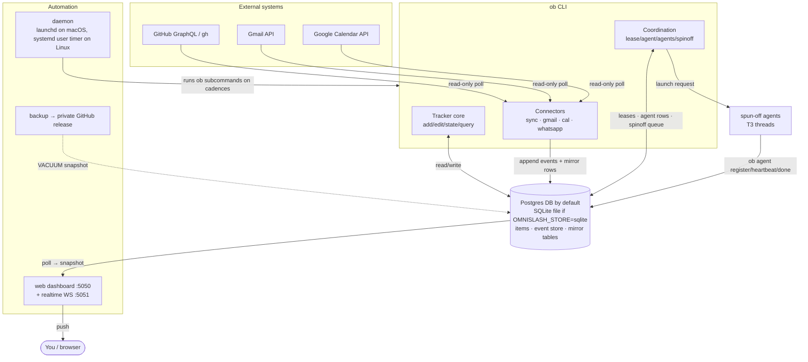

# `ob` — the OmniSlash CLI

`ob` is a personal command-center for everything you're working on: a single, prioritized
worklist across side projects, home, admin, and learning, backed by Postgres by default, with a
local SQLite file as the opt-in, fully scriptable (`--json` / `-q`), and grown over time into four cooperating layers.

Core tracking is zero-network. On top of it sit read-only **source connectors** (Gmail /
Calendar / WhatsApp), an agent **coordination** layer (leases, the agent registry, spinoffs), and
an **automation** layer (a daemon that runs on launchd on macOS and on a systemd user timer on Linux, a live dashboard, and off-machine backup).

> This is the authoritative user guide. `ob --help` gives the compact command overview; `ob <command> [subcommand] --help` and `ob help env` provide focused reference pages.

---

## How it fits together

The tracker state is one Postgres database by default, a local SQLite file when `OMNISLASH_STORE=sqlite` is set, or no database at all on a machine that sets `OMNISLASH_API` and talks to a remote ob API. The CLI is the only writer of tracker state; the
connectors append external facts; the daemon runs CLI subcommands on a schedule; the dashboard
reads the DB and pushes live updates. Nothing here sends or mutates anything external except the
explicit backup (a private GitHub release) and the spinoff launcher.



If mermaid doesn't render, the same picture in prose:

```
external sources ──(read-only poll)──▶ connectors ──▶ [ Postgres DB ] ◀──▶ tracker core (CLI)
                                                         │  ▲
                            coordination (leases/agents) ─┘  │
   daemon (launchd or systemd timer) ──runs ob subcommands on a schedule────────┘
   web dashboard ──poll the DB → push live snapshots──▶ browser
   spinoff ──opens a T3 thread──▶ agent ──ob agent register/heartbeat/done──▶ DB
```

### The layers

1. **Tracker core** — the worklist. `item` rows (types: `task`, `linear_ref`, `roadmap`,
   `decision`, `learning`) belong to a `project` (which carries a `kind`: `side` /
   `home` / `admin` / `learning`). Each item has a lifecycle: **capture** (`add`, `note`,
   `tag`, `link`) → **workflow** (`start` → `ready` → `close`, or `block`/`unblock`, validated
   per type/kind) → **query** (`next`, `list`, `show`, `brief`, `search`, `status`). `brief`
   assembles a topic's work-state (item/`--in-flight`) as text or `--json` so a reply to a
   "status of X?" question can be grounded in facts (it feeds the `/ob-slack-triage` skill). Priority is
   `critical/urgent/flake/high/medium/low/none` (critical, stored as 6, is an active production bug
   affecting users now and sorts first; flake is a flaky test, its own level between urgent and
   high); an item with no explicit priority derives `high` when it
   belongs to the current `focus` project. `today`/`next` drive the daily worklist.
   An item can be **paired with a GitHub issue** on `wayfinder_repo` (`add --issue` creates both;
   `issue link` pairs existing ones). That pairing is what makes `close` a **two-tracker** operation
   and what `issue landed` / `issue drift` read, see
   [Two trackers, one truth](#two-trackers-one-truth-issue-77).

2. **GitHub PR ingest** — `sync` pulls GitHub PRs and appends them to an **append-only `event`
   store** (plus mirror tables like `pr_comment`). It is what `ob status`'s in-flight PRs, `ob
   brief`'s PR lines, and alert rules 1 and 3 read. (The career-metrics half of this layer —
   `metrics` / `report` / `audit` and the Linear ingest that fed them — was deleted in ob 1121
   once its inputs were gone; the historical event rows stay.)

3. **Source connectors** — read-only awareness. `gmail`, `cal` and `whatsapp` poll their
   sources into dedicated mirror tables (`email_message`, `calendar_event`,
   `whatsapp_message`, each with FTS where relevant), **also mirroring a summary event** into the
   event store, and mapping senders/attendees/authors to people via the `person` registry
   (`resolvePerson`). Ingest is read-only — `whatsapp sync` opens the bridge's SQLite `messages.db`
   in read-only mode and never writes it. **Slack is no longer one of them (ob 208):** its poll
   needed a Slack user token that never existed on this machine, so it failed every 15 minutes from
   the day it was configured; work Slack awareness comes from the Claude Slack connector at the point
   of use (the `/ob-slack-triage` skill) instead. The `slack_message` rows it did ingest stay, and
   `ob slack unread` still reads them.
   `google auth` mints the shared OAuth token the Gmail/Calendar connectors read. **`whatsapp send`
   is the one outbound path** (ob's first): it POSTs the local bridge's REST API (localhost only) and
   is gated by an explicit human confirmation in `sendWhatsapp()` — nothing sends without it. A
   successful send then persists the sent message into `whatsapp_message` itself (#120), reading
   `messages.db` read-only for the bridge's real message id, so an outbound message is a real row
   immediately; ob still never writes the bridge's DB.

4. **Coordination (v2)**: parallel agents. `lease` is a TTL resource mutex in SQLite (FIFO with
   `--wait`), and it is the **only** locking mechanism here. Its keys name what sessions actually
   contend over: `port:3000` (decision #37), **`ticket:<ref>`**, **`worktree:<path>`** and
   **`app:<name>`** (#97). Those last three exist because two concurrent architect sessions had no
   mutual exclusion over a ticket: one removed a worktree, deleted its branch and landed the ticket
   **while another was mid-review and mid-gate on it**, so the reviewing architect's `git`/test output
   described a state that no longer existed. The damage is **untrustworthy verification**, not lost
   work: the same class of error a smoke-gate exists to remove.

   So the guard sits on the paths that **destroy or finalise**, not merely on advice: `spinoff
   cleanup` (removes a worktree, deletes a branch), `spinoff reconcile` (marks a ticket landed) and
   `spinoff <ref>`/launch (starts work on a ticket). The rule is the same in all three: a **live**
   foreign holder is never stomped, not even with `--force`, and an **expired** one is reclaimed
   silently, so a dead session cannot wedge a ticket forever. A blocked caller always gets `held by
   <holder> since <ts>` rather than a false result. **`ob lease release <resource> --force` is the one
   way past a live holder**, deliberately explicit.
   **`flake:slot`** (OB-2230) is the one flake fix on the whole machine: `ob spinoff` takes it for a
   `flake` ticket's builder and the handoff, close, abandon or a failed launch releases it.

   **A lease is owned by its `--holder`, so every later command names the same one** (#75). `acquire`,
   `heartbeat` and `release` are symmetric: what you took as `--holder architect-acme` you release as
   `--holder architect-acme`. The default holder is this `ob` process's `<pid>@<host>`, and every `ob`
   invocation is a **new pid**, so a defaulted release can never match a lease an earlier command took:
   it releases nothing, exits 1, and the message names the recorded holder plus the `--holder` retry.
   Releasing an **expired** lease needs no `--holder` match (it already protects nothing), so `--force`
   is reserved for its one job: breaking a **live** holder that is genuinely gone.

   `agent`/`agents` is a liveness registry (who's working on what now, heartbeat + TTL) and doubles as
    the natural acquisition hook. **Register ≠ launch (417):** `agent register` writes the row and
    claims the lease; it never launches anything. Only `ob spinoff` starts an agent. `agent register --status needs-human` on a t3 builder also puts `🙋` in front of its T3 thread title, and the next register with any other status takes it off again (1579; best effort, a title that cannot be set only warns). A **team role** row (`architect-<team>`, `sentinel-<team>` or `muse-<team>`, a t3 thread; OB-2255) does not need that second register (OB-1710): when it is `needs-human` and the owner sends the thread a message after the row was stamped, the next `ob spinoff reconcile` (the run-state mirror's pass, no new watcher) sets it back to `planning` and takes the `🙋` off through the same title helper. Only a message he typed counts; a queued `ob` note (handoff/landed) or a scheduled-task run leaves it, and a builder's `needs-human` stays until the builder or its handoff changes it. The boundary is the row's `heartbeat_at`, so a team thread that heartbeats after asking pushes it past his reply: re-register `--status planning` yourself then. `agent register --ticket` claims `ticket:<ref>` except when that builder's spinoff is already `handed-off` (577: register still updates note/status, does not re-claim `ticket:`/`worktree:`, does not `agent done`), `agent heartbeat`
     refreshes it, `agent done` releases **only the leases that agent itself acquired**. **A lease you
    already hold is compatible with registering under it**: an architect holding `ticket:<n>` for a gate
    dispatches a builder for that same ticket with
    `agent register --id <builder> --ticket <n> --holder architect-<team>`, which leaves the architect's hold
    exactly as it is instead of treating the documented flow as a collision. **`agent done` on that
    builder does not drop the architect's hold** (341): the builder inherited it, and an architect's hold
    survives while builders come and go under it. **`spinoff <ref> --holder`
   and `spinoff reconcile --holder` take the same flag with the same meaning** (#136): dispatching and
   landing a ticket you hold is the flow, not contention, so the architect's own hold is compatible and is
   left untouched, while a genuinely different live holder gets a refusal that names it (1589).
     `spinoff <ref>` opens or adopts the ticket's T3 thread in the same
     invocation and prints the thread id (1589); there is no queue to wait on
     and no drain daemon. When another live session holds its
     `ticket:`/`worktree:` lease (#97) it refuses, names the holder, exits
     non-zero and leaves no pending row.
     Agent count is not a reason to leave a row pending (ob 767): expired/stale
     builders do not occupy a launch slot, and `ob agent done` is not required
     to free the next tab.

5. **Automation** — `daemon install` schedules the recurring jobs below (Mac launchd / Linux systemd --user);
   `web` serves a live read-only dashboard on `:5050` (with a WebSocket sidecar on `:5051` that
   re-pushes on any DB change); `backup` captures an off-machine monthly snapshot.

   Both listeners bind **`127.0.0.1` by default** (192), so a laptop's dashboard is reachable from
   that laptop and nowhere else. The always-on server sets a LAN address instead
   (`OMNISLASH_WEB_BIND` in its systemd unit, or `ob config set web_bind <addr>`), which is what makes
   `https://<lan-name>:5050` work from the phone. The browser derives the sidecar's address from the
   page's own origin, so the LAN page dials the LAN sidecar without any second setting.

   **TLS (220) rides on exactly that same "one deployment" rule.** The page derives the socket's
   **scheme** from its origin too, so both listeners take the same certificate or neither does:
   `--tls-cert`/`--tls-key` > `OMNISLASH_WEB_TLS_CERT`/`OMNISLASH_WEB_TLS_KEY` > the
   `web_tls_cert`/`web_tls_key` rows. **A laptop is untouched**: with nothing configured, `ob web`
   serves plain HTTP and says nothing about it, which is not a fault but the default. The always-on
   server gets a real Let's Encrypt certificate for a LAN-only name (`ob cert`, below), issued over a
   DNS-01 challenge so nothing is ever exposed, and its private key lives at
   `/etc/omnislash/tls/privkey.pem` (mode 0600, in a 0700 directory owned by the service user) where it
   is out of git and out of `ob backup`'s artifact by an explicit guard. The reason any of this exists
   is that the dashboard is growing pages you *type into*: a token pasted over plain HTTP is a token on
   the wire.

   The sidecar also hosts the **WhatsApp media endpoints** (158 voice notes + 162 images) — same
   CORS-open + LAN posture. They proxy the Go bridge's `POST /api/download` so the browser never sees
   the bridge bearer token (read server-side, sent only to the loopback bridge); decrypted bytes are
   cached to `whatsapp_media_cache_dir` keyed by `(chat_jid, id)`:
   - `GET /api/whatsapp/media?chat_jid=&id=` — streams a message's image/audio bytes with the right
     content-type (the dashboard's `` thumbnail / `<audio>` player src). Cache-first.
   - `GET /api/whatsapp/avatar?jid=` — streams a chat/group **profile picture** (163) via the bridge's
     `GET /api/avatar?jid=` (token stays server-side). Cache-first to `whatsapp_avatar_cache_dir`, keyed
     by jid with a long TTL (avatars rarely change). **404** when there's no picture — the round avatar in
     the feed then falls back to the name's initials.
   - `POST /api/whatsapp/transcribe` — body `{chat_jid, id}` → on-demand local-whisper STT of a voice
     note → `{ok:true, transcript}` stored on the message, or `{ok:false, reason}` when no whisper/
     ffmpeg is installed (**graceful** — the feed never breaks).

### The daemon jobs (`daemonJobs`)

`ob daemon install` writes **GUI-local jobs only** (457/664). Since OS-67 that is one job,
`role-tick` (`ob role tick` every 900s), which runs on the client because a pass may open a role
run and runs open on the caller's own T3. Since ob 1589 `ob spinoff <ref>` launches its T3 thread
immediately, so the 45s `spinoff-drain` poll is retired. `ob daemon install` and `ob daemon uninstall`
both **remove** a leftover drain unit
(`com.omnislash.spinoff-drain` on macOS, `omnislash-spinoff-drain.{service,timer}` under
`~/.config/systemd/user` on Linux) and say so. A plist sets `HOME` and `PATH` in `EnvironmentVariables` (601),
because launchd does not inherit `HOME` and without it the `ob` wrapper skips
`~/.cloudflare_warp_ca.pem` and bun fetch dies; on Linux it is a systemd --user timer with
`HOME`/`PATH` in `Environment=`, never a plist under `~/Library`.
Server jobs live on the API host as systemd system units (declared in the server's job list). Logging is
`~/.local/share/omnislash/logs/` (launchd) or the user journal (Linux). After a freeze, reload the Mac column with
the cutover script that starts the GUI agents. Do not `ob daemon uninstall` leftover server
plists as a build step; the owner unloads those when he wants.

| Job | Command | Cadence | Placement |
|---|---|---|---|
| `role-tick` | `ob role tick` | every 900s (15 min, OS-67): writes what needs each team's architect into its inbox and delivers it; nothing new is one line, delivers nothing and starts no run. It also test-merges the team's running branches and posts each conflicting pair to the sentinel (OS-48). It also ends idle (15 minutes) and over-cap (200k context) role runs after asking each for its note (OS-57). The server's `ob jobs` never sees its runs, so it is never reported stale or never-ran there | **client** (`omnislash-role-tick.timer` on Linux, `com.omnislash.role-tick` on macOS) |
| ~~`spinoff-drain`~~ | `ob spinoff drain` | **retired (1589)** | No longer installed anywhere; install/uninstall remove a leftover unit. `ob spinoff drain` is still a manual one-shot. |
| `sync` | `ob sync` | every 3600s (hourly) | server (the API host) |
| `gmail-sync` | `ob gmail sync` | every 300s (5 min) | server (the API host) |
| `cal-sync` | `ob cal sync` | every 900s (15 min) | server (the API host) |
| `alerts` | `ob alerts --digest --notify` | daily 08:00; prints the digest and (1655, narrowed by 1687) pushes it as ONE Home Assistant message when at least one *action* alert exists (job, credential or blocked; never aging) | server (the API host) |
| `creds-check` | `ob creds check --all` | daily 07:45, ahead of the 08:00 digest (1655). **Declared here and installed only on the server** as `omnislash-creds-check.timer`, enabled by hand after one manual run. Exits 1 and names the credentials when any verdict is FAILED | server (the API host); never a Mac plist |
| `ci-main` | `ob ci main --notify` | hourly (OB-2276): the catch-up behind the GitHub webhook receiver, telling a red run on main the receiver missed and its recovery. **Declared here and installed only on the server** as `omnislash-ci-main.timer`, enabled by hand after one manual `ob ci main`. Exits 1 when a repo could not be read or a note not sent | server (the API host); never a Mac plist |
| `web` | `ob web` | persistent (KeepAlive + RunAtLoad) | server (the API host) |
| `whatsapp-bridge` | `ob whatsapp bridge run` | persistent (KeepAlive + RunAtLoad): `run` blocks (like `web`), so KeepAlive supervises the real bridge: crash → immediate restart. Moved to the Proxmox box (ob 193/202) as `omnislash-whatsapp-bridge.service` with `Restart=always`. | server (the API host); plist removed from the Mac |
| `whatsapp-sync` | `ob whatsapp sync` | every 60s: poll the bridge → ob so the dashboard feed live-updates (184) | server (the API host); plist removed from the Mac |
| `cert-renew` | `ob cert renew` | daily 03:40, renews the LAN certificate the dashboard serves (220). **Declared here and installed only on the server** as `omnislash-cert-renew.timer`, like `ha-health`: the certificate belongs to the box that serves the dashboard. Daily is deliberate for a 90-day certificate, because lego only acts inside the last 30 days: that leaves a month of daily attempts between the first failure and an expiry, each one counting toward the `JOB FAILING` alert. On a machine with no `tls_domain` it prints "nothing to renew" and exits 0, so it is inert rather than noisy on a laptop | server (the API host); never a Mac plist |
| `backup` | `ob backup` | monthly, 1st at 03:15 | server (the API host) |

**Client vs server after cutover (448/457/664).** Client = GUI-local only: `role-tick` since OS-67
(the `spinoff-drain` job it used to hold is retired in 1589). `ob daemon install` / `status` / `uninstall`
talk about that client set, not the old full launchd fleet. Server = everything else (`sync`, `backup`, `gmail-sync`, `cal-sync`, `alerts`,
`net-pull`, `web`, the WhatsApp pair, `ha-health`, `cert-renew`). The pg-cutover
runbook's unfreeze step reloads **the Mac set**, which is `role-tick`; `ob daemon status` lists it.

This table is the **only** declaration of the fleet: the server's job list and the systemd units are
asserted against it by `apps/cli/test/proxmox-units.test.ts`, and since ob 218 the per-job health signal
reads its expected cadence from it too. `ob jobs` reports what each of them last actually did, and
`ob alerts` rules 7-10 complain when one stops doing it.

---

## Global conventions

- **Shape:** `ob <command> [<positional>...] [--flags]` — git/gh-style. Primary argument is
  positional; the rest are named.
- **Output modes** (global flags):
  - default → concise **human** text (one line per item for lists)
  - `--json` → machine JSON (the stable contract skills and `jq` consume)
  - `--table` → aligned columns
  - `-q` / `--quiet` → **IDs only** (for scripts)
- **Other global flags:** `--db <path>` (overrides `OMNISLASH_DB` / the default DB location; **local-only**:
  with `remote_host` set it is refused rather than sent to the server, see
  [`--db` never crosses the wire](#--db-never-crosses-the-wire-213)),
  `--local` (answer from the local read replica; never dispatch over ssh; see
  [The client/server split](#the-clientserver-split-183)), `--no-daemon` (accepted; the CLI always
  opens SQLite directly), `-h` / `--help`.
- **Exit codes:** `0` success (including a clean empty result), `1` runtime error, `2` usage
  error (bad flags/args or no command). An empty result is **not** an error — scripts test
  output, not the exit code.
- **The `--json` guarantee** (149): a `--json` invocation either prints **parseable JSON** on stdout
  or **exits non-zero with a reason on stderr**, never both silent and successful. An empty result
  set is still valid JSON (`[]` or `{}`), so a consumer can `JSON.parse` stdout whenever the exit code
  is `0`, and any failure names itself rather than surfacing as the caller's own parse error. This is
  enforced in one place (`run()` in `cli.ts`), so it holds for every command: a handler that would
  print nothing in `--json` mode exits `1` saying so. Two concrete `ob` bugs sat behind it: the DB
  open ran outside `run()`'s error handling, and `openDb` set `busy_timeout` *after* the WAL switch, so
  a concurrent opener hit `SQLITE_BUSY_RECOVERY` with a 0ms retry budget and died with an uncaught
  stack and empty stdout. `openDb` now sets `busy_timeout` first, skips the migration pass when nothing
  is outstanding, and retries a bounded number of times on **`SQLITE_BUSY` only** (223): a deterministic
  failure surfaces on the first attempt with its cause, rather than being re-proved six times under a
  "concurrent access" headline that was not true.
- **Requested help exits `0`** (#134): `ob --help`, `ob -h`, `ob help`, `ob <command> [subcommand] --help`,
  `ob help <command> [subcommand]`, and `ob help env` print focused help on **stdout** and exit `0`,
  because asking for help is not a usage error. That makes `ob --help >/dev/null && echo OK` a valid
  "does `ob` load?" probe, which is what the repo's pre-land gate checks. Unknown help targets
  (`ob help nope`, `ob project nope --help`) print an error on stderr and exit `2`. A **bare `ob`**
  with no command is still a usage error: it prints the root overview on stdout and exits `2`.
- **Relative time windows:** because parsing is strict, a leading-dash value must use `=`, e.g.
  `--since=-7d` (not `--since -7d`). `--since` accepts ISO, `YYYY-MM-DD`, or `-Nd`.

### Database location (resolution order)

1. `--db <path>` (local-only: refused once `remote_host` is set, see
   [`--db` never crosses the wire](#--db-never-crosses-the-wire-213))
2. `OMNISLASH_DB` environment variable
3. `$XDG_DATA_HOME/omnislash/omnislash.sqlite`
4. `~/.local/share/omnislash/omnislash.sqlite` (default)

**MEMORY.md (739/740)** is this machine's always-on fact file at `$XDG_DATA_HOME/omnislash/MEMORY.md` else `~/.local/share/omnislash/MEMORY.md`, override `OMNISLASH_MEMORY_PATH`. Personal XDG, not git. `ob memory add` / `ob memory show`. OpenCode prepends the capped file into session context (740). session.idle stays needs-human; idle is a backstop only (no second model).

**SOUL.md (756)** is git-tracked `.opencode/SOUL.md` (shared identity). OpenCode prepends it into session context; missing file → skip, no crash. Not capped. MEMORY.md stays personal XDG.

**Creating a database is deliberate (198).** The server already has one. Every command opens an existing
database or refuses:

```
$ ob next
error: no database at /home/ob/.local/share/omnislash/omnislash.sqlite, and creating one is deliberate: ob will not make a new tracker as a side effect of a command.
  the real database is probably elsewhere: run with OMNISLASH_DB=<path>, or pass --db <path>
  a machine that genuinely has no database yet gets one with OMNISLASH_DB_CREATE=1 (honours --db and OMNISLASH_DB)
```

It reads that way round because the likely cause is the likely cause: an environment that does not carry
`OMNISLASH_DB` while the real database sits somewhere else. That is exactly what happened on the server,
where the systemd units set `OMNISLASH_DB=/var/lib/omnislash/omnislash.sqlite` but an interactive shell does
not: a bare `ob status` used to create a second, empty, perfectly functional tracker at the default path
and answer from it. `OMNISLASH_DB_CREATE=1` is the process-wide opt-in for a caller that legitimately makes
throwaway databases (the test suites set it once, in `apps/cli/test/preload.ts`). A laptop is an API client and must not have a database (D2).

With `remote_host` set there is a **second** database on this machine: the read replica at
`<same directory>/replica.sqlite`, plus its `replica.meta.json` bookkeeping and the `replica.lock` /
`replica.swap-gate` files the swap is serialised on (308). It is a whole-file copy of
the server's DB, opened **read-only**, and it is what read commands answer from. It is never written by
a handler and never edited by hand: `ob replica refresh` replaces it wholesale. See
[The client/server split](#the-clientserver-split-183).

### `ob` talks to an API, not to the database (353)

**Setting `OMNISLASH_API` makes this machine an API client.** Every data command then goes over HTTPS with a
bearer token to the API [ob 352 mounts at `/api/ob`](#the-ob-api-352-purpose-built-endpoints-hosted-by-the-dashboard), and `ob` opens **no database at
all** — no Postgres driver, no connection url, no `pg_hba` entry for a laptop whose DHCP lease just moved.
Unset (which is the state today) nothing changes and `ob` uses the direct Postgres path described below.

```bash
export OMNISLASH_API=https://ob.example.org        # or: printf '%s\n' 'https://…' > ~/.omnislash_api_url
printf '%s\n' '<token>' > ~/.ob_api_token        # the SAME file the server authenticates against
chmod 0600 ~/.ob_api_token
```

**There is no dual mode, and that is the point (map decision D2).** `ob` talks to the API whether or not
it is on the LAN. It does *not* use Postgres when local and the API when remote, because a client that can
reach the data two ways eventually reaches it the wrong way and says nothing — which is ob 237 and ob 324
twice over: a path that still resolved, still opened, still answered, and every answer was wrong. So an
unreachable API is an **error**, never a quiet fall back to a database. The cost is honest and accepted: a
LAN call now goes over HTTP rather than straight to Postgres, which for a personal tracker is nothing.

**The credential is a token in a file outside the repo, mode 0600 (D5)** — `~/.ob_api_token`, the same path
and the same `OB_API_TOKEN_FILE` override the server reads, so there is one definition of where it lives.
`OMNISLASH_API_TOKEN` covers a one-off. Deliberately **not** an `ob secret`: the secret store is a table
inside the database the API fronts, which is the same circular bootstrap ob 320 hit. The token is sent in
the `Authorization` header and nowhere else — never in argv, never in a url, and never in an error message
(a transport error that echoes the request back is redacted before it reaches stderr).

**The team role routes can go to a second server (OS-76).** `OMNISLASH_ROLE_API` (or the first line of
`~/.omnislash_role_api_url`; `OMNISLASH_ROLE_API_URL_FILE` moves that file) names a base url for the role
routes only: `GET` and `POST` `/teams/:name/runs`, `POST /teams/:name/runs/:id`, `POST
/teams/:name/runs/:id/note-shown`, `GET /teams/:name/tick`, `GET /teams/:name/brief`, `POST
/teams/:name/notes`, and `GET` and `POST /teams/:name/inbox` with `POST /teams/:name/inbox/read`. Every other
route stays on `OMNISLASH_API`, including `/teams`, `/teams/:name`, `/teams/:name/edit`, `/teams/:name/join`,
`/teams/leave` and `/teams/:name/handoffs`. Both servers get the same bearer token and the same Access
headers, and an error from the role server names the role url it called. Unset or empty, every route goes to
`OMNISLASH_API` exactly as before, so nothing changes until the file is written.

**Nothing waits forever (1616).** On 2026-10-20 a leaked Postgres pool slot left every `omnislash-web` write
hanging for 43 minutes with no error. Now each side has a bound that names the call: the client gives up
after `OB_API_TIMEOUT_MS` (default 150000) with `did not answer POST /items within 150000ms (timed out, not
unreachable)`; the server answers a request that outlives `OB_API_REQUEST_TIMEOUT_MS` (default 120000) with
a 504 `timeout` naming the route; and a Postgres `txn` / `NOTIFY` fails after `OMNISLASH_STORE_TIMEOUT_MS`
(default 30000). The server's bound is shorter than the client's, so a stalled store reports itself before
the client has to guess. A timeout bounds the WAIT only: Bun SQL has no abort, so a query already sent keeps
running underneath. The ingest routes (`/sync`, `/gmail/sync`, `/cal/sync`, `/creds/check`) get ten times the budget on both ends. A call that is legitimately slower still raises the variable, not the code. **Scope:** the API and a Postgres `txn` / `NOTIFY` are bounded; plain reads that bypass the API (the dashboard's own page loaders on `getStore()`) are not yet.

**A short outage is ridden out, not reported (OB-2160).** Every live deploy restarts `omnislash-web`, and for that
moment the port refuses connections. A call whose connection is **refused** (the request never reached the server)
is retried with backoff (0.5 s doubling, capped at 4 s) for up to `OB_API_RETRY_MS` (default 30000) in total, for
**every** method, since nothing was sent; it prints one stderr line, `ob API at <base> refused the connection,
retrying for up to 30s (a deploy restarts it)`, then answers or fails with the original `could not reach` error.
A connection **reset** may have reached the server, so only a `GET` retries one; a write that was reset fails at
once. A **timeout** is never retried (the server took the request). No command is excluded: a refused write never
arrived. File downloads (OB-1808) retry a refused connection only. `OB_API_RETRY_MS=0` turns it off, for a script
or test that wants the old fail-fast.

**Three classes of command, and nothing falls between them:**

| class | commands | what happens |
|---|---|---|
| routed | `add` `agent` `agents` `agenda` `alerts` `block` `brief` `cal` `close` `config` `creds` `cursor` `decision` `focus` `gmail` `issue` `jobs` `lease` `learning` `link` `list` `log` `next` `note` `order` `person` `project` `tournament` `ci` `github` `ready` `reopen` `review` `review-miss` `machine` `roadmap` `scope-change` `search` `secret` `show` `slack unread` `spinoff` `stakeholder` `start` `state` `status` `standup` (save/set/latest/posted) `sync` `tag` `test-user` `today` `triage` `unblock` `untag` `whatsapp search` `whatsapp recent` `whois` | one typed call to a purpose-built endpoint, rendered by the same code the local command uses. `sync` runs **on the API host**. |
| split | `google auth` `memory` | `google auth` (420/424): loopback **runs here** (browser + `127.0.0.1`), persist via `POST /secrets` (`secret set google`) so the host store gets it. Creds from `--client` / `--client-id` / `--client-secret`, else stored secret `google`. `google auth-url` (1305) is **served** (see below). `memory` (739/740): MEMORY.md is **this machine's** XDG file (`~/.local/share/omnislash/MEMORY.md`, override `OMNISLASH_MEMORY_PATH`); `show` reads it here with no HTTP, `add` appends here then dual-writes `POST /items` `--type learning`. Never dispatched over ssh. OpenCode prepends the capped file into session context (740). |
| local, and it runs | `daemon` `vision` | `daemon` writes launchd plists into `~/Library/LaunchAgents` on macOS, and systemd user timers on Linux. `vision compare` shells to this machine's mlx-vlm against local PNG paths (468, 477). All are handed handles that **refuse by name** if they ever reach for the data |
| the host runs it (OB-1808) | `backup` `db` `cert` `net` `ha` | the client asks `POST /host-jobs`; the host runs them as a job, so no HTTP request stays open. See [Commands the API host runs](#commands-the-api-host-runs-ob-1808) |
| local, and it refuses | `web` (run on the API host); plus the local halves of the SPLIT commands (`spinoff watch`, `whatsapp bridge`, `secret import`, `config … remote_host`) and four unported flags | refuse **up front and by name**. Host-only refusals name the API host. Machine-local refusals name THIS machine. No HTTP request is made. The complete list is [below](#the-refusals-enumerated-1121) |

**`ob spinoff` is SPLIT too, and the old classification was the bug (360).** It was marked local-only at
the cutover because it touches the database, and its refusal read *"run it on the machine that has both the
checkouts and the database: the API host"* — which has none of his checkouts.
That sentence sent the owner, at the office, to the one machine that could not do the job. Its two halves
live in different places and **neither is the API host**:

| half | where it lives | how |
|---|---|---|
| the queue, the ticket, the leases | Postgres | over the API: `GET/POST /spinoffs`, `/spinoffs/config`, `/spinoffs/launchable`, `/spinoffs/claim`, `/spinoffs/stamp`, `/spinoffs/land`, `/spinoffs/reclaim`, `/spinoffs/cleanup-guard` |
| the worktree, the agent spawn, `cleanup`'s git | the laptop in front of the human | locally, between the claim and the stamp |

So a spinoff from the office needs **his machine plus the API**, which is exactly what he has:

```sh
ob spinoff 360 --repo acme     # enqueued + claimed over the API, T3 thread opened on THIS laptop, stamped (217/1589)
ob spinoff drain                  # manual one-shot, this repo only (OB-1796; --repo <slug|path> names another, --all drains every repo): reclaim lapsed claims, launch the queued/legacy pending rows (a row whose ticket is done, whose work is on origin/main, or whose project is paused or archived without --allow-paused, is left queued: 'ob spinoff abandon <row>' retires it)
ob spinoff reconcile              # this machine's git decides; the API records the landing
ob spinoff list --json            # landed from GET /items status + this machine's origin/main
ob spinoff cleanup --dry-run      # git on this disk, guarded by the API's leases; "merged" is measured against origin/main (1760), or a squash-merged PR with the same head sha (OB-2141)
```

`ob spinoff list --json` sets `landed` the same way the local command does (932/937): ticket
status from one `GET /items?status=done` (only `done` counts; a per-ticket GET would stall the
host, which runs this command on the UI thread), and a LANDING commit naming the ticket on this
machine's `origin/main` — a merge subject or a conventional scope, never a `docs(`/`chart(` note,
and never one older than the row's `base_sha` (1201). A failed status read does not fail the list — the commit side can
still set the flag. Reconcile uses that same signal, so a done ticket or an origin/main landing
is marked merged even when local `main` has not moved. Human `ob spinoff list` (no `--json`)
does not fetch ticket status.

**Two properties of the drain survive the split, deliberately.** ob 308's race fix is still one conditional
`UPDATE … WHERE status='pending' RETURNING *`, executed on the authoritative database inside
`POST /spinoffs/claim` — the client never reads a row and then writes it, so two drains that both ask get
one row between them. ob 191's ordering is unchanged too: the **claim goes first** (it is the exclusion),
the launch happens here in between, and the stamp records it; a launch that happened whose stamp did not
is reported with the command that finishes the job, and the claim lease lapses so `ob spinoff reclaim`
re-queues the row.

**Only `ob spinoff watch` refuses, and its refusal names *this* machine.** It blocks on `fs.watch` of the
database *file*, and an API client has no database of any kind — it would block forever and report nothing.
The message says so, says that everything else about `ob spinoff` works here, and points at
`ob spinoff reconcile` / `ob spinoff list` / `ob agents` instead. A `#<issue>` ref refuses for the separate
reason that fetching the issue needs the tracker's GitHub credential, the same edge `ob add --issue` has.

**`ob whatsapp` is SPLIT too (366), and the old refusal sent people to the wrong machine.** `whatsapp
search` / `whatsapp recent` are ingested messages already in Postgres, so they are served
(`GET /api/ob/whatsapp/search?q=&limit=`, `GET /api/ob/whatsapp/recent?limit=&since=`). **OB-1809 served the rest, because the bridge runs on the API host:** `sync` and `bridge status` are host jobs, and `send`, `bio` and the per-chat prefs are routes. `send` still asks the human on the terminal they are at, before any request exists, and the server refuses a body without a literal `confirm: true`. Only `bridge start|run|stop` still refuses by name.
The native app's WhatsApp screen adds two more reads, `GET /api/ob/whatsapp/status` and `GET /api/ob/whatsapp/chats` (OB-1765).

**`ob gmail` / `ob cal` / `ob agenda` are served (415), and the token stays on the host.** Search,
list and agenda are store reads (`GET /api/ob/gmail/search?q=&limit=`, `GET /api/ob/gmail/list?limit=&since=`,
`GET /api/ob/cal/agenda`). Sync runs **on the API host** against secret `google` (or the host token
file) (`POST /api/ob/gmail/sync`, `POST /api/ob/cal/sync`) so a laptop never needs `~/.google_token`.
`ob gmail draft` and `ob gmail send-draft` (1757) run on the host the same way (`POST /api/ob/gmail/drafts`,
`POST /api/ob/gmail/drafts/:id/send`). `ob gmail read` and `ob gmail attachment` (1680) fetch from Gmail on the host
(`GET /api/ob/gmail/messages/:id`, `GET /api/ob/gmail/messages/:id/attachments`), and the **CLI writes the files and reads
the `--attach` files**, so the bytes cross the API as base64 and the host never touches your disk. A send needs `confirm: true` and `hash: "<hex>"` in the body, which the CLI sets only from `--confirm --hash <hex>`; the host re-reads the draft and decides the hash match itself (OB-1910), so the client never does.
`ob gmail drafts`, `ob gmail draft-edit` and `ob gmail draft-delete` (OB-1750) run on the host too (`GET /api/ob/gmail/drafts`, `POST /api/ob/gmail/drafts/:id/edit`, `DELETE /api/ob/gmail/drafts/:id?confirm=true`); a delete without `confirm=true` is a 400, and none of the three sends anything.
**`ob google auth` is SPLIT (420/424), and 1305 adds the phone half.** The desktop flow runs on an API
client — loopback OAuth (a browser + a `127.0.0.1` receiver) here, then persist via
`POST /api/ob/secrets` (`secret set google`) so the host store gets the minted JSON. No local DB, no
`~/.google_token`. Client creds from `--client` / `--client-id` / `--client-secret`, else `GET` secret
`google` and parse `client_id`/`client_secret` (a dead refresh token is fine).
**`ob google auth-url` (1305) IS served, because a phone cannot reach `127.0.0.1`.** The API host mints a
one-time `state` (10-minute TTL, single use, bound to the redirect URI) and answers with Google's consent
URL; the phone taps it, Google returns to `GET /api/ob/google/callback`, the state is burned, the code is
exchanged, and the token lands in the same encrypted secret `google`. The callback and `GET
/api/ob/google/auth` are the API's only **unauthenticated** routes — a browser tap cannot send a bearer
token — but **the mint itself is authenticated**: a browser route only resumes a state `auth-url` minted,
because otherwise anyone who can reach the host could start a flow and replace the stored token with their
own Google account. The desktop loopback flow above is unchanged.

Everything else refuses by name too, saying it is not behind an endpoint yet and where it can be run. That
is the ob 337 servable-list rule reinstated over a different transport: a command that reaches half its
data the wrong way is worse than one that refuses, because the refusal is reversible and an answer that
was acted on is not.

**`ob issue landed` / `ob issue drift` are SPLIT (389), like spinoff.** Pairing and the spinoff-table
facts come from the API (`GET /issues/pairing`, plus `GET /issues/github` for drift). Git runs HERE, on
this checkout. They do **not** print "run it on the API host" — that host has the wrong checkout (the
360-class bug). `could-not-tell` / `could-not-read` only when THIS machine's git cannot answer.
`ob issue reconcile` and `ob add --issue` use the GitHub credential on the API host and are served.
`ob link`, `ob edit`, `ob rm`, `ob today`, `ob focus` are store data and are served.

**416 killed the unrouted third class.** Every `ob` command is API-routed or local-only. A new HANDLER without a classification fails `api-routing-416.test.ts`. `unroutedRefusal` is a safety net, not a class.

**Already-servable commands now have purpose-built endpoints (416), not `POST /rpc`:**

| command | endpoint |
|---|---|
| `ob project` / `ob project add` | `GET/POST /api/ob/projects` |
| `ob project edit` / `ob project rename` / `ob project rm [--force]` | `POST /api/ob/projects/:name/edit`, `POST /api/ob/projects/:name/rename` (`{name}`), `DELETE /api/ob/projects/:name[?force=true]` |
| `ob t3 team` / `team add` / `team show` / `team edit` / `team join` / `team leave` / `team rm [--force]` / `team handoff` / `team restart` | `GET/POST /api/ob/teams`, `GET /api/ob/teams/:name`, `POST /api/ob/teams/:name/edit`, `POST /api/ob/teams/:name/join`, `POST /api/ob/teams/leave`, `DELETE /api/ob/teams/:name[?force=true]` (OB-2255); `POST /api/ob/teams/:name/handoffs`, `GET /api/ob/teams/:name/handoffs/latest?role=<r>`, `POST /api/ob/teams/:name/handoffs/:id/consume` (OB-2257). `ob t3 architect\|sentinel\|muse` reads, launches, titles, pins and turns auto-settle off on the client (T3 is there) and writes the row through `/agents`; `--remove` and `team rm --force` unpin on the client too. |
| `ob role start` / `role status` / `role end` | `GET /api/ob/teams/:name/runs[?role=<r>]`, `POST /api/ob/teams/:name/runs` (the marker and its lease; `created` false answers the open run), `POST /api/ob/teams/:name/runs/:id` (`thread_id`, `item_count`, `context_tokens`, `last_activity_at`, or `end_reason`, which ends the run and releases its lease). The thread is read, launched, pinned and settled on the client, where T3 is. |
| `ob role tick` | `GET /api/ob/teams/:name/tick` (the findings, computed on the server where the store is: `kind`, `ref`, `stamp`, `body`), then `POST /api/ob/teams/:name/inbox` per finding with its `client_key`, and delivery as `ob send`. Branch conflicts read the rows from `GET /api/ob/spinoffs`, test-merge in the client's checkout, post to the sentinel through the same inbox route and note each ticket with `POST /api/ob/items/:id/notes`. The team checkout and T3 are the client's. |
| `ob role brief` / `role note` | `GET /api/ob/teams/:name/brief?role=<r>` (the store facts: team, projects, rows, inbox, asks, the next three, the waiting note; a read, so a retried GET never loses the note), `POST /api/ob/teams/:name/notes` (`role`, `body`), `POST /api/ob/teams/:name/runs/:id/note-shown` (sent once the brief is printed, unless `--peek`). Pacing and each handed-off row's `State:` line are read on the client, where the T3 cache and the worktrees are. |
| `ob send` / `ob inbox` / `ob inbox --read` | `POST /api/ob/teams/:name/inbox` (`role`, `from`, `body`, optional `kind`, `ref`, `client_key`; a `client_key` already stored answers that message with `created` false), `GET /api/ob/teams/:name/inbox?role=<r>[&unread=false]`, `POST /api/ob/teams/:name/inbox/read` (`role`, `ids`, `by`). |
| `ob brief` / `ob brief --in-flight` | `GET /api/ob/brief?q=` or `?in_flight=true` |
| `ob log list` / `ob log <type>` | `GET/POST /api/ob/log` |
| `ob jobs` | `GET /api/ob/jobs` |
| `ob backup`, `ob db backup\|snapshot`, `ob cert` | `POST /api/ob/host-jobs`, then `GET /api/ob/host-jobs/:id` (OB-1808, see "Commands the API host runs") |
| `ob jobs host [<id>]` | `GET /api/ob/host-jobs`, `GET /api/ob/host-jobs/:id` |
| `ob jobs host fetch <id>` | `GET /api/ob/host-jobs/:id/files` |
| `ob db fetch <snapshot>` | `GET /api/ob/db/snapshots/:name` |
| `ob alerts` / `ob alerts snooze` | `GET /api/ob/alerts`, `POST /api/ob/alerts/snooze` |
| `ob decision` | `GET /api/ob/decisions`, `GET /api/ob/decisions/:id`, `POST /api/ob/decisions/supersede` |
| `ob doc` | `GET /api/ob/docs[?project=]`, `POST /api/ob/docs`, `GET /api/ob/docs/:id`, `POST /api/ob/docs/:id/set` |
| `ob learning` | `GET /api/ob/learnings`, `GET /api/ob/learnings/:id` |
| `ob roadmap` | `GET /api/ob/roadmaps`, `GET /api/ob/roadmaps/:id`, `POST /api/ob/roadmaps/:id/members` |
| `ob standup` save/set/latest/posted | `GET /api/ob/standup/latest`, `POST /api/ob/standup/save\|set\|posted`. **`generate` stays on THIS machine** (claude -p). |
| `ob slack unread` | `GET /api/ob/slack/unread?limit=`. **No poll revival (208).** `slack sync` stays retired. |
| `ob person` / `ob whois` | `GET/POST /api/ob/people`, `GET /api/ob/people/show`, `GET /api/ob/whois` (456) |
| `ob ci main` / `ob github hooks` | `GET /api/ob/ci/main`, `POST /api/ob/ci/main/notify`, `GET/POST /api/ob/github/hooks` (OB-2276); GitHub itself posts to `POST /api/ob/github/webhook` |
| `ob tournament` | `GET/POST /api/ob/tournaments`, `GET /api/ob/tournaments/:id`, `POST /api/ob/tournaments/:id/candidates\|matches\|pick` (OB-2271) |
| `ob review-miss` / `ob cursor` | `POST /api/ob/review-misses`, `GET /api/ob/review-misses/top`, `GET/POST /api/ob/cursors` |
| `ob machine audit` | `GET /api/ob/machine/audit?since=&stale_days=` (OS-170; admin family `machine`) |
| `ob test-user` | `GET/POST /api/ob/test-users` (add POSTs the secret value; host encrypts) |
| `ob sync` | `POST /api/ob/sync` — GitHub ingest **on the API host** |

After 456, `OB_API_LOCAL_ONLY` has no `store path not ported (337)` rows.

**A flag with no endpoint behind it refuses rather than being dropped.** `ob add --type decision --choice …`
would lose its detail row; `ob tag --repo` also *moves* the item; `--dry-run` on close/reopen has no
preview endpoint. Each says so and writes nothing — a command that ran, exited 0 and did not do what it
said is the ob 237 failure in miniature.

**`ob config` is routed, and `remote_host` is the one key that refuses.** The config table is the SERVER's,
so `ob config get/set` reads and writes the server's settings over `GET/POST /config` — that is how a
client flips `spinoff_engine` or any other setting without a database path. `remote_host` is NOT a config
key on the API client: it is the old ssh-hop pointer, and the client's real address comes from
`OMNISLASH_API` / `~/.omnislash_api_url` (353). So `ob config get/set remote_host` refuses by name rather than
reading — or worse, writing — a client-local pointer into the server's table.

#### The refusals, enumerated (1121)

**Every command a served client refuses, read off the code rather than remembered.** The lists come from
`apps/cli/src/api/routing.ts` (`API_ROUTED_COMMANDS` = served, `LOCAL_ONLY_COMMANDS` = refused up front,
with the wording in `OB_API_LOCAL_ONLY`), from the by-name refusals inside the SPLIT handlers
(`api/client-handlers.ts`, `api/spinoff-client.ts`), and from `unsupported()` — the four flags refused
rather than dropped. Nothing "unknown": a row is either **runs here** (the local half executes; no
endpoint is needed), **local** (refused; the machine that must run it is named), or **unported** (refused;
the endpoint does not exist yet, so the flag or ref is refused rather than silently ignored).

*Refused up front (`LOCAL_ONLY_COMMANDS`):*

| command | disposition | why it is machine-local |
|---|---|---|
| `ob daemon` | runs here | renders this machine's launchd plists (macOS) or systemd user timers (Linux) from `daemonJobs()` and shells to `launchctl` or `systemctl --user`; touches no tracker data |
| `ob vision` | runs here | mlx-vlm comparing local screenshot files; nothing leaves the machine (468) |
| `ob models` | split | the local override file is this machine's (`~/.config/ob/models.jsonc`); `model_routes` (show, get, set, unset, use, reader) is read and written over the API (OS-145) |
| `ob api-token` | runs here | it writes the scoped API tokens file on this machine (`~/.ob_api_tokens.json`), which the API host reads per request; a token never crosses HTTP (OS-178) |
| `ob usage` | runs here | reads the Claude transcripts on this machine (`~/.claude/projects`); only the thread names and `ob project list` come over the API, and a failed read prints slugs (OB-2278) |
| `ob skills` | runs here | reads and repoints the skill links in `~/.claude/skills` on this machine; only the `repo_checkouts` setting comes over the API, and without it the checkouts are `~/dev/omnibus` and `~/dev/omnislash` (OS-182) |
| `ob web` | refused — API host | it starts the dashboard, and the dashboard reads the store the API host holds |

*Refused inside a SPLIT handler (the served half goes over the API; this half is local):*

| refusal | disposition | why it is machine-local |
|---|---|---|
| `ob spinoff watch` | refused — this machine | it blocks on `fs.watch` of the database FILE, and an API client has no database file. Everything else about `spinoff` works here |
| `ob spinoff #<issue>` | refused — unported | a `#<n>` ref needs the tracker's GitHub credential to fetch that issue, and that fetch is not behind an endpoint; a ticket ref works |
| `ob whatsapp bridge start\|run\|stop` | refused — the server's own process | the Go bridge is a long-running unit on the API host, and no caller needs to run it: `sync`, `send`, `bio` and the chat prefs all reach it through the API, and `bridge status` is a host job (OB-1809) |
| `ob secret import` | refused — unported | it copies the plaintext token FILES on the machine it runs on; served it would import the server's files instead of the laptop's, so its meaning is not clear. The refusal lists the files it would read. `ob secret set <name>` stores one from here |
| `ob config get\|set remote_host` | refused — unported | `remote_host` is this machine's old ssh-hop pointer, not a server setting, so writing it into the server's table would point the server somewhere else |

*Runs here rather than refusing* (the local half is the only place it can happen, inside a served command):
`ob google auth` (loopback OAuth, then `POST /secrets`), `ob issue landed` / `ob issue drift` (pairing
over the API, git HERE), `ob t3 doctor` / `ob t3 login` / `ob t3 architect` (T3 is on this machine; the
architect's registry row is served), `ob memory show` / `ob memory add` (this machine's XDG `MEMORY.md`).

*Flags refused rather than dropped (`unsupported()`), on commands that ARE served:*

| refusal | disposition | why |
|---|---|---|
| `ob add --type roadmap\|decision\|learning` | refused — unported | the item's detail row (roadmap/decision/learning fields) is not part of `POST /items`, and creating the item without it would lose what you typed |
| `ob tag --repo/--project` | refused — unported | the flag also MOVES the item to that project; the tags endpoint only tags |
| `ob close\|reopen\|state --dry-run` | refused — unported | there is no preview endpoint, and running it for real is not what `--dry-run` means |
| `ob agent register --spawn-failed` | refused — unported | invalidating the queued spinoff row is not part of `POST /agents` |

*Not a machine refusal, listed so the count is complete:* `ob slack sync` (retired by ob 208 — no token
exists on any machine), `ob standup generate` (removed; standups are written with `ob standup save`),
`ob spinoff --agent` (retired by 563 — spinoff is always interactive; the flag is refused by the SAME
message on both surfaces, so it is not a hole one machine has and another does not), and
`ob metrics` / `ob report` / `ob audit` (deleted in 1121 — they are no longer commands at all, so there
is nothing to refuse). `unroutedRefusal` is a safety net that no known command can reach (416).

#### `ob secret` and `ob creds` over the API (357)

**A secret VALUE crosses the wire, where before it never left the host.** That is a real change and it was
weighed rather than assumed: the owner asked for it, because from the office `ob secret get`
refused and he could not reach Cloudflare or Home Assistant with tokens he owns. What makes it acceptable
is stacked — TLS to Cloudflare, an Access service-token policy in front of the tunnel, the API's own bearer
token, and the part that does **not** move: **decryption stays server-side**, against a master key that
never leaves the API host. The client receives plaintext; it never receives the key, the ciphertext, the iv or
the auth tag.

| command | endpoint |
|---|---|
| `ob secret list` | `GET /api/ob/secrets` — **names and ages only**; the response type has no field a value could arrive in |
| `ob secret get <name>` | `POST /api/ob/secrets/read` — decrypts on the host, returns the value, printed verbatim to stdout |
| `ob secret set <name>` | `POST /api/ob/secrets` — the value is read from **stdin**, never argv. Clears the credential's recorded check verdict, like the local command |
| `ob secret rm <name>` | `POST /api/ob/secrets/remove` |
| `ob secret import` | **not served** — refuses by name |
| `ob creds` | `GET /api/ob/creds` — presence, age, the last recorded verdict. Never a value |
| `ob creds check <name>\|--all` | `POST /api/ob/creds/check` — runs the live check on the host, where the credentials are |

**The read is a `POST` and not a `GET /secrets/:name`, deliberately.** The value is in neither shape's url,
so that is not the question; the **name** is. `linear`, `ha`, `cloudflare` is an inventory of what is worth
stealing and of when each was last reached for, and a path segment lands in Cloudflare's access logs, in
the tunnel's logs and in any proxy between — none of which this repo controls, and all of which outlive the
request. A body lands in none of them. It also makes one invariant checkable rather than a per-endpoint
judgement: **nothing about a secret, name or value, ever appears in a url**, which the test suite asserts
over every request the client makes. It costs REST symmetry, which D1 already gave up everywhere else.

**`ob secret import` stays local and refuses by name.** It copies the plaintext token *files* on the
machine it runs on into the store; served, it would import the **server's** files while the person meant
the laptop's — a command that exits 0 having done something else.

**A value never reaches a log line, an error message or a url.** `ob secret set` is the one call that puts
plaintext in a request body, so the client declares that value to its redaction alongside the bearer token:
a transport failure or a non-2xx body that carried the request back is scrubbed before it reaches stderr.
Server-side the plaintext never reaches the database driver at all — `setSecret` encrypts first, so what is
bound to the insert is base64 ciphertext, and no driver error can carry the value out through a 500.

**The endpoints are purpose-built, not generic CRUD (D1)**, and the request/response types live in
`apps/cli/src/api/contract.ts`, which **both halves import**, so a shape that changes there fails typecheck
on the client and the server in the same run rather than being discovered at runtime.

Missing token? The refusal is a setup guide rather than a complaint — the exact path it looked in, the mode
that file needs, the command that writes it, and where the token comes from:

```
no usable ob API token, and ob talks to the API for all of its data (there is no direct database path).
  looked for it in: ~/.ob_api_token
  that file holds ONE line, the token, and nothing else. Mode 0600.
  write it with:
      printf '%s\n' '<token>' > ~/.ob_api_token
      chmod 0600 ~/.ob_api_token
  the token is issued by the API host, not by ob: it is the SAME file that host authenticates
  against (ob 354 deploys it). It is NOT an 'ob secret' -- the secret store lives inside the
  database the API fronts, which is the circular bootstrap ob 320 hit.
  a one-off somewhere else, without touching the file: OMNISLASH_API_TOKEN=<token>
  a different file: OB_API_TOKEN_FILE=<path>
```

### The client/server split (183)

**Unset `remote_host` means nothing changes.** With no `remote_host` configured, `ob` opens the local
database read/write and behaves exactly as it always has, byte for byte. That is the pre-cutover
behaviour, and it is also what must happen **on the server**, where the same code runs and must never
dispatch anywhere. Everything below is inert until the pointer is set:

```bash
OB_REMOTE=0 ob config set remote_host ob@<server>   # point this client at the server
OB_REMOTE=0 ob config set remote_host ""                # ... and back to purely local
```

`remote_host` is read from **this machine's** DB, not the replica: it is the client's own pointer, so it
lives on the client. Every *other* setting stays the server's, because `ob config` is itself a remote
command once the pointer is set. `OB_REMOTE=0` is the inert mode that resolves the chicken-and-egg, and
it is the only supported way to set, change or clear the pointer.

If the `remote_host` setting cannot be read (the local DB is unopenable or corrupt, for example), `ob` fails
with `error: could not read the remote_host setting in <path>: <cause>` and exits 1 rather than quietly
writing a local database the server never sees. `OB_REMOTE=0` forces local mode deliberately. A missing DB
file, a DB with no `config` table and an unset or blank key still mean "no server configured".

**The classification rule: an explicit allowlist of READ commands answers from the replica, and
everything else goes to the server.** The default is remote on purpose. A command added next year, or
one nobody thought about, is therefore run on the server (correct, it might write) rather than silently
answering from a stale copy. `READ_COMMANDS` in `apps/cli/src/remote.ts` is the allowlist, and a test
enumerates every `HANDLERS` key so the classification cannot go stale in silence.

**Classification is on the full invocation, not the first word.** Several read-looking commands carry a
mutating subcommand, so only the read halves are allowlisted: `person list|show` (not `person add`),
`lease` / `lease status` (not `lease acquire`), `triage` (not `triage clear`), `issue list|landed|
reconcile|drift` (not `issue link`), `usage`. Flags count too: `focus` reads with no
flags, while `focus --clear` writes config. When in doubt, remote.

**The backstop that makes a mistake loud: the replica is opened read-only** (`bun:sqlite`'s
`{ readonly: true }`, so the connection itself is `SQLITE_OPEN_READONLY`). A
command wrongly classified as a read raises `SQLITE_READONLY` at the exact statement that would have
been lost, instead of writing into a file the next refresh overwrites. Silent write loss is the one
failure that would end trust in the tracker, so it is made impossible rather than merely avoided.

**Refresh triggers**, in priority order:

1. a successful remote command marks the replica **dirty**;
2. a read that finds it dirty (or missing) **refreshes synchronously first**, so `ob add … && ob next`
   shows the new item rather than yesterday's state;
3. `ob replica refresh` by hand (`--force` copies even on an unchanged token);
4. a periodic refresh on a timer (the launchd/systemd side is a separate ticket).

**The refresh protocol.** `ob replica token` on the server reports a cheap change token (size plus
nanosecond mtime of the DB **and** its `-wal`); an unchanged token skips the transfer entirely, which
matters because the live DB is ~59MB. Otherwise `ob replica dump` runs `VACUUM INTO` a temp file and
streams it gzipped on stdout, the only consistent way to copy a live WAL database; the `.sqlite`/`-wal`
files are never copied directly. The client writes it to a temp path, checks that it opens and that its
**schema fingerprint** (the same 097 fingerprint the migration safety-net snapshots) matches what this
client expects, and only then `rename()`s it into place, so a killed refresh cannot leave a half-written
replica.

**The rename waits for readers, and gives up rather than hanging (308).** On macOS, SQLite checks that the
path it opened still resolves to the inode it opened, so a reader whose replica is renamed away underneath
it gets `disk I/O error` (`SQLITE_IOERR_VNODE`) on every later statement -- permanently, on that handle.
Retrying the statement cannot help and a per-reader hardlink does not shield it, so the swap is serialised
instead: every replica reader takes a **shared** `flock` on `replica.lock` for the lifetime of its handle,
and a refresh takes an **exclusive** one for the rename alone (after the transfer, so nobody waits on a
59MB download). A refresh that cannot get it inside a few seconds is **deferred**: the previous replica
stays, the meta stays dirty so the next command tries again, `ob replica refresh` says `replica busy: ...`
and exits 0, and `--json` carries `"deferred": true`. A slightly stale replica is a correct answer; a hung
`ob` is not. `replica.swap-gate` is the fairness half: a refresh holds it while it waits, which makes new
readers queue behind it, because `flock` would otherwise let a busy machine starve the swap forever. Both
files are plain lock files, never read or written -- the lock cannot live in the database it is protecting,
so it is not an `ob` lease. A hold dies with the process that took it, so nothing is left to reap.

**Staleness never passes as live.** A replica-served read older than 120s, or one whose dirty refresh
could not reach the server, writes one line to **stderr**: `replica as of 4m ago (server unreachable)`.
stderr, not stdout, so `--json` consumers are untouched and the `--json` guarantee still holds.
`ob replica status [--json]` reports the path, age, token, dirty flag, host and last refresh result, plus a
`deferred:` line (when a refresh last kept the old copy because a reader had it open, `-` when never).
**Schema skew backs off.** A dump whose schema does not match this client is refused, and for the next 10
minutes a refresh does not download it again (`last refresh: failed: schema skew, backing off until <iso>`);
`ob replica refresh --force`, or a checkout whose migrations changed, retries at once. The JSON carries
`last_deferred_at`, `skew_at` and `skew_backoff_until`. The meta file is written atomically and every change
to it is one locked read-modify-write (`replica.meta.lock`), so a write marked dirty mid-refresh is not lost.

**Offline writes REFUSE and are never queued.** When ssh cannot reach the host, `ob` says so, names the
host, and states that the command was **not** applied. A replayed outbox against state that has moved on
is a corruption engine, and a refused `ob add` is only annoying. "Could not reach the host" (ssh's own
exit 255) and "it ran on the server and failed" (the server's exit code, streamed through unchanged) are
reported as different things, because they need opposite reactions.

**The loop guard.** The ssh hop sets `OB_REMOTE_HOP=1` in the child environment. An `ob` that starts with
that marker set **and** has `remote_host` configured refuses with a clear error instead of hopping again,
so a server that accidentally points at itself fails fast rather than ssh-ing to itself forever.

#### `--db` never crosses the wire (213)

**`--db` is a machine-local flag.** It names a file on the machine the command was typed on, and the whole
argv is what crosses the ssh hop verbatim, so `ob --db /tmp/scratch.sqlite add "x"` used to arrive on the
server as `ob --db /tmp/scratch.sqlite add x` and point it at a path only the client has. That stayed a
refusal rather than silent data loss for one reason: 198 refuses to create a database it was not asked
for. Without that guard the server would have made one at the client's path and quietly accepted writes
into a decoy.

**So with `remote_host` set, `--db` is refused** by every mode that consults the server, reads included,
before anything is dispatched:

```
$ ob --db /tmp/scratch.sqlite add "x"
error: --db is a LOCAL-ONLY flag: it names a database file on the machine the command was typed on, so it
is never sent to the server. 'ob add x' would have run against the server's own database instead of
the one --db names, so it was refused: nothing ran and nothing was written. To run it against that
database, make the invocation inert: OB_REMOTE=0 ob --db /tmp/scratch.sqlite add x. To read this machine's
replica of the server, use --local without --db. To run it on the server, drop --db.
```

Refusing beats silently dropping the flag: a user who passed `--db` meant a *specific* database, and
quietly running against a different one is the exact failure this whole design exists to prevent. Reads
are refused for the same reason in the other direction: a replica-served read under `--db` would answer
with the **server's** rows while naming a local file, and reading a pre-cutover copy that way is a step in
the cutover runbook. The one exception is the replica plumbing itself (`ob replica …`), whose job is
managing the per-database replica files.

**With no `remote_host` configured nothing changes**: `--db` behaves exactly as it always has, which is
how every test and every script uses it.

**No other flag is in this class.** The table was walked: `db snapshot --dir` is a directory on whichever
machine runs the snapshot, and the database being snapshotted is the server's; `person doc add --path` is a local input to a dispatched handler that fails **loudly** on the
server rather than resolving to something else (getting the bytes there is separate work); `spinoff
--worktree|--branch` and `agent register --worktree|--branch` are recorded as **data** about the
client's checkout, which is what the row should say (`spinoff --repo` also RESOLVES a path, and 217 settled
that one below by resolving it here instead of refusing it); and `web --bind` is part of a split command whose
local half never leaves this machine.

#### `spinoff --repo` is RESOLVED before the wire, not refused (217)

`ob spinoff <ticket>` is a write, so once `remote_host` is set the whole invocation is dispatched and every
argument is interpreted on the **server**, which holds `/opt/omnislash` and none of the owner's checkouts. A
`--repo` naming a filesystem path therefore either failed there or matched something different. Refusing
paths was weighed and rejected: pointing at a directory is the ergonomic actually used.

**So the path becomes a machine-independent SLUG here, on the machine that has the checkout, and only the
slug crosses the wire:**

```
$ ob spinoff CUE-1234 --repo ~/dev/cue-frontend.CUE-1234
# dispatched as: ob spinoff CUE-1234 --repo cue-frontend
```

The value is canonicalised first (relative paths and symlinks resolved, the way lease keys canonicalise a
worktree), and a worktree yields its **repo's** slug — a `wt` worktree `<repo>.<branch>` beside its repo, or a
T3 composer worktree `~/.t3/worktrees/<repo>/t3-<id>` (read from its git common dir, the same resolver `ob t3 architect`
uses), so running `ob spinoff` from an architect's T3 worktree needs no `repo_checkouts` entry per thread. The slug must
resolve **back** to that same checkout through the ordinary `resolveRepo` lookup (basename first, then any
`repo_checkouts` key pointing at it), so what is sent provably names the repo that was meant. A **bare slug
passes through unchanged**; it is already machine-independent.

Two refusals, both before anything is dispatched — nothing runs and nothing is written:

- a path **outside every checkout** (not a git checkout, or no such directory): there is no slug to derive,
  and guessing one from a basename would queue work against a repo nobody named;
- a checkout **no slug resolves back to** (typically a second checkout sharing a basename with the one
  `~/dev` or `repo_checkouts` names): the message says which checkout was meant, which one the slug names
  here, and to add a `repo_checkouts` entry for it — it never silently picks one.

With **no `--repo` at all** the ticket's own project checkout (OB-2130), else the cwd, is resolved here too, for the same reason (the server's cwd is
never the repo you meant), and 235's guard is unchanged: in a repo whose architect is **shared**, cwd still
says nothing, so it still asks for the flag. The row then carries the slug, and the drain resolves it back
to a checkout on the machine that launches it (`rowRepoPath`) — a row queued before this, carrying an
absolute path, is used exactly as it always was.

### The third class: split commands (side effect here, database half there)

A handful of commands write to the database **and** have to act on the machine in front of you. Dispatched
whole they write the right rows and then open a tab on a server with no display, reporting success. So
there are **three** answers, not two:

| class | where it runs | members |
|---|---|---|
| **replica** | here, read-only, offline-capable | the `READ_COMMANDS` allowlist |
| **remote** | entirely on the server | everything else (the default) |
| **split** | handler **here**, database half **on the server** | `daemon`, `web`, `spinoff drain\|reconcile\|cleanup` |

**The mechanism is one-directional: the local process finishes its own job.** A split command runs here,
reads from the replica like any other local read, and dispatches its database half back to the server as
an ordinary `ob` sub-invocation (`spinoff cleanup`'s is one `ob agent done <branch>` per branch it removed).
The server never reaches into the laptop. A server able to spawn
processes on a client is a far larger security surface than a client that finishes its own job, and it
would have to be able to reach *inwards*, which a laptop on someone else's Wi-Fi is not.

`SPLIT_COMMANDS` in `apps/cli/src/remote.ts` is the membership list, matched on the full invocation the
same way the read allowlist is (`spinoff drain` splits; `spinoff list` reads). A future command joins by
adding a rule, not by editing dispatch logic. `daemon` and `web` are the degenerate members: their database
half is **empty** (neither writes a row), so they run here, read the replica and dispatch nothing.

**Which class a machine-local command belongs to (216).** The read allowlist and the split class both
answer "run it here", so the line between them is what the invocation DOES, not where its files are. An
invocation that **answers a question** about this machine is a read; an invocation that **durably changes**
this machine is a split member, however empty its database half. Keeping a writer out of `READ_COMMANDS`
also keeps that table's invariant worth something: everything in it is safe to answer from a read-only
replica handle.

**The line is drawn at the EVIDENCE, not only at the side effect (225).** A command can be dispatchable in
every mechanical sense -- it writes rows, nothing about the argv names a local path -- and still be wrong to
send, because it decides *what* to write from facts that only exist here. `spinoff cleanup` is the live
example: it removes worktrees and branches from THIS machine's checkout, so dispatched whole it would delete
branches out of the server's own clone. So the question to ask of a candidate is not only *where does its
side effect land* but *where did the facts it acts on come from*.

**Ordering: the local half runs FIRST, the server half second.** The residue a partial run can leave is
therefore "something happened here that the server has no row for", never "a row for something that never
happened". That direction is chosen: the local half is the one you can see. The opposite residue is
invisible, and a claimed-but-unstamped row is bounded by the claim lease and recovered by `ob spinoff
reclaim`. It is also the order these handlers already ran in with no server configured, so inert and split
mode differ only in *where* the row lands.

**A partial failure is loud, and nothing is rolled back or queued.** When the local half lands and the
server then refuses (or is unreachable), `ob` prints what exists, what does not, and the one command that
finishes the job, and **exits non-zero** so a script cannot read it as success. Nothing is queued, for the
same reason offline writes are not: a replay against state that has moved on loses more than it saves.

**`--local` refuses a split command** rather than serving half of it: `--local` promises no network, and a
split command's database half *is* the server. `OB_REMOTE=0` is the way to run one entirely locally. The
refusal covers the degenerate members too, whose database half is empty and which `--local` could
therefore serve: an empty half is a fact about a handler that can change, and the answer should not depend
on which member you happened to invoke.

**The loop guard covers the class too.** A split command that arrives over an ssh hop (`OB_REMOTE_HOP=1`)
refuses, whether or not the server has a `remote_host` of its own, because its side effect belongs to the
machine that dispatched it.

**`REFUSED_COMMANDS` holds one command, `ports` (OB-2041: its lease table is the server's but `ss`, `ufw` and the route are read on this machine, so no one ssh hop answers both).** 189 refused `spinoff drain` and `spinoff
cleanup`, because drain's database half was a per-row claim/lease/launch/stamp pass in one sweep. A
refusal was never survivable there: the `spinoff-drain` daemon job runs `ob spinoff drain` **every 45
seconds on this Mac and stays here**, so the first `remote_host` would have stopped spinning off work
dead. 191 separated the sweep, which is what let drain join the class. (That job is retired since 1589;
the protocol it proved is what `ob spinoff <ref>` itself runs now.) The mechanism stays for the next
command whose halves will not separate, as `ports` did.

#### `spinoff <ref>` and `spinoff drain`: the claim/stamp protocol (191, 1589)

Since 1589 `ob spinoff <ref>` runs this protocol for its own row in the same invocation (enqueue →
claim → T3 launch here → stamp), so the thread id is printed before the command returns; a foreign
lease refuses at the enqueue and leaves no row. `ob spinoff drain` runs the same steps over every
pending row, by hand. The sweep is three steps, and only the middle one is local:

| step | where | what it is |
|---|---|---|
| `ob spinoff reclaim` | server | take back rows a previous drain claimed and never stamped (an expired claim, or no claim on record and older than the TTL) |
| `ob spinoff claim --id <n> [--holder <id>]` | server | **atomically** move one row `pending → launching`, take its `ticket:`/`worktree:` leases, and answer with the row |
| the launch | **here** | the worktree, the process table, the spawned agent |
| `ob spinoff stamp --id <n> --outcome launched\|failed [--worktree --base-sha --launcher --session --engine --t3-thread --t3-run --model --effort --raised --error]` | server | record the outcome and register the agent. `launched` needs a claimed (`launching`) row and `failed` any live row; a landed or failed row is refused, naming the row, its status and the target (OB-1920) |
| `ob spinoff land --id <n> --input-tokens …` | server | the reconcile write: retire a merged row, with the token totals read from **this** machine's transcript. Only a building or handed-off row lands (OB-1920) |
| `ob spinoff tokens backfill` | read here, write on the server | OB-1993: a landed row with no token count gets the count read from **this** machine's transcript, through a token-only write (`POST /spinoffs/tokens`) |

**The claim goes first, against the local-half-first rule above, and that exception is the point.** A
claim is not a side effect anyone can see; it is the exclusion that stops two machines launching the same
row. Ordering it second would be launching first and asking permission afterwards, and two Claude sessions
in one worktree cannot be undone by an error message.

**The claim is atomic in the strong sense**: one conditional statement (`UPDATE spinoff SET
status='launching' WHERE id=? AND status='pending' RETURNING *`), not a read followed by a write. SQLite
serialises writers, so exactly one drain gets a row back and every other gets nothing: there is no window
for a second drain to interleave with.

**A crash between claim and stamp cannot strand a row.** The claim also takes a lease, `spinoff:<id>`,
under the row's branch for **300s** (`CLAIM_TTL_S`), and the stamp releases it. A machine that dies in
between leaves a `launching` row whose claim simply **lapses**, and `ob spinoff reclaim` (run at the head
of every drain, and available to type by hand) puts it back to `pending`. It is bounded by the same
`launch_attempts` retry count as #151, so a deterministic crash cannot relaunch forever: the second
abandonment marks the row `failed` with the reason. A running launch **heartbeats** its claim every 100s
(a third of the TTL), so a slow launcher is never reclaimed and launched twice (OB-1921). A claim lease that
cannot be taken leaves the row `pending` and says who holds it. A `launching` row with **no claim on
record** (moved by hand, from before 191, or its lease released under it) is reclaimed too once it is older
than the TTL, aged by its `launched_at` (set at the claim) or else its request time; inside the TTL it is
left alone. `launch_attempts` is counted in **one** place, the claim: once per launch attempt, whether that
attempt then launches, throws, is reclaimed or is reported as a spawn failure. Reusing the lease table is
deliberate: the claim *is* a lease, and it already has an owner, a TTL and an expiry, so no migration was
needed.

**A failed local launch is visible and recoverable.** A launcher that throws is stamped `failed` with what
the local half had already resolved (worktree, base sha, launcher), exactly as the one-pass sweep recorded
it. If the **stamp itself** cannot be applied, the drain prints `NOT RECORDED:` with what launched here,
what the server does not have, the `ob spinoff stamp …` line that finishes the job, and the note that the
claim lapses and `ob spinoff reclaim` re-queues it, and exits non-zero. An unreachable server stops the
sweep at the claim, **before** anything local happens.

**`spinoff cleanup` is a local command by definition, so it splits rather than growing a claim.** Its git
half removes worktrees and deletes branches from the checkout in front of you; on the server it would do
that to the server's own clone, which has different branches with the same names. There is no per-row
claim to make, because the contended thing is a worktree on this disk, not a row. Its whole database half
is one `ob agent done <branch>` per branch it actually removed, dispatched strictly **after** the removal,
so the residue is a registry row for a branch that is gone: visible in `ob agents`, and cleared by
running the same command again. (Since 191 that step also runs on the "worktree removed, branch delete
failed" path, which used to release the leases but keep the row; the worktree that agent was building in
has just been deleted, so the row was never true either way.)

**One pass behind, deliberately.** The drain *reads* from the replica (refreshed first, like any other
split command) and *writes* through the steps, so a row reclaimed or a slot freed by this same pass is
only visible to the **next** one. A drain is run by hand now (1589), so the cost is a row that starts on
the next pass; the alternative, re-reading the server between rows, would put a network round trip inside a
loop that exists to be cheap.

**`spinoff watch` is still remote**, and its reconcile therefore reads the *server's* git state. It is not
part of the drain path, so nothing schedules it: splitting it is a follow-up, not a cutover blocker.

### Master key location (resolution order)

1. `OMNISLASH_MASTER_KEY_FILE` environment variable, a file holding **base64 of exactly 32 bytes**, mode `0600` (or tighter)
2. the macOS Keychain (`omnislash-master-key`), on darwin only. It is created only by the first write into an empty store; a missing key while secrets are stored is a named error, and the fix is to restore the key from backup (OB-1911)
3. otherwise an error naming `OMNISLASH_MASTER_KEY_FILE`; there is no third source

The env var **wins even on darwin**, deliberately, so the file path is exercisable on the Mac. See
[Secrets](#secrets) for the file format and the rules that go with it.

---

## Command reference

Global flags apply to every command. Flags in `[...]` are optional.

### Item refs: `<KEY>-<seq>` per project (1949)

Every item has a **ref** numbered inside its project: `PS-12` is pixelslash's twelfth item, `OB-1700`
OmniSlash's. The global number is still the item's internal id and primary key, so nothing that joins on it
changed; the ref is what `ob` shows and what you type.

- **The key** comes from the project: `ob project add <name> --key PS` or `ob project edit <name> --key PS`
  (2-4 letters `A-Z`, unique across projects). The agreed keys are set by the migration and by `project add`
  for a new project of that name: omnislash `OB`, pixelslash `PS`, hackcove `HC`, acme-shop `TH`,
  advisor-quotes `AQ`, stayawake `SA`, claude-skills `CS`, ha-frontend `HAF`,
  hack-cove-themes `HCT`. **An item with no project is numbered under `OB`.** An item in a project with no
  key has no ref yet and keeps showing its legacy number until a key is set, which numbers it.
- **Input:** every `<id>` takes the ref in any case (`ps-12`, `PS-012`), an **alias** (a ref the item
  held before a move), or the **legacy number**. A bare number means the legacy number, **except where it
  is also another item's `OB-<n>` key (OB-1751)**: the sequences drifted, so `149` can be the internal id of
  OB-142 while OB-149 is a different item. Every typed `<id>` (`note`, `close`, `state`, `edit`, `spinoff`, ...)
  then **refuses**, names both items and changes nothing; type the ref (`OB-149` or `OB-142`). A hand-charted
  wayfinder number that a ticket path names still binds to that ticket. API mode refuses the same way (OB-1754): the
  server checks every typed id, so `ob note 149 x` through the API is a 400 naming both items, not a write to OB-142.
- **Output:** lists, `show`, `-q` and the write echoes (`add`, `close`, `state`, `triage`, ...) print the
  ref. `--json` keeps `"id"` (the legacy number) and adds `"ref"`.
- **Moves:** `edit <id> --project <other>` gives the item the next ref in the new project and keeps the
  old one as an alias; `show` prints `was: PS-3`. Moving into a keyless project keeps the current ref.
  Changing a project's key renumbers its items the same way, old refs kept as aliases.
- **Allocation** is an atomic per-key counter (`ref_counter`) taken inside the insert's transaction, on
  SQLite and Postgres alike, so two concurrent `add`s (including over the API) never share a ref.
- **Spinoffs** are named by the ref: `ob spinoff ps-12` (or `ob spinoff <legacy id>`) queues the row as
  `PS-12`, on branch, worktree and builder id `ps-12`, under the lease `ticket:PS-12`, and the commit scope
  is `feat(PS-12): ...`. The land guard and the Conventional Commits check accept both `(ob 1949)` and
  `(PS-12)`. Rows and branches queued before 1949 keep their bare names and keep working.

### Capture & edit

| Command | Purpose |
|---|---|
| `add <title> [--type <t>] [--kind <k>] [--project\|--repo <p>] [--priority <p>] [--body <text>\|--body-file <file>] [--tag <t>]... [--link <url>]` | Create an item. `--body-file <file>` (OB-2181) reads the body from a file on the machine you run it on, so only its text crosses an API; `--body` with `--body-file` is refused. A flag `add` does not read (for example `--subject`) is refused by name, creating nothing, rather than dropped; a modifier is read only with its parent (`--from` with `--triage`, `--map`/`--exec` with `--issue`, `--link` only without `--issue`, the detail flags with their type). `--kind` is store-side: an API client refuses it with the reason. Over `remote_host` the file is read on this machine and sent inline as `--body=<text>`; a flag the command does not read is refused on this machine before the ssh hop, and a file whose quoted command would pass 100 KB is refused, never truncated.  Default `--type task`; `task`/`linear_ref` need a project (inferred from the cwd git remote if `--project`/`--repo` omitted). `roadmap`/`decision`/`learning` take their own detail flags (see Entities). Prints the new id. `--link <github issue url>` is refused, creating nothing, with the same message `ob issue link` gives (the API create answers 409) when another item already holds that issue; a non-GitHub URL is not checked. **On an API client, or once `remote_host` is set, a missing `--project`/`--repo` is resolved from THIS machine's cwd git remote first (243)** and only the resolved project crosses the wire: the server's cwd is `/opt/omnislash` or the ob user's home, which cannot infer the checkout meant. An explicit `--project`/`--repo` is already machine-independent and is left alone. A cwd with no inferable remote still errors with the same message, here, rather than guessing. |
| `add <title> --issue [--map <name>] [--exec <mode>] [<same flags as above>]` | **Opt-in (default OFF):** also create a **GitHub issue** on `wayfinder_repo` — this is the **source of truth** — labelled `wayfinder:task` (plus `map:<name>` / `exec:<mode>` when given), then a **local mirror item** linked to the issue via `--link` so `ob next`/`status`/`agents` still surface it. `--body` becomes the issue body. Without `--issue`, `add` is unchanged (a plain local item). Prints `<id> → issue #<n> <url>` (`{id, issue, url}` in `--json`). |
| `add <title> --triage [--from <repo>] [<same flags as above>]` | Flag the new item for the **triage inbox** (#56): an architect running in another repo handing personal/tooling/cross-cutting work to the OmniSlash architect. `--from` names the origin repo; when omitted it is auto-captured from the current git repo (repo-root basename, or empty when not in a git repo). Defaults to open, priority none. Clear it later via `ob triage` (see below). |
| `edit <id> [--title] [--body\|--body-file <file>] [--priority] [--project\|--repo]` | Edit fields on an existing item. `--body-file` replaces the body with the file's text (read on this machine, OB-2181); an unknown flag is refused by name, changing nothing. **Setting `--priority` on a triage item triages it and clears its inbox flag.** A `--priority` that changes the stored value records a `priority_change` on the item's Decisions trail (from, to, `--holder` or `human`, `--note`); the same value again records nothing (OS-26). |
| `note <id> <text>` | Append a note to the body (FTS-indexed). |
| `log <kudos\|suggestion\|comment> "<text>" [--about <handle>] [--item <id>]` | Standup journal entry — written as a `source=journal` event; `--about` stored raw (resolved via the person registry at read). |
| `log list [--since <when>] [--type <t>]` | Read back journal entries (default: since last standup). |
| `tag <id> <tag>... [--repo <r>]` | Add tags. `--repo` also sets the item's repo/project (alias of `--project`), so a classification + its repo are recorded together. See [Work-classification tags](#work-classification-tags). |
| `untag <id> <tag>...` | Remove tags. |
| `link <id> <rel> <other-id>` | Relate two items. `rel`: `roadmap_member` \| `spun_off_from` \| `references` \| `blocks` \| `supersedes`. |
| `linear <id> --url <url>` | Attach a Linear reference to an item. **Refused** when the item is paired with a GitHub issue (one reference row per item; see [One reference per item](#one-reference-per-item)). |
| `rm <id>` | Delete an item. |

### Two trackers, one truth (`issue`, 77)

Work here is tracked in **two numberings**: ob item ids and **GitHub issues** on `wayfinder_repo`.
`ob add --issue` creates both together, but plenty of work exists on one side only (an item added
without `--issue` for a ticket that already had an issue), and landing a change used to close whichever
numbering the session happened to be holding, so the other side stayed open. That is how ob 55 landed
as `Merge ob 55` while gh#110 still read "to do", and a whole builder run was spent re-verifying
finished work. The `ticket:` leases (#97) do not cover this: they stop two sessions working one ticket
**at the same time** and are released on completion, so they say nothing about a ticket that is
**already finished**.

The link is **not a new table**. It is the issue URL on the item's ref row (`linear_ref.url`), exactly
where `ob add --issue` already puts it, so there is one place to look and no migration. `ob show`
renders a GitHub link as `issue:  #<n>` (a Linear URL still renders as `linear:`). That row holds **one**
reference, so `issue link` refuses an item that already carries a leftover Linear ref; see [One reference per item](#one-reference-per-item).

#### The two numberings are separate, and only a link joins them

ob item ids and GitHub issue numbers are **independent sequences that collide constantly**. `main` carries
`Merge ob 75`, `fix(ob 75): …` and a merged branch `75-lease-release-holder`, all from **ob item 75**,
while **GitHub #75 is an unrelated open ticket**. So evidence is only ever read together with its marker:

| written as | proves something about | example |
|---|---|---|
| `ob <n>`, or a spinoff `ticket_ref` of `<n>` | the **ob** namespace, nothing else | `Merge ob 55`, `feat(ob 77):` |
| `#<n>`, or a spinoff `ticket_ref` of `#<n>` | the **issue** namespace, nothing else | `Merge #102:`, `fix(#123,#128):`, `Closes #41` |
| a bare `<n>` in a commit scope | **neither**: these are retired markdown-tracker numbers | `docs(27):`, `fix(111):` |
| a branch named `<n>-<slug>` | neither on its own | `deriveBranch` writes this shape from **both** an issue number and an ob id, so the namespace comes from the branch's spinoff `ticket_ref`; unattributed, it is reported as `ambiguous` and never counted |

A signal found under one namespace is reported for a ref in the other **only when a link proves they are
the same ticket**, and the hit says `(via the link)` when that is why it counted.

| Command | Purpose |
|---|---|
| `issue [list]` | The current ob↔issue pairs: `ob <id>`, `#<issue>`, status, title. `--json` for machines. |
| `issue link <id> <#n\|url>` | Pair an **existing** item with an **existing** issue. Idempotent for the same pair; **refused** when that issue is already linked to a different item, or when the item already carries a Linear ref. A bare `#n` means `wayfinder_repo`; a full URL carries its own repo. |
| `issue unlink <id>` | Clear **whichever** reference the item holds, a GitHub issue pairing or a Linear ref (#138). Clears the ref, keeps the row, and keeps the item with everything attached to it (notes, tags, links, history, state). Clearing a Linear ref drops ob's local read-only pointer only: nothing in Linear is written. Says so and changes nothing when there is no reference. |
| `issue landed <id\|#n> [--repo <path>]` | **Is this already on `main`? Run it before dispatching work.** Local git + the local `spinoff` table only, with no network. Four signals, each reported with the evidence that fired it: `merge-commit` (a `Merge ob <n>` / `Merge #<n>:` subject, the way this repo lands, including multi-ticket `Merge #123 + #128`), `commit-ref` (a **leading** conventional scope `(ob <n>)`/`(#<n>)`, or a closing `Closes #<n>`; a number mentioned in prose is not a landing claim), `merged-branch` (a `<n>-*` branch merged into `main` **and proved to carry commits of its own** and attributed to a numbering), `spinoff-row` (a spinoff for `<n>` reconciled `merged`, held to that same proof). `signals hit:` lists **only what fired**. A **linked** ref is checked under **both** numberings; an unlinked one under only one, and the output says so. **Four answers, never two:** `ALREADY ON MAIN` · `no evidence on main` (**not proof of absence**) · `COULD NOT TELL` · `COULD NOT READ` (git could not be read, so nothing was checked, which is not a quiet "no"). **`COULD NOT TELL` is what evidence matching the NUMBER but not the numbering earns** (129): a `#<n>` whose `<n>` is **also an UNLINKED ob item** reads as either ticket, so it is listed under `ambiguous:` for **both** numberings and counted for **neither**, instead of one reading being picked silently. `main` really does carry `Merge #122` for ob item 122 while GitHub #122 is an unrelated ticket, which made `landed 122` answer "no evidence" for work sitting on `main` **and** made `landed '#122'` cite two unrelated changes as landing one issue. **The house rule: an unlinked ob item lands as `Merge ob <n>`, never `#<n>`**: link the pair and the marker means what it says again. A merged `<n>-*` branch that nothing attributes to a numbering is `COULD NOT TELL` for the same reason. **A bare number is the internal item id, not the `OB-<n>` the ticket shows (OB-1700)**: the two sequences drifted apart (id 1697 is OB-1477; OB-1697 is id 2302), so `landed 1697` answers for OB-1477 and, when `OB-1697` is a different item, adds a `note:` line saying so. Ask by ref (`landed OB-1697`) for the ticket you mean, and scope commits by that ref, `(OB-1697)`, never `(ob 1697)`: the commit-msg hook and the land guard warn on an `(ob N)` scope. Refuses a checkout that is not `wayfinder_repo`, so running it from another repo can never answer from the wrong history. `--repo` picks the checkout (default: the cwd's git root). `-q` prints just `landed` / `could-not-tell` / `not-landed`. **Clean repo (OB-1992):** outside OmniSlash no subject carries a ref, so the answer comes from the spinoff row and the merged branch that row recorded (a title slug, not the ref), and the output prints `clean repo: subjects carry no ref`. |
| `issue reconcile [--limit <n>]` | Likely **unlinked** pairs, by title-token overlap (≥ 0.6 on the smaller token set) plus branch-slug agreement (`55-theme-sync` ↔ issue #110's derived `110-ob-theme-sync`). Prints the `ob issue link` line for each candidate and **links nothing itself**: a human confirms every pair. |
| `issue drift` | Tracker drift **both ways**: open issues whose feature already looks like it is on `main` (the `landed` signals, checked under both numberings when linked), and closed issues whose linked ob item is still open for its type (a task or learning not `done`, a roadmap not `archived`, a decision still `draft`). Read-only. |

#### One reference per item

`linear_ref` holds **one row per item**, and that row is where both a Linear reference and a GitHub issue
pairing live. So the two kinds cannot coexist, and each refuses to overwrite the other rather than doing it
silently:

- `ob issue link <id> #<n>` on an item carrying `CUE-1234` **refuses**. It used to null the `linear_id` and
  overwrite the URL with no warning, unrecoverably losing a read-only Linear reference.

**The refusal names the same non-destructive remedy: `ob issue unlink <id>`.** It clears whichever kind of
reference the row holds and keeps the item, so a wrong reference costs one command and never the item. A
wrong field is never a reason to `ob rm` anything, and nothing in `ob` should say otherwise (#138).

To pair an item that still carries a leftover Linear ref, clear it first (`ob issue unlink <id>`, then
`ob issue link …`).

#### Doors that do NOT mirror

- The **dashboard drawer's** Close/Reopen goes straight to the shared workflow core and stays **local**,
  because the dashboard deliberately mutates nothing external. Closing there leaves the issue open.
- `ob rm <id>` deletes local tracking and never touches the issue: deleting an item is not finishing work.

`ob state <id> done` *does* mirror, exactly like `close`; it is the same landing.
`ob issue drift` is what catches whatever the non-mirroring doors leave behind.

### Workflow

| Command | Purpose |
|---|---|
| `start <id> [--note <why>]` | → `in_progress`. |
| `ready <id> [--note <why>]` | → `ready` (the mark-ready gate). |
| `close <id> [--no-github] [--dry-run] [--note <why>]` | → `done`, **and closes the linked GitHub issue** (77), printing exactly which issue it touched. Narrow by design: only the one issue the item's link names, only on `wayfinder_repo` (a link to any other repo is reported and left alone), and **nothing at all when there is no link**; output is then the bare id, unchanged. `--no-github` skips the GitHub call only. `--dry-run` **writes nothing on either side** (the item is not closed either, the house meaning of the flag) and previews both moves, validating the transition first so a preview can never promise an impossible move. The local move always stands: if GitHub fails, the item is still `done`, the mismatch is printed to stderr and the **exit code is 1**, because a silent half-close is the drift this exists to stop. **A close also emits the LANDING CHECKPOINT (362) on stderr** (the short form of `ob architect checkpoint`: this session's token weight, whether to `/compact` or start fresh, and how much is still open. `--no-checkpoint` (or `OMNISLASH_NO_CHECKPOINT=1`) silences it; `--json` and `-q` never emit it, so machine-readable **stdout is byte-identical**; and a checkpoint that fails prints one warning and never changes the close's outcome. **A close also MARKS LANDED the ticket's own spinoff rows (1589)**: the `building`/`handed-off` rows **that serve the closed item** (the same item resolution as below) move to `landed`, printing `marked landed: <refs>`, so a land no longer waits for a drain's reconcile pass; a row serving another item is never touched, a failure warns and names `ob spinoff reconcile` without failing the close, and over the API the server does it in the `close` handler. **The land records the builder's tokens, read on the CLIENT (OB-1993):** over the API, `ob close` (and `ob state <id> done`) first asks which rows serve the item, reads each building/handed-off row's tokens on **this** machine (its Claude transcripts, or opencode's DB for an opencode row) and sends them with the close as `tokensById`; the server records those instead of reading its own disk, which has no builder transcripts (every API-mode land used to record `- tok`). A row the client did not send is read where the close runs, as before, and a zero read never overwrites a count a row already has. Rows that landed with no count are recovered with `ob spinoff tokens backfill`. `ob spinoff reconcile` stays callable. **A close also SETTLES the ticket's T3 threads (1120)**: the spinoff rows **that serve the closed item** have their threads settled, so a finished builder leaves T3's active list (T3's own 3-day auto-settle is the backstop). A row serves the item when the item its ref names IS that item (1226), decided in the order the evidence is **specific**: the ref's **ticket path**) the mirror whose own record names a `<ref>-*.md` file in the wayfinder tickets directory, i.e. the wayfinder number a hand-charted ticket was dispatched under (row 591: ref `1124`, item 1134), then the identity the row **recorded** (`spinoff.item_id`, stamped at dispatch, 1163), then the ref AS an item id, for a row that recorded nothing (the `ob add` numbering). The bare id is LAST because the two sequences **collide**: ref `1133` is both the strip mirror's item id and the readying-note ticket's wayfinder number, and the path is the only evidence specific to it: item 1135 is whose thread that row is (`ob close 1133` telling it otherwise re-activated a builder that had finished, 1226). A row that recorded the colliding id is **re-resolved** to the path as it is read, and a row queued before 0032 (no identity at all) resolves that way too. Only a **confirmed absence** licenses a weaker leg: a ref two items both name as a ticket path, or a tracker read that fails, leaves that row **unresolved and NAMED on stderr**, its thread left alone: "could not tell" is not "nothing to settle", and a missed settle is a tidy-up where a wrong one costs a real builder turn. Best effort and **never a rollback**: a thread that could not be settled is named on stderr and the close stands: and nothing is asked of T3 when the ticket has no `t3` rows (not even a credential read). **A close that found no row at all says so on stderr** rather than returning silently (1163), because that silence is what let the mismatch case survive its own first land; the line names the item and the refs it looked for. so a finished builder leaves T3's active list (T3's own 3-day auto-settle is the backstop). Best effort and **never a rollback**: a thread that could not be settled is named on stderr and the close stands: and nothing is asked of T3 when the ticket has no `t3` rows (not even a credential read). On a **split client** the rows come over the API and the settle runs **here**, because this is the machine with T3 (`ob close` itself is served); WHICH rows serve the item is resolved where the store is, in one read (`POST /spinoffs/serving`, `item_id` in the body: 1226/357), because a client has no database and the answer turns on the item's own record: the row list itself is read again only when there is nothing to settle and the close owes the human a sentence about why. **It also ANNOUNCES THE LAND BACK (1133):** each of those builder threads gets the sentence it otherwise has to infer: `landed: <ticket> is on main (squash <sha>)`. The sha is the newest commit on `main` whose subject names the ticket (`(ob <ref>)`, the repo's squash convention); it is reported as **unreported** rather than guessed when it cannot be read: deliberately **not** "main's tip", which another land could have moved. A row with **no recorded `t3_thread_id`** (the 1142 field-drop is the live example) is a **named skip**, never a failure and never a guess at which thread was meant. **The sha is read per ROW, for that row's own dispatch ref**, on both close paths: a hand-charted ticket's row was dispatched under its wayfinder number while the closed item is its mirror, and the squash subject names the former. **The reply goes FIRST and the settle follows**, and that order is measured, not assumed: a delivered message **re-activates** a thread (settle-then-send leaves it unsettled) and T3 **refuses** a settle while the note's own turn is still running ("Thread … is still running. Stop it before settling"). So `ob close` sends the note, waits (bounded, 30s) for that turn to end, and *then* settles: which is what makes 1120's settle survive the reply. **The note is an explicit STOP (1188)**: `INFORMATIONAL … do not start or continue any work, do not reply, end your turn now`: because a message is the only vehicle T3 offers (every `t3_thread_send` mode starts a run) and the first wording, measured at the 1163 land, bought a **fresh builder turn on every land**: the finished builder re-read the ticket and re-loaded its tooling, and that live turn was exactly what refused the settle. **The settle is RETRIED over a bounded window (1188)**: up to 6 asks, each waiting up to 20s for the live turn to end: instead of one shot after one wait, so a builder that outlasts the reply still ends **settled in the same invocation**; when it still cannot settle, the warning names the thread and the attempts and T3's 3-day auto-settle is the backstop. The retry is spaced by `t3_thread_wait` and nothing else, so a refusal for any other reason (thread gone, credential rejected) costs a few fast asks and never a two-minute hold. The note never claims the thread was settled (ob cannot know that at send time); the settle is reported to the architect on stderr where it always was. A send that fails is a **warning**: the land stands and the exit code is unchanged (exit 1 on `close` means the GitHub mirror drifted). **And it WITHDRAWS THE NOTE THAT IS NO LONGER TRUE (1205).** A readying note is queued (`mode: queue`), which is the right vehicle, an architect mid-turn finishes before the note lands: and that is what makes a stale one possible: the note is delivered when the architect's turn **ends**, and a land happens *inside* that same turn (the human says "land it"; the architect stamps, gates, squashes and closes without ever ending a turn). Last night the 22:48 stamp for 738 arrived at 23:08 for a ticket already landed, closed and reaped, and cost a turn re-verifying it. So a close asks the pinned architect's thread what it is still holding (`t3_queue` (`action: list`)) and withdraws any readying note for **this** ticket (`t3_queue` (`action: cancel`)), matched on the note's own first line (`handed off: <ticket>`, or the pre-1513 `ready for the gate: <ticket>` on a note queued before the rename), so **only its own** ticket's note goes: another ticket's queued note is a live declaration and is left where it is. The rows it reads are the **identity-joined** ones the settle already reads (1163): and so are the ones the land reply reads, on both close paths: so a hand-charted ticket whose row was dispatched by its wayfinder number is not missed, which is the case a `ticket_ref` comparison silently drops. Silent when nothing is held (the ordinary land: a line there would be noise on an output a human reads), one line when one was withdrawn, a **warning** when T3 refused: never a rollback, and a ticket whose rows are all legacy (pre-t3) asks T3 nothing at all (its rows never announced, so no note can be held). A queue that does not come back in **one live page** is a **warning too** (`partial`), never a clean empty queue: `t3_queue` (`action: list`) returns a live offset page, so a second read against a queue that is being drained can step over an item and still run out of cursor: "no note in what I read" is not "nothing is held". That warning stands even when a note from the pages that *were* read was withdrawn. That guard also covers an architect that stamped **without** `--no-note`: the note it queued to itself is withdrawn at the close it was queued for. **Run from a builder's own worktree (OB-1670, #80)**, the close leaves THAT builder's row out of the land reply and the settle: since #80 a builder could close its own ticket from its worktree (since OB-1686, #82, the architect merges and closes, and the skip stays), and a close written for an architect would have told the running builder thread it had landed and settled the thread doing the close. Its handoff note is still withdrawn: once the PR has merged that note is stale, which is exactly what 1205 withdraws. The row whose worktree is the checkout the close runs in is named once (`t3: <ticket> closed from its own builder's worktree (row <id>): …`); every other row is handled as before, and a close from `main` (the architect's) is unchanged. A **failed or abandoned** row (OB-1685: `ob spinoff abandon`, or a launch that failed) is left alone the same way: its thread is neither told it landed nor settled again (`t3: <ticket> closed; spinoff #<id> is failed or abandoned, …`), matching how the close marks only landable rows `landed`. **Closing a spike (OB-1826)** retires its row as `failed` with a `spike: <note>` error, never `landed`, prints `spike closed (not a landing)`, and tells the builder thread it is closed. Its worktree stays: the architect removes it with `git worktree remove --force <wt>` and `git branch -D <branch>`. |
| `reopen <id> [--no-github] [--dry-run] [--note <why>]` | Reopen a `done` item → `open`, and **reopen the linked GitHub issue** on the same terms as `close`. |
| `block <id> --reason <r> [--owner <who>] [--note <why>]` | → `blocked` with a reason (and optional owner). `--note` carries the same words as `--reason`; either satisfies the requirement, and the decision trail records it, with `--owner` as `block_owner` in the transition's payload (OS-26). **Refused (OB-1928)** on an item that is already blocked (so a reason is never silently overwritten), on a `done` item, and on a type whose vocabulary has no `blocked` (`decision`, `roadmap`, `learning`). |
| `unblock <id> [--note <why>]` | Clear a block (reason and owner) and **restore the status the item was blocked from** (OB-1928), read from the newest `<from> -> blocked` line on its decision trail. Falls back to `open` when the trail has none, when that status is no longer valid for the item, when the status table has no move back to it from `blocked` (`merged`, `qa` and the like), or when it was `done` (a legacy row; restoring it would skip the close's side effects). A type with no `open` is refused rather than written outside its vocabulary. Records `blocked -> <status>`. |
| `state <id> <state> [--note <why>] [--repair <why>]` | Explicit transition, checked by the item's lifecycle machine (`platform/state-machine/src/item.ts`, OS-172): a move the machine does not allow is refused with `item '<ref>' is <from>: 'to:<state>' is not a move from there` and exit 1 (409 over the API), and writes nothing; a stored status that is not a state of the machine is refused the same way and names `--repair`. `blocked` needs a non-empty `--reason` (`a block needs a reason`, OS-172). `--repair '<why>'` skips the edge check for a stuck row: the target must be in the type's vocabulary and may not be `done` or `blocked` (repair to open, then close or block); the move still goes through the guarded write, so a concurrent change refuses it, and the trail records `repair: <why>` with `repair: true`. It runs only against a local store, not over the API. Moves go through the **same doors as the named verbs** (OB-1928; the API's `/state` `set` action shares the one move function): `blocked` is `block` (honours `--reason`/`--owner`, and is refused on an already-blocked item); any move off `blocked` clears the block fields and records `blocked -> <state>`; `open` on a `done` item is `reopen`, so it **reopens the linked GitHub issue** too; `done` is the same landing as `close`, so it **mirrors to the linked GitHub issue**, marks the item's spinoff rows landed, and honours `--no-github`/`--dry-run`. |

Transitions are validated per item type — a `linear_ref` allows the fuller QA
lifecycle; other types use the basic set.

#### Decisions (1515): every status change says who and why

Every command that moves a status takes **`--note "<why>"`** (short **`-m`**): `start`, `ready`,
`close`, `reopen`, `block`/`unblock`, `state`, `spinoff` (enqueue, `stamp`, `handoff`, `land`,
`reconcile`/`drain`), `agent done`, and `lease release --force`. The flag is **optional everywhere** —
no note is still a perfectly good transition.

The note is not free text on the item body: it is a **decision record** in the same `event` store the
rest of ob's activity trail lives in, keyed to the item, carrying the **timestamp**, the **actor**
(`--holder`, the agent id, or `human` when nobody named themselves), the **transition** (`from → to`,
and the spinoff row id when the transition was a row's) and the **text**. It is written **whether or
not** a note was given, so a silent `ob close` still leaves `open → done` with no text — the trail says
*that* it happened and *who* did it, which is the part chat and commit bodies always lose.

`ob show <id>` prints them under **Decisions**, newest first, one line each:

```
  Decisions:
    2026-10-20T18:04:11.208Z · architect-acme · handed-off → landed (row 636) · gated: nx green, no waivers
    2026-10-20T17:41:02.551Z · 1515 · building → handed-off · gate passed, skeptical review clean
```

**Priority changes (OS-26)** sit on the same trail as their own event type, `priority_change` (so the
readers that look only at transitions, `unblock` and the spinoff checks, never see one), and print as
`priority <from> → <to>`. One is written, in the same transaction as the update, whenever the stored priority
actually changes: `ob edit --priority`, an `ob order` that crosses into another band, and the dashboard
(actor `dashboard`). `--note` and `--holder` on `ob edit` and `ob order` carry the why and the who. A priority
given at `ob add` is not a change; clearing one records `→ none` (between unset and an explicit `none`, unset is named `unset`). History from before OS-26 does not exist.

```
    2026-11-24T09:12:40.031Z · architect-os · priority medium → urgent · prod is down
```

`--json` carries the same list as `decisions[]` (`kind`, which is `transition` or `priority`, then `ts`, `who`, `from`, `to`, `note`, `spinoff_row`). A
decision never leaves this machine: `ob close --note` does not send the note to the GitHub issue (the
issue is mirrored exactly as it always was, without the note).

Over the API the note **travels with the transition** (`POST /items/:id/close|reopen|state` carry
`note` and `actor`), so a split client gets the same trail. An **older host ignores the fields** rather
than failing — they are ordinary optional JSON — and an older host's item detail simply has no
`decisions`, which `ob show` renders as no section.

### Query

| Command | Purpose |
|---|---|
| `next [--project <slug\|repo>]` | Today's focus list, ordered `today_rank → effective priority → kind → queue_rank → updated` (OB-2083: a ranked item sits ahead of an unranked one in its band, so a note or edit no longer reshuffles the queue). `--project` (alias `--repo`) shows one project's queue; an unknown project is an error. The top buildable item of `ob next --project <slug>` is that repo's next dispatch. API: `GET /next?project=`. When the triage inbox is non-empty, a one-line banner (`Triage inbox: N item(s) awaiting triage - run \`ob triage\``) prints near the top. **The critical-only line (OS-108, OS-129):** at 98% or more of the active models profile's weekly usage (`gemini-weekly` in T3's `~/.t3/caches/antigravity.json` for Antigravity, `seven_day` in `~/.t3/caches/claudeAgent.json` otherwise, read on the machine ob runs on; `OB_USAGE_T3_CACHE` overrides the path; `checkedAt` reads `usageLimits.checkedAt` falling back to top-level `checkedAt`), until `resetsAt`, `next` lists only `critical` items after one line, `Weekly Claude usage is 99% (resets Tue 03:00): critical only.` (or `Weekly Gemini usage` for Antigravity; stderr under `--json`/`-q`). A missing cache, no weekly window or a `checkedAt` over an hour old prints `usage unknown (<why>)` once on stderr and the normal list: it never blocks, and never reads as fine silently. Without `--project`, items in a paused or archived project are left out (OS-134); `--project <p>` still lists them. |
| `status` | NOW snapshot: agents (each row prints **`status · run`**, 1189: ob's workflow word and T3's run state, two fields with one writer each, joined only for the human line and carried apart in `--json`), recently completed spinoffs (#36), **T3's live threads (1124), with a `needs you` line for the ones parked on the human, and one line saying T3 could not be read when it cannot be**, in-flight PRs by state, blocked, **live deploy when its result is not `ok`** (636; quiet when live is ok or unrecorded), today's focus, the wayfinder frontier (takeable tickets, sourced live from GitHub issues, see below), and the last 24h of journal. Shows the same triage-inbox banner near the top when the inbox is non-empty. `--json` carries `live_deploy` (`null` when quiet) and `threads` (`null` when the block was not read). |
| `triage` | List the **triage inbox** (#56): items with the triage flag still set, awaiting triage, newest first: id, title, origin repo, and a note/body snippet. Reports when empty. |
| `triage clear <id>` | Clear an item's triage flag (it has been triaged); the item is kept. |
| `triage reject <id>` | Close the item (it will not be worked) **through the same door as `close`** (OB-1928): the move is validated (a type with no `done`, such as a decision, is refused and keeps its flag), recorded on the decision trail, mirrored onto the linked GitHub issue, and the item's spinoff rows are marked landed. The output is `close`'s (the item ref, plus the issue line when it has a link). Over the API, `POST /triage/:id/reject` answers the same shape as `/close`, with `issue_error` for a GitHub failure. **Any close clears the triage flag**, so a closed item never stays in the inbox. |
| `list [--open] [--status <s>] [--kind <k>] [--project\|--repo <p>] [--team <name>] [--priority <p>] [--type <t>] [--tag <t>] [--since <when>] [--updated-after <when>] [--by priority\|updated\|created] [--limit <n>]` | The workhorse filtered list. `--repo` is an alias for `--project`; combine with `--tag` to slice repo × work-class (`ob list --tag rework --repo cue-frontend`). `--team <name>` (OB-2255) keeps only items whose project is in that team; an unknown team exits 1 naming it. |
| `show <id>` | Full detail for one item (fields, tags, links, Linear ref or `issue: #<n>` GitHub pairing, type detail, body), plus its **Decisions** trail (1515) — one line per status change, newest first. |
| `brief <id>` / `brief --in-flight` | Work-state for a topic, to ground a "what's the status of X?" reply. `<id>` (a local id or Linear ref) → the item, linked items, and last ~10 events. `--in-flight` → everything open: the in-flight PRs by state, then the open items. Text by default; `--json` for the `/ob-slack-triage` skill. Reports facts only — it never drafts prose. |
| `search <query>` | FTS5 over title + body. |
| `order <ref> --top [--priority <p>]` / `--before <ref>` / `--after <ref>` | **Queue order (OB-2083).** Place an open item in its project's execution queue. The queue is the priority bands (the item's *effective* priority, so an unset item in the focus project sits in `high`); inside a band the order is `item.queue_rank` ascending, ranked before unranked. `--before` / `--after` an item of **another** band moves the item into that band: its priority is set explicitly to the target's effective priority (through `ob edit --priority`'s core), then it takes the place. A move inside a band never writes the priority. `--top` puts it first in its own band; `--top --priority high` sets the band first. The band is then renumbered `1..n` in one transaction; other bands and `today_rank` are untouched. The target must be open and in the same project, else a usage-style refusal names why and nothing changes. Closing, reopening or `ob edit --priority` leave `queue_rank` as it is. `ob show` prints `queue:     rank N`. API: `POST /items/:id/order` with `{top?, priority?, before?, after?, note?, actor?}`, answering the fresh item detail plus `order: {priority, priority_changed, rank}`. |
| `today <id> [--rank <N>]` / `today --clear` | Pin an item to today's focus (optionally at an explicit rank), or clear all pins. |
| `focus <project>` / `focus --clear` | Set / clear the focus project (its items derive `high` priority). Bare `focus` prints the current one. With `--json` every path emits an object: `{"focus_project": "<id>"}`, `{"focus_project": null}` when none is set, `{"focus_project": null, "cleared": true}` for `--clear`. |

### Work-classification tags

A small, flat vocabulary for classifying the *nature* of a ticket, applied to both
`linear_ref` items and personal tasks, so work is labelled consistently. These are a
**documented convention, not an enforced set**: a flat classification tag is
indistinguishable from any other free-form tag, so `ob tag` never rejects an unknown
tag. Mix and match (a ticket can be `frontend` + `rework` + `based-off-design`).

| Tag | Purpose |
|---|---|
| `frontend` | work on the client / UI layer |
| `backend` | work on the server / API / data layer |
| `new-work` | net-new feature or capability |
| `rework` | redoing or revising work already delivered (churn) |
| `maintenance` | upkeep — deps, refactors, chores; no new behaviour |
| `security-fix` | remediating a security vulnerability (e.g. a CVE) |
| `bug-fix` | fixing a defect in existing behaviour |
| `based-off-design` | implemented from a design mockup (Figma) |
| `based-off-acs` | implemented from written acceptance criteria |

The **repo** is a second, orthogonal dimension carried by the item's project, not by a
tag. `--repo <name>` is an alias for `--project <name>` (on `add`, `edit`, `tag`, and
`list`); the repo *is* the project (ob's repo = a `project` row). A new repo/project is
created on first use with kind `side` unless you pass `--kind` — set the right kind with
`--kind` or fix it later via `ob project`. If both `--repo` and `--project` are given and
differ, `--repo` wins.

```bash
# classify a Linear ticket and record its repo in one command (creates cue-frontend if new):
ob tag CUE-9893 frontend rework --repo cue-frontend

# slice by work-class × repo:
ob list --tag rework --repo cue-frontend
```

Metrics over these tags — rework ratio (`rework` vs `new-work`), FE/BE mix, per-repo
breakdown, design- vs AC-driven split — were a phase-2 follow-up that 1121 deleted with the
measurement layer; the tags themselves are live (`ob list --tag`).

### GitHub PR ingest, alerts and job health

| Command | Purpose |
|---|---|
| `sync [--source github] [--since=<when>] [--backfill]` | Ingest GitHub PR data into the event store. Cursors persist; `--backfill` fetches ~2 quarters. It is what `ob status`'s in-flight PRs, `ob brief`'s PR lines and alert rules 1/3 read. Linear ingest is gone (ob 619); the career-metrics commands that sat on top of it (`metrics`, `report`, `audit`) are gone too (1121). |
| `alerts [--digest [--notify]]` / `alerts snooze <key>` | Proactive surfacing (unreviewed high-pri PR, aging work, stale branch, stalled blocked item, plus the four **daemon-job health** rules below, and rule 12 `main red`: a red run on `main` not yet followed by a green one, OB-2276). `snooze` suppresses an alert until its underlying state changes. `--digest --notify` pushes only the alerts that need action (blocked, the job rules 7-10, credential invalid); aging, overdue contact, PR unreviewed and stale branch stay in the printed digest and `ob alerts` but never reach the phone (1687). Rule 5 (epic scope churn) went with the measurement layer in 1121: the `epic_snapshot` table it read has had no writer since the Cue/Linear ingest was removed. |
| `jobs` | Per-job health: one row per job `daemonJobs()` declares, with its state, last success, failure streak, unfinished-run streak and last error. The read behind alert rules 7-10. The state says whether the job **works**, not whether it alerts: a failure streak below `alert_job_failures` reads `degraded`, and `ok` needs a success on record. |

#### Daemon-job health (rules 7-10, ob 218/221/222)

Four jobs each failed silently for weeks and every one was found by a person opening a log file: gmail
ingestion dead 17 days while its 300s timer kept firing (ob 152), `slack-sync` erroring every 15 minutes
with no token (ob 208), `net pull` failing on every source (ob 209, where half of the "failure" was a
source that was never going to run unattended, so the fix was partly to stop calling that a failure at
all), and `ha-health` never installed
anywhere at all (ob 212). None of them surfaced in `ob next`, `ob status` or `ob alerts`.

One of those four was answered by deleting the job rather than fixing it: `slack-sync` wanted a Slack
token that had never existed, so ob 208 retired the poll and the alert went with it. That is the
intended ending for a job that cannot work, and it is why this list is a history rather than a roster.

**Where the truth lives.** One `job_run` row per job (migration 0024) holding current state: first
attempt, last attempt, last success, last failure, a truncated last error, the consecutive-failure
count, and (migration 0025) the consecutive count of runs that started and never finished.

**How it is recorded.** By `ob` itself, in the command-dispatch layer (`run()` in `src/cli.ts`), around
every invocation that IS a declared job. There is no helper for a connector to call and therefore none
to forget: a job is covered by having been declared in `daemonJobs()`. Matching is on the whole
invocation, so `ob alerts --digest` is the 08:00 job and a bare `ob alerts` typed by a human is not.
Recorded only when the command runs against the real local database, so on a client with `remote_host`
set the SERVER records the run it actually performed.

**What the signal does not cover.** "Success" means the command exited 0, which is narrower than "the
run did useful work": a run that ingests nothing and exits 0 is recorded as a success. (Ob 177's gmail
wedge exits non-zero, so that one IS caught.) A per-source did-it-move signal is separate work.

**Runs that never finish (ob 221).** The attempt is written BEFORE the handler and the result after it,
so a run that is killed, times out, or sleeps with the laptop leaves an attempt with no result. That
used to read as zero failures, and zero failures read as `ok`: an hour after ob 218 landed the live
tracker reported `sync` as healthy when it had never once succeeded. An **unresolved** attempt (one with
no success and no failure after it) is now its own state and can never be `ok`:

- `running`: unresolved for less than one cadence, so it is plausibly in flight right now.
- `interrupted`: unresolved for longer than one whole cadence. The next run is already due, so that one
  is not still going: it was killed or it timed out.

The count is incremented when a NEW attempt arrives while the previous one is still unresolved, which is
the proof that the previous run died; any result, success or failure, clears it.

**The state is not the alert (ob 222).** The same shape came back a third time in two days: `ob jobs`
printed `slack-sync  ok  last success never  2 fail(s) in a row`, the word `ok` on the same line as the
evidence against it. The alerting was right (three failures in a row is the threshold, and one or two
genuinely should not wake anyone); the LABEL was wrong, because the alert threshold was its only input,
so "not loud enough to alert" and "working" had collapsed into one word. They are now two questions:

- **the state** answers *is this working*, and
- **the thresholds in `ob config`** answer *should this shout*.

They are allowed to disagree, and below the threshold they do. A job in a failure streak reads
**`degraded`** and stays silent until its third failure; `ok` requires a success actually on record plus
a latest completed run that succeeded. Having no cadence is not an excuse either: a `web` or
`whatsapp-bridge` run that comes back broken reads `degraded` rather than `unscheduled`, the same way it
would read `failing` past the threshold. The only state that claims the job works is `ok`.

The full ladder, worst first, with the two unresolved states read ahead of `degraded` so a job that
keeps dying mid-run cannot have rule 10's label taken away by an older failure:

| State | Means |
|---|---|
| `ignored` | Silenced by hand through `alert_job_ignore`. |
| `failing` | `alert_job_failures` consecutive failures. Rule 7. |
| `degraded` | Its latest completed run did not succeed, fewer times in a row than that threshold, or it has completed runs and never once succeeded. No alert, and not `ok`. |
| `stale` | It has run before but has not succeeded within its own window. Rule 8. |
| `interrupted` | Latest attempt unresolved for longer than one cadence: killed or timed out. Rule 10 past `alert_job_interruptions`. |
| `running` | Latest attempt unresolved and younger than one cadence: plausibly in flight. |
| `never_ran` | Declared, the fleet has been tracked longer than its window, no record at all. Rule 9. |
| `untracked` | No record yet, and not long enough has passed to call that a problem. |
| `unscheduled` | No cadence to be late against, or its runs cannot be observed here, and nothing has come back broken. |
| `ok` | A success on record, the latest completed run succeeded, and that success is inside its window. |

| Rule | Fires when | Threshold |
|---|---|---|
| 7 `job failing` | N consecutive failures | `alert_job_failures` (default 3) |
| 8 `job stale` | It has run before but has not succeeded within its own expected window | `max(cadence x alert_job_stale_multiple, alert_job_stale_floor_hours)` (default 3 intervals, floor 24h) |
| 9 `job never ran` | It is declared, the fleet has been tracked here for longer than that same window, and this job has no record at all | as rule 8 |
| 10 `job interrupted` | N runs in a row started and never finished | `alert_job_interruptions` (default 3) |

The expected cadence comes from `daemonJobs()` itself (`StartInterval`, or daily/weekly/monthly from
`StartCalendarInterval`), so there is no second list to drift from the schedule.

**Not crying wolf.** A job produces at most one of the four. Rule 10 is deliberately gated on
REPETITION: one interrupted run is a laptop closing mid-sync, a reboot or a launchd or systemd timeout, and none of
those is a broken job, so only a job dying run after run says anything, and it says it well before rule
8's 24-hour floor would. Staleness still wins over both unresolved states, so a long silence keeps
saying so rather than hiding behind one dead run. For the same reason a benign no-op is a **success**:
`ob whatsapp bridge run` finding our own bridge already up exits 0 (it still prints what it found), so
the KeepAlive relaunches that a healthy bridge attracts do not accumulate as failures. The 24-hour floor
is why a 5-minute job
does not alert because a laptop was shut for lunch. A weekly job on a machine that started tracking
three days ago is `untracked`, not late. A job with no cadence (`web`, `whatsapp-bridge`: KeepAlive
processes meant to stay up, not to finish) and a job whose runs this database cannot observe
(`web`; `spinoff-drain` was one until 1589 retired the job) are never called stale;
they still read `degraded`, and past the threshold `failing`, when a run of theirs comes back broken here. On a fresh database nothing has recorded
anything, so nothing is late. Snoozing works exactly as it does for every other alert (`alert_ack`
pinned to a `state_hash`): a `job failing` snooze holds while it keeps failing the same way and returns
when it fails differently, and a `job never ran` snooze holds until the job actually runs. To silence a
job for good, e.g. one that ships installed-and-disabled on purpose:
`ob config set alert_job_ignore whatsapp-sync,whatsapp-bridge`.

Auth: GitHub via `gh`/`GITHUB_TOKEN` (or the `github` secret), which is what `ob sync` reads. The
thresholds that remain live here are in `ob config` (`branch_age_days`, `alert_*`, `github_login`);
`pr_max_lines` / `pr_max_files` went with `ob audit` (1121), and `linear_team_key` went with the Linear
ingest (ob 619).

### Sources / connectors

Read-only, event-mirrored, person-mapped. Never auto-send.

| Command | Purpose |
|---|---|
| `google auth [--client <client_secret.json>] [--client-id <id> --client-secret <s>] [--scopes <s,...>]` | Loopback OAuth flow → stores the token as the encrypted secret `google` (offline access). Default scopes: **`gmail.modify` + `calendar`** (read/write — labels, drafts, send, calendar events; not `mail.google.com`, so no permanent delete). `--scopes` merges extras. **A Testing-status OAuth client issues refresh tokens that die in 7 days** — publish the consent screen to **Production** (unverified is fine for a personal desktop app) then re-run this command, or the daemon will need weekly re-auth. **SPLIT on an API client (420/424):** loopback **runs here** (browser + `127.0.0.1`); persist via `POST /api/ob/secrets` (`secret set google`) so the host store gets it. No local DB. No `~/.google_token`. Creds from those flags, else stored secret `google` (`client_id`/`client_secret` from a prior auth). No `google_oauth_client_path` — that needs a local DB. A re-auth whose response carries no new refresh token keeps the stored one (same OAuth client only; the hosted callback does too, OB-1916). When Google refuses a refresh (`invalid_grant`), the token is marked, the google credential is recorded as failing (alert 11) and no refresh is tried again until `ob google auth` (OB-1950). |
| `google auth-url` | Print the **hosted** authorize URL for tap-to-reauth (1305). The API host mints a one-time `state` (10-minute TTL, single use, bound to the redirect URI) and returns Google's consent URL; the phone completes consent at `GET /api/ob/google/callback`, which burns the state, exchanges the code and stores secret `google` through the same secret path. Needs an API client (`OMNISLASH_API` / `~/.omnislash_api_url`); without one it refuses and names `google auth` (the desktop loopback path, unchanged). The redirect URI must be registered in the Google console — pin it with `ob config set google_oauth_redirect_uri <uri>`, else it is derived from the origin the tap arrived on. A replayed, expired or absent `state` is refused **by name**; the code is never logged. |
| `gmail sync [--backfill] [--days <n>\|--since <when>\|--query <q>] [--max <n>]` | Poll Gmail into `email_message` (+FTS); history-id cursor. The first run / `--backfill` is **bounded to a recent window** (default the last 30 days) instead of the whole mailbox. Narrow it with `--days <n>` or `--since <when>`, or override entirely with `--query <q>` (a raw Gmail query, kept as given). A relative window is fixed as `after:<unix seconds>` when the backfill starts, so it covers the same mail however many runs it takes. `--max <n>` is a hard cap on messages fetched per run (default `500`); messages are ingested incrementally as pages arrive. **A capped backfill resumes on the next run with the same window** (OB-1914): it stores a resume point (`(<window>) before:<oldest fetched second + 1>`) and every later run, including a plain scheduled `ob gmail sync`, carries on down the window until the list runs out. **The history cursor is the profile `historyId` read at backfill start**, written only when the window is complete (an empty window is complete at once), so mail that arrived during a long backfill is picked up by the history poll and mail the cap cut off is never skipped. `--backfill` always starts a new window, dropping any resume point. **A capped history run resumes from the last history record it finished** (OB-1949), and already-stored messages do not count toward `--max`. An aborted run writes no cursor, so the next run repeats it. A **404/403 on an individual message GET is skipped** (the id vanished between list and fetch, a normal race) and the cursor still advances past it. A **404 on `history.list`** means the stored `historyId` is too old (Gmail keeps history about a week): the run falls back to the same bounded `messages.list` backfill as a first run / `--backfill`, so a disabled timer or a week of downtime cannot wedge the job forever. Only session-bad errors abort (401/`invalid_grant`, 429 quota, network, timeout). Each run reports `skipped` so a mass-skip cannot look clean. Every Google HTTP call (gmail + calendar, including token refresh) has a **30s timeout**, so a wedged socket cannot hold the launchd/systemd job forever and silently suspend the schedule. **Served over the API (415)** (`POST /api/ob/gmail/sync`): runs on the host using secret `google`; the laptop does not need `~/.google_token`. |
| `gmail search <query> [--limit <n>]` | FTS over ingested email (subject + body). **Served over the API (415)** (`GET /api/ob/gmail/search`). |
| `gmail list [--since <when>] [--limit <n>]` | Recent ingested email. **Served over the API (415)** (`GET /api/ob/gmail/list`). |
| `gmail read <message-id> [--json]` | Read one Gmail message (1680), **read-only** (`gmail.modify` already covers it; no new scope): from, to, cc, date, subject, the **text body** (the first `text/plain` part, else the `text/html` one stripped to text) and the **attachment list** (filename, mime type, size, Gmail attachment id; `(inline)` when the bytes ride in the part). Straight from Gmail, so it also reads mail `gmail sync` has not ingested. **Served over the API** (`GET /api/ob/gmail/messages/<id>`). |
| `gmail attachment <message-id> [--name <filename>] [--out <dir>] [--force]` | Save a message's attachments (1680): all of them, or the one called `--name` exactly (an unknown name lists the real ones). Default directory `$TMPDIR/ob-gmail/<message-id>/` (never a hardcoded `/tmp`); prints each saved path, one per line (`--json` gives `{message_id, saved:[{path,filename,mime,size}]}`). **It never overwrites silently**: if any target file exists the whole save is refused before anything is written, until `--force` or another `--out`. A sender-chosen name is cut to a plain file name (no path, no control characters) and two attachments of one name become `name.pdf` and `name (2).pdf`. **Served over the API** (`GET /api/ob/gmail/messages/<id>/attachments[?name=]`): the host fetches the bytes from Gmail and **this machine writes the files**. |
| `gmail draft --to <addr> [--subject <s>] --body <text>\|--body-file <file> [--cc <addr>] [--reply-to <message-id>] [--from <addr>] [--attach <file>]...` | Create a Gmail **DRAFT** (1757) and print its id and a preview: recipients, subject, the start of the body. **It never sends.** `--reply-to <message-id>` puts the draft in that message's thread with `In-Reply-To`/`References` set, and `--subject` then defaults to `Re: <original>`. `--body-file` is read on the machine you run it on, so only its text crosses the API. A CR or LF in `--to`, `--cc` or `--subject` is refused (header injection). `--attach <file>` (repeatable, 1680) builds a **multipart/mixed** draft with each file base64-encoded (a non-ASCII name also gets the RFC 2231 `filename*=` form); the files are read on the machine you run it on and refused over **10 MB** in total (Gmail caps a message at 25 MB, base64 adds a third, and the draft goes up as one JSON request), and the preview prints an `attach:` line per file so the human sees what `send-draft` would send. `--from <addr>` (OB-1961) sends the draft as one of your Gmail **Send-as** addresses: it is checked against `settings/sendAs` (case-insensitive; `Name <addr>` matches on the address) and must be the primary address or a verified alias, and the `From:` header is built from the matched Send-as entry (its address and display name), never the raw flag. Anything else refuses with exit 2, naming the usable addresses; a new address is added in Gmail under Settings > Accounts > Send mail as. If the stored Google token cannot read the Send-as list (403), it refuses by name and says which scope is needed. Without `--from` there is no lookup. The preview always prints a `from:` line, `(Gmail default: primary address)` when the draft has none. It is still a draft: nothing is sent. **Served over the API** (`POST /api/ob/gmail/drafts`): runs on the host using secret `google`. |
| `gmail drafts [--limit N]` | List your Gmail drafts (OB-1750), newest first, one line each: `id<TAB>to<TAB>subject` (default 20, `--limit N` for more; `--json` gives the full previews). Gmail's list returns ids only, so each draft is read for its headers. Drafts discarded in Gmail sit in its Trash and are still listed, marked `[trash]` (`"trashed": true` in `--json`; OB-1752). Reads only. **Served over the API** (`GET /api/ob/gmail/drafts?limit=N`). |
| `gmail draft-edit <draft-id> [--from <addr>] [--to <addr>] [--cc <addr>] [--subject <s>] [--body <text>\|--body-file <file>] [--attach <file>]... [--no-attach]` | Change an existing draft **in place** (OB-1750; Gmail `drafts.update`, so the draft id survives). Only the fields you pass change; at least one is required. `--cc ''` clears Cc. `--from <addr>` (OB-1961) replaces the From, with the same Send-as check as `draft`; without it the draft's existing From is kept. `--attach` (repeatable) **replaces** the draft's files, `--no-attach` drops them, and with neither the draft's existing files are kept (their bytes are fetched and re-sent). Thread, `In-Reply-To` and `References` are kept. The draft is rewritten as **plain text**, so an HTML-only body becomes its text. Same checks as `draft` (no CR/LF in headers, 10 MB of files). Prints the draft as it now stands and `DRAFT UPDATED — nothing was sent`. **It never sends.** **Served over the API** (`POST /api/ob/gmail/drafts/<id>/edit`, body = the fields to change). |
| `gmail draft-delete <draft-id> --confirm` | Delete a draft (OB-1750). `drafts.delete` removes it **outright**; it does not go to Trash, so like `send-draft` it needs `--confirm`: without it the command prints the draft's recipients and subject and refuses with exit 2 (`--yes` does not count). A wrong id fails before anything is removed. **It never sends.** **Served over the API** (`GET /api/ob/gmail/drafts/<id>` for the refusal preview, `DELETE /api/ob/gmail/drafts/<id>?confirm=true`). |
| `gmail send-draft <draft-id> --confirm --hash <hex>` | Send an **existing** draft (1757). Without both `--confirm` and `--hash` it prints the draft's recipients, subject, body preview and `hash: <hex>`, then refuses with exit 2 and names the exact command to send it; `--yes` does not count. **The send is bound to what was previewed (OB-1910):** the hash covers the full body, From, To, Cc, Bcc, Subject and each file's name and size (OB-1961 added From, so a hash read before that change no longer matches: the safe direction), and the host re-reads the draft at send time, so a `draft-edit` after the preview refuses with exit 2 and names the new hash; nothing is sent. A draft in Gmail's Trash never sends. The API refuses a send whose body lacks `"confirm": true` or a `"hash"` string (400). There is **no one-shot send**: mail goes out only as a draft a human has read and confirmed. Agents and skills create drafts; they never run `send-draft` without the owner's word on that draft. **Served over the API** (`GET /api/ob/gmail/drafts/<id>` for the refusal preview, `POST /api/ob/gmail/drafts/<id>/send`). |
| `cal sync [--backfill] [--since <when>] [--max <n>]` | Poll Google Calendar into `calendar_event` (syncToken cursor). A full sync (first run / `--backfill`) is **bounded to the last 30d forward** rather than all history — widen it with `--since <when>`. `--max <n>` caps events processed **per calendar** (default `500`; each calendar withholds only its own syncToken on a capped run, so the next run resumes it and the calendars after it are still synced — before 1936 the cap was shared, so one busy calendar silently skipped every later one). **Served over the API (415)** (`POST /api/ob/cal/sync`) — runs on the host using secret `google`. |
| `cal agenda` (or `cal` with no subcommand) | Today's events: the South African day (UTC+2), so a 23:00Z event is tomorrow's, and clock times print in SA time (OB-1787). **Served over the API (415)** (`GET /api/ob/cal/agenda`). |
| `agenda` | Top-level alias for `cal agenda`. **Served over the API (415)** (same endpoint). |
| `slack unread [--limit <n>]` | Most-recent Slack messages ingested before ob 208 retired the poll. A pure read of `slack_message`: no token, no network. `slack sync` is gone: work Slack awareness comes from the Claude Slack connector at the point of use. |
| `whatsapp sync [--backfill] [--since <when>\|--days <n>] [--max <n>]` | **An API client runs it as a host job and follows it (OB-1809)**, because `messages.db` is on the server. Ingest the WhatsApp Go bridge's SQLite `messages.db` (**READ-ONLY** — ob never writes the bridge; inbound only) into `whatsapp_message` (+FTS) + summary events. Cursor on the bridge `timestamp`; rows are ordered **oldest-first** and **capped** (`--max <n>`, default `2000`) so a big history ingests in bounded chunks that resume across runs. `--since <when>` / `--days <n>` set a lower bound. Senders map to a person via `person.whatsapp_jid` (exact jid match; an unmapped `@lid` privacy id is stored as-is and stays unmapped). **The CHAT jid is canonicalized too (312)**, so a contact's `@lid` chat and their `<phone>@s.whatsapp.net` chat are ONE conversation: the `(chat_jid, id)` key then dedupes them by itself. Before that fix the same message landed twice — a store paired fresh on 2026-08-17 held every Sophie message under both jids — which doubled the feed, doubled AI draft context, and split per-chat prefs across two halves of one thread. Each run also **folds** any `@lid` rows already stored onto their canonical chat and says how many (`folded` in `--json`): a true duplicate is deleted with its hand-maintained FTS entry, while an `@lid` row with no canonical twin is **re-keyed, never deleted** — it is the only copy of that message. An **unmapped** `@lid` chat is left completely alone, because a wrong fold merges two people's conversations, which is far worse than a duplicate row. **Delivery/read receipts only move forward, and every run sweeps for them (1936).** `whatsapp_message.status` ranks `sent` < `delivered` < `read` < `played`: a re-read row only writes when the receipt is HIGHER, so a lagging `delivered` after a `read` no longer loses the tick, and an unrecognised status is ignored rather than stored. A fresh outbound message is stored as `sent` (so NULL means inbound or pre-186a, one meaning), inbound rows stay NULL, and existing NULL outbound rows are not backfilled. Because the cursor walks forward by message timestamp, a receipt that arrives after the cursor passed its message would never be selected — so each sync also re-reads the bridge's **last 48 hours** of outbound receipts and advances rows already stored (never inserting, never moving the cursor). |
| `whatsapp search <query> [--limit <n>]` | FTS over ingested WhatsApp message content, voice transcripts, and image descriptions. **Served over the API (366)** — the rows live in Postgres (`GET /api/ob/whatsapp/search`). |
| `whatsapp recent [--limit <n>] [--since <when>]` | Most-recent ingested WhatsApp messages. **Served over the API (366)** (`GET /api/ob/whatsapp/recent`). |
| `whatsapp send --to <jid> (--body <text> \| --file <path>...) [--yes] [--resend]` | **An unknown outcome is remembered (OB-1909).** When the bridge answers 5xx the message may or may not have gone, so ob records an `event(source='whatsapp', type='send_unknown')` keyed on the recipient, the text and the file's name and size. For the next 24 h an identical send refuses, naming the time of the earlier attempt and asking you to check the chat (in WhatsApp, or `ob whatsapp recent`) first; over the API that refusal is a 409. **`--resend`** sends it anyway, and a later successful send of the same message clears the refusal. A 4xx records nothing (it did not go). A multi-file send that stops part way lists the files that went, says whether the failed one may have gone, and prints the exact `ob whatsapp send` command for the files that surely did not (with `--body` only when the first file failed); nothing is skipped or retried automatically. **ob's first outbound channel.** **Over the API (OB-1809)** it is `POST /api/ob/whatsapp/send`: the gate below still runs on your terminal before any request exists, the route refuses a body without a literal `confirm:true`, the text reaches the bridge unchanged, each `--file` goes in its own request (11.9 MB each, refused before the prompt), and nothing is retried: if the answer is lost, the error says to check `ob whatsapp recent` before sending again. Send a WhatsApp message via the local Go bridge (`POST {whatsapp_bridge_url}/api/send`, `Authorization: Bearer <token>` from `whatsapp_bridge_token_path`). ob only ever POSTs **localhost** — the bridge is the one that talks to WhatsApp. **Hard safety gate:** prints the recipient + full message and requires an interactive `y/N` confirm before sending; `--yes`/`-y` skips the prompt (still a human typing it). The gate lives in `sendWhatsapp()` (`confirm === true`, no default) so every caller inherits it — nothing sends without explicit human confirmation, and Claude never sets `confirm` on its own (a suggested reply is a draft). Records an `event(source='whatsapp', type='sent')`. **`--file <path>` (repeatable, ob 1683) attaches a file:** a `.pdf` goes as a *document* carrying its filename, a `.jpg`/`.jpeg`/`.png` as an *image*, and `--body` becomes the caption (it may be omitted when there is a file). The bridge takes one file per send, so each `--file` is its own message and the caption rides on the **first** only; if one fails the rest are not sent and the error says how many went out. Any other file type, a missing path, a directory or an empty file is refused **before** the prompt, so a typo'd path cannot publish a key or a database. The path is made absolute (the bridge reads it on this machine) and sent as `media_path`. **The gate is unchanged and shows more:** it prints the recipient, the caption **and each file's name, size and mime** (and whether it goes as a document or an image) before the `y/N`; `--yes` is for a human's word only, as ever. The mirrored `whatsapp_message` row carries `media_type` (`document` / `image`; the pickup narrows its match on it so an uncaptioned file is not confused with a text row), and the audit event records the file's `name`/`size`/`mime`/`type`. With `--json` a file send prints an array, one result per file. Tests drive it through the injected transport and a fixture bridge DB; nothing in them can send. **On success it also PERSISTS the sent message into `whatsapp_message` immediately** (#120) so the message is a real row the moment it's sent, rather than appearing up to 60s later when the sync pulls it back. The bridge's send response carries **no message id**, but the bridge writes the message into its own `messages.db` (with the real id) *before* it answers — so ob reads that DB **READ-ONLY** to recover the true id and stores the row exactly as `whatsapp sync` would (same `(chat_jid, id)`, `is_from_me`, timestamp, FTS entry and event mirror), which makes the later sync a **no-op** on the unique index instead of a duplicate. That match is deliberately narrow (resolved chat jid + `is_from_me` + exact content + a few-seconds timestamp window): if it's **ambiguous** (two identical messages to one chat inside the window) or finds nothing, it stores **nothing** and the 60s sync backfills as before — never a wrong id. `--json` reports the id it stored (`null` when it fell back). ob still **never writes** the bridge's DB. |
| `whatsapp bridge run\|start\|stop\|status` | **Over the API (OB-1809)** only `status` is served, as a host job; the rest is the server's own long-running process and refuses by name. **Manage the local Go bridge's lifecycle** (161) the way `ob web` manages the dashboard, so it's on the right port and stays up (when it's down, `whatsapp send` 404s and ingest stops). **run**: the **daemon-supervised, foreground/blocking** mode (the `ob web` model): spawns the binary and **waits on it**, so `ob` stays alive exactly as long as the bridge does and launchd's KeepAlive (or systemd's `Restart=` on Linux) supervises the *real* process (crash → immediate restart, no polling); this is what the `whatsapp-bridge` daemon job runs. **start**: the same spawn but **detached + returns**, for manual/interactive use. Both use **cwd = the binary's own dir** (it needs `store/` beside it), env **`WHATSAPP_BRIDGE_PORT`** = the port parsed from `whatsapp_bridge_url` (so they + `whatsapp send` always agree) and a **proxy-stripped env** (all `*_PROXY` vars removed, 180, the bridge must dial `web.whatsapp.com` *directly*; the loopback sandbox proxy `ob` runs behind would otherwise break its connection), stdout/stderr → `~/.local/share/omnislash/logs/whatsapp-bridge-<port>.log`, and a pidfile (`~/.local/share/omnislash/whatsapp-bridge-<port>.pid`), **keyed by port since ob 310**, because those two paths used to be fixed per machine and that made the health verdict readable by any other bridge process on the box: a throwaway bridge on another port, with its own store, wrote 30 `Scan this QR code` lines into the shared log and overwrote the shared pidfile, so the **live, ingesting, healthy** bridge reported `NOT AUTHENTICATED` (the false red #119 exists to prevent) and a `creds check` would have alerted on a working session. Only one process can hold a port, so the port is the key. The pre-310 shared paths are still **read** as a fallback, which is what stops an upgrade orphaning a bridge that was already running with its pid in the old file and an open fd on the old log; `status` names whichever log it actually read, and a per-port log always wins over a legacy one; both refuse with a clear message if the binary is missing or the port is held by a process that is **provably not ours**, and **both are idempotent** (a live bridge of ours → a no-op that **exits 0**, printing what it found; ob 221: `run` used to fail instead, so every KeepAlive relaunch onto a healthy bridge counted as a job failure and the first alert the tracker ever raised was 82 of them). **A pid match is not a foreign pid** (#119): the occupant of the port is checked against our pidfile pid *and* against the bridge's own executable path (canonicalised, so `/var/…` vs `/private/var/…` does not read as two different binaries) before the word "foreign" is used: our own bridge is reported as already up, and `start` adopts it by rewriting the pidfile. **stop**: kills it via the pidfile, falling back to the port's listener **only when that listener is verifiably ours**. **status**: **port-open is not logged-in** (#119): the verdict is one of **four** distinct states, `down` / `NOT AUTHENTICATED` (running, nothing can be ingested) / `healthy` / `UNKNOWN` (a process is up, its session state could not be read), and `unknown` is its own answer, never folded into either. The bridge exposes **no auth-state endpoint**, so the verdict is assembled from the local signals that do exist and every one is printed with what it does **not** prove: `GET {whatsapp_bridge_url}/api/health` with the bearer (`whatsapp_bridge_token_path`) reports whatsmeow's **websocket transport** (`IsConnected()`), not login state; the **bridge log tail** is the only direct session reading (`invalid use of deleted device` / `logged out` / the QR prompt) and outranks the probe in both directions; `store/whatsapp.db` proves only that a pairing row **exists** (a deleted device leaves it behind); `store/messages.db` proves ingest was live at its newest row (silence never proves logged-out, so staleness is reported, never used to downgrade). A zero-result `whatsapp sync` says **which kind of zero** it was (nothing new / bridge not authenticated / bridge down / unreadable). **A listener we did not start is not our bridge (1936):** a foreign process on the port reports `running: false` and health `unknown`, never `healthy` whatever it answers on `/api/health`, with `source: port` kept so the readout names the pid and executable holding the port and the remedy says to free it; `beginPairing` then falls through to `start` and refuses with the same named error. **Re-auth is HITL**: on first link, the ~20-day session drop and after a phone re-registration the bridge prints a **QR to its log**, and ob only ever prints the remedy (for a deleted device: stop the bridge, move `store/whatsapp.db` aside, start it, scan the QR), it never pairs or touches WhatsApp itself. The `whatsapp-bridge` daemon job (KeepAlive + RunAtLoad) keeps it up across reboots/crashes. |
| `whatsapp bio [<text>] [--clear]` | **Served over the API (OB-1809)**, like the three pref rows below. **Global self-bio** (#28): a short first-person "about me" (who you are, what you do, how you talk) woven into **every** Claude-suggested reply as a **trusted, additive block near the top of the prompt**, so drafts sound like you without re-declaring it per chat. No text → **show** the current bio; `<text>` → **set** it; `--clear` → remove it. Stored in the `self_bio` config (not schema), empty by default (omitted from the prompt when blank → the exact prior suggest shape). Distinct from a person's per-chat comms profile (which describes the *counterpart*): this describes *you*, and applies to all chats. The dashboard has an inline edit box for the same value. |
| `whatsapp hide\|show <chat_jid>` | **Per-chat preference** (169): `hide` drops a chat/person from the dashboard WhatsApp feed; `show <chat_jid>` un-hides it; `show` with **no jid** lists the currently hidden chats. Persisted in `whatsapp_chat_pref`, keyed by the **canonical** `chat_jid` (164) — a person's `@lid` privacy-id and phone-jid share one pref, and groups + unmapped numbers work too. The dashboard has the interactive toggle (a "Show hidden" switch reveals hidden chats, each with an unhide control); this CLI path is for scripting/tests. |
| `whatsapp ai-off\|ai-on <chat_jid>` | **Per-chat preference** (169): `ai-off` disables Claude-suggested replies for a chat — the dashboard hides the Suggest/Refine button and skips the reply pre-suggest, and the `suggestReply` server fn **refuses server-side** (never calls `claude`) as defense in depth; manual compose + the gated send still work. `ai-on` re-enables suggestions. Same `whatsapp_chat_pref` store, keyed by the canonical `chat_jid`. |
| `whatsapp favorite\|unfavorite <chat_jid>` | **Per-chat preference** (190a): `favorite` marks a chat/person a favourite; `unfavorite` clears it; `favorite` with **no jid** lists the currently favourited chats. The dashboard feed defaults to **favourites-first** (a "Favourites / All" toggle reveals the rest, and it falls back to showing all when nothing is favourited), with a ★ toggle in each row's ⋯ menu. Same `whatsapp_chat_pref` store, keyed by the canonical `chat_jid`; the CLI path is for scripting/tests. |

### Coordination (v2)

| Command | Purpose |
|---|---|
| `lease acquire <resource> [--ttl <s>] [--wait] [--holder <id>]` | Acquire a TTL resource mutex. Default TTL is **1200s (20 minutes)** for `ticket:` / `worktree:` / `port:` / `app:<variant>`; pass `--ttl` for a longer gate. While still working, **heartbeat every 10 minutes** (`ob agent heartbeat` refreshes every lease that holder has). `--wait` blocks until the hold **lapses or is released**; it does **not** time out at 60s. **`--wait` also waits out an unreachable ob API** (OB-2157: a deploy restart refuses connections for a few seconds): one stderr line, `ob API unreachable, still waiting for <resource>`, then `ob API back`; any other error still ends it, and a plain `acquire` (no `--wait`) still fails fast. **A `--wait` that has to wait says so in its T3 thread's title (OB-2153):** in a T3 agent shell (`T3CODE_THREAD_ID` set) the first denied attempt puts a `⏳<label>` marker in front of the thread's title (`⏳🌐 · <title>` for `cpu:browser`; the short label and the one-marker-per-resource rules are `lease run`'s, below, OB-2169), and the marker comes off exactly when the wait ends, however it ends (granted, Ctrl-C, SIGTERM, an error). A grant on the first attempt, or a shell outside T3, changes nothing. A retitle that fails prints one `could not retitle the thread: <reason>` line and never fails or holds up the lease. **`lease acquire` never marks a hold** (OB-2169): the `🔒` marker is `lease run`'s alone, because an acquire exits at once and nothing would take the mark off when the lease is released or lapses (which is also why `ticket:` and `worktree:` holds leave titles alone). Skills that need a lease wait; they never `--force` and never kill the holder. When a lease expires, that holder's agent row becomes **stale** (hidden from `ob agents`); it is **not** `agent done` (ob 560; it does not block the next drain, ob 767). **Exits 1 when denied**, printing `<resource> held by <holder> since <ts> (ttl Ns)`, never a silent success. Key classes (#97): **`ticket:<ref>`** (a unit of work; `#96`/`96` both normalise to `ticket:96`, `CUE-1234` → `ticket:cue-1234`), **`worktree:<abs-path>`** (a checkout, whose path is resolved through symlinks so the `/var/...` alias `$PWD` reports and the `/private/var/...` path `git worktree list` reports are **one** key; without that the lease guards nothing on macOS), **`app:<name>`** (a single-instance GUI app only one session may drive or screenshot-verify, `app:<name>` for a single-instance GUI), **`port:<n>`** (decision #37, the cue-app dev server), **`spinoff:<id>`** (the launch claim on one spinoff queue row, OB-1921; registered as a class by OB-1922), **`cpu:<name>`** (a machine-wide CPU slot, OB-2071; `cpu:browser` is the one browser test runs share, taken with `ob lease run`). **Re-acquiring a lease you already hold live keeps its `acquired_at`** (OB-1922): only the expiry moves (`heartbeat_at` + the new `--ttl`), so `since` in `ob lease status` is still the lease's real age. Re-acquiring after your own lease has expired is a fresh lease and starts a new `acquired_at`. `--holder` names a **stable** owner (`architect-acme`, the branch), because the default `<pid>@<host>` belongs to the `ob` process, which exits immediately, so anything a *later* command must heartbeat or release needs an explicit holder. |
| `lease run <resource> [--holder <id>] [--ttl <s>] [--max <s>] -- <command...>` | **Hold a lease for exactly as long as a command runs (OB-2071).** Waits for the lease (one stderr line, `waiting for <resource>, held by <holder>`, names who has it), runs the command with stdin, stdout and stderr passed through, refreshes the lease while it runs, and **always releases it**: on a normal exit, on a failure, and on SIGINT/SIGTERM/SIGHUP to `ob` (the signal is forwarded to the command first, `ob` waits for it, then releases). `ob` exits with the command's own code, **128 + the signal** when `ob` itself was signalled (130 for Ctrl-C, 143 for SIGTERM, also while still waiting, in which case the lease was never taken), and 127 when the command cannot start. The default holder is `<branch or directory>:<pid>@<host>`, unique per run, so two runs on one branch do not share the slot (`--holder` overrides, and two runs given the same `--holder` are one holder and share it). The default `--ttl` is **300s**, refreshed every 60s (a fifth of a short `--ttl`), so a run killed without a signal (a crash, `kill -9`) frees the slot when its lease lapses, within five minutes (a command that survived the kill is not stopped). After `--` everything is the command, flags included. **Nested runs pass through:** the command inherits `OB_LEASE_RUN_HELD`, so an `ob lease run cpu:browser` started inside a wrapped command runs at once under its parent's hold instead of queueing behind it forever. On a terminal, Ctrl-C and hangup reach the command through the process group, so `ob` does not send them a second time (SIGTERM is always forwarded). Works through the API as well as against a local database; refused under the legacy ssh `remote_host` mode, because the command would run on the server. **The `cpu:browser` slot:** `cpu:<name>` is the key class for machine-wide CPU slots, one holder at a time. Every local Storybook and Playwright run, in every repo, goes through `ob lease run cpu:browser -- <command>` and never bare, because several browser runs at once overwhelm the desktop and time out each other's tests. CI is not covered (it runs on its own machines). **A `cpu:` run is stopped at a 10 minute cap (OB-2229):** one long browser run once held `cpu:browser` while four others queued behind it, so a run still going 10 minutes after its grant (the time spent waiting does not count) is stopped: `ob` prints one line, `stopped at the 10 minute cap on cpu:browser (ran 10m 0s); split the run into parts that each finish inside 10 minutes and lease each part`, sends the command SIGTERM (SIGKILL 10s later), releases the lease and **exits 124** (as `timeout` does). Work that takes longer is split into several leased runs, each inside the cap. `--max <seconds>` takes a whole number from 1 and may lower the cap, never raise it: `0`, a fraction, a non-number or a value above 600 on a `cpu:` key is a usage error (exit 2) before anything is acquired. Other key classes have no cap unless `--max` sets one, up to 2147483 seconds (about 24 days, the most a timer holds). A nested run (under `OB_LEASE_RUN_HELD`) starts no cap of its own; its parent's covers it. On the user-service path below the unit also carries `RuntimeMaxSec` equal to the cap, so systemd stops it even if `ob` has died. **An unreachable ob API is waited out (OB-2157):** a deploy restart of omnislash-web refuses connections for a few seconds, so a waiting or starting run treats a call that gets no answer (refused, reset, timed out) as "not yet": it prints `ob API unreachable, still waiting for <resource>` once, then `ob API back`, and never runs the command without the lease or exits on it (an HTTP error still ends it, exit 1). A release that cannot reach the API is retried every 2s for 60s (once only when `ob` was signalled, so Ctrl-C and SIGTERM still exit at once), then `could not release <resource>: ob API unreachable; it frees when its TTL lapses`; the exit code stays the command's. A holder whose own lease lapsed during an outage longer than its TTL and was taken by another holder prints one `LOST <resource>: now held by <holder>; this run is no longer protected by the lease` line and runs to its end; its release cannot remove the other holder's lease. Before OB-2157 such a run exited 1 at once with `could not reach the ob API`, without running the command: a test run that failed that way was never run, so it is neither a test failure nor a flake. **The thread says it is waiting, and who holds the slot (OB-2153, OB-2169):** run from a T3 agent shell (`T3CODE_THREAD_ID` set), a run that has to wait puts `⏳<label>` in front of its thread's title from the first denied attempt, so the sidebar shows a queued builder instead of one that seems to run forever; once it holds the lease (at once or after a wait) the marker becomes `🔒<label>`, in place, and stays until the command has ended and the lease is released, however it ends (the command's end, a signal, an error). So the thread that holds the `cpu:browser` slot a `⏳🌐` thread waits for reads `🔒🌐 · <title>`. **Several leases share the title, one marker each:** the markers sit at the very front, separated by one space, and one ` · ` ends them before the title, for example `🔒🌐 ⏳🔌5101 · OB-12 · …`. A run adds its own marker at the front of the run of markers, swaps only its own, and removes only its own; every other marker, and the title behind them (a needs-you `🙋` included), is left exactly as it was. **The label**, first rule that applies: the icon for the exact resource (`cpu:browser` → `🌐`, so `🔒🌐`); the icon for its class and the value (class `port` → `🔌`, so `⏳🔌5101`); otherwise the value after the class (`probe:ob-2169-a` → `ob-2169-a`; a `worktree:` path gives its last segment). The built-in icons are just those two, looked up in one function, `leaseIcon` (`apps/cli/src/t3/lease-icon.ts`), which OB-2170 will back with a dashboard-edited table. A marker is found by its label, so two resources with the same label in one thread share one marker (rare; accepted). **Two processes in one thread** (a run whose command starts another `lease run`, or two shells) can retitle at the same moment, and T3 has no compare-and-set rename, so each retitle re-reads the title after its rename and, if its own marker is not as it wanted, applies its change to the fresh title and renames again, up to 3 renames inside the 5s bound; still losing after that prints the one `could not retitle the thread` line. That closes the common race, not every one: a stale rename that lands after the other writer's last re-read still drops that marker, which only a compare-and-set rename could prevent. A nested run for the **same** resource marks nothing (the outer run already wears its `🔒`); one for a **different** resource marks its own beside the outer one and clears only its own when it ends. A shell outside T3 never touches the title; a retitle that fails prints one `could not retitle the thread: <reason>` line and never fails, holds up or changes the lease. The hold mark is not awaited, so the command starts at once; the restore is awaited before `ob` exits. A run whose lease was LOST mid-run keeps `🔒` until its command ends. In a T3 shell a `lease run` therefore retitles twice even without a wait (mark and restore, each bounded at 5s; the restore gets its own 5s after the mark, so a slow mark never costs the restore its time). **The command escapes T3's realtime limit (OB-2161):** T3 Code runs with `RLIMIT_RTTIME` ("Max realtime timeout") at 0 soft and 0 hard, every agent shell inherits it, and at 0 the kernel SIGKILLs any process that arms a per-thread CPU-time timer, which browsers do for their hang watchdogs, so local Playwright runs lost browsers under load. A child cannot raise a hard limit and a `systemd-run --scope` keeps the caller's limits, so when `ob`'s own hard limit is finite and `systemd-run` is on PATH, `ob lease run` starts the command as a transient user **service** (`systemd-run --user --wait --pipe --same-dir`, unit `ob-lease-run-<pid>-<random>`), which the user manager starts unlimited. The caller's cwd and environment reach it (the environment goes in a mode 0600 file under `$XDG_RUNTIME_DIR` that the runner deletes before the command starts, so no value shows in `systemctl --user show` or a process list); stdin, stdout and stderr are the caller's own; the exit code is the command's, and 128 + the signal when the command died by one. `ob` sends each signal it gets to the unit itself (the command is no longer in the terminal's process group, so Ctrl-C on a terminal is passed on by `ob`); a second signal, or 10s after a SIGTERM without an exit, stops the unit (a Ctrl-C has no deadline, so a test runner's teardown runs to its end) (SIGTERM to everything in it, SIGKILL 10s later). If `ob` is killed outright the runner sees it within 2s and ends the command. Interactive job control on a TTY is not a goal: the wrapped commands are test runs. Without a user manager (the service never starts) the command runs directly, under the inherited limit, with one stderr line saying so. Outside T3 (unlimited), on macOS, in CI and in a `lease run` nested inside an escaped one, nothing changes. `OB_LEASE_RUN_ESCAPE=0` never escapes; `=1` always does where `systemd-run` exists (the tests use it). **A `cpu:` run goes through TaskSlash when its daemon answers (OB-2234).** When `taskslash status --json` exits 0 within 2s (the client on PATH is used only when its `status --json` answers, else `~/.cargo/bin/taskslash`; OB-2254: a PATH client that does not answer, such as a stale mise shim, is passed over with one stderr line, `lease run: taskslash on PATH (<path>) did not answer; using <cargo path>`, and when neither answers nothing is printed), the run takes no lease and no timer of ob's: it runs `taskslash run --kind browser --name ob:<resource>:<the command line, first 120 characters> -- sh -c '<record pid>; exec timeout -k 10 <cap>' <command>`, so the daemon admits it against the machine's headroom instead of the one-slot count, a repeated command learns one cost history, and the cap counts from admission (a run cut at it still exits 124, and `timeout` stops the command's whole process group, browsers included; `--max` lowers it as before). The `taskslash run` client forwards no signal and the daemon stops nothing when a client dies, so the job writes its pid (which `exec` makes `timeout`'s, the leader of the job's process group) to `$OB_LEASE_RUN_JOB_PIDFILE`, and `ob` sends every signal it gets to that group itself (to the client while the job is still queued, which takes it off the queue); a second signal, or 10s after a SIGTERM without an exit, SIGKILLs it. The client runs in its own session, so a terminal's Ctrl-C reaches it only through `ob`. Under a finite RTTIME limit (a T3 shell) the client runs in the OB-2161 escape unit described above, because its `systemd-run --scope` keeps its caller's limits. It prints one stderr line, `lease run: through taskslash`, sets no `⏳`/`🔒` title marker (there is no lease; `taskslash run` prints its own `taskslash: waiting` lines while the daemon holds the job), and exits with the command's code (`taskslash run` gives 128+N on signal N, 127 when the command cannot start). No daemon (no client, `status` fails or does not answer in 2s, as on a laptop or in CI): the lease path above, unchanged and silent. If the daemon goes away between the check and the run, `taskslash run` exits 1 without running the command and that 1 is passed through, not retried. A nested run keeps the nested path, so it submits no second job. `OB_LEASE_RUN_TASKSLASH=0` never uses TaskSlash (the test preload sets it); a path uses that client. |
| `lease heartbeat <resource> [--holder <id>]` | Refresh a lease you hold, so a long gate/review never expires under itself. Exits 1 if you are not the holder, printing the **recorded** holder and the `--holder <that holder>` retry. **A heartbeat never revives an EXPIRED lease** (OB-1922): once the TTL lapsed, any other holder could have acquired it, so the heartbeat is refused with `LeaseExpiredError` (exit 1, `<resource> expired before <holder> beat it: acquire it again`) and the holder runs `ob lease acquire` again, which decides afresh. `ob agent heartbeat` beats only that holder's **live** leases and acquires its expired ones afresh (see below). The spinoff launch claim does the same: a beat refused as expired takes `spinoff:<id>` again with a fresh acquire, so a long launch is not reclaimed underneath itself. |
| `lease release <resource> [--holder <id>] [--force] [--note <why>]` | Release a lease you hold. **Pass the same `--holder` you acquired with** (#75): release is symmetric with acquire, and the default holder is this `ob` process's `<pid>@<host>`, which is a **new pid every invocation**, so a defaulted release can never match a lease an earlier command took. It releases your own hold, or one whose **TTL has expired** (an expired lease already protects nothing, so tidying one needs no `--force`). Otherwise it releases nothing, **exits 1**, and names the recorded holder with the `--holder <that holder>` retry, so a "release on land" step can never look like it worked while the lease stays held for its whole TTL. **`--force` is the one documented way past a *live* holder**: every guard below refuses to stomp one, so breaking a lease whose session is gone is a deliberate human act, never a side effect, and never the first thing an error message suggests. **A forced release is a decision (1515): `--note "<why>"` records it on the ticket item's Decisions trail** — who forced it, what was broken, and why; a routine release on a land stays out of the trail. |
| `lease status` (or `lease`) | Active leases (held / expired). An **expired** lease is reclaimable by anyone (TTL, so a dead session cannot wedge a ticket forever); a **live** one is not. **It also sweeps** (OB-1922): a row that has been expired for **over a day** is deleted (stderr names them; `--json` output is unchanged), so expired rows no longer build up. A row expired for less than a day stays listed so you can still see who held it. |
| `agent register [--ticket --worktree --branch --status --note --launcher --session --ttl --id --holder] [--no-lease] [--spawn-failed]` | **Register ≠ launch (417).** Registry write only: never launches anything and never opens a tab. Only `ob spinoff` starts an agent. **`--session <id>`** records the Claude Code session this row was launched with (#126), so its tab can be resumed; omitted on a re-register the stored id is kept. For a `launcher t3` row it carries the **T3 thread id** instead (1120): the same idea, "the id that lets a human reopen the session", so it reuses this column rather than adding a second truth. It is settable from the CLI because a **split** command's database half is an `ob agent register` run on the server (see [the third class](#the-third-class-split-commands-side-effect-here-database-half-there)), and an architect row registered without its session id is a row nobody can resume. Register/refresh this agent in the liveness registry (branch/worktree inferred from git). Status ∈ `planning\|working\|readying\|needs-human\|blocked`: ob's OWN workflow words, and the only ones this column takes (1189). T3's thread enum (`idle\|preparing\|queued\|starting\|running\|waiting\|completed\|interrupted\|failed\|cancelled\|rolled_back`) lives in a **separate `run` field** (`agent.run`, migration 0033, 1120/1189), written **only** by the run-state mirror and never merged into `status`: `ob agents` prints `status · run` (`working · running`), and `--json` carries the two apart. A mismatch is information, not an error: `run=failed` with `status=working` is "the run died and the agent never reported back". `waiting` is T3's own (a run parked on the human) and is **no longer** a write-alias for `needs-human`. The retired words (`launching\|failed\|resolving-comments\|manual-review`) are **refused** here but still **READ** off old rows, which are shown exactly as they are and never rewritten: `launching`/`failed` are the **spinoff row's** words now (#146/#151), because the queue already carries both, and `needs-human` covers what `manual-review` meant. `--launcher t3` records **where this agent lives** (#125): a `spinoff` launch stamps it automatically from the resolved launcher, so this is for an agent registered by hand; omitting it on a re-register keeps the recorded value (an unknown value is a usage error, and since #79/1589 `warp` and `headless` are among them: the rejection says so and names t3, while a row that already recorded either keeps it and a launcher-less re-register never blanks it). With `--ticket` it also **claims `ticket:<ref>`** (#97): a second agent on a ticket another live agent holds is **refused, exit 1, `held by <id>`**, rather than two sessions working one ticket. A re-register (the heartbeat form) refreshes the same key. **A handed-off spinoff for that builder does not re-claim `ticket:` or `worktree:`** (577): `spinoff handoff` already released them so the architect can acquire; OpenCode's heartbeat `--note` / `session.idle --status needs-human` still updates note/status, does not `agent done`, and does not take the keys back. A team role's hold (`architect-<team>`, `sentinel-<team>`, `muse-<team>`) is left as it is. **`--holder <id>` registers UNDER a lease you already hold** (#75): the documented gate flow has the architect take `ticket:<n>` before it dispatches a builder for that same ticket, so `agent register --id <builder> --ticket <n> --holder architect-<team>` treats that hold as **compatible, not a conflict**, and leaves it exactly as it is (the builder never re-takes it, so the architect's longer TTL is not shortened and only its holder heartbeats it). A lease held by a genuinely **different** live holder still refuses, and the refusal names the `--holder` retry first and `--force` only as the break-a-dead-holder escape hatch. **`--spawn-failed`** reports the one failure that is not the agent's (#151): a launch that produced **no session at all**, which only the app that tried to spawn it can know (#146). Since 1189 it no longer also demands `--status failed`, since `failed` is a launcher word that left the agent vocabulary, and the flag itself is the distinction, and it invalidates the **`spinoff` row** that queued the launch, which was still reading `launched` for a session that never started. The row goes back to **`pending`** for **one** retry (`launch_attempts` < 2, counted on the row and shown in `spinoff list --json`), and on the next reported failure to **`failed`**, terminally. Either way it leaves `launched`, so `ob spinoff list` stops calling it a live launch. The bound is one because #146 could not establish *why* a spawn produces nothing: a deterministic cause would relaunch forever unbounded, while a transient one (a libghostty handle, a momentarily exhausted PTY) clears on a second attempt. The failure is never inferred here - no age threshold, no missing process guessed after the fact - because a guessed failure is how the false `working` arose in the first place. Reported on the app's existing correction rather than a second command, since the agent row and the spinoff row drifted apart exactly by being written from two places. It deliberately does **not** claim the cwd's `worktree:`, because the registry is a *coexisting* liveness registry (an architect plus an ad-hoc agent legitimately share one checkout); the worktree key is claimed where a checkout really is exclusive (a `spinoff` launch, or an architect taking it explicitly for a gate). `--no-lease` opts out. |
| `ports [--all] [--json]` | **The LAN dev-port range (OB-2041).** Lists `5100` to `5199`, the range opened to this machine's LAN (the /24 around its LAN address) so an iPad or iPhone on that network can open a dev server. One state per port: `free`, `leased` (holder), `listening` (pid, process, bound address) or `leased+listening`. A server bound to loopback is flagged `loopback only: the iPad cannot reach it, start it with --host`; a listener with no lease is flagged `unleased`. Each reachable listener gets its LAN URL, `http://<lan-ip>:<port>` (the address of the default-route interface, never `localhost`), and the output says whether the ufw range rule is `present`, `missing` or `unknown` (read from `/etc/ufw/user.rules`, no sudo). When it is missing the exact line is printed, `sudo ufw allow from <lan>/24 to any port 5100:5199 proto tcp comment 'ob dev ports'`, for the owner to run; **ob never runs sudo and never changes the firewall**, and the range is never opened beyond the LAN. Free ports collapse to ranges unless `--all`. Listening state is read **here** (`ss -ltnpH`), lease state over the API, and each source degrades on its own (no `ss`: listening `unknown`; lease API down: lease state `unavailable`; either way the ports that look free read `unknown`, not `free`). The firewall reads `present` only for an inbound tcp allow of `5100:5199` from exactly the LAN's /24; a rule for one host, a narrower subnet or part of the range reads `missing`. A listener bound to an address that is neither a wildcard nor this machine's LAN address gets no URL. |
| `ports next [--holder <id>] [--ticket <ref>] [--ttl <s>] [--quiet]` | Claim the lowest port that is neither leased nor listening. The lease acquire is the claim (a refusal because someone took it first moves on to the next port; an exhausted range is an error), so a port that is leased but not yet listening is never handed out. Prints the port, then its LAN URL; `--quiet` prints the number alone: `PORT=$(ob ports next -q --holder ob-1234)`, then start the server with `--host --port "$PORT" --strictPort` (bind `0.0.0.0`, on exactly that port). The holder is `--holder`, else the lowercase `--ticket`, else `<pid>@<host>`. The default TTL is 8 hours (`--ttl` overrides, whole seconds), since a dev server outlives the 20 minute lease default. When this machine's LAN address cannot be found no URL is printed (a warning says so). Needs the lease API (it cannot claim without it). Release with `ob lease release port:<n> --holder <id>`. Under the legacy `remote_host` ssh mode `ports` refuses by name (ss and ufw are read on this machine, leases on the server): unset it and use `OMNISLASH_API`. |
| `agent heartbeat <id>` | Refresh an agent's heartbeat **and every live lease it holds**. A lease of that holder's that has already **expired** is never revived (OB-1922): it is **acquired afresh** (new `acquired_at`), and stderr notes `note: <id>: <resource> had expired and was acquired again as a fresh lease`. A `ticket:` or `worktree:` key the agent row records that another session (not a team role agent) now holds live prints `lost: <resource> is now held by <holder> since <since>; stop work on this ticket and ask the architect` on stderr and exits 1 after the beat (OS-110; the API heartbeat returns them as `lost_leases`). |
| `agent done <id> [--no-lease] [--note <why>]` | Deregister on clean exit (frees a spinoff slot; **the only drain-cap free**: TTL does not, ob 560) **and release only the leases that agent itself acquired** (`--json` reports `released` and `kept`). A ticket lease the agent registered **under** (the architect's `--holder`, 341) is **kept**, not dropped: a builder finishing must not release `ticket:<n>` out from under the architect mid-gate. A `ticket:` key this holder recorded that another live agent is still on is kept the same way. **`--no-lease`** (225) clears the **row alone**, for a caller that judges each lease separately: it is the database half a reconcile dispatches, and that caller deliberately keeps a lease whose own TTL is current, so the un-flagged form would release exactly what it had just decided to protect. **`--note <why>` (1515)** records the retirement on the agent's ticket item's Decisions trail (`agent <id> → done`), with the agent id as the actor unless `--holder` names the human calling it. |
| `agent active [--within <min>]` | Whether any agent heartbeated within the window (used by StayAwake). |
| `agents [--all]` | Who's working on what now (a `needs-human` row's note prints as `🙋 needs you: <reason>`, cut at a word boundary, 1579; live only; `--all` includes expired). TTL hides a row here; it does **not** block the next drain (ob 767). Each row prints **`status · run`** (1189): ob's workflow word (`planning · working · readying · needs-human · blocked`) and, when there is one, T3's run state (`running`, `waiting`, `completed`, …) — two fields, one writer each, joined only for this line. `--json` carries them **apart**, and a **mismatch is information, not an error**: `run=failed` with `status=working` is "the run died and the agent never reported back". A legacy **headless** row has **no run at all** (the field is null), and a launch that produced nothing is recorded on the **spinoff row** (`launching`/`failed`), which is what `ob spinoff list` shows — not here. The launcher claims **no workflow word**: a freshly launched row reads `-` (or just its T3 run) until the agent registers itself. The **cross-launcher** view: every row shows the **launcher** it lives in (#125): the agent's own recorded value falling back to its launching spinoff's, and `-` when neither knows (a row from before the launcher was tracked, or a hand-registered agent that never said). A row that recorded the removed `warp` (#79) still renders as `warp` here, honestly and unrewritten: a launcher going away is not a reason to hide or relabel where an agent actually lived. "Where does this agent live?" is the question you ask when something dies, so it is answered here. |
| `agents reset [--dry-run]` | **Full wipe of the agent registry AND every lease (437).** Bare command **mutates** — no `--yes`, no confirm prompt. Empties the agent table and releases **every** lease (`ticket:*`, `worktree:*`, `port:*`, `spinoff:*`, and any `app:<name>`). After it, `ob agents --all` is empty and `ob lease status` shows no held rows. **`--dry-run` is opt-in preview only** (not the default): prints every agent id and every lease resource that would go, exits 0, changes nothing. Does **not** touch spinoff rows, items or worktrees. Live processes stay up: the next `ob agent register` / heartbeat recreates that agent row; the next lease acquire recreates that hold. **API-routed write** (`POST /agents/reset`): store lives on the server, so this must not refuse on an API client. This is a **blind wipe**. |
| `spinoff <ticket\|#issue> [--repo <path\|slug>] [--branch <b>] [--worktree <path>] [--launcher t3] [--holder <id>] [--no-flake-slot '<why>'] [--complexity <1-10>] [--tier complex\|medium\|simple] [--effort low\|medium\|high\|xhigh\|max] [--opus-high '<his ask>'] [--brief -] [--note <tier rationale>] [--no-check '<why>'] [--over-usage '<why>'] [--allow-paused '<why>'] [--no-trial]` | **Launch it NOW (1589).** While a model trial is active a dispatch at its tier runs twice (see `spinoff trial` below, OB-1991); `--no-trial` makes it one build. Refused by the measure-twice gate (OB-1825, see `spinoff check`) until the ticket is checked. One invocation enqueues (dedups on a live row per ticket: queued, launching, building or handed-off), claims, opens or adopts the ticket's T3 thread and stamps it, then prints the thread id, or prints a named refusal and exits non-zero. There is no queue-and-wait and no drain daemon. A **live foreign** `ticket:`/`worktree:` lease refuses naming the holder and leaves **no pending row**; **`--holder <id>`** dispatches under a hold you already have (#136), leaving it exactly as it is. `ob spinoff queue <ref>` is the enqueue-only form. **`--complexity <1-10>` (OS-177) rates the build and picks the model its T3 thread runs on**: the score is the routing key, and the `builder.<from>-<to>` band covering it names the model (by default 1-3 → `claude-haiku-5-5`, 4-6 → `claude-sonnet-5-5`, 7-10 → `claude-opus-5-5`; the tier is a derived label, 1-3 simple, 4-6 medium, 7-10 complex). `--tier simple\|medium\|complex` is an alias for 2, 5 and 8 that prints `ob: --tier is now --complexity; simple=2 medium=5 complex=8`; both flags together exit 2. The model runs on the T3 project's **own provider instance** (the `instanceId` of its default selection, only the model is swapped), unless the band's model is **provider-qualified** (1549): `<provider>:<model>` runs on that provider instance instead (split on the **first** colon) and is stamped qualified in `spinoff.model`, so `spinoff show` says what ran. The row stores both the score and its tier label; a row from before the column reads as its tier's alias value. The architect rates every dispatch with the rubric in the `ob-architect` skill. **No score = 5**, and the queue line says `complexity 5/10 (medium, default)`. **An urgent ticket is the exception (OB-2075, OS-177): a ticket at priority `urgent` runs at `max(score, 7)`, whatever `--complexity` names or omits.** The row records the raised score, a lower one named is raised (the line reads `complexity 7/10 (complex, urgent, raised from 4)`) and 9 stays 9, and a priority raised after queueing is picked up at launch, which also corrects the row. `flake`, `high` and lower keep the tier named; a model-trial leg and a ref with no item are left alone; an adopted thread keeps its model. **A `flake` ticket is the one flake fix on the whole machine (OB-2230).** Its launch takes the machine-wide `flake:slot` lease in the same transaction as `ticket:` and `worktree:`, held under the builder id with a 6 hour TTL that `ob agent heartbeat` keeps moving. A dispatch that finds `flake:slot` held by another builder exits 1 with `flake:slot held by <holder> for <ref>; one flake fix at a time` and queues nothing; a non-flake dispatch never looks at the slot. The handoff, `ob close`, `ob spinoff abandon` and a failed launch release it, so the next flake dispatches; a send-back or reopen takes it again, and is refused by name while another flake fix holds it. A flake ticket runs no model trial (two legs would be two flake fixes). Over the API the server refuses a held slot and adds the paragraph below, from the box presence the client sends. `--no-flake-slot '<why>'` launches without taking it and records `flake-slot → no-flake-slot` with the reason on the Decisions trail, bound to that row. A flake row's launch prompt carries one paragraph before the skill directive: run every test and reproduction through `flake-box <command>`, with no `ob lease run cpu:browser` and no time cap inside the box, starve further with `flake-box taskset -c 4 <command>`, never `systemd-run --user` inside it, and no machine-wide load generator. On a machine without `/usr/local/bin/flake-box` the dispatch warns and the paragraph says the box is missing. The tier is recorded on the row at queue time (`spinoff.tier`, migration 0034); the model the launch **actually** ran on is stamped (`spinoff.model`, an adopted thread's own model on an adoption), and both are printed by `spinoff show`/`list`/`gateable`. An unknown tier is a usage error. A tier model T3's catalog does not list on that instance, a provider T3 does not advertise or reports unusable, or a malformed `spinoff_tier_models`, **fails the row with a named refusal**, never a fallback to the project default. A ticket whose row is already **launching, building or handed-off** is not re-dispatched: `ob spinoff <ref>` prints `already building: <ref> (#id) in T3 thread <id>; nothing new was launched`, inserts no second row and exits 0, so one ticket never has two builders on one worktree. To relaunch it (a dead thread, another tier), run `ob spinoff abandon <ref>` first, then dispatch. Re-dispatching a still-**pending** ref with `--tier` re-rates it in place; a relaunch at a different tier whose worktree still has an **unsettled thread on another model** is refused naming that thread (settle it, then re-dispatch) instead of being adopted on the old model, except for an urgent ticket (OB-2075), which adopts it. A row queued before 0034 launches as `medium`. **`--note <why>` (1515)** records the dispatch on the item's Decisions trail, the **tier rationale**, in the architect's own words; optional, and the dispatch is recorded either way (a trail line ending `→ queued`). `--repo` accepts a local path OR an org/name slug, resolved in order: an existing local directory that's itself a git repo, a configured `repo_checkouts` map entry (keyed by the slug or its last path segment), then `~/dev/<name>`; an unresolvable slug errors clearly instead of failing later at launch with a confusing "No such file or directory". **Once `remote_host` is set the enqueue is dispatched, so a path is resolved to a machine-independent SLUG on THIS machine first (217)** and only the slug crosses the wire: a path would otherwise be resolved against the SERVER's filesystem, which holds none of these checkouts. The path is canonicalised (relative + symlinks) and a `wt` worktree `<repo>.<branch>` yields its **repo's** slug, the same way 235 reads a worktree directory; a bare slug passes through unchanged. A path **outside every checkout**, or a checkout **no slug resolves back to**, is REFUSED here (naming the checkout meant, what the slug names instead, and the `repo_checkouts` entry that settles it) rather than dispatched, nothing runs and nothing is written. With no `--repo`, the cwd is resolved here the same way. The row then carries the slug, and the drain resolves it back to a checkout on the machine that launches it; a row queued before this, carrying an absolute path, is used exactly as it always was. **With no `--repo`, the repo is the ticket's own project (OB-2130)**: the item's project is resolved to a checkout on this machine (`repo_checkouts`, else `~/dev/<project>`) and, when that checkout is not the cwd's repo, the build goes there and stderr says so (`SS-5 is a slashslash ticket: building in <path>`). So `ob spinoff SS-5` from the OmniSlash checkout makes a slashslash row, a title-slug branch and a `<slashslash>.ss-5` worktree, never an empty `omnislash.ss-5`. All three dispatch paths do this (local, the split client, which sends `--repo <project slug>`, and the API client, which reads the project off `GET /items/:id`), and `spinoff brief` resolves the same way so the brief checked is the brief the builder gets. A project with no checkout here (`personal`), an item with no project, or a checkout that is already the cwd's repo keeps the cwd; `--repo` overrides the ticket's project. A launch whose project checkout has no T3 project is **refused before any row or worktree exists** (`no T3 project is registered for <path>`), where it used to fail at launch with both already made. Otherwise `--repo` defaults to the **cwd**. `--worktree <path>` points at an existing checkout explicitly and takes precedence over the derived `<repo>.<branch>` path; launch also **adopts** a branch already checked out at a different worktree (reuses that path) instead of failing on `git worktree add` ("is already used by worktree at ..."). **A fresh worktree is cut from `origin/main` as of the launch (1490)**: the launch runs `git fetch origin main` first and starts the branch at that sha, never at the checkout's local `main` (lands push from their own worktree, so local `main` never moves and a builder cut from it starts behind, reintroducing code later landings removed). A fetch that fails (offline) warns on stderr and starts from `origin/main` as last fetched; a repo with no `origin/main` falls back to local `main`. The row's `base_sha` is the merge-base against `origin/main` for the same reason. An existing or adopted branch is never moved. `--brief -` reads the brief from stdin. Spinoff is **always interactive** (563): the harness (`spinoff_agent_cmd` for Claude Code, or `opencode_spinoff_agent_cmd` under `spinoff_engine=opencode`) launches in the row's worktree with the **ticket's own brief** as its prompt (#147, a session still starts). **That message is COMPOSED FROM THE TICKET (1162)**, not a pointer to it: ob reads the wayfinder tickets directory's `<ref>-*.md` file off the checkout this repo names (the machine that enqueues has it; the API host has none of them) and inlines the ticket's **title**, `## What to build`, `## Acceptance` and `## Do not`, then the short directive to run the spinoff skill, so the thread's first item IS the work order and the work can be followed from the thread alone, phone included. `## Context` / `## Work log` and the frontmatter stay out (the record is not the order); a ticket longer than 20000 characters is **cut at a line boundary with an explicit marker** naming the file to read for the rest, never pasted whole and never silently truncated. Fallbacks, in order: no ticket file → the **ob item's** title + body, read where the store is; a **client** has no store, so it makes the **one** `GET /items/:id` read (`ob show <ref>`'s own call) on the enqueue it already sends, and a read that **fails** falls through instead of failing the dispatch (1190); neither → today's pointer text, unchanged. A **`#<n>` ref** keeps its own issue head and never reads the local file: `#` is the disambiguator, so `#42` is a GitHub issue while the wayfinder tickets directory's `42-*.md` is a different, local ticket. A caller's `--brief` still **wins outright**. It is the **ASK**, not a procedure: no gate list, no report-this-before-that, the builder still runs `ob-spinoff`, the architect still steers, the human still declares done. No operating-procedure wrapper, no self-terminate. You steer; you hand it off (`ob spinoff handoff` / `/ob-spinoff-handoff`; the pre-1513 `ob spinoff ready` / `/ob-spinoff-done` still work). **`--agent` is a usage error.** `--interactive` is a silent alias. A **`#<n>` ref** (e.g. `#35`) resolves to that **GitHub issue** on `wayfinder_repo`: its title + body seed the brief and the branch is derived from it (`<n>-<slug>`), no bridging ob item needed, though with no item the measure-twice gate has no body to check, so such a ref takes `--no-check '<why>'` (OB-1825). A bare ref (`154`, `CUE-1234`) stays the existing ob/wayfinder path (used verbatim), so `#` is the disambiguator. **The row also RECORDS the ob ITEM that ref serves** (`spinoff.item_id`, 1163), resolved where the tracker is and in the order the evidence is **specific** (1226): a `#<n>` ref resolves through its **issue link**; a bare ref resolves to the mirror whose own record names the `<ref>-*.md` file in the wayfinder tickets directory that the ref is (a hand-charted ticket is dispatched by its wayfinder number while its ob mirror carries a different id, so those two are not the same number), else to the item carrying that id (the `ob add` numbering, where ref and item share a name). The PATH wins because the two sequences **collide** and always will: item 1133 is the strip mirror's id while wayfinder 1133 is the readying-note ticket (mirror 1135), so `ob spinoff 1133` binds to 1135, the bare id is the coincidence, and the dispatch **says so on stderr** instead of picking silently. Every join re-reads that identity the same way, so a row recorded under the colliding id is corrected to the path and a row queued before 0032 resolves through it too. The identity is what every join uses, settle-on-close, the `Threads` block, `ob t3 tree`/`open`, and the T3 thread's own name, and `ob spinoff show` prints it. A ref that resolves to no item records NULL rather than a guess. **Launcher resolution, most specific first (#135):** `--launcher` (this row's own, below) > a `spinoff_launcher_by_repo` entry for the repo's basename, when it names a known launcher (#83) > the global `spinoff_launcher` > `t3`. **The only routable launcher is `t3`** (1589): `headless` is retired with `warp`, and either one, or any unknown value, is a usage error naming t3. Old rows that carry them still READ (`spinoff list`/`show`). A `spinoff_launcher_by_repo` entry naming something unknown warns and falls through to the global. **`--launcher t3` names the launcher for ONE spinoff** without touching global config, and is recorded **on the row at queue time**, so the launch honours it instead of re-resolving from live config. That timing is the whole point: the launcher used to be resolved at **drain**, so the obvious set-the-setting → dispatch → restore-the-setting sequence silently handed the row back to the launcher it was trying to avoid, with no error and no sign anything was wrong until the tab opened in the wrong app. An **unknown** value is a **usage error**, never a silent fallback, and `warp` is now one of those (#79): the rejection names the routable launchers and says the value was retired, so a value that was correct hours earlier does not read as a typo. The row's value cannot be re-routed by a later config change, and it shows on the pending row in `spinoff list` rather than `-`. There is deliberately **no `--variant` at QUEUE time**, and none at drain time either (ob 1109): a row goes to a T3 thread bound to its own worktree. **`--launcher t3` (1120)** opens a **T3 Code thread**. The launch claims the row, ensures the ob-owned worktree as it always does, then launches a thread in the T3 project whose checkout this repo is (`workspaceRoot`, matched on the repo, not the `<repo>.<branch>` worktree beside it), bound to that worktree with `{type: existing_worktree}` (ob creates worktrees; T3 binds them, map decision #4), titled `<ticket> · <ticket title>` **by ob** (1143: the ticket's own ob title, normalised to one line, a repeated leading ref dropped and cut at ~60 chars; a ticket with no title falls back to the branch, and to the number alone when that branch IS the number), with the ticket's own brief as its message (1162: the ticket's title, `## What to build`, `## Acceptance`, `## Do not`, then the directive to run the spinoff skill; see the enqueue row above), the ticket's `runtimeMode` (its frontmatter, default `full-access`) and the row's **tier model on the project's own provider instance** (1480, see `--tier` above), a project with no default model is a **named refusal** rather than a guess at whatever the catalog lists first. The thread id and run id are stamped on the row (`spinoff.t3_thread_id` / `t3_run_id`) and the agent row is registered with `--launcher t3`, the thread id in `session_id`. **One thread per worktree, ever:** every launch first looks for a thread already bound to this row's worktree (T3's own `titleContains` filter to narrow the scan, then the thread's `worktreePath` as the **identity**, never the title) and **adopts** it, so a launch killed between the launch and the stamp leaves exactly one thread when it is re-run. That adoption, not a receipt, is the retry guard: on the pinned build `t3_thread_launch` takes **no retry key** at all ("Each call creates a new launch with no retry key"), so ob still sends its stable `clientRequestId` (derived from the row id) for the day T3 honours one, and does not rely on it. ob's **queue** states (printed `queued · launching · building · handed-off · landed · failed` since 1513; stored as `pending · launching · launched · ready-for-gate · merged · failed`, see **Spinoff vocabulary** below) are unchanged, they are ob's, and T3 has no concept of "waiting to be launched for a ticket". **OVER THE API (`SPLIT`, 191/360) it works the same way, in the same places:** the queue is served and the launch happens **here**, and here is where T3 is, so a client `spinoff <ref>` (or a manual drain) claims on the server, opens or adopts the thread locally and sends the ids in the stamp (`t3_thread_id`/`t3_run_id`, two fields on `POST /spinoffs/stamp`). Nothing is deferred: a `t3` row is ready on a client, and a build older than 1120 on the API host drops those two fields rather than failing (it has no column for them either), re-stamp the row with `ob spinoff stamp --id <n> --outcome launched --t3-thread <id> --t3-run <id>` after that host is updated. **`--effort low\|medium\|high\|xhigh\|max` (OB-1815) picks the reasoning level the builder runs at, beside the tier's model.** It reaches T3 as `modelSelection.options`, `[{id:"effort",value:"high"}]` for a Claude model, `[{id:"variant",…}]` for an OpenCode model, whichever the model lists. No `--effort` sends no `options`, and the row stamps what the model defaults to: `default (high)`, or `default (none listed)` when the model lists no default. `ultrathink` (T3's one-turn prompt keyword) and OpenCode's variant words are not levels and are refused at the flag. A level the tier's model does not list, a model that lists no effort or variant option, or a repo with no T3 project is **refused by name before anything is queued** (exit 2, no pending row; `spinoff queue` skips the check and the launch refuses instead). A tier model missing from T3's short capabilities list is looked up by name (`orchestrator_capabilities` `search`) and used when found. It is recorded on the row (`spinoff.effort`, migration 0039); the launch stamps the text it ran at and `ob spinoff show` prints it as `effort:`. Re-dispatching a still-pending ref with `--effort` re-rates it, as `--tier` does; an adopted thread keeps its own effort. **`--opus-high '<his ask, quoted>'` (OB-2107): Opus runs above its default effort only when the owner explicitly asks.** `--effort high`, `xhigh` or `max` on a tier whose model is Opus (after the urgent rule, so an urgent ticket on any tier) is refused by name before anything is queued unless `--opus-high` quotes his ask; the quote goes in front of the dispatch's `--note` on the ticket's Decisions trail (`opus-high on the owner's ask: "<quote>"`). `spinoff queue` runs this check too, and a model trial whose leg runs Opus at `high` or above needs the same `--opus-high`. A ticket made urgent after it was queued at one of those levels on a lower tier is refused at launch instead (re-dispatch it). Haiku, OpenCode models and `--effort low\|medium` are not affected.  **The usage gate (OS-108):** past the critical-only line (see `next`), `spinoff <ref>`, `spinoff queue <ref>`, a re-dispatch and `spinoff sendback` refuse a ticket that is not `critical`, before any row exists, naming the usage and the reset; checked on the calling machine, where T3's cache is (over the API the client refuses before the request; the server has no cache and only records the override). `--over-usage '<why>'` overrides and goes on the Decisions trail as `usage → over-usage`; an empty reason is refused, and so is a run from a T3 thread (`T3CODE_THREAD_ID` set). A critical ticket, like an urgent one, always builds on the complex tier. **A held project (OS-134):** a ticket whose project is `paused` or `archived` (see `project edit --status`) is refused by `spinoff <ref>`, `spinoff queue <ref>` and the API enqueue before any row exists, exit 1 naming the status (`not dispatched: OS-5 is in project os is paused. Nothing was queued.`). `--allow-paused '<why>'` dispatches it anyway and records `<status> → allow-paused` with the reason on the Decisions trail, bound to that row; an empty reason exits 2. `spinoff drain` leaves a held project's queued row pending as not ready, naming the status, unless that row carries the override; re-dispatching it with `--allow-paused` records the override and launches it. |
| `spinoff queue <ticket\|#issue> [same flags as spinoff]` | **Enqueue ONLY (1589).** Writes the row (same dedup, tier, launcher and brief rules as `spinoff <ref>`) and launches nothing: it waits as `queued` until a manual `ob spinoff drain` or a later `ob spinoff <ref>` launches it. The lease refusal is the same: a foreign live hold leaves no row. |
| `spinoff drain [--repo <slug\|path> \| --all] [--holder <id>] [--note <why>]` | **Scoped to one repo by default (OB-1796).** The repo is the cwd's, resolved exactly as `ob spinoff <ref>` resolves it; `--repo <slug\|path>` names another; `--all` drains every repo and prints how many each launched. Another repo's queued row is neither claimed nor failed: it stays `queued` and the report names it as skipped. Run outside any resolvable repo it exits 2 (a usage error), names why and launches nothing; it never falls back to everything. `reclaim` and `reconcile` stay global, because they judge merges, not launches. There is no confirmation prompt, since an architect runs it unattended. **A MANUAL one-shot (1589): no daemon job runs it any more**, because `ob spinoff <ref>` launches its own row in the same invocation. It is kept for the rows that still need a pass: the ones `ob spinoff queue` left, a legacy queue from before 1589, and the `spinoff reclaim` that puts a lapsed claim back. One pass reconciles done spinoffs (git-state, see `reconcile`), reclaims, then launches every pending row that is not lease-blocked. Agent count is not a reason to leave a row pending (ob 767). A pending row whose `ticket:`/`worktree:` lease is held by **another live session** is left **`pending`** (never `failed`) and reported with a `⏸` line (#97). A pending row recorded under a retired launcher (`headless`, `warp`) warns and launches on t3. **`--holder <id>` drains UNDER a lease you already hold** (#136), the same flag and the same rule as `agent register --holder` (#75): a hold by that holder is **compatible, not a collision**, and is left exactly as it is, while a hold by a **genuinely other** live holder still leaves the row `pending` and reported. The `--holder` also covers the reconcile folded into the drain. **With a `remote_host` set it is a SPLIT command (191):** the claim and the stamp run on the server (`spinoff claim` / `spinoff stamp`) and the launch runs here, and every pass starts with `spinoff reclaim`. See [the third class](#the-third-class-split-commands-side-effect-here-database-half-there) for the protocol and its crash recovery. |
| `spinoff reconcile [--holder <id>] [--note <why>]` | Mark building spinoffs `landed` once their **branch is merged into `main`** AND has **at least one commit past the `base_sha` captured at launch/adoption**: git-state plus a unique-commit gate, not PR (decision #29: OmniSlash skips PRs, so a PR check would never fire and a spinoff would linger `launched` forever, #36). Without the unique-commit gate, a just-launched branch with zero commits is trivially "merged into main" and was being flagged done immediately, while its agent was still starting (#60); a `NULL base_sha` counts from the branch's reflog fork point (OB-1921), and with no reflog is a safe fallback that this gate never marks merged. Reuses the same merged-into-`main` detection as `spinoff cleanup` (`git branch --merged main`). **Also marks a `launched` row merged when the ticket is `done`, or a LANDING commit naming it is on `origin/main`** (ob 932) (a merge subject, a conventional scope (`feat(ob N)`, `chore(ob N)`), or an explicit closing keyword (`Closes ob N`), never a `docs(ob N): …`/`chart(…)` note, and never a commit older than the row's `base_sha`, so a chart that landed before the dispatch can no longer retire a row mid-flight (ob 1201). Local `main` need not move, and this does not fast-forward it. A `handed-off` row lands when its branch is merged into `main` **or its ticket is `done`** (1596: a squash-merge never makes the branch an ancestor of `main`, and `ob close` is the land decision, so a row whose ticket closed before `ob close` marked its own rows, 1589, is retired by the sweep); a commit that merely names an **open** ticket does not retire a handed-off row, and an open ticket leaves it alone. `ob spinoff list --json` carries the same `landed` flag so a running tab can close before reconcile rewrites the row. Folded into `drain`. **It also MIRRORS the T3 run state of every `launcher t3` row that is building or `handed-off` (never `merged` or `failed`) onto its EXISTING AGENT row's `run` field (1120/1189)**. The write only updates (OB-1923): it **never creates an agent row**, so a retired or deleted agent stays gone and the row is reported as a skip. It refreshes the row's heartbeat only while the run is active; a finished run (`completed`/`interrupted`/`cancelled`/`rolled_back`) leaves `heartbeat_at` alone, so the row ages out on its TTL. The mirrored value is the thread's own status verbatim) `idle`/`preparing`/`queued`/`starting`/`running`/`waiting`/`completed`/`interrupted`/`cancelled`/`rolled_back`: written to `run`, **beside** ob's own workflow `status`, which the mirror never touches (the two fields stay apart on the wire; `ob agents` prints them joined as `status · run`). A pending question (`pendingRequestCount > 0`) reads as `waiting`, which is exactly what T3's own `waiting` means. The spinoff **queue** status is never touched: `launched` says "a builder is out for this ticket", which T3 has no opinion about. A status this build does not know is **reported and written nowhere** (never guessed), and an unreachable T3: or a machine with no credential, such as the API host, is reported **per row** rather than failing the sweep: the queue is fine, T3 is not. Nothing is asked of T3 when there are no `t3` rows, so a headless-only fleet pays nothing, not even a credential read. Marking a row landed is a **finalisation**, so it **refuses** while a THIRD party holds the row's `ticket:`/`worktree:` lease (an architect mid-review of that very ticket, #97) and reports it instead; the row's **own** agent is not foreign (reconcile *is* that agent's completion), and landing releases that agent's leases. Neither is a holder named with **`--holder <id>`** (#136): the architect holding `ticket:<n>` through its gate is the reviewer performing the landing, so its own hold must not block it; its lease is left in place for it to release itself. **`--note <why>` (1515)** attaches to every row the sweep retires, so a hand-run reconcile says why; the retire is recorded on each item's trail either way, with the actor `reconcile` (or `--holder`). |
| `spinoff watch [--once]` | **BLOCK**, watching the DB directory (same `fs.watch` + debounce as the realtime sidecar); on every change run a git-state `reconcile` and print one concise line (`ticket · branch · outcome`) per spinoff that **newly** transitions to done: the push delivery so an architect learns a spinoff finished **without polling**. Completions are a **landing** (merge into main) *or* a **handoff** (`ob spinoff handoff` / `/ob-spinoff-handoff`, row `handed-off`, ob 391: the human handed an interactive spinoff to the architect to gate; the branch need not be on main). Each completion is reported **exactly once, persistently**: printing the report stamps `spinoff.reported_at`, so a row is emitted only while that column is `NULL` (#41). Reportedness therefore survives across processes: a **fresh** `watch` never replays the historical `merged` backlog, and a completion that `spinoff reconcile` or `spinoff drain` transitioned first is still reported once by the watcher. The stamp lands **only after the line has been printed** (74): a print cannot be transactional with the write, so the order is chosen to make a watch killed mid-report **re-report** that completion rather than lose it forever. On start it does one immediate reconcile+report of anything done-but-never-reported, then watches. `--once` exits `0` after the first such **new** completion (run it as a one-shot background task and be re-invoked); without it, keeps watching. `--json` emits one JSON object per newly-done spinoff. Graceful: a git error on a tick is skipped, not fatal, and a report that fails to write leaves `reported_at` `NULL` without stopping the other completions in the same tick. |
| `spinoff handoff [ticket\|id] [--no-note] [--note <one-line summary>] [--report <file>] [--tier-fit lower\|right\|higher] [--tier-fit-why <one line>] [--ci-unchecked <why>]` | **The handoff (391/426/471/577; named in 1513, `spinoff ready` is an alias that keeps working).** Hands a `building` interactive spinoff to the architect: the row becomes `handed-off` (stored `ready-for-gate`) so `ob spinoff watch` (and `ob status`'s recently-completed list) treat it like a finished spinoff. That stamp is the **human land yes** (471, amends 442): the architect loads `ob-land`; `needs-human` on the last commit does **not** block land. `blocked` / `partial` / missing State still do not land. **Refuses if the worktree is dirty** (449 left the real fix uncommitted): prints the dirty paths; does not invent a commit, he commits, then ready again. **And it refuses when that worktree does not exist, or the row has already LANDED** (1188): a checkout deleted with the land used to **pass** the dirty check that exists to catch exactly that, and a woken builder then announced **merged** work to the architect, a note naming a deleted worktree, which an architect acting on it would have gated and re-landed. A landed row is refused by name: `nothing to gate; <ticket> landed as <sha>` (the sha read off `main`, so it answers even with the checkout gone; an unreadable one is reported as unreported), and a missing worktree is refused naming the path. Either way: **no stamp, no note**, with **one exception, because the cleanup is safe and the note is the hazard**: a **repeat** on a row that is *already* `handed-off` whose checkout is gone still releases the builder's leftover `ticket:`/`worktree:` holds (426, the stuck-lease class a `/ob-spinoff-handoff` leaves behind) and **skips the announce** with a named reason. It does **not** merge and it does **not** call `ob agent done` (which would delete the row; 341 keeps an inherited architect ticket hold, but the row still goes). **`--note <one-line summary>` (1515)** records the builder's own summary on the item's trail (`building → handed-off`), beside (not instead of) the note it sends the architect. **`--tier-fit lower|right|higher` (1552) is the builder's verdict on its OWN tier**, `lower` = a cheaper tier would have done it, `right` = the tier fit, `higher` = it struggled and needed more, because the model that just did the work is the only one that knows, and the mix (1548) and the bake-off (1551) need the evidence. It is recorded on the **same Decisions trail** `--note` writes, as its own row whose note is `tier-fit: <rating> (ran <tier> on <model>)` followed by the reason (the row's recorded tier and the model the launch actually ran on; no migration, no new column), and the same line rides in the **readying note**, so the architect reads it too. `--tier-fit-why '<one line>'` is the reason and is meaningless without a rating (a usage error on its own). Every handoff records its own rating, so a **repeat** adds a new row, each attempt is one observation. It is **optional**: a handoff without it still stamps and announces, and prints a one-line hint that it was omitted; the note then carries a `tier-fit: (unreported ...)` line. A value that is not one of the three is a **usage error before anything is stamped** (over the API it is a `400`, and nothing is written). It **does** release the **builder's** `ticket:<ref>` and `worktree:` holds (holder = `agent_id` or `branch`, including the `worktree:omnislash.<branch>` form) so the architect can acquire them, the 418 miss was `/ob-spinoff-done` (now `/ob-spinoff-handoff`) leaving `ticket:418` held by `418`. A team role's hold is never released. A later `agent register` from that builder (OpenCode's heartbeat `--note`, or `session.idle --status needs-human`) updates note/status only and does **not** re-claim those keys (577). Why a new status, not the other candidate: `agent register --status readying` is already the builder's in-progress gate phase, and `spinoff stamp` is the drain's `launched\|failed` write (191), mixing a human-done signal into either would collide. No arg resolves from this worktree path, then this git branch. Prints ticket, branch, worktree, the last `State:` verdict and its reason line (1579), `landable: yes`, and `architect: gate and merge the PR (the handoff is the human yes)`, since OB-1686 (#82) the builder opens the PR, hands off with its URL and stops, and the architect gates the PR head and merges it (`gh pr merge --squash --delete-branch`), so the line names who acts next. Idempotent if already `handed-off`, and that path still releases leftover builder leases. **A builder hands off only once its PR's CI passes (OB-2044).** With an open PR for the branch (`gh pr list --head <branch>`) the handoff refuses, stamping nothing, when the PR head is not your HEAD (push first), when a check failed (named with its link; any conclusion other than success, skipped or neutral), when a check is still pending, or when no check has reported yet and the repo has a workflow that runs on `pull_request`: wait with `gh pr checks <N> --watch`, then hand off. It refuses with `COULD NOT READ CI` when `gh` cannot be read: CI is never assumed green. No open PR means no CI check; a repo with no `pull_request` workflow and no checks passes with `no CI checks on PR #N`. A green PR puts `ci: gate pass, ui-review pass on <sha7>` in the readying note's gate line and on the Decisions trail. The architect's own `--no-note` stamp is guarded the same way, so it stamps once the head's CI is green. `--ci-unchecked <why>` skips the read and records `ci: UNCHECKED (--ci-unchecked: <why>)` on the trail and in the note; a blank reason is a usage error. A repeat handoff on a row already `handed-off` whose checkout still exists runs the same guard first when it will announce, so a red or ahead PR refuses before the lease release (a repeat with `--no-note` announces nothing and skips it); a checkout that is gone skips it (nothing is stamped or announced there). **It also TELLS THE TEAM (1133, OB-2255).** The same command sends a **readying note** into the team thread for the ticket's project (see Handoff routing below): the thread id off the `sentinel-<team>` row, the sentinel starting when the team has none, with `t3_thread_send` and `mode: queue`, so a thread mid-turn finishes before the note lands. The note is **composed from facts ob already holds**, never re-typed: ticket, branch, worktree, commits ahead of the row's `base_sha`, the last `State:` line, the gate the builder reported (its latest `agent register --status readying --note`, read **before** the stamp overwrites that note with its own handed-off note) and the **review line** inside that note (`skeptical-review: 3 cut, 0 open`). Anything ob cannot know is printed as **unreported**, never invented: a missing gate, a missing review line and an uncaptured base all say so. **Idempotent and re-announceable:** the send carries a `clientRequestId` derived from the row and the branch's head SHA (OB-1805), so a handoff twice on one commit sends one note while any new or amended commit sends a second, different one; the output says 'note: queued for <sha7>', never 'told', because T3 does not report a dropped repeat. **No team thread is a named outcome**: `no <team> sentinel thread: run ob role start <team> sentinel`, or for a project in no team `<project> is in no team: ob t3 team join <team> <project>, or ob t3 architect in its checkout`, and the stamp is applied anyway; a legacy row that ran under `headless` sends nothing and reads no credential. **T3 down never blocks the stamp:** a failed send is retried once after 5 seconds with the same request id (OB-2172; T3 sends one note per key, so a first send that did arrive is not delivered twice; a missing or rejected T3 credential is not retried), and a note that still fails is a loud, named warning (with the seam's own remedy) and **exit 1**. That failure is **kept on the row** as `note_error` (`<iso time> <reason>`, migration 0044; over the API through `POST /spinoffs/note-error`), the warning says so, and `ob spinoff gateable` and `ob spinoff show` print it (under its leg, for a trial pair) until a later note for that row is sent, which clears it. A failure that cannot be recorded is a second warning; a delivered note whose earlier record cannot be cleared is named on its own line and does not change the exit code. The stamp and the lease release stand, a notifier is not a gate. A human always triggers it (`ob spinoff handoff` / `/ob-spinoff-handoff`), which is what makes it a notification rather than an autonomous dispatch, and it never parses a thread for landability: the `State:` trailer in git stays the verdict. `--json` carries the outcome as `architect_note`. `--json` `leases_released` is `true` when any builder lease was released, `false` when none were held; `tier_fit` is the recorded line, or `null` when the builder rated none. **`--no-note` makes it a STAMP ONLY (1205)**: the caller is the thread the note would be sent **to**. This is the architect's own case, not a builder's: `ob-land` has the architect stamp **on the human's behalf** (the stamp *is* the land yes and the human said land), so the note was a message to itself, queued and delivered when its own turn ended, the 22:48 stamp for 738 that arrived at 23:08 for a ticket landed, closed and reaped twelve minutes earlier. The stamp, the `readying` bump and the builder lease release are **unchanged**; only the announce is skipped, printed as a named skip (`--no-note: stamped only, nothing announced`) and carried in `--json` as `architect_note.outcome: "skipped"`. Nothing else changes: a **builder's** stamp still announces exactly one note (that is the note's whole purpose), `/ob-spinoff-handoff` still announces, and the flag is never inferred, the row describes the BUILDER, not the caller, so `ob-land` passes it explicitly. And it is not the only guard: a stamp that forgot the flag is still safe, because `ob close` withdraws a readying note the architect is still holding for the ticket it just landed. **And the note DATES ITSELF (1267).** T3 holds a queued note until the architect's turn ends, the architect's turns are long (20 to 40 minutes of tool calls), so the announcement for a completion regularly arrives **after** the architect already acted on it, measured three times in one night (738, 1189, 1190), each costing a re-verification pass over work already landed. There is **no hook at delivery** (verified against the live surface: `t3_thread_send` takes only `threadId`/`message`/`mode`/`clientRequestId`, with no expiry or delivery-age field; the `queue_*` tools act while a message is still queued; and the harness prompt hook has no access to the message text), so the note is composed as an unmistakable **snapshot** instead of an undated declaration: `row: <id> · <status> (as composed)`, `composed: <iso> (T3 delivers a queued note when your turn ends)`, and a closing block naming the checks that answer "is this still true?", `ob spinoff show <row-id>` for the row's **recorded** status (it prints persisted fields, never whether the worktree path still exists), and `ob spinoff gateable`, the list `ob-land` reads, which drops a row once it has merged and marks `worktree missing` when the checkout went with the land, and saying plainly that either way there is nothing left to gate. The **first line** is `handed off: <ticket>` (1513; it was `ready for the gate: <ticket>`), and `ob close` matches **either**, so a note queued before the rename is still withdrawn; the status and the timestamp are passed **in** as facts, so the composer stays pure and its shape stays testable without a server. **A spike (OB-1826)** hands off differently: a ticket tagged exactly `spike` skips the dirty-worktree rule (it tries things) and may commit **documentation only** past `base_sha` (OB-2227): a `.md` file outside `apps/`, `platform/`, `domains/`, `skills/` and `ops/`, or a `.mmd` or `.json` file under the repo-root `docs/` (OS-166, the diagram and data beside a doc; `docs/` and the extension are matched case-sensitively), so `docs/x.ts`, a diagram image, `package.json` or `notes/a.mmd` is refused. Any other path the branch changes (a deletion or a rename counts) is refused by name, and so is a branch git cannot read. It stamps nothing: the row stays `building`, never reaches `spinoff gateable`, and the note to the architect says the answers are on the parent (`ob note`) and to close the spike. A spike with a doc commit pushes its branch and opens its own `docs(OB-N): ...` PR, which the architect merges like a chart before the close; the note and the report name that PR's URL (read with `gh pr view`; no PR or a gh failure never refuses the handoff, the note then carries no URL). **`--report <file>` (OB-1992)** puts the file's text (Done check, review, gate line) on the ticket's Decisions trail; a missing or empty file is a usage error and nothing is stamped. **Clean repo (OB-1992):** in every repo but OmniSlash the handoff reads the branch name, each commit message past main and the PR title and body (`gh pr view`), and refuses, naming each hit, when any carries ob (a ticket ref, a `State:`/`Gate:`/`Visual:` line, an `ob` command, or the words architect, spinoff, omnibus, AGENTS.md (not "builder", which is ordinary text)). The diff is never scanned. Refused, with nothing stamped and no note sent, when the row's `ticket:` or `worktree:` lease is held live by a session that is neither its builder nor a team role agent; the refusal names the holder (OS-110). |
| `spinoff state <ticket\|id> <landable\|needs-human\|blocked\|partial> [--reason <line>] [--gate <line>] [--json]` | **A clean repo's verdict (OB-1992).** A PR outside OmniSlash carries nothing of ob, so its commits have no `State:` line: the builder records the verdict on the spinoff row instead (`verdict`, `verdict_reason`, `gate_line`). One reader serves the handoff, `gateable`, `show` and the readying note: the recorded verdict wins, and a row with none falls back to the last commit's `State:` line. Refused for an OmniSlash row, a merged row, or any other word. |
| `spinoff mix [--since <date>] [--json\|-q]` | **Dispatch mix (1550), read-only.** Share of dispatches per complexity band (1-3, 4-6, 7-10, printed as simple, medium and complex; a pre-OS-177 row's tier stamp reads as its alias score) against the 50/30/20 target (with the delta), computed over the **rated** rows only — an unstamped pre-0034 row cannot be placed, so dividing by it would measure the missing stamp rather than the mix, and it is counted in its own `(no tier)` line instead. Then per **model** and per **work tag** (`WORK_TAGS`; a ticket with several tags counts under each, one with none is `untagged`): count, `landed`, `re-dispatched higher`, `blocked` (failed) and `in flight`. Built to answer "does Haiku (or DeepSeek) land what it is dispatched?". Honest about gaps: `re-dispatched higher` is **derived** (a later dispatch of the same repo+ticket ran at a higher tier and this one did not land; a row with no tier stamp is never claimed re-dispatched), not stamped; **provider** is not on the spinoff row yet, so the per-provider split is noted as pending; rows with no model stamp are counted in their own bucket and named. `--since 2026-10-01` keeps rows requested on or after that date (retries outside the window still count for re-dispatch). Adds no table and writes nothing; reads through the API in API mode. `-q` prints `<tier> <count> <pct>%`. An **abandoned** row (1697) is excluded from every count, as neither a launch nor a landing, and reported in a note. A closed spike (a `failed` row whose error starts `spike:`, OB-1826) is excluded and counted in a note, like an abandoned one. |
| `spinoff abandon <row-id\|ticket> [--note <why>] [--force] [--json]` | **Retire a launched-but-unbuilt spinoff (1697)** without `ob close`, which would stamp it landed and poison `spinoff mix`. Interrupts the row's T3 thread and waits for it to settle (a thread that will not settle refuses and changes nothing; `--force` retires the row anyway and exits 1 with a warning), stamps the row `failed` with the error `abandoned: <note>`, releases the builder's `ticket:`/`worktree:` leases and runs `agent done`. Refuses a landed row, a row that already failed or was abandoned, and a row with commits past its `base_sha` (that is a land or a needs-human; `--force` overrides) or whose commits git cannot count. **Never deletes the worktree or branch** (remove them with `wt`). A bare number is the row id, as in `spinoff show`. Also: a ref that equals a spinoff subcommand word (`abandon`, `drain`, `list`, …) is refused rather than launched as a ticket. |
| `spinoff sendback <ticket\|id> --note '<what to fix>' [--over-usage '<why>']` | **The architect's send-back (OB-1805).** Past the critical-only usage line it is refused for a ticket that is not critical, like a dispatch (OS-108). Moves a `handed-off` row back to `building`, queues the note into the builder's T3 thread (mode queue, like every ob note: it never steers a running turn) and tells the builder to run `ob spinoff handoff` when done. `ob spinoff gateable` stops listing the row until it is handed off again. Refuses by name, changing nothing, on a row that is not handed-off or has no builder thread; `--note` is required. If T3 refuses the note, the row is put back to `handed-off` and the error says so. Works in split client mode (`POST /spinoffs/sendback`; the note is sent from the client, where T3 lives). |
| `spinoff reopen <row\|ticket> --note '<why>'` | **Undo a wrong land (OB-2180).** Moves a `landed` row back to `building`, with the note on the ticket's Decisions trail. For a row reconcile landed before anything merged (row 2022: an empty branch rebased onto a newer main read as merged). Refused for a row that is not `landed`, and for one reconcile would land straight back: its ticket is `done` (reopen the ticket first), a landing commit naming the ticket is on main since its `base_sha` (the refusal names the sha), or its branch is merged into main with commits of its own. The git checks read the checkout on the machine you run it on; on an API client the host only moves the row. The land finished the builder's agent row, so the builder's next `ob agent register` brings it and the ticket lease back. |
| `spinoff gateable [--team <name>] [--json\|-q]` | `--team` (OB-2255) keeps only the rows a member project of the team built (the row's repo slug names a member, or its repo resolves to a member's checkout); an unknown team exits 1. **Architect read of handed-off work (454/471).** Lists current `handed-off` rows and, per row, the last `State:` verdict and its reason on one marked line (`🙋 needs you: …`, `⛔ blocked on: …`, `🧩 missing: …`, 1579, the reason only, cut at a word boundary, never the gate paragraph; `--json` adds `reason` beside the full `state`), the tier and model it ran on (`complexity 2/10 · model: claude-haiku-5-5`, 1480, OS-177), whether it is landable, and what to rebuild after land. **A row whose readying note never reached the architect (OB-2172)** also prints `readying note: NOT delivered at <time>: <reason>`, read from the row's `note_error`; `--json` carries it as `note_error`. Does **not** merge, close, drain, or watch. Empty list is exit 0. A `handed-off` row is landable unless the last State is `blocked` or `partial`, or State is missing, or the worktree is missing. `State: landable` (or the pre-1513 `State: ready` an older commit carries) → landable; `needs-human` + handed-off → landable (`isLandable(state, { handedOff: false })` is still false for it). Rebuild comes from a **locked path table**, not moon's affected detection: `apps/cli/src/db/` / `platform/cli-db/` → gate includes `moon run cli-db:test` twice, the second with `--force` (on-PATH `ob` is a source wrapper, no binary rebuild); other `apps/cli/` / `platform/cli-core/` → `moon run cli:typecheck cli:test cli-core:test`; `apps/dashboard/` (the dashboard app, not in this repo) → deploy + restart `omnislash-web`; `ops/` → server deploy; `skills/` only or empty diff → `none`, or `close only` when there is nothing to merge. Several prefixes list every matching rebuild. **A `files:` line (OB-2131)** compares the planned files of the ticket's newest `go` check (both sheets' `files`, any body, directories and globs left out) with the branch diff: `files: <t> of <n> planned touched, <u> unplanned`, plus ` (read why: under half the planned files touched)` when fewer than half were touched (the OB-2132 audit's one mechanical signal: 12.5% misses then, against 4.0% with all touched). With no go check it prints `files: no go check`; with a go check that plans no file, `files: no planned files on the go check`; with no diff or a missing worktree, `files: no diff to compare`. `--json` adds `files: {planned, touched, unplanned, note}`. Over the API the planned files come from `POST /spinoffs/planned-files`; an older server without it prints `files: planned files not read (the API server has no planned-files route)`. No `gh` call: ob-land still reads `gh pr diff --name-only`. Unknown `apps/<x>/` names the moon project path and does not invent a target. Runs **HERE**: spinoff rows from the store/API, git from local worktrees (`git diff --name-only main...<branch>`, or vs `base_sha` if main is missing). A missing worktree still lists the row (`rebuild` = `worktree missing`) and does not fail the command. `--json`; `-q` prints ticket ids only. |
| `spinoff trial start --target <n> --a <provider:model>[#effort] --b <provider:model>[#effort] [--range 4-6] [--a-price in,out,cw,cr] [--b-price ...] [--name <n>]` | **The model trial (OB-1991).** The next `<n>` dispatches whose complexity falls in the trial's `--range a-b` (OS-177; default 4-6, `--tier` is the old alias for its band), counted across every architect and repo from the store, run **twice** from the same brief: leg a on `--a`, leg b on `--b`. Leg b's branch, worktree, builder id and `ticket:` lease carry a `-b` suffix. Neither builder is told about the trial. Each row stamps its model and effort. `ob spinoff <ref> --no-trial` is one build; simple and complex dispatches are never paired. A pair opens only while open plus recorded pairs are below the target. If one leg fails to launch, the pair is void and the other leg goes on as a single build, and the output says so. Prices are list dollars per million tokens (input, output, cache write, cache read). Refused while a trial is active. `ob spinoff gateable` lists a pair as one entry with both row ids and a `pair` field, and no model. |
| `spinoff trial status` · `spinoff trial stop` | The active trial's counts. `stop` ends it and voids its open pairs, naming each (both legs keep building as ordinary rows). |
| `spinoff trial pair <ticket\|#pair> [--diffs <dir>] [--json]` | The **blind** view: labels X and Y (drawn at random per pair), row ids, status, handoff. Never a model or a branch. `--diffs <dir>` writes exactly `X.diff` and `Y.diff`. |
| `spinoff trial record <ticket\|#pair> --x <0-10\|blocked\|partial> --y <...> [--notes <file>]` · `--forfeit <X\|Y>` · `--void [--reason <why>]` | The blind review's verdict. The higher score wins and a **tie goes to leg a**; blocked, partial or a leg handed off more than 24 hours after the other scores 0. The loser's row is marked failed with `lost trial pair <n>`; the architect closes its PR with `gh pr close --delete-branch` and a comment and lands the winner only. `--notes` is JSON `{"X":{"done":[true,...],"defects":["..."],"notes":"..."},"Y":{...}}` and is refused when its `done` count differs from the ticket's `## Done when`. Recorded on the pair per leg: wall time, active time (the T3 runs the thread read returns), launch to landed, steers, gate first time, sendbacks, tokens (in, out, cache write, cache read, read from the transcripts the leg's **model** names: Claude's for a `claudeAgent:` model, opencode's `session` and `session_v2` tables otherwise), list-price dollars and opencode's own cost. `--forfeit` scores the named leg 0 (stale 24 hours with one leg handed off); `--void` drops the pair from the count (stale 48 hours, neither leg). The target-th verdict ends the trial and the next dispatch is single. |
| `spinoff trial feedback <ticket\|#pair> --label <X\|Y> --note <text> [--rating 1-5]` · `spinoff trial fix <ticket\|#pair> --note <text>` | Feedback on one leg, and a fix the winner needed within 7 days of the verdict (refused after). Both appear in the report. |
| `spinoff trial report [--json]` | The **only** place that unblinds: per pair (models, scores, winner, every measure) and per-model totals (wins, mean score, done-when met, gate first time, defects, fixes, time, tokens, dollars per win). Dollars are a list-price comparison between the models, not the bill. A measure not taken reads `not recorded`, never 0. |
| `spinoff show <ticket\|id>` | One spinoff row's full detail, including the brief `list` omits, the **tier** it was rated and the **model** its launch actually ran on (1480; an unrated pre-0034 row reads `medium (unrated)`), and the **effort** it ran at (OB-1815: `high`, `default (high)`, `default (none listed)`; a row not yet launched or queued before 0039 reads `default`), and (for a `launcher t3` row) its T3 thread and run ids (1120), plus the **ob item the row serves** when it differs from the ref it was dispatched with (1163: a hand-charted ticket is dispatched by its wayfinder number while its ob mirror carries another id, so a row dispatched as `1124` prints `item: 1134`). **Never enqueues**, `show` is inspect, same as `ob show` / `ob person show`. It also prints the `files:` line `gateable` prints (OB-2131), and `--json` adds it as `files`. A row whose last readying note failed after its retry prints `readying note: NOT delivered at <time>: <reason>` (OB-2172), the same line `gateable` prints; `--json` has it as `note_error`. A numeric id is the row PK (wins when it exists); a ticket_ref or branch picks the newest matching row. Missing ref is usage (exit 2); no match is exit 1. `--json` is the row (+ `log_path` like list); `-q` is the id. |
| `spinoff list [--status <s>] [--team <name>]` | `--team` (OB-2255) filters the rows as `spinoff gateable --team` does. Queued / launching / building / handed-off / landed / failed launches. Output prints only these words (1513); `--status` takes either them or the stored spelling (`pending` / `launched` / `ready-for-gate` / `merged`), and an unknown status is a usage error. A row the app reported as having produced **no session** (#151) shows here as `queued` again (its one retry, with the reported reason in the error column) or `failed` once that retry is spent - never as `building`, and `launch_attempts` in `--json` says how many launches it has actually had. Each row shows the **launcher** it was launched into (#125): a name, or a legacy `warp` on a row from before #79 removed it, stamped at launch from the *resolved* launcher (`launcher` in `--json`; `-`/`null` for a row launched before it was recorded). It is stored rather than re-derived because `spinoff_launcher`/`spinoff_launcher_by_repo` change: reading them back would make every historical row claim wherever the config points today. Each row shows its **tier** and the **model** its launch ran on after the engine (1480; `-` until launched, and for a legacy headless row). Each row shows the **engine** stamped beside the launcher (`claude`\|`opencode`; `engine` in `--json`), WHERE the tab lives vs WHICH harness ran in it, resolved once at launch and stamped the same way, so a later `spinoff_engine` flip cannot rewrite which harness already-launched agents ran under (a pre-0023 row reads as `claude`). Each row also shows a compact **token total** (e.g. `106.5k tok`, `-` until populated): the agent's usage summed at reconcile from the transcript source of the engine the row was **stamped** with (`spinoff.engine`, 0023), Claude Code's `~/.claude/projects` jsonl, or opencode's own SQLite `session` table, *never* whatever `spinoff_engine` says today, for the same stamped-not-derived reason the launcher is; a row stamped before the engine existed reads as `claude` (#55); `--json` carries the raw `input_tokens` / `output_tokens` / `cache_creation_tokens` / `cache_read_tokens` / `total_tokens`. |
| `spinoff overlap <ticket> [--repo <path\|slug>] [--json]` | **Overlap preview (OS-47).** Compares the ticket's declared files (both sheets of its newest `go` check, directory and glob entries kept) with every live spinoff row (queued, launching, building or handed-off) in the same repo, the ticket's own rows left out. A live row's files are its own declared files plus what its branch already touched: `git fetch`, then `git diff --name-only origin/main...origin/<branch>` in this machine's checkout, else its worktree's diff and untracked files when the branch is not pushed yet, else its declared files alone, marked `(declared only)`. `dir/` and `dir/**` cover every path under them, a glob matches with `Bun.Glob`, and `bun.lock`, `package-lock.json` and `pnpm-lock.yaml` are ignored on both sides. Prints `overlap: <ref> (#<row>) <path>, <path>...` per overlapping row, `overlap: none for <ref>` when nothing is shared, or `overlap: unknown, no recorded check`; `--json` gives `{ticket, repo, checked, rows: [{ref, row, paths, declared_only}], lines}`. Launches and records nothing and always exits 0. On an API client the rows and declared files come over the API (`POST /spinoffs/overlap`) and the diffs from the local checkout. **Every dispatch runs the same check** (a first dispatch and a re-dispatch, local, split and API), after the check gate and before the launch: it prints the lines on stderr, records one `dispatch → overlap` decision with payload `{rows: [{ref, row, paths}]}` on the ticket's Decisions trail, and **launches anyway**: it warns, never refuses. With `--no-check` it prints `overlap: unknown, no recorded check`. A split ssh client prints the lines and records nothing. |
| `spinoff conflicts [--repo <path\|slug>] [--json]` | **Branch conflicts (OS-48).** Test-merges the pushed branches of running builders against each other, so only a real merge conflict counts: two branches editing one file at different lines merge cleanly and are not reported. Running rows are `pending`, `launching`, `launched` and `ready-for-gate` rows with a branch. Per repo with two or more, in this machine's checkout of it: one `git fetch origin` of their branches (each alone when a branch is missing on origin, so one unpushed branch hides nothing; any other fetch failure is one warning for the repo), then `git merge-tree --write-tree --name-only origin/<a> origin/<b>` per pair. Exit 0 is clean, 1 is a conflict (the paths after the tree id, up to the first blank line), anything else warns and skips the pair. A branch not on origin is skipped, a repo with no checkout on this machine is skipped, a conflict git names no file for is reported as `no file named by git`, a pair whose only conflicted files are lockfiles (`bun.lock`, `package-lock.json`, `pnpm-lock.yaml`) is clean, and two rows of one ticket are never compared. Prints `conflict: <ref> (<short head>) and <ref> (<short head>): <file>, <file>` per pair (lower row first) or `conflicts: none`; `--json` gives `{conflicts: [{repo, a, b, files, key, line}], unpushed, warnings}`. `--repo` limits it to one repo. Records nothing and exits 0; a git failure is a stderr warning. On an API client the rows come over the API and the merges run in the local checkout. **`role tick` runs the same check** for each team it ticks and posts each pair to the team's sentinel (below). |
| `spinoff check <ref> --architect <json\|file> --checker <json\|file> [--resolutions <json\|file>] [--json\|-q]` | **Measure twice (OB-1825, OB-2131).** Computes the verdict for the item's current body and records it on the Decisions trail with both sides, the percentages and the body hash; `ob show` prints only the verdict, so a checker that reads the ticket on a recheck sees no score. The gate reads the item's body, not the launch text: a hand-written `--brief` or a later edit to a wayfinder tickets file does not void a `go`. **It gates on questions only (OB-2131):** `go` when every checker question has a resolution, `no-go` when one has none (the unresolved questions are printed with their text). The OB-2132 audit found the scores and the gap did not separate planning misses from first-time lands, so either side under 70, a criterion at 0, scores over 15 apart and file lists that share no path are printed as `read:` lines and stored in `read`, and never refuse. `--resolutions` is a JSON list with exactly one entry per checker question, in order: `[{"q": <1-based>, "how": "edit"\|"dismiss", "note": "<what changed, or why none is needed>"}]`. `edit` means the ticket body was changed to answer it (the check is recorded against that body); `dismiss` means no change is needed, with the reason in `note`. A missing or extra index, an empty note or another `how` is refused by name and nothing is recorded. With no checker questions it is optional (absent and `[]` are the same). The resolutions are stored as `resolutions`, beside the checker sheet, which is kept as received; `questions_resolved` stays, true exactly when every question has an entry. `--questions-resolved` is replaced by `--resolutions` and is refused with a message saying so. A body whose newest check is an old `investigate` or `read the gap` still refuses at the gate: check it again. `--json` adds `read` and `resolutions`. Exit 0 on `go` (with or without `read:` lines), 1 on `no-go`. Each value is inline JSON when it starts with `{` (or `[`, for `--resolutions`), else a file path. Shape: `{"does","files","done_means","questions","scores":{problem,scope,done,design,proof,unknowns,size},"evidence"}`; the architect's also carries `low: {"<criterion>": {"why","raises"}}`, required for every architect score under 2 or nothing is recorded. ob calls no model: the architect seals its scores and runs the blind checker (`skills/ob-architect`), and `check` only takes the two JSONs afterwards. **The gate:** `spinoff <ref>` and `spinoff queue <ref>` refuse a new dispatch by name, leaving no row, with no `## Drilled` section (OB-1980), no `## Done when` item or no `go` for the current body (one refusal names every missing section); the newest check on that body decides, so a later edit or `ob note` needs a new check and an overturned `go` does not stand. `--no-check '<why>'` overrides and records `check → no-check` with the reason; an empty reason is refused. A ticket with a live spinoff row (queued, launching, building or handed-off) is a re-dispatch and is not gated, and neither is `sendback`; one whose only rows are failed or landed needs a fresh check (OB-1924). A ref that resolves to no ob item is refused first, row or no row. **A spike (OB-1826)** is gated on shape, not a score: a ticket tagged exactly `spike` (`spike-mechanism` is not one) needs non-empty `## Questions`, `## Box` and `## Done when` sections and an outgoing `spun_off_from` link to the ticket it serves (`ob link <spike> spun_off_from <parent>`). `ob spinoff <spike>` refuses any missing piece by name, leaving no row, and needs no recorded check; `--no-check` still overrides. A spike edits, tests and runs commands, never commits code, and answers with `ob note` on the parent; a report under `docs/` is the one commit it may make, on its own PR (OB-2227). |
| `spinoff brief <ticket> [--repo <path\|slug>] [--branch <b>] [--brief -]` | Print the launch message enqueue would store, dry-run/inspection, no launch. Since 1162 that is the **ticket's own brief**, not a pointer: the ticket's title + `## What to build` + `## Acceptance` + `## Do not` off the repo checkout's wayfinder tickets directory (`<ref>-*.md`), then the directive to run the spinoff skill. Context/Work log stay out; a long ticket is cut with a marker; no file → the ob item's title + body; neither → the pointer text; `--brief` wins outright. `--repo` names the checkout the file is read from (default: the cwd). |
| `spinoff cleanup [--repo <path>] [--dry-run] [--force]` | **HUMAN-RUN** sweep of the worktrees + local branches the spinoff/agent fleet leaves behind once a ticket is DONE. Git state is the source of truth: a worktree whose branch is **fully merged into `origin/main`** (1760; local `main` when it is ahead or there is no origin) AND is **clean** → `git worktree remove` + `git branch -D` (the merge check above is the proof; `-d` judges against a stale HEAD); anything **dirty or unmerged** is **SKIPPED with a reason** (never deletes unmerged/dirty work). **A squash-merged branch counts as merged** (OB-2141): every land is `gh pr merge --squash`, which never makes the branch an ancestor of `main`, so a branch is also merged when a **merged GitHub pull request has it as its head ref and that PR's head sha equals the local branch tip** (a branch that gained commits after its PR merged stays unmerged). The pull requests are read once per repo per run with no cap, `gh api --paginate "repos/{owner}/{repo}/pulls?state=closed&per_page=100"`, run in the checkout so `gh` fills in the repo from its remote. If that read fails (no `gh`, no network, no GitHub remote), every branch keeps the git-only answer and the summary prints `github: could not read merged PRs (<reason>); squash-merged branches were not recognised` (`github_error` in `--json`). `spinoff reconcile` and `spinoff list`'s landed signal read the same merged set. Also prunes **dangling merged branches** (merged, no worktree). Each swept branch's agent-registry row is marked `done` so `ob agents` stays truthful. `--dry-run` previews only; `--force` also removes dirty/unmerged (`git worktree remove --force` + `git branch -D`). **A leased candidate is SKIPPED even with `--force`** (#97): `--force` exists to override *git* state, never to delete a worktree or branch another **live** session is building or gating. The keys checked are its `worktree:<path>` plus a `ticket:<ref>` for every ticket the spinoff queue or the live agent registry maps to that branch, so holding **either** protects it (a ticket and its worktree are only ~1:1, since adopted worktrees, #61, break the mapping). To proceed anyway, break the lease explicitly first: `ob lease release <resource> --force`. **A worktree a live process was launched from is SKIPPED even with `--force`** (ob 138): the same `#121` process table (`ps -A -o pid=,comm=`). Could-not-tell (unreadable table, or a table that cannot see the asking process) is also SKIP, never remove: unknown is not "nothing is running". **A worktree whose T3 thread has a LIVE RUN is SKIPPED even with `--force`** (1120), alongside those two probes: a `launcher t3` row's thread with an active run id, or one of T3's live statuses on a thread that is neither settled nor archived, means a builder is working in that checkout right now, and git state cannot tell you that. Could-not-tell is SKIP here too (T3 unreachable, credential rejected, thread unreadable). Only worktrees a `t3` row owns are probed, so a fleet with no t3 rows pays one query and no network. **A worktree or branch with a LIVE spinoff row is SKIPPED even with `--force`** (OB-2159): a row matched by worktree path or branch whose status is queued, launching, building or handed-off means a builder still owns it, even when its lease has lapsed, its thread is between turns and its branch has no commits yet (git then reads it as merged). The skip reads `live spinoff row <id> <ref> (<status>): retire it with ob spinoff abandon <ref> if it is stale`, and `--dry-run` lists it, so a stale row shows up for retiring. A row read that fails is `could not read spinoff rows: <reason>`, a skip, never a removal. The API client reads the rows once per sweep. Removing a worktree/branch clears its own stale lease rows so they can't block a future checkout at the same path. The main checkout/branch is never touched. `--json` for the machine-readable summary. |
| `spinoff claim --id <n> [--holder <id>] [--json]` | **The server side of a drain (191).** Atomically move **one** row `pending → launching`, take its `ticket:`/`worktree:` leases under the row's branch, and answer with the row. It is a **single conditional `UPDATE`**, so two drains racing for one row cannot both win it. It also takes `spinoff:<n>` for 300s, which is the claim's receipt: that is what `spinoff reclaim` reads. Answering `{"claimed": null}` is not a failure: somebody else is launching it. `--holder` counts an existing hold as the caller's own, exactly as `spinoff drain --holder` does. |
| `spinoff stamp --id <n> --outcome launched\|failed [--worktree <p>] [--base-sha <sha>] [--launcher <l>] [--session <id>] [--engine <e>] [--t3-thread <id>] [--t3-run <id>] [--effort <stamped text>] [--raised] [--error <msg>] [--note <why>]` | **The other server side of a drain (191).** Record what the launch actually did: `launched` stamps the row (the attempt was already counted at the claim, OB-1921), persists what the local half resolved (worktree, base sha, launcher, engine, the minted session id) and registers the agent row (1189: with no `launching` bookend, the row's own workflow word is the agent's, and the spinoff row is what says a launch is in flight); `failed` records the reason and still keeps what was resolved. Either way it releases the claim. `--engine <e>` (0023) records which harness the launch resolved, the same stamped-not-derived fact its `--launcher` is: reconcile sums the row's tokens from the transcript source of the engine the row was **stamped** with, so a later `spinoff_engine` flip cannot re-read an already-launched agent's usage as zeros (and a hand re-stamp records it by the same flag). `--raised` (OB-2075) says the launch ran an urgent item on `complex` (a fresh thread, not an adopted one that kept its own model), so this stamp records the row as `complex`; without it the row keeps its tier. `--t3-thread`/`--t3-run` (1120) record the T3 thread a `launcher t3` launch opened, or **adopted** from a previous attempt, and the thread id is also written to the agent's `session_id`, which is the id a human reopens it with. It is the command a partial-failure message tells you to retype, which is why it takes flags rather than a blob. **`--note <why>` (1515)** records the row's move on its item's Decisions trail (`queued → building`, or `→ failed`), so a stamp that failed for a reason leaves that reason beside the row. |
| `spinoff tokens backfill [--since <date>] [--dry-run] [--json]` | **Recover the token count of landed rows that recorded none (OB-1993).** Lists the `landed` rows with no count, reads each on **this** machine (the reader its model names: Claude transcripts or opencode's DB) and records the non-zero reads through a **token-only write** (`recordSpinoffTokens`; `POST /spinoffs/tokens` over the API) that refuses a row that is not landed or already has a count, by name, and never changes a status. Read on the client, written on the server, like reconcile. `--dry-run` lists what it would record and writes nothing; a row that reads zero here is printed as **not recoverable** (run it on the machine that ran the builder). `--since` keeps rows launched on or after that date. Exit 1 when a write was refused. |
| `spinoff land --id <n> [--input-tokens <n>] [--output-tokens <n>] [--cache-creation-tokens <n>] [--cache-read-tokens <n>] [--total-tokens <n>] [--pr-url <url>] [--note <why>]` | **`reconcile`'s write half (191).** Retire a merged row: status `merged`, the token totals recovered from the agent's transcript, and its agent deregistered (freeing a slot). The decision is made on the machine that has the git checkout and the transcript; only this write crosses the wire. **`--note <why>` (1515)** is that machine's explanation, recorded on the item's Decisions trail as `handed-off/building → landed` with the row id; a reconcile retire with no note still records the move, its actor `reconcile` (or `--holder`). **`--pr-url <url>` (OS-163)** is the branch's merged PR, recorded as `pr_url` on that landed event (the dashboard timeline's Merged line); without it the command reads it with `gh pr list --head <branch> --state merged` in the row's repo checkout on the machine running the command (the client in API mode), and records none when there is no checkout, no `gh` or no merged PR. `ob close` and `ob spinoff reconcile` record it the same way. |
| `spinoff reclaim [--json]` | **Take back rows a drain claimed and never stamped (191).** A `launching` row whose `spinoff:<id>` claim has **lapsed** goes back to `pending` (or `failed` once `launch_attempts` is spent, with the reason). Run at the head of every drain; safe to run by hand when a laptop died mid-pass. A `launching` row with **no claim on record** is reclaimed the same way once its `launched_at` (or request time) is older than the 300s claim TTL, and left alone inside it (OB-1921). Reclaim counts no attempt: the claim already did. |

#### Handoff routing for teams (OB-2255)

`ob spinoff handoff` sends its readying note to the role `ob` resolves for the row. The row's ticket's project decides it. The note is stored in that role's inbox and delivered into the role's run (OS-56): queued into its open run on this machine's T3, else into the role's live seat thread as it is (OS-82), else a new run is started whose brief lists it; a run open on another machine's T3 gets nothing here and the note stays unread. Only when the inbox write fails (an older server answering 404) does the note go straight to the seat thread, as before.

| The ticket's project | The note goes to |
| --- | --- |
| in a team (OS-181) | the team's sentinel run (seat row `sentinel-<team>`), started by the delivery when the team has no live sentinel run or seat; never the architect |
| in no team | nowhere: `<project> is in no team: ob t3 team join <team> <project>, or ob t3 architect in its checkout` |
| none (the ticket has no project) | nowhere: a named skip |

A sentinel start that fails (T3 unreachable, no T3 project for the checkout, the role model not listed, or another start still launching the run) holds the note: the handoff's note outcome is `failed`, the inbox message stays unread, and the warning names why the sentinel could not start. It is never sent to the architect. The stamp stands in every case. `ob close` withdraws a still-queued note from the same thread. The muse changes no routing.

### T3 Code — the execution-plane seam (ob 1102)

T3 Code is where agents will run; `ob` decides they run. `ob` talks to it over **MCP over OAuth** — the
transport written up in `docs/t3-integration.md`.
One module owns it (`apps/cli/src/t3/client.ts`), so no other code knows the endpoint, the credential or
the protocol. `ob t3 architect` and the `spinoff --launcher t3` drain are the **write** half (1120); the
**read** half — `t3 status`, `t3 projects`, `t3 tree`, `t3 open` and the `Threads` block in `ob status` —
is 1124, and it launches nothing, settles nothing and writes no T3 state.

| Command | Purpose |
|---|---|
| `t3 doctor [--base-url <url>]` | Health of the ob→T3 transport, end to end, with **named failures and a one-line remedy per stage**: `server` reachable, `version` + channel (drift against the map's pinned build is reported, not fatal), `credential` present and valid (expiring when), `environment`, `projects` mapped, `providers` advertised (instances and model counts; an unauthenticated instance is `UNAVAILABLE` with its own reason), and the MCP `tools` count. Exits **1 naming the failing stage** when the server is down or the credential is missing/stale/revoked; exits 0 otherwise. `--json` is the whole report. |
| `t3 login [--ttl <ttl>] [--access <level>] [--base-url <url>]` | Mint (or **renew**) the MCP credential and store it **outside the repo, mode 600** (`~/.omnislash/t3-mcp-credential.json`, override `OB_T3_CREDENTIAL_FILE`; the path is named in `doctor` output). T3's OAuth metadata advertises **no refresh grant**, so renewal is re-minting — this is that path and `doctor` points here when the token expires or the server rejects it. Consent is completed **without a browser** by approving with a one-time `t3 auth pairing create` code. `--access` picks the MCP level (`read-only` \| `approval-required` \| `auto-accept-edits` \| `auto` \| `full-access`); the default `full-access` is the level whose scopes (`orchestration:read`+`operate`, `settings:write`, `source-control:write`) cover launch and update. |

| `t3 team add <name> [--projects <a,b>] [--icon <emoji>] [--display-name <text>]` / `t3 team edit <name> [--icon] [--display-name]` / `t3 team join <name> <project>...` / `t3 team leave <project>...` / `t3 team list [--json\|-q]` / `t3 team show <name> [--json\|-q]` / `t3 team rm <name> [--force]` | **Teams (OB-2255).** A team is one or more projects that share one **architect** thread (drills, checks, dispatches; the point of contact), plus an optional **sentinel** thread (gets every handoff from the team's builders, gates, merges, deploys, closes) and an optional **muse** thread (captures a ramble, verifies it, then tickets it). Names are lowercase letters, digits and hyphens. `add` makes the team and joins `--projects`; a re-add with the same labels answers with the name, different labels exit 1 and point at `team edit`. `''` clears a label on edit. A project is in at most one team: `join` refuses a project that is in another team (leave it first), and an unknown team or project exits 1. `leave` takes the projects out of whatever team they are in. `list` prints name, icon, display name, member ids and `role=thread` pairs, tab-separated (`-` when none); `show` prints the members and each role's thread, agent row and pin, or `none` with the command that adds it. `rm` exits 1 while the team has members or role rows; `--force` clears both (members leave, the `<role>-<team>` rows go, and each thread is unpinned, warn-and-continue). The teams live in the `project_group` table that 0046 made, so there is no migration. Served over the API (`/teams`). |
| `t3 team handoff <team> --role <architect\|sentinel\|muse> --body-file <file>` (or `--body <text>`) / `t3 team handoff <team> --role <role> --show [--json\|-q]` | **A role thread's handoff (OB-2257),** held by ob through `t3 team restart`. The old thread runs it when the restart asks: everything its replacement needs to carry on (work in flight with refs, what it waits on, open questions for the owner, its scheduled tasks' prompts and schedules). The row records the thread that wrote it, shown as "from" by `--show` (OB-2275): `T3CODE_THREAD_ID` when it runs inside T3 (over the API the client sends it as `from_thread_id`), else the role's bound thread, so a thread run from a terminal never needs its own id. **A late report is forwarded:** a handoff written by a thread that is no longer the role's bound thread (a thread a restart replaced, still sending its reports) is queued to the bound thread as `Late report from replaced thread <old>, handoff <id>:` plus the body, and marked consumed with the bound thread's id at once, so it is never stranded and never seeds a later restart. A failed forward leaves it unconsumed, says why and exits 1. `--show` prints the newest (exit 1 when there is none); `-q` prints only the body. An empty body, an unknown team or a role that is not one of the three is refused. Stored in `team_handoff` (migration 0050, Postgres 0028); over the API through `/teams/<team>/handoffs`. |
| `t3 team restart <team> \| --all [--role <r>[,<r>]] [--force] [--timeout <minutes>] [--json\|-q]` | **Replace each bound role thread with a fresh one that carries on its work (OB-2257).** For a thread grown too long to read (past about 1,000 items). One role at a time, architect, sentinel, muse; `--role` limits it, `--all` does every team. Per role: (a) a thread with a run in flight, a pending request or queued messages is skipped naming why, and `--force` interrupts it and goes on; the thread running the command (`T3CODE_THREAD_ID`) is always skipped, `--force` or not, so run it from a terminal or another thread; (b) ob sends the thread a queued handoff request: write the handoff, record it with `t3 team handoff`, only then delete its own scheduled tasks, and end the turn; (c) it waits up to `--timeout` (default 15 minutes) for a handoff newer than the request, printing a timestamped heartbeat line each minute, and on a timeout skips the role with the old thread still bound and pinned; (d) it waits for the thread to go idle, settles it and unpins it; (e) it opens the new thread in the old one's T3 project through the same path as `t3 <role>` (row `<role>-<team>`, titled, pinned, auto-settle off); (f) it seeds it with `/ob-<role>`, one line saying whose seat it takes, and the handoff to carry on from (not "orient only"), then marks the handoff consumed with the new thread id. A restart seeds only from a handoff the replaced thread itself wrote, so a late report recorded after it never hides it. Scheduled tasks cannot move (T3 gives ob no seam for them): the handoff carries their prompts and the seed tells the new thread to re-create them. A re-run resumes: a thread that was settled after its handoff is replaced from the held handoff without being asked again, and a replacement whose handoff was not marked consumed is marked. Prints each step, then one line per role (`restarted`, `skipped`, `failed` with the reason). Exit 1 when any role failed or was skipped for a reason other than having no thread. `--json` is the outcomes; `-q` the new thread ids. On a client the team, the rows and the handoffs go over the API; the T3 calls run here. |
| `t3 architect [<team>] [--thread <id>]` | Ensure the team's **ONE architect thread**, idempotent **by thread id, never by title**: agent row `architect-<team>` (launcher `t3`) carries the thread id in `session_id`, so a second call reads the thread back and says `already live ... nothing created`; a thread that is settled, archived or gone is replaced. With no `<team>` it takes the team of the project whose checkout holds the cwd (a subdirectory or a linked worktree resolves to its checkout); a project in **no team becomes a team of one** under its own name and labels, and stdout says so. A new thread opens in the cwd's checkout on route `role.<role>` (`ob models get role.architect`; OS-145) when the local models file or the server's `model_routes` names it, else on the T3 project's default model, and is seeded once with `/ob-architect` plus one orientation line (orient only: read `ob t3 team show <team>` and `ob status`, then ask). **`--thread <id>` ADOPTS a live thread** instead (the one the architect skill runs in, from T3's `t3_thread_configuration`) and is never seeded; refused when the thread is not live, or when a different live thread is already recorded (settle it or `ob agent done architect-<team>` first). Every call titles the thread `<icon> <display name or name> · architect` (`⚔️ Slash · architect`), **pins** it, and turns its **auto-settle off** (T3's global setting is untouched, so builders keep the sweep); if T3 refuses auto-settle the title stands, a warning names the thread and the sidebar fix (Auto-settle behavior, Disabled), and it exits 1. Refuses by name when the checkout is not a T3 project or neither a profile model nor a project default model is available. `--json` is the outcome; `-q` the thread id. On a client the team and the row go over the API and the T3 calls run here. |
| `t3 sentinel <team> [--thread <id>]` / `t3 sentinel <team> --remove` · `t3 muse <team> [--thread <id>]` / `t3 muse <team> --remove` | The optional roles, the same procedure as `t3 architect` (rows `sentinel-<team>` and `muse-<team>`, seeded with `/ob-sentinel` or `/ob-muse`, pinned, auto-settle off), but `<team>` is required. `--remove` drops the row and unpins its thread (an unpin that fails warns on stderr and the row still goes). Only the sentinel changes routing: see Handoff routing above. Every `ob t3` subcommand refuses a flag it does not read with exit 2 before any T3 call (`ob t3 architect slash --dry-run` opens nothing). |
| `role start <team> <role>` | **One run per team role** (architect, sentinel, muse), recorded in the `role_run` table. Reuses the open run while its thread is live and prints it (`run <id> is open, thread <id>; nothing launched`). With no open run and a live seat thread (the `<role>-<team>` agent row on `t3`, bound by `ob t3 architect` or `t3 team restart`), **the seat is used as it is until OS-58** (OS-82): no run is opened, nothing is launched, pinned or moved, so the tick's end pass never settles it (`seat thread <id> is live; no run opened (the seat is used as it is until OS-58)`; `--json` has `seat: true`, `run: null`). Otherwise opens a new T3 thread in the cwd's checkout on route `role.<role>` (OS-145; its default is the active profile's `builder.complex` with a provider, else `claudeAgent:claude-opus-5-5`), at the model's default effort (no `options` sent), seeded with `/ob-<role>`, a blank line and the start brief (`role brief`), pinned, auto-settle off. A run whose thread is settled, archived or gone is ended with reason `gone` first. The launch carries request id `ob-role-run-<team>-<role>-<run id>-<time>`, unique across stores, because T3 dedups a launch on its request id and run ids start at 1 in every store (OS-82). Two starts at once launch once: a partial unique index on (team, role) where `ended_at` is null keeps one open run, and the lease `role:<team>:<role>` (holder `role-run-<id>`, TTL a day as a backstop) is taken with the marker. Points the `<role>-<team>` agent row at the run's thread, so readying notes reach the live run. An unreachable T3 changes nothing; a run with no thread yet (another start is launching, or a launch died) refuses by name. `-q` prints the thread id. A new run's start brief lists the role's unread inbox, and once the run is recorded every unread message (not only the ones the brief shows) is marked read by `role-run-<id>`; the run reads the rest with `ob inbox`. |
| `role status <team> [<role>] [--json\|-q]` | The team's open runs: run id, thread, what T3 reads the thread as now (its status, `settled`, `archived`, `gone`, `launching`), item count, the context tokens the last `role tick` read, started and last activity. Refreshes `item_count` and `last_activity_at` from the thread header; exit 1 when a thread could not be read. |
| `role end <team> <role> [--reason idle\|context\|gone\|manual\|superseded]` | Settles and unpins the run's thread, sets `ended_at` and `end_reason` (default `manual`), releases `role:<team>:<role>`, and drops the `<role>-<team>` agent row when it points at that thread, so a settled sentinel stops catching handoff notes. A run opened on another machine's T3 makes `start`, `status` and `end` refuse by name (`run <id> was opened on <host>; this machine's T3 is <local>`) and is never ended as gone. SPLIT like `t3`: the T3 calls run here, the runs go over the API (`GET`/`POST /teams/:name/runs`, `POST /teams/:name/runs/:id`). |
| `role brief <team> <role> [--peek] [--json]` | **What a fresh run needs, computed rather than hand-written.** Nine sections in this order: **Team** (name, display name, the role, bound threads, each member project with its stage), **Pacing** (the weekly window in the active models profile's local T3 cache: `~/.t3/caches/antigravity.json` window `gemini-weekly` when `builder.complex` is on `antigravity`, else `~/.t3/caches/claudeAgent.json` window `seven_day`; `OB_USAGE_T3_CACHE` overrides the file; used percent, share of the week gone, reset time, and `ahead` when used is more than 10 points past the week gone; `unknown` when the file or window is missing or its `checkedAt` — `usageLimits.checkedAt` falling back to top-level `checkedAt` — is over an hour old), **Rows in flight** (the team's spinoff rows not landed or failed: ref, status, tier, branch), **PRs to gate** (handed-off rows with the `State:` line their worktree's last commit or recorded verdict carries), **Unread inbox** (`ob inbox`, oldest first, the body's first line cut to 160 characters), **Open asks for the owner** (the team's role rows and its builders at `needs-human`, with their note), **Next three** (the top three buildable items across the team's projects in `ob next` order: not blocked and not already a row in flight), **Skill** (`Load /ob-<role>.`) and **Note from the last run** (printed whole, or `none`). Each list is capped at 10 (the queue at 3) with a `+N more` line; at every cap with a 40-line note the brief stays under 150 lines. Printing the note marks it shown, so a second brief says `none`; `--peek` prints it without marking it. `role start` seeds a new run's thread with `/ob-<role>`, a blank line and this brief, and marks the note shown once the launch went through; a brief that cannot be built never blocks the start (the seed names the command instead). |
| `role note <team> <role> --body-file <path> \| --body "<text>"` | Stores the note this run leaves its successor on its `role_run` row (`successor_note`, `note_at`): the role's open run, else its most recently ended one. Capped at 40 lines and 4000 characters; a note over either is refused with exit 2 naming both counts and both limits, and nothing is stored (it is never cut, so the writer trims). A second note on the same run replaces the first and waits to be shown again. |
| `role tick [--team <t>[,<t>...]] [--json]` | **One pass of the `role-tick` client job (OS-67), for the architect.** With no `--team` it takes every team whose checkout is on this machine: the first member project that resolves (an existing path, its `repo_checkouts` entry, else `~/dev/<id>`). A team with none prints `skip <team>: no checkout here` and the pass goes on. Each finding from the store becomes one inbox message to the architect, from `tick`, with `client_key` `tick:<team>:<kind>:<ref>:<stamp>`, so an unchanged finding writes nothing and a changed one writes again: **stale-builder** (a `building` row launched by `t3` whose agent's `heartbeat_at`, or with no agent row its `launched_at`, is over 60 minutes old; stamp `building@<time>`; rows of the launchers retired in October, `omnishell` or none, are skipped), **flake** (an open item of priority `flake` with no live spinoff row; stamp its `updated_at`) and **idle-repo** (a member project with no live spinoff row whose first non-blocked item in `ob next` order would dispatch today; stamp `<item>@<updated_at>`). Live means `queued`, `launching`, `building` or `handed-off`. Then it delivers the architect's unread messages as `send` does, opening a run in that checkout when none is open. **Branch conflicts (OS-48).** It also runs `spinoff conflicts` on the team's rows in this machine's checkouts, and posts each conflicting pair as one inbox message to the team's **sentinel**, from `tick`, with `client_key` `conflict:<rowA>:<headA>:<rowB>:<headB>` (rows ordered), printing `role tick <team>: wrote #<id> conflict: ...`. Unchanged heads write nothing; a new head that still conflicts posts once more. Only when that message is new, each ticket gets one note, `conflict: <other ticket> at <shaA>/<shaB>: <files>`. The sentinel's unread messages are delivered as `send` does, starting a sentinel run when the team has none (`role tick <team> sentinel: ...`). Any failure in the check (git, the rows, a note on a ticket that is not an item) prints `role tick <team>: conflicts: ...` on stderr and never fails the tick or holds back the architect's delivery. **Nothing new** (no unread messages after the writes) is one line, `role tick <team>: nothing new`, with no delivery and no run (the end pass below still reads each open run's thread; a team with no open run makes no T3 call). While `~/.cache/ob-good-night` holds a future time (read at call time; empty or unparseable is unlocked) it writes the findings but starts and sends nothing. A failed team warns, exits 1, and the next team still runs. **Then, on every tick, it ends role runs that are done (OS-57).** For each open run of the team (architect, sentinel, muse) on this machine's T3, except one this pass's delivery just queued into: a thread with a turn in flight, a question pending for the owner or a message in its T3 queue keeps it; a context of **200,000 tokens** or more (the newest turn's `tokenUsage.usedTokens` in T3's `~/.t3/userdata/statev2.sqlite`, read read-only) ends it at that quiet point; otherwise unread inbox rows for the role keep it (skipped under the night lock, when nothing is delivered); and **15 minutes** after its last turn completed (else after its start) it ends as idle. Each run due to end is asked, queued into its thread, to write its successor note with `role note`; the pass waits up to 10 minutes in total for every note it asked for, then settles and unpins each run that wrote one and ends it (`end_reason` `idle` or `context`, lease released, seat dropped). One line per run: `kept (<reason>)`, `run <id> ended (idle\|context), note <n> lines`, `no note within 10m, run kept` (asked again next tick), or `skip <team> <role>: run on <host>`. A context size it cannot read prints `context unknown for <thread>` and never ends a run on context. The size read is stored on the run (`context_tokens`, shown by `role status`). Over the API the findings come from `GET /teams/:name/tick`; the inbox and runs use the routes above and T3 stays local. |
| `send <team> <role> "<text>" [--body-file <path>] [--from <id>] [--no-deliver] [--json\|-q]` | **A team role's inbox, on the server, delivered into the role's run.** Stores a message for the role (architect, sentinel or muse) in `role_message`, so any machine reaches it and a message to a thread that was replaced is not lost. The role must be the architect, the sentinel (every team has one, started on delivery when it has no thread; OS-181) or one bound on the team (`ob t3 team show <team>`), else it is refused by name and nothing is stored. `--from` names the sender (default `owner`). Then it delivers the role's unread messages: with an open run on this machine's T3 (`t3_host`) each is queued into its thread (`mode: queue`, request id `ob-role-msg-<id>`); with no open run and a live seat thread each is queued into the seat as it is and marked read by `seat:<role>-<team>` (`<n> messages queued into seat thread <id>`; OS-82, until OS-58); with neither it starts one (`role start`) whose brief lists them; with a run open on another machine's T3 it sends nothing and leaves them unread (`run <id> is open on <host>; message stored`). Delivered messages are marked read by `role-run-<id>`, or by `seat:<role>-<team>` on the seat path. A delivery that fails (T3 unreachable or refusing) leaves the message stored and unread and exits 1. `--no-deliver` only stores. `-q` prints the message id; `--json` adds `delivery`. Over the API the messages and runs go through the routes above and T3 stays local. `ob spinoff handoff` stores its readying note here too, as kind `handoff` for the role the note goes to, keyed so a second handoff of one commit adds no row, and delivers it the same way, so a team with no open run gets one started for its sentinel (never its architect, OS-181); if the store fails (an older server answers 404, a network error) the note goes to the seat thread as before and one stderr line says `inbox: handoff not stored (<reason>)`. `ob close` withdraws the ticket's unread handoffs. |
| `inbox <team> <role> [--all] [--json\|-q]` · `inbox <team> <role> --read <id>... --by <run\|agent id>` | Lists the role's unread messages that are not withdrawn, oldest first; `--all` lists every one. `--read` marks messages read by a run or agent id (`read_at`, `read_by`), so they leave the unread list; an id not in that inbox refuses and marks nothing, and a message read before keeps its first reader. |
| `t3 broadcast architects <message> [--message-file <path>] [--dry-run] [--json\|-q]` · `t3 broadcast threads <message> [--message-file <path>] [--dry-run] [--json\|-q]` | **One message to every active architect, or to every active T3 thread (OB-2187).** Replaces listing threads and calling `t3_thread_send` once per thread by hand. **Active** is T3's own active list: not settled, not archived, top level (subagents left out), in every project, running or idle. It reads every project's unsettled threads (paged to the end), then reads each candidate on its own, since T3's list rows carry no `archived` field: an archived or settled one is dropped, one T3 cannot find is a named skip. **`architects`** is the recorded thread of each `architect-<team>` registry row (launcher `t3`) and nothing else: no title matching, so a sentinel, a muse or a builder titled like one is never reached (OB-2255). **`threads`** is every active thread, architects included. The caller's own thread (`T3CODE_THREAD_ID`, set in every T3 agent shell) is left out and named as skipped. Each send is **queued** (`mode: "queue"`: it arrives when that thread's current turn ends and never interrupts a run) and carries `clientRequestId` `broadcast:<sha256 of the message as delivered, sender line included, 12 hex>:<threadId>`, so running the same broadcast twice delivers it once, while two senders of the same text stay two messages. The message is framed with one leading line, `Broadcast from <caller thread title, or "ob" outside T3> to all active <architects\|threads>:`, so a recipient can tell it is not from the owner directly; the text is otherwise sent as given. The text is the remaining arguments, or `--message-file <path>`; an empty message refuses. **`--dry-run`** prints the recipients (title, project, thread id) and sends nothing. Output is one line per thread (sent, skipped and why, FAILED and why), then a count; exit 1 if any send failed, the others still sent. An unreachable T3 fails before any send. There is no confirmation prompt: every message stays inside T3; `--dry-run` is the check before a wide send. On a client the architect rows come over the API and the sends run on this machine, where T3 is. `--json` is the report (`rows`, `message`, and the tallies `recipients`, `sent`, `skipped`, `failed`; on a dry run `recipients` counts who would receive it and `sent` is 0); `-q` prints the recipient thread ids. |
| `t3 status [--json\|-q]` | **What T3 is doing, without a browser (1124).** The **health stages `ob t3 doctor` computes** (`server`, `credential`, `version`, reusing that one measurement rather than a second implementation of it) then every project's threads **newest first**, each with its `status`, `settled` flag, `pendingRequestCount`, `branch`, `worktreePath` and the **ob ticket/row it belongs to**. The join is **ids, never titles**: `spinoff.t3_thread_id` for a builder, the architect's agent row (`launcher t3`, thread id in `session_id`) for the architect; a thread ob has no row for prints `-` rather than a guess. The ticket a builder shows is the **ob item it serves** (`spinoff.item_id`, 1163), falling back to the ref it was dispatched with, so a hand-charted ticket reads as its mirror id rather than the wayfinder number its worktree is named after. Threads needing the human are listed again under **`needs you`**: the **interim** rule is `pendingRequestCount > 0` or a `waiting` run, because 1103 (the t3 surface contract ticket) item 7 (the measurement that settles what "needs you" means) has not landed; when it does it **replaces** this rule rather than extending it. Subagent threads are **excluded**: ob launches top-level threads and stamps rows on those (`t3 tree --subagents` is where they are asked for). A thread that T3 lists but will not detail is **named** in the output, never silently dropped, and a project holding more threads than one page (50, newest first) is reported as truncated. A failure of the **ob rows** (the join) is its OWN line, and it never hides the threads T3 answered with: they are shown **unattributed** and the command still exits non-zero: the two failure paths are deliberately separate, because folding them together would hide a healthy T3 behind an API outage. **Unreachable T3 or a rejected credential prints the health stages and exits 1 naming the remedy** (`ob t3 doctor` / `ob t3 login`): never an empty successful list; the threads line then reads `not read: T3 is not healthy` instead of `(none)`. `--json` is the whole report; `-q` is the thread ids. |
| `t3 projects [--json\|-q]` | T3's **registered projects**, read **live** (1124): id, title, `workspaceRoot`, repository identity, default model and script count. **Deliberately not mirrored into an ob table** — 1120 resolves the project from the checkout, so a local copy would be a second truth that goes stale the first time a project is renamed in T3. A project with no default model is labelled as one a launch would **refuse**. `-q` is the project ids. |
| `t3 tree [--subagents] [--json\|-q]` | The **architect → builder graph** (1124): T3's own `parentThreadId` / `relationshipToParent` over the threads, joined to ob's rows so each node names its ticket (or its architect agent id, or `[unattributed]` when T3 has a thread ob knows nothing about). A node whose parent is not in the set is a **root** (the normal case, because ob's builders are **top-level** threads in their project (the map's decision): the project group is the tree, and only a delegated subagent nests. Subagents are **excluded by default**; `--subagents` includes them (and then they nest under their parent). An unreadable thread, a truncated page and an unreadable ob join are **named in the human output too**, exactly as `--json` reports them) an incomplete tree must not read as a complete one. Read-only. |
| `t3 open <ticket\|thread-id> [--json\|-q]` | Resolve a ticket's **stamped** T3 thread and print T3's own link for it — `t3-thread://v1/<threadId>`, verbatim, because that is the string T3 Code opens a thread from (the CLI cannot focus a GUI window, and does not pretend to). A ticket matches the ob **item** the row records (`spinoff.item_id`, 1163), else a spinoff row's `ticket_ref` or `branch`, **newest row first**; anything containing a colon (or a bare uuid) is taken as a thread id. The thread is then **read from T3**, so a stale id fails loudly instead of printing a link to nothing, and an unreachable T3 fails like every other read command. A ticket with no stamped row exits 1 naming `ob spinoff list`. `-q` is the link alone. |

**The credential, measured on build `0.1.0` (2026-10-17):** a `t3 auth session issue` bearer is accepted
by T3's own HTTP API (`/api/orchestration/*` with `x-t3-orchestration-protocol: 2`) but **rejected by
`/mcp` with `401 invalid_mcp_credential`** — a session bearer is not an MCP credential. The MCP token is a
**30-day** bearer (`MCP_CLIENT_SESSION_TTL = days(30)`), single-use authorization code, `S256` PKCE, and
`scopes_supported` is exactly `orchestration:read orchestration:operate`. Nothing is committed; the file
is mode 600 and the transcript of the live probe lives in `docs/t3-transport-probe.md`.

#### Seeing T3 from ob — the read surface (ob 1124)

`ob` answers *what is T3 doing, which thread is which ticket, and where am I needed* **without a browser and
without hand-driving the raw MCP tools**. Four commands plus a block in `ob status`:

- **`ob t3 status`** — the health stages (server · credential · version, the same ones `ob t3 doctor`
  computes), then every project's threads newest first, joined to ob's rows.
- **`ob t3 projects`** — T3's registered projects, read live.
- **`ob t3 tree`**: the architect → builder graph from T3's own parent links (`--subagents` to include the
  delegated children, which are hidden by default).
- **`ob t3 open <ticket|thread-id>`** — the `t3-thread://v1/<threadId>` link for a ticket's stamped thread.
- **`ob status`** — a **`Threads`** block reading the same data, with a **`needs you`** line, and **one line
  saying T3 could not be read** when it cannot (a silently missing section reads as "nothing is running").

**The join is ids, never titles.** A builder thread is matched by `spinoff.t3_thread_id`; the architect
by its agent row (`launcher t3`, the thread id in `session_id`). A thread T3 has that ob knows nothing about
is reported **unattributed** — never guessed at from the title ob itself wrote, and never by parsing a title
back into a ticket. **The ticket a thread shows is the ob ITEM the row serves** (`spinoff.item_id`, 1163, and
`ob t3 open` matches it too), falling back to the ref the row was dispatched with: for a ticket charted by
hand those differ (row 591 was dispatched as `1124` while its ob mirror is 1134), and the item id is the one
that means the same thing at every reader.

**"Needs you" is interim.** A pending measurement settles which T3 fields mean "a human is required"; it has not landed, so the rule here is
`pendingRequestCount > 0` (a question or approval parked on the human) **or** a `waiting` run. It is labelled
interim wherever it is printed, and it gets **replaced** — not quietly extended — when 1103 reports.

**Read-only, and live every time.** These commands launch nothing, rename nothing, settle nothing and write
no T3 state. There is **no cache, no mirror table and no polling daemon**: a `t3_project` mirror was floated
on the map and deliberately declined, because 1120 resolves the project from the checkout and a copy would be
a second truth that goes stale the first time a project is renamed. Every command reads the live surface and
exits.

**`SPLIT` (1124).** The T3 server and its credential are on **this** machine, while ob's rows live behind the
API — so the read commands run here (as `doctor`/`login` do) and their **join** crosses the wire: the spinoff
and agent rows come from `GET /spinoffs` and `GET /agents?all=1`, the threads come from the local T3. That is
why an idle architect's row is read with `all=1`: its row ages out of the live list after its TTL, and a
live-only read would report a live architect thread as unattributed.

### Automation & admin

| Command | Purpose |
|---|---|
| `standup save` / `standup set` | Save generated / edited markdown from stdin (upsert today's row). |
| `standup latest [--json]` (or `standup`) | Print the effective text of the latest standup. |
| `standup posted` | Mark today posted and advance the last-standup boundary to when the standup's content was assembled (its `generated_at`, else `edited_at`). `posted_at` is that same one time, because posting is a status, not a second timestamp. |
| `web [--bind <addr>] [--tls-cert <pem> --tls-key <pem>] [--prebuilt] [--app <name>] [--port <n>] [--no-sidecar-port]` | Build the dashboard (production build) then self-host the built output on `:5050`, plus the realtime WS on `:5051`. **`--app <name>` (OB-2199 step 1)** serves `apps/<name>` instead of the dashboard; a name with no such directory is refused by name, and `--prebuilt` with a missing `apps/<name>/dist` refuses naming `bunx moon run <name>:build`. **`--port <n>`** sets the port (default `5050`, the same bind and TLS handling). **`--no-sidecar-port`** starts no standalone `:5051` realtime listener and prints no `realtime:` line; the app's own `serve.ts` mounts its sidecar on its own origin. Without these flags `ob web` is unchanged. **`--prebuilt` (OB-2160)** skips the build and serves the `apps/dashboard/dist` already on disk (`apps/dashboard` is not part of this repo, so the flag needs an app checkout that has it); with no dist (`dist/server/server.js` or `dist/client` missing) it refuses to start, naming the path and `bunx moon run dashboard:build`. The server's `omnislash-web.service` runs `ob web --prebuilt`, and `ob deploy` builds the dashboard **before** it restarts the unit (the server's deploy script), so a deploy's restart is down for the process start, not the 6 to 8 s vite build that used to run inside it. Plain `ob web` keeps building, so a laptop or a dev run is unchanged. **Both bind one address, loopback by default** (192): `--bind` > `OMNISLASH_WEB_BIND` > the `web_bind` config row > `127.0.0.1`. A laptop therefore serves nobody but itself, and the always-on server's LAN address (set in its systemd unit) is always something a human typed. `0.0.0.0` binds **every** interface on the machine and is an explicit opt-in, never a default; LAN only either way, since nothing about `ob web` is published through the Cloudflare tunnel. The dashboard page derives the sidecar's host from **its own origin**, so a page served over the LAN dials the LAN sidecar rather than `localhost`. Build-on-start cadence: `dist/` is gitignored (never a stale artifact), so each (re)launch runs `bun run build` then serves via `apps/dashboard/serve.ts`, a thin Bun entry that serves `dist/client` statics and delegates other requests to the built SSR handler (`bun:sqlite` stays a Bun builtin, so SSR reads live data). Long-running (the daemon `web` job supervises it). **TLS is opt-in and covers BOTH listeners** (220): `--tls-cert`/`--tls-key` > `OMNISLASH_WEB_TLS_CERT`/`OMNISLASH_WEB_TLS_KEY` > the `web_tls_cert`/`web_tls_key` rows. Same material on both, because the page derives its socket's **scheme** from its own origin as well as its host, so an `https` page dials `wss` and a sidecar left on plain `ws` would leave the page loaded and frozen. **Two outcomes, never a third** (1383): nothing configured is plain HTTP and **not an error** (a laptop is unchanged by this feature); **configured is TLS or a refusal to start**. A certificate or key that is **absent** (not issued yet) or **unusable** (empty, not PEM, a directory, or a key readable beyond its owner) makes `ob web` exit non-zero with the missing path and the fix (`ob cert renew`, then `ob cert status`), before either listener opens. There is no warn-and-downgrade path: a configured TLS install never serves cleartext, so issue the certificate **before** configuring it (on the server, the server runbook has the cutover order). Half a pair (a cert with no key) is a usage error. **OB-1933:** a key that is not the certificate's own is refused too (a mismatched pair cannot complete a handshake, so serving it would fail silently in every browser). A served certificate with **fewer than 7 days** left prints `WARNING: TLS certificate <path> expires in <N> day(s) (<notAfter>); run ob cert renew` after the `TLS:` line, or `... EXPIRED on <notAfter> ...`; an expired certificate is still served with the warning, because refusing would take the dashboard down for a certificate the daily renew is about to replace. `ob web` **exits with the serve child's code** when the server crashes, so systemd sees the failure; a forwarded SIGTERM/SIGINT exits 0. |
| `cert status \| renew [--force] [--staging] [--json]` | **The LAN certificate `ob web` serves** (220). A real **Let's Encrypt** certificate over a **DNS-01** challenge, driven by `lego` (the `lego_bin` row), because a self-signed one would train "click through the warning" on the page that holds every credential and a phone cannot easily be made to trust a private CA. DNS-01 is the challenge that needs **no inbound connection**: no port is opened, nothing joins the tunnel, and the `_acme-challenge` TXT record is written and deleted by lego through the Cloudflare API. The name (`tls_domain`) resolves to the LAN address through a **Pi-hole Local DNS** record, so **no public A record** ever exists. The Cloudflare token comes from the encrypted store (`cloudflare-api-token`) straight into lego's environment: never a file, never a unit, never an argument, so never in `ps` or the journal. **`status`** prints subject, names, issuer, days left, where the material is and **which source** it came from. It checks the pair `ob web` serves (`--tls-cert`/`--tls-key` > `OMNISLASH_WEB_TLS_CERT`/`OMNISLASH_WEB_TLS_KEY` > the `web_tls_*` rows), else the `tls_dir` pair (reported as `tls_dir (not served by ob web on this machine)`); both come from one resolver, so status can no longer report a file nobody serves (OB-1933). It **exits 1**, still printing the report (each `PROBLEM:` on its own line; JSON carries `ok`, `problems` and `paths_agree`), when the cert or key is missing, the cert is expired, the key has group/other bits, the key does not match the cert, or the served and installed paths differ. Not configured (no `tls_domain` and nothing served) exits 0. **`renew`** issues or renews, then installs `fullchain.pem` (0644) and `privkey.pem` (0600) into `tls_dir` through an atomic rename, **key first and cert last** (the cert rename is what restarts the dashboard; a crash between the two leaves a mismatched pair that `ob web` refuses until the next `renew` rewrites it), and reports whether anything changed; the dashboard picks new material up when it restarts (on the server, `omnislash-cert-reload.path` does that). `--force` renews early, `--staging` uses Let's Encrypt's staging CA for a rehearsal that cannot burn a rate limit. **With no `tls_domain` it prints "nothing to renew" and exits 0**: it is a declared job (`cert-renew`, daily 03:40), so failing on a laptop that wants no TLS would raise a `JOB FAILING` alert every day for a working machine. Runs on the API host (served from Postgres, 1615). |
| `daemon install \| uninstall \| status` (or `daemon`) | Manage the GUI-local client jobs. **The one client job is `role-tick`** (OS-67, every 900 s; a Mac LaunchAgent or a Linux systemd --user timer). The `spinoff-drain` job is retired (1589) because `ob spinoff <ref>` launches immediately: `install` writes **no drain unit**, and `install` and `uninstall` both **remove** an existing one and say so. Server jobs (web, backup, snapshot, sync and the rest) live on the API host (the server's job list) and are never written here (457/664). |
| `deploy status` (or `deploy`) / `deploy record --target <t> --host <h> --unit <u> --sha <s> --result <ok\|rolled-back\|refused> [--at <iso>]` / `deploy run [--sha <sha>] [--ssh]` | **The ob record of what is deployed (582)**: the answer to "is that SHA actually serving?" without grepping journalctl on the API host. **One row per deploy target** (`live` = omnislash-web on the API host :5050, `web-dev` = the ob 581 test/dev instance on :5150, …) holding `target`, `host`, `unit`, the full git SHA, `at` (ISO) and the last attempt's `result` (`ok` / `rolled-back` / `refused`). **`ob-deploy.sh` is the writer for live**, on every run: a deploy, a no-op ("already at SHA", which still refreshes the row so what's live cannot go stale), a rollback (`rolled-back`, SHA = what was restored), a refusal (branch/dirty-tree: `refused`, SHA = what is still serving), and a restart failure (also `refused` @ the old SHA until the next `ob deploy run` heals it). The 581 `ob-web-dev-push.sh` writes the `web-dev` row from the Mac. **`deploy record` is what the scripts call, not a human guessing.** **An older `--at` never overwrites a newer row (OB-1926):** the script passes the moment it decided, so an `ok` decided before the restart cannot land on top of a `refused` an API kick wrote meanwhile; such a write changes nothing and prints `ignored: the <target> row is newer (...)`. `--at` must parse as a date and is stored as one canonical ISO instant; anything else is a usage error. The no-op is `ok` only when `omnislash-web` is active and was last restarted onto the target (`/var/lib/omnislash/deploy-served-sha`); otherwise the run smokes the checkout and restarts onto it, and an inactive web unit, a failed fetch or pull, or a run refused the deploy lock (which leaves the request file for the next run) records `refused`. `status` prints one line per target; `--json` the rows; `-q` the target names. The record is written **after** the live restart, so it can never claim a SHA the unit is not serving. Served from Postgres and routed over the API, so it works from the Mac unchanged. **`deploy run` (636, OB-1809)** is `POST /api/ob/deploys/run`: the bearer token is required with no exemption, and the server validates a pin and starts `omnislash-deploy.service` through systemd (`--no-block`). That unit lives outside the web service's cgroup, so the deploy survives the restart of the API that started it. The call returns immediately (exit 0). It answers 409 while a deploy is already running, and on any instance that does not set `OMNISLASH_API_DEPLOY_ENABLED=1` (only the live web unit does), so a dev instance cannot restart production. **`--sha <sha>` (1534)** pins it: the SHA reaches the script through `/var/lib/omnislash/deploy-request`, a file the script reads and deletes, so the pin is enforced where the deploy happens, not here. A refused pin now exits 1 under that unit, so it also opens the `omnislash-job-failed@` ticket, and the next good deploy closes it. **`--ssh` is the last resort for when the API is down**: `ssh -o BatchMode=yes -o ConnectTimeout=15 ob-host 'nohup env OMNISLASH_REPO=/opt/omnislash [OMNISLASH_DEPLOY_SHA=<sha>] /opt/omnislash/bin/ob-deploy.sh >/tmp/ob-deploy.log 2>&1 &'`. It is never automatic: a kick whose answer was lost may have started, so `ob` tells you to read `ob deploy status` first. There is **no deploy timer** any more: a land deploys its own squash SHA (ob-land step 5), so every deploy names the commit it puts live. If `origin/main` is not the pinned SHA when the server looks, `ob-deploy.sh` refuses **without fetching, building or restarting**, records `refused` at the SHA still serving, and the unit exits (no 'activating' wedge). **The server Bun must meet the repo floor (1395):** after the fetch and before the tree moves, `ob-deploy.sh` compares `bun --version` with `/.bun-version` at the target commit and refuses below it (`refused` at the SHA still serving, the upgrade command in the log), on the no-op path too; it never upgrades Bun itself. A pin is never a deploy of "whatever is upstream". A short (7+ char) SHA is accepted; anything that is not a commit id is a usage error (2). It does **not** wait for smoke/restart and does **not** open a tab. If the kick cannot start (over the API, or ssh itself): records `refused` for `live` (last-known host/unit/sha, or placeholders `api-host` / `omnislash-web.service` / `unknown`) and exits 1. Proof later is `ob status` (live, only when not ok) / `ob deploy status`. |
| `vision compare <left> <right> [--as design\|old\|flag] [--design <path>] [--json] [--no-enforce]` | **Layout and chrome-tone screenshot compare (468, 477, 480).** Local mlx-vlm only (decision #31): one `mlx_vlm.generate --image LEFT RIGHT` per pair, then one single-image chrome list of each side. Named listing-header chrome (Chats/Calls and labelled chrome) is the set-diff of those two lists — a two-image claim that chrome X is absent/present is dropped when both lists contain X, and that dropped claim does not enforce-fail `--as design`. Inbox title / search-field grey-versus-grey (lighter/darker same hue family) claims are dropped (480); hue-family change or appear/disappear is kept. Two-image still reports layout/geometry. Reuses the WhatsApp vision bin/model/timeout/chrome-strip. Nothing leaves the machine. **`--as design`** — left is the mockup, right is the build; **expect match** (structure and chrome tone). **`--as old`** — left is before, right is after; report only unless `--on`/`--off` or `--design` is also set. **`--as flag`** — left is flag off, right is flag on; **expect change**. **`--design`** adds a mockup-vs-new pair (**expect match**). Default: exit 0 only when every implied expect holds. `--no-enforce` prints diffs and exits 0 after a successful model run. Usage errors exit 2. mlx/binary failure exits 1 and never invents diffs. Ignores copy, names, numbers, dates, avatars, mocked fixture text, and which conversation or empty-state is in the detail pane. Structured walk (any UI): chrome icon tone, label/count baseline, row pad/height, selected wash covering trailing controls, bounded list well vs shrink-wrap. N/A if that chrome is not in the shot. Page-title or search-field grey-versus-grey is not a diff. Reports structure and chrome tone (idle vs active, icon vs label, fill vs page). |
| `vision compare --as old\|design --on <before-on> <after-on> --off <before-off> <after-off> [--design <mockup>] [--json] [--no-enforce]` | **Feature-flagged pair (468, 477).** `--on` and `--off` each take two paths; both required; no positional `<left> <right>`. One two-image mlx call plus two single-image chrome lists per pair, labelled flag on and flag off. Named listing-header chrome presence is the set-diff of those lists (477). **`--off` expects match** (flag-off After must be the same layout as Before — any layout diff is a leak). **`--on` expects change** (`NONE` means the flag did nothing). **`--design` expects match** against After-on. `--as flag` cannot combine with `--on`/`--off` (exit 2). `--on` without `--off` (or the reverse) is exit 2. `--json`: `{ as, ok, pairs: [{ flag, left, right, expect, ok, diffs: [{ where, what }] }] }`. LOCAL ONLY — runs here on an API client. |
| `backup [--dry-run]` | Monthly off-machine backup: a **`pg_dump --format=custom` of the Postgres database** (337) + full HA config + every full/secret network artifact staged in `network/.full/` (globbed generically — AdGuard's `AdGuardHome.yaml`, the router `.bin`, …) → a **private** GitHub release (`backup_repo`), pruning releases older than 12 months. The `.full/` copies go **only** to the private release, never git. Refuses a non-private repo. The DB artifact is `omnislash-YYYY-MM-DD.dump` — **the suffix is the format**, because a restore begins with somebody finding this file in a release a year later; restore it with `pg_restore --clean --if-exists --dbname omnislash <file>`, or `--table <name>` for one table. Every dump is verified with `pg_restore --list` before it counts as a backup, and a failure **throws** saying outright that there is no backup. The connection reaches `pg_dump` through the libpq environment (`PGHOST`/`PGUSER`/`PGPASSWORD`/…), never the argv, so no password is visible in `ps` while the dump runs. `--dry-run` no longer takes the copy — under SQLite that was a free local `VACUUM INTO`, under Postgres it would dump the live database to answer a question — it prints the command it would run instead. |
| `db backup [--dry-run]` | Alias for `backup`. |
| `db snapshot [--dir <path>] [--keep-hourly N] [--keep-daily N] [--max-bytes N] [--dry-run] [--list]` | **Local point-in-time history (200, on Postgres since 337).** `pg_dump --format=custom` into a rotated directory (`--dir` > `OMNISLASH_SNAPSHOT_DIR` > `~/.local/share/omnislash/snapshots` — there is no database *file* to hang it off any more), named `omnislash-snap-YYYYMMDD-HHMMSS.dump`. Snapshots named `omnibus-snap-*.dump`, written by a host still on pre-rename code, are listed and fetchable (`ob db fetch`) but never pruned or counted toward `--max-bytes` (OS-161). A **consistent logical** copy restored with `pg_restore`, which can pull out a single table. Every dump is verified with `pg_restore --list` before it counts. Pre-cutover `.sqlite` snapshots in the same directory are never pruned: rotation only recognises `.dump` names, and those are the last copies of the old engine. Runs hourly on the server as `omnislash-db-snapshot.timer`. **Retention, applied before the new copy is written:** the newest `--keep-hourly` (24), plus the newest survivor of each of the next `--keep-daily` (7) distinct days, capped at `--max-bytes` (2 GiB), and it **refuses to write** rather than take the volume below 512 MiB free. Files whose names it does not recognise are never touched, so a hand-taken pre-migration copy in the same directory is safe. `--list` prints what is retained; `--dry-run` prints the plan and writes nothing. This is **not** the retired Linear epic snapshot (`ob snapshot`, gone). It lives on the same volume as the database, so it covers a bad write / bad migration / fat-fingered `ob rm` and **not** losing the volume: that is the host-side weekly `vzdump` (the server runbook, step 11). |
| `ha pull [--dry-run]` | Sync Home Assistant config (tar-over-ssh) into the repo's `homeassistant/` (git-safe excludes, including `*.retired-*` so a dated `frontend.retired-YYYYMMDD` never lands). **Resolved from the enclosing git checkout, not the main checkout (ob 159):** the on-PATH `ob` is a source wrapper, so a mirror dir resolved off `import.meta.url` would always land on the architect's checkout no matter which worktree ran the pull. It now walks up from cwd to the git root and **refuses** outside a git repo or when that repo has no `homeassistant/`, so a spinoff's pull lands on its own branch. After extract, reports any top-level path over 10MB instead of silently landing it. |
| `cloudflare zones \| tunnels [--floor <version>] \| dns list <zone> \| dns add <zone> <type> <name> <content> [--proxied] [--ttl <s>] [--yes] \| dns rm <zone> <record-id\|name> [--yes]` | **Cloudflare zones and DNS records (1756)**, so a record is not a hand-rolled `curl` with the token in a variable. The token is `cloudflare-api-token` from the encrypted store (`cloudflare-account-id` narrows `zones` to the account when present); it goes in the `Authorization` header and is never printed, logged or put in an argument. `<zone>` is a zone name or id, checked against the account's zones (an unknown one exits 2 and lists the known ones). `dns list` prints `id type name content proxied|dns-only ttl` (`--json` the raw records, `-q` the ids). **Writes are external changes and are gated by `--yes`**: `dns add` and `dns rm` print the exact change (`dry run: would add A www.example.com -> 203.0.113.7 (proxied: no, ttl: auto)  [zone example.com]`) and, **without `--yes`, send no write and exit 0**; with it they make the change and say so. The reads that make the preview exact still go out. `add` takes `A\|AAAA\|CNAME\|TXT\|NS` (other types need fields it does not accept and are refused by name); the record `<name>` may be relative (`www`, `@` for the apex) or fully qualified; `--ttl` is `1` (auto, the default) or 60..86400; `--proxied` applies to `A\|AAAA\|CNAME` only and fixes the ttl at auto. `rm` takes a record id or a name; a name that matches more than one record is refused with the ids listed, so one record is removed per call. **`tunnels` (1643)** is the stale-connector check: per non-deleted tunnel it prints `name status N connectors versions`, reading the versions from `GET /accounts/<acct>/cfd_tunnel/<id>/connections` (`result[].version` and `result[].conns[].client_version`), because the list endpoint's own `conns` field is empty. It needs `cloudflare-account-id` as well as the token (the endpoints are account-scoped). A tunnel is marked `STALE`, with a `fix:` line for its host, when a connector is a release-month behind the newest version in the fleet (`2026.8.2` beside `2026.10.x`; patch lag such as `2026.10.3` beside `2026.10.4` is each host's channel and is not drift) or is below `--floor <version>`, an advisory's exact cutoff (`--floor 2026.10.2`). It exits **1 when anything is stale, 0 when clean** (an empty fleet is clean), and `--json` prints the rows. A failed Cloudflare read is its own `cloudflare: GET … -> <status>` error and never a stale verdict. It is the declared daily job `tunnel-check` (07:30, server only, enabled by hand after one read run), so `ob jobs` shows its last success and a drifting fleet becomes a `JOB FAILING` alert and the unit's OnFailure ticket, whose text names the tunnel, the observed version and the fix. A hand-run with `--floor` is not recorded as that job. Every subcommand is servable on the Postgres store (1646): the two secrets and the `tunnel-check` job row go through the store, so it runs on ob-host (the API host) and never opens the SQLite file. It only observes: no cloudflared is installed, upgraded or restarted (the per-host fix is in the server runbook). **Not here:** bulk edits, zone creation, and the `_acme-challenge` TXT `ob cert` leaves to lego (the DNS-01 path is untouched). The Cloudflare call is made from **this** machine; on an API client only the token is fetched, over `POST /secrets/read`, like `ob secret get`. |
| `api-token add <user> --project <p>[,<p>...] \| list [--json] \| revoke <user>` | **Scoped API tokens (OS-178).** `add` issues 32 random bytes (base64url), prints the token **once** to stdout and stores only its sha256 in `~/.ob_api_tokens.json` (`OB_API_TOKENS_FILE` moves it) as `{user, sha256, projects, families}`, written 0600; families default to `items`, `next`, `search`, `projects`, `spinoffs`, `agents`, `leases`, `teams`, `decisions` (OS-179). A user that already has a token is refused (revoke first). `list` prints user, projects and families, never a hash. `revoke <user>` removes the entry. The API re-reads the file on every request that is not the admin's: a scoped token reaches only the routes marked `scoped` in `OB_API_ROUTES` (`read` admits a GET, `write` any method), and every one of them is filtered to its projects. Items: reads and writes on its projects' items; a create or `edit` must name one of its projects; a link or `order` to another project's item is `404`; `DELETE` is `403`. Spinoffs: a row is its ticket's item's project; the list, `launchable` and `serving` are filtered, `config` keeps only its projects' repos, `claim` checks the scope inside its one conditional UPDATE, and `reclaim`, `reopen` and `trial` are `403`. Agents: a builder by its ticket, a team role agent by its team; `reset` is `403`. Leases: by the ticket, spinoff row or worktree they name, so a machine slot (`cpu:browser`, `port:<n>`) is `404`; `sweep` is `403`. Teams: in scope when every one of its projects is (a team with no projects is in none); the role routes and inbox follow; create, edit, join, leave and delete are `403`. Decisions: by the decision's project; `supersede` is `403`. Anything outside the scope is `404` worded as a missing one, and the server writes `actor`, `holder`, `by`, `caller` and `from` (and a lease release's `holder`, dropping `force`) as the token's user. Every other route, method or unknown path is `403 forbidden`. A file readable beyond its owner, or one that does not parse, refuses every scoped token (`503 api_disabled`, naming the path); no token or hash is ever logged. With no file the API behaves as before. Local only. |
| `models [show\|get\|set\|unset\|use\|reader\|list\|init\|legs] [--json]` | **Which model runs every use, in one setting (OS-145, replaces OB-1969's file-first model).** A **route** is a named use of a model: the builder bands `builder.<from>-<to>` (OS-177: they must cover complexity 1-10 with no gap and no overlap, or the layer is refused naming the range; the old `builder.simple`, `builder.medium`, `builder.complex` load as 1-3, 4-6 and 7-10, a layer mixing the two forms is refused, and the old names stay readable as the bands covering 2, 5 and 8; `role.*` and `job.*` fall back to the band covering 8), `checker`, `role.architect`, `role.sentinel`, `role.muse`, `sweep.first`, `sweep.escalate`, `subagent.explore`, `subagent.fixup`, and `job.<name>` for any headless job. Each route is a **fallback chain** of models (`<provider>:<model>` or a bare Claude id) and an optional effort (`low\|medium\|high\|xhigh\|max`). Routes are grouped into **profiles** (one per account) in the server setting `model_routes`: `{"active": "claude", "fallback": ["neon"], "profiles": {"claude": {"routes": {"builder.medium": {"chain": ["claudeAgent:claude-opus-5-5", "antigravity:gemini-4-neon"], "effort": "high"}}, "review": {"readers": {...}, "tiers": [{"from": 1, "to": 3, "legs": [...]}, ...]}}}}`. **Precedence per route: local, then server, then default.** Local is this machine's `~/.config/ob/models.jsonc` (`OB_MODELS_FILE` overrides the path; `apps/cli/models.example.jsonc` is the seed), whose `routes` or old `builder` / `checker` keys override the server, and whose own `active` wins on that machine. The defaults are exactly what ran before: the builder tiers from `spinoff_tier_models` over Opus / Sonnet / Haiku, Haiku for `checker`, the profile's `builder.complex` (with a provider) for `role.*`, `job.<name>` shown as `default (builder.complex)`, Haiku for `sweep.first` and `subagent.explore`, Opus for `sweep.escalate` and `subagent.fixup`. A server that cannot be read prints one stderr line and runs on the local file and the defaults; a stored value or file that does not parse refuses by name. `show` (default) prints the active profile and every route with its chain and its label (`local (profile X)`, `server (profile X)`, `default`); `--json` gives the same. `get <route>` prints the one model the route runs now: the first chain entry whose provider is under its weekly limit in the T3 cache (`ob models get sweep.first`). `set <route> <model>[,<model>...] [--effort <l>] [--profile <p>]` writes the chain into a server profile (the active one, else `default`, which it makes active), a `builder.<from>-<to>` carves that range out of the profile's own builder set (a profile with no full set of its own takes only `builder.1-10` first, so no default band is copied onto the server), `unset <route>` removes it, and either warns when this machine's file hides the change. `use <profile>` writes the server's `active` (an unknown profile is refused; a local `active` still wins on its machine, and it says so). `reader add <leg> <model>`, `reader remove <leg>` and `reader range <from-to> <leg>...` edit the profile's review readers (OS-175: ranges covering 1-10, `reader tier <tier>` is the old spelling of its band); a leg a range still names cannot be removed. The old `review_readers` key is read as the default and never written. `list` names the local file's profiles (`*` is active); `init` copies the seed and refuses if a file exists. On a client every read and write goes over the API. **Readers:** `ob spinoff --complexity` (the band `builder.<from>-<to>` covering the score), role threads (`role start`, `t3 architect\|sentinel\|muse`, `t3 team restart`, route `role.<role>`), usage pacing (`ob next`, `usage day`, `role brief`, the T3 cache of `builder.complex`'s provider, from the local file and the last `model_routes` this machine read, cached beside the models file), `ob review readers` and `skills/ob-skeptical-review/review-leg.ts` (a leg whose model starts `antigravity:` runs through `agy`, `opencode/` or `opencode-go/` through opencode, anything else through claude; default legs `neon` and `opus`), and the sweep (`ob models get sweep.first` / `sweep.escalate`). No secret goes in either place. **Fallback on a credit error (OB-1970, OS-145).** A spinoff launch on the band covering its complexity (`builder.4-6`) tries the active profile's chain entry by entry, then the same route in each `fallback` profile, each model once. A move happens only on a credit or quota error (a provider code such as `insufficient_quota`, `credit_balance_too_low`, `usage_limit_reached`, or as a named last resort the message text), when T3 refuses the launch or the run mirror (`spinoff reconcile`) sees the row's **first** turn end `failed` on one (the dead thread is settled first). Each move prints and records `route <name>: <from> -> <to> (quota)` on the ticket's Decisions trail, prints `<ticket>: <A> out of credits, relaunched on <B>`, and stamps `spinoff.model` with ` (profile B)` when the row left the active profile. A rate limit, an outage or any other error never moves. When every attempt is spent the row fails with `blocked: every model on route builder.4-6 is out of credits for <ticket>: tried a (reason); b (reason)`, and the architect's HA push rule for blocked applies. `review-leg.ts` does the same per leg. Recent hits and the attempts each row ran on (`<profile>\|<model>`) live in `models-state.json` beside the models file (local, not the DB); `list` marks a profile out of credits in the last 6h and `--json` carries `credit_hits`. |
| `models legs [--days <n>] [--json]` | **The skeptical-review legs' run trend (OB-2133).** `skills/ob-skeptical-review/review-leg.ts` appends one JSON line per leg attempt to `review-legs.jsonl` beside the models file (a credit retry is two lines): `start`, `end`, `wall_s`, `leg`, `kind`, `model`, `variant`, `profile`, `cwd`, `diff` (`git diff --shortstat origin/main...HEAD` in the leg's cwd, `OB_REVIEW_DIFF_BASE` overrides the base, `null` when git fails), `brief_bytes`, `out_bytes`, `err_bytes`, `tokens` (claude legs: summed from the session transcript the leg leaves under `~/.claude/projects`, read through a fixed `--session-id`; antigravity legs: read from `agy --output-format json`'s `usage` object; opencode legs: `null`, because `opencode run --standalone` leaves no usage on disk), `exit_code`, `signal` (`SIGTERM`/`SIGINT` when a caller's timeout cut the attempt short, `timeout` when the leg's own wall-clock limit did, `spawn-error: <message>` when it never started), `credit` (it ended on a credit or quota error) and `stop` (OB-2140: `max-turns` when the claude leg hit its `--max-turns 40`, `steps` when an OpenCode leg hit the profile's `steps: 40`, read best-effort from the reader's last message; `null` otherwise). Each attempt has a wall-clock limit, 15 minutes or `OB_REVIEW_LEG_TIMEOUT_S` seconds: on expiry the child gets SIGTERM (SIGKILL 10 s later), the output already printed stays, one stderr line says `review-leg: <leg> timed out after <n>s; partial output above` (for an `agy` leg, `no partial output`, since agy prints only when it finishes), and the leg exits 124 without trying another profile. A record that cannot be written is one stderr line and never changes the leg's exit. `ob models legs` prints one line per UTC start date and model over the last `--days` (default 14): `<date> <model> runs <n> wall p50 <s>s p90 <s>s per100 <s>s failed <k> credit <c> timeout <t>`. Percentiles are nearest-rank; `per100` is the median of seconds per 100 changed diff lines (`-` when no record has a diff); credit-error attempts count only in `credit` and timed-out ones only in `timeout`, not in the wall figures or `failed`. `--json` gives `{ days, groups: [{ date, model, runs, wall_p50_s, wall_p90_s, per100_p50_s, failed, credit, timeout }] }`. With no records it prints `no review leg records in the last <n> days` and exits 0. Runs locally even on an API client. |
| `usage day [--since <iso>] [--until <iso>] [--compare] [--limit <n>] [--json]` | **Where the Claude tokens went (OB-2278).** Reads the transcripts Claude Code and T3's claudeAgent write on this machine, `~/.claude/projects/<cwd slug>/<session>.jsonl` and `<session>/subagents/*.jsonl` (`CLAUDE_CONFIG_DIR` or `OB_USAGE_TRANSCRIPTS` overrides the root); files older than the window by mtime are not opened. Default window: the last 24 hours. Prints the **estimated** list-price total, by model, by token class (cache read, cache write, output, input), main vs subagent, the **ob projects** with their average context per call, and the top sessions with their peak context, plus the weekly window from the T3 cache of route `builder.complex`'s provider (`~/.t3/caches/antigravity.json` window `gemini-weekly` when its first model is on `antigravity`, else `~/.t3/caches/claudeAgent.json` window `seven_day`; `OB_USAGE_T3_CACHE` overrides the file) as used vs share of the week gone. **The project lines are the projects in `ob project list` and nothing else (#610):** each session is placed by the `cwd` its records carry, in the project whose checkout holds it (`~/dev/<name>`, a `~/dev/<name>.<branch>` worktree, `~/.t3/worktrees/<name>/`, or a spinoff row's worktree whose repo is the project; names compare case-insensitively), and every other cwd (scratch threads, other repos, `~/dev/hackcove-docs`) goes on one `not an ob project` line, printed last and never cut by `--limit`. Each session is named by its thread where `ob` can map the checkout: a spinoff row's worktree names its ticket (`OB-2276 · <title>`), a team role in the agent registry names its own checkout (`architect-acme`), and a repo's main checkout otherwise reads `<repo> · architect`; if that read fails the slugs are printed, every session goes on the `not an ob project` line, and the totals are unchanged. Counting: one call per `message.id` (a message split over several records counts once), `<synthetic>` records count zero, a sidechain record or a `subagents/` file counts as subagent and is folded into its parent session. Prices are one table in `apps/cli/src/commands/usage.ts`, dollars per million input-equivalent tokens fitted from 638 sessions' `cost-state` records (within about 20%): Opus 3.36, Sonnet 1.77, Haiku 0.34, Fable 7.0, with output 5x, cache read 0.1x, 5 minute cache write 1.25x and 1 hour write 2x. `--compare` puts the window of the same length just before beside every figure with the change. `--limit` sizes the top lists (default 10). `--json` gives the same numbers plus `previous` and `weekly`. No database; runs locally even on an API client. No transcript directory: names the path and exits 2. The daily review that reads it is `skills/ob-usage-review`. |
| `hosts [<name>] [--json]` | **Where the machines are and how to reach them (1755)**: one line per host (name, address, login, how), or one host in full with its role and notes. `<name>` is the host name or an alias (`api-host`, `pg`, `haos`, `ob-host`), case-insensitive. An unknown name exits 2 and lists the known names. The data is ONE table in `apps/cli/src/hosts.ts`, which `skills/ob-infra/SKILL.md` points at instead of copying: change a host there. Read-only: no database, no network probe, and never a secret value (key PATHS and `ob secret get <name>` names only). Runs locally on an API client too. `--json` prints the rows (`name`, `aliases`, `role`, `address`, `login`, `how`, `notes`); `-q` prints `name<TAB>address`. `pixelslash` (1769) is the PixelSlash review server: its `notes` give the export lines for a visual upload (`PIXELSLASH_SERVER`, and a chmod 600 `PIXELSLASH_TOKEN_PATH` written from `ob secret get pixelslash-hackcove-org`, the org token for the hackcove org), never the token value. |
| `net pull [--adguard] [--router] [--unattended] [--dry-run]` | Capture home-network config into the repo's `network/`. **Resolved from the enclosing git checkout, not the main checkout (ob 159, same as `ha pull`):** walks up from cwd to the git root and **refuses** outside a git repo or when that repo has no `network/`. With **no source flag, pulls every source that can run on this run**; a single flag pulls just that source. `--adguard`: **retired (ob 495)** — AdGuard Home was removed from HA, so the source is **skipped, not failed**, on unattended/default runs (same shape as the router skip). Last capture is historical in `network/adguard.*`. Explicit `--adguard` without `--unattended` is an error. `--router`: capture the TP-Link Archer AX53 (`router_host`) over HTTPS (the AX53's certificate is self-signed since the 2026-11-02 reset, so it is not verified) by shelling out to `python` in an ob-managed venv holding `tplinkrouterc6u` (login→read→logout in one burst). The venv lives at `~/.cache/ob/router-venv` and is built from the system `python3` on first use (`python3 -m venv` + `pip install tplinkrouterc6u`); **uv is not needed** (ob 1737), then write a **sanitised** `network/router.md` + `network/router.json` (WiFi **PSK/keys redacted**; DHCP reservations / device map kept, git-safe topology) and stage the **full** unredacted capture in `network/.full/`. If `router_bin_path` points at a native `.bin` export, it is staged into `network/.full/` too (private-release-only). **Admin password (209, ob 1737):** read from the **`router` ob secret** (`ob secret set router`) first, so it runs unattended once set; else a `router_token_path` file when one exists; else it is **typed in at a no-echo prompt** (never echoed, never in argv, never written to disk by this command). With none of the three and no terminal the source is skipped. `--dry-run` writes nothing and needs no credential. Runs weekly (Sun 03:00) as the `net-pull` daemon job. |
| `project add <name> --kind <k> [--remote <url>] [--key <KEY>] [--icon <emoji>] [--display-name <text>]` / `project list` (or `project`) | Manage projects. `kind` ∈ `side\|home\|admin\|learning`. `--key` sets the ref key (see [Item refs](#item-refs-key-seq-per-project-1949)); without it an agreed project name takes its agreed key. A malformed or taken key exits 1 (400/409 over the API). `--icon` and `--display-name` (OB-2116) title the project's architect thread, see `project edit`. `project list [--all]` prints tab-separated columns `id, kind, name, remote, key, icon, display name, stage, status`, every column on every row (empty when unset; the stage is `-` when unset, OB-2103; the status is `active`, `paused` or `archived`, OS-134); `--json` carries `key`, `icon`, `display_name`, `stage` and `status`. Archived projects are left out, in text and `--json`, unless `--all`. `project add` on a name that already exists no longer silently keeps the old row (1621): the same kind/remote just prints the id, a different kind or a `--remote` that differs exits 1 and points at `project edit`. |
| `project edit <name> [--remote <url>] [--kind <k>] [--key <KEY>] [--icon <emoji>] [--display-name <text>] [--stage <s>] [--status <s>]` / `project pause\|resume\|archive <name>` | Change an existing project's git remote, kind, ref key, icon, display name and/or release stage (1621, 1949, OB-2116, OB-2103). `--stage` records the stage architects and builders read from one place (the rule each sets is in `skills/ob-architect`); `none` clears it, unset is treated as beta, and any other value exits 2 (400 over the API) naming the five: `alpha` (anything may break, no compatibility work owed), `beta` (breaks allowed, each flagged with `!` and a `Breaking:` line), `rc` (very cautious: a break needs an impact note and the owner's yes before dispatch), `stable` (no break on the current version; a break waits for the next major), `legacy` (not maintained: take no work unless the owner says). The stage shows in `project list`, the wiki facts block (`- stage:`), and first in `project rules` and every spinoff launch prompt. The icon (trimmed, at most 16 UTF-16 code units, so a ZWJ flag like 🏴‍☠️ fits) and the display name (trimmed, at most 40 characters) label the project; `''` clears either (an over-long value is a usage error, 400 over the API). A team of one that `ob t3 architect` makes from the project takes both as the team's labels. A project joins a team with `ob t3 team join <team> <project>`. A new key numbers the project's unnumbered items; a changed key renumbers them and keeps the old refs as aliases. No flag is a usage error; an unknown name exits 1 naming it. **`--status active\|paused\|archived` (OS-134)** sets the project's lifecycle status (`POST /api/ob/projects/:name/edit` with `{status}` over the API); any other value exits 2 naming the three, and a project from before migration 0005 reads `active`. `project pause <name>`, `project resume <name>` and `project archive <name>` are aliases of `--status paused`, `active` and `archived`. A paused or archived project is **held**: `ob spinoff`, `spinoff queue` and `spinoff drain` refuse its tickets unless `--allow-paused '<why>'` (see `spinoff`), `ob next` without `--project` leaves its tickets out, and `ob role tick` and the team brief skip it. Archived also hides it from `project list` unless `--all`. |
| `project rename <old> <new>` | Rename a project in place (OB-1846). The project moves to the new name (its id is the name's slug) with its kind, remote, created date and ref key, and every item follows, so each keeps its ref: `AB-12` still resolves after `alpha` becomes `beta`. An `ob focus` on it follows too. An unknown old name, or a new name another project already holds, exits 1 naming which and changes nothing (404/409 over the API). |
| `project rm <name> [--force]` | Remove a project row (1621). Exits 1, naming the count, while open items still reference it (open means not closed for the item's type: a task or learning not `done`, a roadmap not `archived`, a decision still `draft`); `--force` removes anyway. Clears the `ob focus` project when it was the removed one. Items that pointed at it (done ones too) are detached, i.e. their project is cleared, because `item.project_id` is a foreign key in both engines. |
| `project rules <project> [--json]` | Print the project's stage line, then the repo's private agent rules (1803): `repos/<project>/AGENTS.md` in the OmniSlash checkout, versioned here because a repo that went public cannot carry the ob-specific half (tracker, PixelSlash upload, the PR land, dispatch). The first line is `Stage: <s> (<rule>)`, or `Stage: not set, treat as beta (...)` when none is set (OB-2103); a project with no AGENTS.md prints only that line. `--json` answers `{project, stage, stage_line, rules}`. Every spinoff launch prompt for that repo ends with the same block, AGENTS.md or not, and the architect's Step 0 reads it. Seeded today: `repos/hackcove/`. The rules are read on this machine; the stage comes from the store, or from one `GET /projects` on an API client (a failed read is said on stderr and the rules still print; over an ssh `remote_host` it is not read). |
| `project wire <project> [--dir <path>] [--json]` | Install the project's opencode architect wiring (`repos/<project>/opencode/`: `SOUL.md`, `agents/architect.md`, `commands/ob-architect.md`, the four `plugins/ob-*.ts`) into `<path>/.opencode/` (default: the current directory). Only files the checkout does not track are copied, so a repo that still commits its own keeps it while ob's own untracked copies are refreshed; installed files are added to the checkout's `info/exclude`, so the worktree stays clean for `ob spinoff handoff`. Every spinoff launch runs the same install for its worktree and aborts the launch (a failed row) when the install or the git exclude cannot be written; the manual command only reports it. A project with no `repos/<project>/opencode` is a no-op. |
| `wiki` / `wiki list` `[--json\|-q]` | List the project wiki's pages (OB-2006): markdown in the OmniSlash checkout's `wiki/` (`OB_WIKI_DIR` overrides it), `wiki/projects/<slug>.md` one per project, `wiki/topics/<name>.md` for anything else, `wiki/incidents/<area>.md` the incident log. Which wiki: `OB_WIKI_DIR`, else the `wiki/` of the OmniSlash git checkout you stand in (a builder's worktree), else the one next to the running source. See `wiki/README.md` for the layout and a topic page skeleton. |
| `wiki <name> [--json]` | Print a page. A project page shows its facts block (name, slug, kind, key, remote, whether `repos/<slug>/AGENTS.md` exists) re-rendered live, then `## Live (this machine, now)`: local path, open item counts by priority (references excluded) and the last 5 closed items. A project with no page prints `no page yet: run ob wiki refresh <slug>` (exit 0). An unknown name exits 1 listing the nearest names; `../etc` is a usage error. |
| `wiki refresh [<project>]` | Rewrite only the text between `<!-- ob:facts:start -->` and `<!-- ob:facts:end -->` of every project page (or one), creating a missing page. A second run changes nothing. |
| `wiki check` | Exit 1 naming each project page with a stale or malformed facts block, each project with no page and each page for no project, and each `wiki/incidents/<area>.md` entry with no valid `YYYY-MM-DD: ` date or no `- what:` line. `wiki/topics/` is ignored. By hand, not in CI. |
| `wiki incidents [<area>] [--json\|-q]` | The incident log (OB-2007). With no area, list every area (the starter areas `home-assistant`, `network`, `deploy`, `daemon`, `sources`, `ops` plus any other with a file) with its entry count and latest entry. With an area, print `wiki/incidents/<area>.md`. Look here first when something breaks day to day. |
| `wiki log <area> "<title>" --what <text> [--cause <text>] [--fix <text>] [--ticket OB-N[,OB-M]] [--date YYYY-MM-DD] [--new-area]` | Add an entry to the area's log, newest first (by its date), after you fix or diagnose a failure: `## <date>: <title>` with `what`, `cause` (default `unknown`), `fix` (default `open`) and `tickets` (default `none`) lines. The date defaults to today (local). An area that is not a starter area and has no file is refused naming the nearest areas, unless `--new-area`. It writes into the wiki of the OmniSlash checkout you stand in, so commit it with your work. `wiki check` also exits 1 for an entry with no date or no `what` line. |
| `cursor get <skill> <key>` / `cursor set <skill> <key> <value>` | Skill cursor key/value storage. |
| `config` / `config get <k>` / `config set <k> <v>` | Read / write config (bare `config` dumps all). See settings below. With `remote_host` set this is itself a **remote** command, so the server stays the source of truth for settings; the client's own pointer is set in inert mode (`OB_REMOTE=0 ob config set remote_host <host>`). |

### Secrets

`ob` keeps its API tokens in an **encrypted store in the DB** — no loose plaintext token files on disk. Each value (a raw token, or the Google OAuth token JSON) is encrypted with **AES-256-GCM**; the ciphertext, a per-secret random IV, and the GCM auth tag live in the `secret` table. The 32-byte **master key is never in the DB**, and therefore never in a backup: it comes from the macOS Keychain (`security` item `omnislash-master-key`, created only by the first write into an empty store; if the item is missing while the store holds secrets, `ob` stops with a named error rather than minting a key that could not decrypt them, and you restore it from backup with `security add-generic-password -s omnislash-master-key -a omnislash -w <base64 key>` or from the copy in `$OMNISLASH_MASTER_KEY_FILE` on the server) or, off darwin, from a key **file** (see below).

| Command | Purpose |
|---|---|
| `secret set <name>` | Store/rotate a secret. The value is read from **stdin** (never argv — no shell history), e.g. `pbpaste \| ob secret set linear`. **Drops the credential's last live-check verdict (OB-1934):** the `credential_check` row for that name is deleted, so a failed check stops raising alert rule 11 after the fix and the credential reads *unchecked* until the next `ob creds check`. No live check runs from `set` (that costs a provider call, made only on request). `secret rm`, the Tokens page paste and `ob google auth` do the same; the google token refresh during a sync does not. |
| `secret get <name>` | Decrypt the value to **stdout** (the one intentional retrieval path). |
| `secret list [--json]` | Names + `updated_at` only — **never** the values. |
| `secret rm <name>` | Remove a secret. |
| `secret import` | Copy each known token FILE (`google`/`github`/`ha`, from its `*_path` setting) into the store. Idempotent; leaves the file in place. |

The connectors read from the store first. **During the transition**, if a secret isn't in the store yet they fall back to the legacy `*_path` file and print a one-line "run `ob secret import`" nudge on stderr; run `ob secret import` to migrate, then delete the plaintext files.

#### The master key off darwin: `OMNISLASH_MASTER_KEY_FILE` (182)

The Keychain is macOS-only, which is what kept `ob` from running on a Linux server. Set
`OMNISLASH_MASTER_KEY_FILE` to a file and `ob` reads the master key from there instead:

- **Format:** base64 of **exactly 32 bytes**, one line, surrounding whitespace ignored.
- **Permissions:** `0600` or tighter. Any group/other bit is refused with a `chmod 600 <path>` fix.
  On the Proxmox box that file is `/etc/omnislash/master.key`, root-owned.
- **Precedence:** the env var wins everywhere, including on darwin (so the path is testable on the
  Mac); no env var + darwin = the Keychain; no env var + anything else = a clear error naming the
  var. Full order in [Master key location](#master-key-location-resolution-order).
- **A missing file is a hard error, and `ob` will NOT mint a key there.** A freshly generated key would
  not decrypt the ciphertext already in the `secret` table, and the damage would only surface later
  as unreadable secrets. Place the key, or fix the path.

**The SAME 32 bytes on another machine make the existing ciphertext keep working**, so moving `ob`
to a server needs no re-encryption and has no window where secrets are unreadable. Export the key
from the Mac's Keychain with `security find-generic-password -s omnislash-master-key -a omnislash -w`
and place that base64 string in the server's key file. The key is **never** in git.

**The key file must never live alongside a DB backup.** `ob backup` ships the DB, ciphertext and
all, to a private GitHub release; the key in the same artifact would make the encryption decorative.
`ob backup` asserts this over every staged asset and refuses rather than uploading, so a future
change to what gets staged trips a test instead of shipping the key.

**Backups hold ciphertext only** — `ob backup` dumps the DB, so the `secret` rows ride along encrypted, and the master key isn't in the release. Consequence: a DB **restored on a machine that does not hold the same master key** (a different Keychain, no key file) cannot decrypt the stored secrets, so carry the key across as above, or **re-run `ob secret set …` (or `ob google auth`) on the new machine**.

#### The credential inventory: `ob creds` and the Tokens page (219)

The store is not the whole credential surface, and the failures prove it: of the four that surfaced in
two days, only one lived in the store. Gmail's token was gone (152), Slack's was never stored (208),
the router password file was absent (209), and GitHub's token only ever existed inside the Mac's
`gh` login (185's audit), which the server will not have. A page that listed `ob secret list` would
have shown all-clear through three of the four.

Slack then left this list again, and the reason is a rule for it: 208's fix was to retire the job that
wanted the token, so nothing depends on a Slack credential any more. 425 applied the same rule to
`router-password` and `claude`: the weekly net pull already skips the router, and the API host has no
`claude` CLI (laptop login is not this inventory).
An inventory entry that is permanently absent and must never be filled in teaches the reader to ignore
the page.

`ob creds` is therefore an inventory of **every credential `ob` depends on**, and it answers three
questions per credential: **is it there**, **is it valid**, and **how do I refresh it**.

| Command | Purpose |
|---|---|
| `creds [--json]` | Every credential: presence, where it was actually found, when it was stored, the last recorded check, and the refresh instruction for its kind. Reads only: no provider is called, so it is free and safe to run anywhere. Never prints a value. |
| `creds check <name>` / `creds check --all` | Ask the provider whether the credential still works and **record the verdict** (`credential_check`), so the dashboard can show "checked 3 minutes ago" without calling again. The only path here that leaves the machine. It runs because a person asked, or from the one daily server job that asks (`creds-check`, below). **Exits 1 when any verdict is FAILED** (1655), after the row is recorded; the verdict line never carries a value. |

**The daily credentials check and the one morning push (1655).** `ob creds check` used to run only on a click or a typed command, and the only recurring GitHub user is the monthly `ob backup`, so a revoked or expired token went unseen until backup day (1575). The `creds-check` job (`omnislash-creds-check.timer` on the API host, daily **07:45**, in the server's job list and `daemonJobs()`) runs `ob creds check --all`: every spec in the credential inventory, each verdict recorded in `credential_check`, exit 1 if any is FAILED with a closing `N of M FAILED: a, b` line naming which. So it rides the same job-health alert list as `gmail-sync` and `whatsapp-sync` (`ob jobs`, alert rules 7-10), and a spec added later (opencode-go, opencode-zen, 1656) is checked with no change to the job. A credential that is not stored fails its check too, so a deliberately absent one fails the job daily: store it, or take its spec off the inventory. The job does not notify. The owner gets **one batched message**: the 08:00 `alerts` job now runs `ob alerts --digest --notify`, which prints the digest and then pushes it once through Home Assistant to `notify.<ha_notify_service>` (host from the `ha_host` setting, bearer token from the `ha` secret, never printed or logged), carrying every alert that needs action in a single message and sending nothing when there are none. Since 1687 "needs action" means job failing/stale/never ran/interrupted (rules 7-10), credential invalid (11) and blocked with no movement (4): the `[aging]` alerts (37 of the 41 pushed on 2026-10-28), PR unreviewed and stale branch are printed in the digest but never pushed, and a morning with only those sends nothing. The 07:45 start is deliberate: alert rule 11 (credential invalid) then reads today's verdicts. `--notify` is explicit, so a person typing `ob alerts --digest` never buzzes their own phone, and it runs only where the `ha` token lives (the server); over the API client it refuses. Like `ha-health`, `creds-check` is enabled by hand after one manual run on the box (`install-units.sh` prints the lines).

**What it covers, and where each one lives.**

| Credential | Home | Refresh |
|---|---|---|
| `google` | encrypted store | **OAuth loopback round trip**: `ob google auth`. Not a paste: it needs a browser and a consent screen. |
| `linear`, `github`, `ha`, `cloudflare-api-token`, `cloudflare-account-id`, `opencode-go`, `opencode-zen` | encrypted store | **a paste**: `ob secret set <name>`, or the Tokens page's box. |
| `master-key` | macOS Keychain here, a `0600` file named by `$OMNISLASH_MASTER_KEY_FILE` on the server (182) | not `ob`'s to rotate: it is the key everything else is encrypted with. |
| `whatsapp` | the whatsmeow pairing in the bridge's own `store/whatsapp.db` | **a QR scan** (274): the Tokens page's pairing panel renders the current QR and the phone does the rest. The one refresh a web page completes by *showing* rather than by *collecting*, so nothing is typed in. |

**What a check actually does.** Each one is the cheapest read-only call that proves the credential:
Linear's `viewer`, GitHub's `/user`, Cloudflare's token `verify` (and, for the
account id, a read of that account with the token, so one check covers both), Home Assistant's
`/api/` on `ha_host`, and for Google either `tokeninfo` on an unexpired access token or a refresh
grant that is **not persisted** when it has expired, since an expired access token beside a working
refresh token is healthy rather than broken. None of them mutates anything. The master key's check is
whether it still **decrypts** a stored secret. The value never appears in the verdict: every detail
string is passed through a redactor with the token it used, so a provider that echoes a credential
back in an error still cannot put it on a page.

**OpenCode (1656).** `opencode-go` and `opencode-zen` pay for the skeptical-review legs (Go: DeepSeek, Luna)
and for `ob jev` (Zen), and an expired key or an empty plan used to fail those silently (1618). They ride the
daily `creds-check --all` job with no job change. The check reads the key in ob's secret store, which may
differ from opencode's own `auth.json` login. Probing the API (2026-10-27) found what each offers:
**Go** has `GET /zen/go/v1/usage`, which reports `rolling`, `weekly` and `monthly` windows as
`{status, percent, resetsAt}`, so the check fails when any window's status is not `ok` ("plan used up") or any
window is at 100%. When **weekly or monthly use is at 90% or more** it is a **warning**, not a failure
(OB-1843): the row stays `ok` and its detail starts `WARNING: OpenCode Go running low`, with the reset time, so the
daily job stays green (the key works and the plan has room). The rolling window is heavy by design and only fails
when exhausted. **Zen** has no balance or usage endpoint (`/balance`,
`/usage`, `/billing`, `/credits`, `/me` all 404), so its check is `GET /zen/v1/models` and **confirms the
key only**; the detail says the balance is not checked. A rejected key reports OpenCode's own code
(`HTTP 401 (api_key_expired)`). Both calls are free GETs: no credits are spent, and the key never
appears in a detail.

**WhatsApp's check is the bridge status, not a second opinion on it (274).** The bridge exposes no
login-state endpoint — `/api/health`'s `connected` is the whatsmeow *websocket*, and calling that an
authenticated session is exactly what let ingestion sit at "0 new" for hours (#119) — so `ob whatsapp
bridge status` already assembles the honest verdict out of the pidfile, the health probe, the bridge's
own log and its two stores, and the credential check reuses **that** verdict rather than re-deriving a
stricter one of its own. It is also the one check on this page that does **not** leave the machine:
loopback only. `healthy` passes; `unauthenticated` and `unknown` fail and carry the bridge's own remedy
text. Presence is the pairing store's existence and says outright that it cannot prove the pairing still
works, because WhatsApp deleting the device *leaves that row behind*. The verdict names the CAUSE when the
log names one (1347): a 405 `Client outdated` means the bridge's whatsmeow library is older than the client
version WhatsApp now accepts - the session is FINE and the fix is a rebuild
(the bridge build script), never a re-pair; and a `logged-in` line in a log nobody has
written to recently is read as history, never as the current session.

**The pairing QR is on the page, and that is the point (274).** Re-linking used to mean tailing
`whatsapp-bridge.log` for an ASCII QR from a terminal on the box, and the code rotates every ~20 seconds,
so a screenshot is stale before it can be used. Generating an image from the log is not possible either:
whatsmeow's own `Emitting QR code` line **truncates** the payload, which is why that was tried and
failed. So the bridge writes the current payload — from the source value, on every rotation — to
`whatsapp_qr_path` (`store/qr.json`, `0600`, written atomically), `ob` reads it, and the Tokens page
renders it beside its age. The Go change is a patch applied
by the bridge build script, because the bridge source is not in this monorepo.

Three things that panel is careful about. The **raw payload never reaches the browser**: the server
renders a PNG and strips the code, since whoever scans a live one links a device to this account. A code
past its validity window reads `expired` and is greyed rather than offered as scannable. And with **no QR
file at all** the panel does not render — a permanent "no QR" card on a linked session is the kind of row
that teaches a reader to ignore this page.

**The page can CAUSE a QR, not only display one.** The first cut of the panel was display-only, and that
made it unusable for its own purpose: with no `qr.json` there was nothing on the page to click, and the
only way to make a code appear was a terminal command — the exact thing the ticket set out to remove. So
the panel renders (with a **Start pairing** button) when the session is **not linked**, which is precisely
the moment somebody comes to this page.

The button does one narrow thing: **start the bridge when it is down**, because whatsmeow opens its QR
channel on startup when no usable device is stored. Everything else refuses and says why. A **healthy**
session is never restarted — that produces no QR at all (it reconnects) and would interrupt ingestion for
nothing. A **running-but-dead** session (the deleted-device case) needs its pairing store *moved aside*
first, which is destructive on the file holding the session, so the refusal hands back the bridge's own
remedy and a human does it deliberately from a terminal. The refusal is rendered as text on the panel, not
thrown: a button that declines has to say why, or it reads as a button that is broken. And no pairing
happens here either way — this opens the window; only a phone walks through it.

**Freshness comes from whatsmeow, not from a guess.** The window is not one number: watching a real
pairing attempt, the first code was good for **60s** and the next was issued 60s later, while later ones
drop to ~20s. whatsmeow tells the bridge how long each code is good for (`QRChannelItem.Timeout`), the
bridge records it as `timeout_s`, and the reader uses that. A single hard-coded window would otherwise
grey out a code with half its life left — on the one panel whose entire job is to be trusted about
freshness. `QR_LIVE_SECONDS` (20s) is only the fallback for a file that carries no `timeout_s`, and it is
deliberately the short end: calling a live code expired costs a refresh, the opposite costs a failed scan
with no explanation. An implausible `timeout_s` is ignored rather than trusted.

**A failed check becomes an alert (rule 11); an absent credential does not.** A credential that is
stored and **rejected by the provider** is unambiguous breakage and is exactly the silence that cost
17 days of Gmail ingestion, so it joins the job-health rules on `ob alerts`. Absence is often a
decision (the key file exists only on the server, a token is deliberately unstored for a while), so
alerting on it would leave a permanent row nobody can clear; the Tokens page shows absence instead.
A snooze is pinned to the failure **reason**, so re-checking a still-broken credential does not undo
it, while a credential that starts failing differently speaks up again.

**Tests can't reach the real Keychain.** Reading the master key would contend for — and, on a first write into an empty store, write to — the login keychain holding live tokens, so `keychainMasterKey().get()` refuses outright when `NODE_ENV=test`, pointing at `inMemoryMasterKey()` instead. `OMNISLASH_ALLOW_REAL_KEYCHAIN=1` is the deliberate opt-out, used by the one test that proves the real wiring against a `security` stub. The **file** provider is not subject to that block (it touches no shared credential storage), but its tests still use a throwaway temp file and a random key, never a real one.

### Entities

| Command | Purpose |
|---|---|
| `add --type roadmap <title> [--target-date --source-ref --owner]` | A roadmap item (narrative in `--body`; `--source-ref` points at a wayfinder map). |
| `roadmap [list \| <id> \| add <roadmapId> <itemId> [position]]` | Roadmap view: members, progress (`done/total`), on-track verdict (progress vs. elapsed time to target). `add` links a member. |
| `add --type decision <title> [--context --choice --rationale --alternatives --decided-at]` | A decision log entry (`draft → accepted → superseded`). |
| `decision [list \| <id> \| supersede <newId> <oldId>]` | Decision view + supersession chain (marks old `superseded`, new `accepted`). Both moves are validated against the decision vocabulary and recorded on each decision's trail (OB-1928); a move the table refuses (a `superseded` decision made `accepted` again) fails the whole supersede and writes nothing. |
| `add --type reference` / `doc [list [--project <p>] \| add <title> --project <p> (--body <text>\|--body-file <file>) \| show <id\|ref> [--version <n>] [--json] \| history <id\|ref> [--json] \| set <id\|ref> (--body <text>\|--body-file <file>) [--title <t>]]` | **Reference documents (OB-2004):** a living, versioned record that is not a task, e.g. the Bumble profile under `personal`. A reference has one status, `active`, and no queue: it never appears in `ob next`, `ob list --open`, `ob status` (focus or blocked) or the aging alert, and `ob close`, `start`, `ready` and `block` refuse with a line naming `ob doc`. `doc add` needs `--project` and a body (`--body` or `--body-file`, read on the machine you run it on); `doc list` is newest updated first; `doc set` replaces the body and/or title in place. Every change to a reference's title or body, whether by `doc set`, `ob edit` or `ob note`, keeps the text it replaced as a version (a `reference_version` event): `doc history` lists them newest first, version 1 is the oldest, and `doc show --version 1` prints that text byte for byte. Search is plain `ob search`; `ob show` works on one; `ob rm` removes one. No migration: a reference is an `item` of type `reference`. |
| `add --type learning <title> [--learn-kind --progress --source --why]` | A learning/growth item. |
| `memory add "<fact>"` | Append a bullet to this machine's **MEMORY.md** (739/740; XDG `~/.local/share/omnislash/MEMORY.md`, override `OMNISLASH_MEMORY_PATH`), cap the file at 4k chars by dropping oldest bullets, and `ob add --type learning` the same fact. Personal XDG, not git. OpenCode prepends the capped file into session context (740). |
| `memory show` | Print MEMORY.md. Missing/empty file → empty stdout, exit 0. |
| `learning [list \| <id>]` | Learning items. |
| `review-miss add --pr <url> --class <tag> "<finding>" [--scope <s>]` | Capture a valid missed review comment (a `review_miss` event). |
| `machine audit [--json] [--since <date>] [--stale-days N]` | **The lifecycle machines' audit (OS-170), read-only.** Three sections, each a count then rows. **Unresolvable:** items whose status is not a state of their machine (`ref machine status`) and spinoff rows whose status the spinoff machine lacks (`#row ticket spinoff status`); the states come from the machines themselves. **Stale:** spinoff rows in `launching` or `launched` not moved (`launched_at`, else `request_at`) for `--stale-days` (default 7), oldest first (`#row ticket status updated`). **Would refuse:** the `machine_would_refuse` events the shadow check logged (OS-169; only spinoff rows after OS-172, and none since OS-173, when both machines became the checks) since `--since` (default 7 days ago), grouped by machine, from, event and today's answer, with a count and the newest example (item id, or `#row`). `--json` prints `{unresolvable, stale, wouldRefuse}`. Writes nothing and always exits 0. Served as `GET /api/ob/machine/audit` (admin token only). |
| `review-miss top [--scope <s>] [--limit <n>]` | Recency-weighted miss classes (half-life 90d) to inject into the next review. |
| `review readers [--complexity <1-10>] [--json\|-q]` | **The skeptical-review readers (OB-2173, per complexity range since OS-175):** which readers run, on which model, per complexity range. The active models profile's `review` (the old server `review_readers` setting is its default), the same value the dashboard's Models page edits. Its `tiers` is a list of `{from, to, legs}` ranges covering 1-10 with no gap and no overlap (a gap or overlap is refused, naming the range); the old `{simple, medium, complex}` form loads as 1-3, 4-6 and 7-10 with the same legs. No flag prints every reader, its model and the ranges it is on; `--complexity <n>` prints the readers of the range covering n as `<leg> <model>`, and `-q` only the leg names, one per line: **this is the run-time lookup**, what a builder's skeptical review runs for its row's score (`ob spinoff show` prints `complexity N/10`). `range <from-to> <leg>...` sets a range's readers, carving it out of the ranges it overlaps (`range 4-6 neon opus` on a 1-10 setting leaves 1-3, 4-6 and 7-10). `--tier <t>` and `tier <t> <leg>...` are the old spellings, kept for one release: `--tier` reads as the tier's score (simple 2, medium 5, complex 8) and `tier` sets the tier's band. Unset means `neon` and `opus` on every score (`deepseek` and `luna` stay runnable when named). `skills/ob-skeptical-review/review-leg.ts` takes a reader's model from here first, then the machine's models file. |
| `review readers set <leg> --model <id>` · `review readers rm <leg>` · `review readers range <from-to> <leg>...` | `set` adds a reader or changes its model (a new reader joins no range); `rm` removes one from every range and is refused while it is a range's only reader, naming the range; `range` sets that range's readers, carving it out of the ranges it overlaps (`tier <tier>` is the old spelling for its band). Every range keeps at least one reader and names only readers that exist, or the write is refused by name. Ranges that are exactly 1-3, 4-6 and 7-10 are stored in the old `{simple, medium, complex}` form so an older `ob` still reads them; any other split is stored as the list. A leg name is `[a-z0-9-]+`. Served over the API (the config table). |
| `test-user add <label> [--role --email --workspace --env --secret-ref --notes] \| list [--role --env] \| show <label> \| check <label>` | Test-account registry. `add` reads the secret VALUE from **stdin** (never argv) and stores it in the **encrypted secret store** under `test-user:<label>` (`--secret-ref` overrides that store key); the shared master key lives in the Keychain, not a per-user item. `show`/`list`/`check` report secret **presence** only and never print the value (`check` uses the store). |

### People

| Command | Purpose |
|---|---|
| `person add "<real name>" [--role --github --linear --linear-name --slack --slack-handle --whatsapp-jid --email --notes --relationship --comms-style --comms-notes --id-number]` | Register a person. A key handle (github/linear/slack id) maps to at most one person. `--whatsapp-jid` maps a WhatsApp sender jid to the person (used by `whatsapp sync`). The **communication profile** primes the WhatsApp suggested reply (104): `--relationship` (partner · dating · family · close-friend · friend · colleague · professional — free text), `--comms-style` (the register: affectionate · playful/flirty · warm-casual · matter-of-fact · formal), `--comms-notes` (free-form: language mix, pet names, inside jokes, boundaries). |
| `person set <id> [<same flags>]` | Update fields (`""` clears a field). |
| `person list` | All people. |
| `person show <id\|handle\|name> [--reveal]` | One person by numeric id, any handle, or a `real_name` match (case-insensitive; exact full name preferred, else substring). An ambiguous name lists the candidates so you can re-run with an id or handle. `--reveal` prints the identity number in full. |
| `person rm <id>` | Remove a person (cascades to their documents). |
| `person doc add <person> --path <file> [--kind affidavit\|certified-id\|contract\|other] [--title <t>] [--issued-on <iso>] [--notes <text>]` | Attach a document to a person. Defaults: `--kind other`, `--title` the filename. |
| `person doc list <person>` | That person's documents, newest-first (`id · kind · title · issued_on · path`). |
| `person doc rm <doc-id>` | Forget the row. The file on disk is never deleted. |
| `whois <handle>` | Resolve any github/linear/slack handle or email → the person (real name + role). Exit 1 when unmapped. |

### CI on main: GitHub webhooks (OB-2276)

GitHub pushes each event to ob within seconds, so no agent polls GitHub to learn that `main` went red. A PR that is only behind `main` merges without a re-run when nothing overlaps, so a commit on `main` can be a combination CI never ran on a PR head; this is what reads `main`'s own runs.

**The receiver** is `POST /api/ob/github/webhook` on the ob API (public through the `ob-api` tunnel, with a Cloudflare Access bypass for that one path). It is the second route with no bearer token, beside the Google browser routes, matched by exact path and method. Its guard is GitHub's `X-Hub-Signature-256`: an HMAC-SHA256 of the body with the secret `github-webhook-secret`, compared in constant time. A missing or wrong signature answers 401 and records nothing; with the secret unset it answers 503. A good one records the delivery by its `X-GitHub-Delivery` id (`github_delivery`), so a redelivery answers 200 and does nothing, keeps a summary in the `event` store (source `github`, type `webhook:<event>`), answers 200 to `ping` and 202 to the rest, and acts after answering (GitHub waits 10 seconds at most).

**What it acts on:** a `workflow_run` completed on `main`, started by a push. A red conclusion (`failure`, `timed_out`, `startup_failure`; never `cancelled`) is told **once per run id** to the project's team's sentinel (the same route as a handoff note; never its architect, OS-181) as a queued T3 note with the repo, workflow, SHA, commit subject, the failing jobs (one REST call with the `github` secret) and the run URL. The webhook has no T3, so a team with no sentinel thread leaves the run unclaimed, and the hourly catch-up (`ob ci main --notify`) starts the sentinel (`ob role start <team> sentinel`) where T3 is and tells it. The first green run of that workflow on `main` after a told failure sends one `main is green again` line; a second green sends nothing. The repo maps to a project through the project's git remote. A project in no team (or a repo that is no project's remote) is told nobody, but its red run is recorded and shows in `ob alerts` as rule 12, `main red`, until it recovers. Each told run is a row in `ci_main_notice` (migration 0052, Postgres 0030), claimed before the send; a send that fails (T3 unreachable, after one retry) removes the row again, so nothing is lost:

**The catch-up**, `ob ci main --notify`, reads each project's latest completed push run on `main` per workflow over REST and acts on it the same way, so a delivery the receiver missed (server or tunnel down, a failed send) is told within the hour. The `ci-main` job runs it hourly on the server (`omnislash-ci-main.timer`, enabled by hand after one manual run). Without `--notify`, `ob ci main` only prints. **The hooks** are one per repo (the account is a user, so there is no org-wide hook): `ob github hooks` lists, per project with a GitHub remote, whether its hook to the receiver exists and sends `workflow_run`, `check_suite`, `pull_request` and `push` (the last three are for OB-2277); without `--yes` it changes nothing.

| Command | What it does |
|---|---|
| `ci main [--project <p>] [--json]` | Each project's latest completed push run on `main`, one line per workflow: workflow, conclusion, short SHA, run URL. A repo with no push runs prints `<project>: no runs on main`, a project with no remote `no GitHub remote recorded`. Exit 1 when a repo could not be read. |
| `ci main --notify [--project <p>]` | The list, then the catch-up above; prints what it told, recorded or recovered. Exit 1 when a repo could not be read or a note could not be sent. |
| `github hooks [--json]` | Dry run: per project, `ok`, `would create`, `would fix: <what is wrong>`, `skip` (no remote) or `could not read`. Changes nothing. |
| `github hooks --yes` | Creates or fixes each hook (`active`, JSON, the four events, signed with `github-webhook-secret`). Refused, naming the secret, when it is not set. |

Both are **served over the API**: the host reads GitHub with its `github` secret, holds the notice rows and sends the T3 notes.

### Tournament: persona tournaments (OB-2271)

A persona tournament compares candidates for one subject (a theme, a ground, a design) in one repo, by matches. In each match a runner (OB-2273, or a repo's own script) asks reader personas, each on a model and shown the two sides in one order (`order` 1 shows `a` first, 2 shows `b` first), to score both sides 1 to 5 on every criterion the tournament declares, with a reason, and to favour one side. The runner writes the match as a JSON file and `ob tournament record` stores it. **ob validates and stores; it never decides a winner**: the file's `winner` is the runner's call, and the choice between the finalists is the owner's `pick` (OB-2038). Personas stay in each project's own repo (`docs/personas/personas.json`). Past runs are not imported: the store starts fresh.

The match file contract:

```json
{
  "name": "SF-1", "round": "SF", "x": "t8", "y": "t5", "winner": "t8",
  "tally": { "t8": 4.5, "t5": 0.5 },
  "calls": [{
    "persona": "thandi", "model": "sonnet", "fallback": false, "order": 1,
    "a": "t8", "b": "t5", "winner": "A", "winnerId": "t8",
    "why": "...", "changes": { "t5": "the change asked" },
    "scores": { "contrast": { "a": 4, "b": 3, "why": "..." } }
  }]
}
```

`name` is unique in the tournament; `round` is free text (`R1`, `SF`, `Rev2`, `Final`, `Rematch`); `tally` is optional and stored as given. `record` refuses, naming the match, the call and the field: a score that is not an integer 1 to 5, a declared criterion not scored or without its `why`, a criterion the tournament does not declare, a `winner` that is not `x` or `y`, a call whose `a`/`b` are not the match's `x`/`y`, a `winnerId` that is not `a` or `b` (or a `winner` letter that disagrees with it), an `order` other than 1 or 2, and a top-level `scores` (the old per-candidate tally: rename it `tally`). A match name already recorded is refused unless `--replace`, which overwrites it and keeps its place in the recorded order. Candidates the file names that are not registered are created with no label. Stored in `tournament`, `tournament_candidate`, `tournament_match` and `tournament_call` (migration 0051, Postgres 0029).

The whole family is **served over the API** under `/tournaments/*`; `record` reads the match file on the caller's machine and sends it parsed. Every subcommand refuses a flag it does not read.

| Command | Does |
|---|---|
| `tournament add --subject <text> --repo <slug> --criteria <a,b,...> [--ref <ticket>]` | Start a tournament and print its id. The criteria are what every call scores. |
| `tournament candidate <id> <key> [--label <text>] [--image <path>]... [--revises <key>]` | Register a candidate, or update the fields given on one already registered. Images are paths relative to the repo; `--revises` names a registered candidate this one revises. |
| `tournament record <id> --match <file> [--replace]` | Validate and store one match file (above). |
| `tournament pick <id> <candidate> [--note <why>]` | The owner's pick; the candidate must be registered, and the tournament reads `picked`. |
| `tournament list [--repo <slug>] [--json\|-q]` | Every tournament: id, repo, open or picked, subject, candidate and match counts. `-q` prints the ids. |
| `tournament show <id> [--json]` | Subject, criteria, candidates, the matches in recorded order (round, name, the two sides, winner, call count), the finalists (the `x` and `y` of the last recorded `Rematch`, else `Final`) and the pick. `--json` carries every call with its scores and any tally. |

### Overnight decision log (OB-2097)

| Command | What |
|---|---|
| `overnight start [--project <p>] [--date YYYY-MM-DD]` | The overnight decision log (OB-2097) lives in ob, not in a file, so every machine reads it. Creates the night's run doc, an `ob doc` reference titled `Overnight review: <project>, <date>` and tagged `overnight`, from the summary template (`## Shipped`, `## Review these`, `## Skipped / needs you`, `## Next actions`, each `- none`), or prints the existing one; a second start makes nothing. `--date` defaults to today on this machine's clock (the night the run started), and the project to this checkout's, as `ob add` infers it from the git remote. `-q` prints the date to pass as `--night`. |
| `overnight decide "<title>" --what <text> --why <text> [--doubt <text>] [--undo <text>] [--context <text>] [--project <p>] [--night YYYY-MM-DD]` | Record one decision: an `accepted` decision item in the project, `--what` stored as its `choice`, `--why` as its `rationale`, `--doubt` and `--undo` in their own `decision_detail` columns (null when not given, shown as `not recorded`), `decided_at` now. `--night` tags it `overnight:<date>` and is refused (exit 1, naming `ob overnight start`) when that night has no run doc for the project; without `--night` it is a daytime architect decision. `--what` and `--why` are required. A later change is an `ob note` on the decision (its trail) or a new decision that supersedes it (`ob decision supersede`). `ob show` and `ob decision <id>` print `doubt` and `undo`. |
| `overnight summary shipped\|review\|skipped\|next --add <line> [--project <p>] [--date YYYY-MM-DD]` | Append a bullet to that section of the night's summary, replacing its `- none`, through `ob doc set` (so each edit is a version, `ob doc history`). Any other section is a usage error. `--date` defaults to the project's latest run. A summary whose section was removed by hand is refused (exit 1) naming the heading. |
| `overnight show [--project <p>] [--date YYYY-MM-DD] [--json\|-q]` | The night: the summary, then its decisions in `decided_at` order, each with what, why, doubt, undo, context and its notes. A summary whose four headings are missing, repeated, extra or out of order (an `ob doc set` by hand) adds a `problem:` line. `--date` defaults to the project's latest run; `-q` prints the decision refs. |
| `overnight list [--project <p>] [--since YYYY-MM-DD] [--check]` | One line per run, oldest first: date, project, decision count, Review these count, and `PROBLEM:` with the summary's problems. `--check` exits 1 naming each run with a problem. Every subcommand is served over the API under `/overnight/*` with the same output and exit codes. |

**Identity numbers are treated as secrets (ob 165).** `--id-number` stores a South African ID number, and every output path masks it to its last four digits (`...1083`) — text *and* `--json`, `person list` and `whois` included. Only `person show <person> --reveal` prints the full value. The reasoning matches `secret list` never printing values: the DB file is never in git, so the realistic way this number escapes is an agent transcript or a screenshot of a listing, and neither has any use for it.

**Documents are pointers, not blobs.** `person doc` records where a document *is* — an affidavit, a certified ID copy, a contract — so the paperwork lives with the person it describes while the file itself stays in the filesystem (`~/Documents/...`), exactly like the `*_path` token files. Replacing a re-signed affidavit is then a file operation, not a migration, and `person doc rm` forgets the row without touching the file.

## The ob API (352): purpose-built endpoints, hosted by the dashboard

The Postgres migration (319) left the **database** as the remote interface, and within hours that cost
three things: `ob` was unavailable off the LAN, a `pg_hba` `/32` rule locked the owner out when his DHCP
lease moved during a power cut, and any remote access would have meant exposing a database port. An API
removes all three and lets Postgres go back to being LAN-only, which is where a database belongs.

The pieces here are **phase A**: the server. Phase B
(ob 353) is the `ob` client that calls it; phase C (ob 354) is the deployment and the Cloudflare tunnel,
and it lands last because it is the only piece that changes what is reachable from outside.

### Where it runs, and where the contract lives

The API is hosted **inside the dashboard server** on the API host (map D4). That host app is not part of this repo; its `serve.ts` mounts it
ahead of its static layer, so it shares the process, the store singleton and the deploy the dashboard
already has, rather than needing a second unit with its own failure mode.

| Piece | File |
| --- | --- |
| **The shared contract**: every request/response type, the route table, the error codes | `apps/cli/src/api/contract.ts` |
| The bearer token (load, permission check, constant-time compare) | `apps/cli/src/api/token.ts` |
| The endpoint handlers | `apps/cli/src/api/handlers.ts` |
| Routing, auth, validation, error mapping | `apps/cli/src/api/server.ts` |
| The mount | the host app's `serve.ts` (outside this repo) |

**Both halves import the contract.** The client (353) and the server share one file of types rather than
each declaring its own, because a client and a server that agree only by coincidence is the class of bug
an HTTP boundary specialises in: a renamed field arrives as `undefined`, and `undefined` renders as an
empty column rather than as an error.

### The surface

Every path lives under `/api/ob`. It is namespaced rather than mounted at the root because the same
process serves the dashboard's own routes, and an API route at `/status` would take the page with it.

| Method | Path | What |
| --- | --- | --- |
| `GET` | `/api/ob/health` | liveness plus which store engine is being fronted |
| `GET` | `/api/ob/next` | the worklist, plus the triage-inbox count |
| `GET` | `/api/ob/items` | query (`open`, `status`, `type`, `project`, `tag`, `kind`, `priority`, `since`, `updated_after`, `by`, `limit`) |
| `POST` | `/api/ob/items` | create an item |
| `GET` | `/api/ob/items/:id` | one item with its `ob show`-level detail |
| `POST` | `/api/ob/items/:id/close` | close it, mirroring onto its linked GitHub issue (77) |
| `POST` | `/api/ob/items/:id/reopen` | reopen it, mirroring the same way |
| `POST` | `/api/ob/items/:id/state` | `start` / `ready` / `block` / `unblock` / `set`. `set` goes through the same move function as `ob state` (OB-1928) and still refuses `done` (use `/close`); a `set` to `open` on a `done` item is a reopen, mirrored onto the linked issue, and the answer then carries `tracker` (the `/reopen` shape) |
| `POST` | `/api/ob/items/:id/transition` | the native item sheet's one verb (OB-1762): body `{action: start\|ready\|block\|unblock\|close\|reopen, reason?, owner?, github?, note?, actor?}`; `block` needs `reason`. Answers `{item, tracker?}`, the fresh `ob show`-level detail (plus the GitHub outcome for `close`/`reopen`). It runs the same handlers as `/state`, `/close` and `/reopen`, so `close`/`reopen` **do mirror onto the linked GitHub issue** (77), unlike the dashboard's local-only `transitionItem`; pass `github: false` to skip it |
| `POST` | `/api/ob/items/:id/rank` | rank into Today (OB-1762): body `{rank?: integer\|null, clear?: true}`; no rank takes the next slot, `clear` removes it. Answers `{item}`, the fresh detail (the same write as `POST /today`) |
| `POST` | `/api/ob/items/:id/order` | place an item in its project's queue (OB-2083): body `{top?: true, priority?: string, before?: string, after?: string}`, exactly one of `top` / `before` / `after` (`priority` only with `top`). `before` / `after` take an open item of the same project; a different priority band's priority is adopted. Answers `{item, order: {priority, priority_changed, rank}}`, the fresh detail (`queue_rank` included). `GET /next?project=<slug>` is that project's queue. |
| `POST` | `/api/ob/items/:id/notes` | append a note |
| `POST` | `/api/ob/items/:id/tags` | add and/or remove tags |
| `GET` | `/api/ob/search?q=` | full-text search |
| `GET` | `/api/ob/status` | the `ob status` rollup |
| `GET` | `/api/ob/snapshot` | the dashboard's full snapshot (OB-1762): the status rollup (with the Today list), standup, spinoffs, agents, the WhatsApp feed and Status tray, and the alert count, from the same `snapshotFrom` the dashboard's SSR loader and WebSocket push use. Answers `{snapshot}` |
| `GET` | `/api/ob/alerts` | active, unsnoozed alerts (`{alerts}`) |
| `POST` | `/api/ob/alerts/snooze` | snooze one alert by key (`{key}`); answers `{snoozed, alerts}`, the fresh list; 404 for a key that is not an alert |
| `POST` | `/api/ob/alerts/ack` | ack (dismiss) one alert by key (`{key}`, OB-1762): the same write as a snooze, so it returns when the alert's state moves; answers `{acked, alerts}` |
| `GET` | `/api/ob/agents` | the agent registry |
| `POST` | `/api/ob/agents` | register / heartbeat / done, claiming and releasing the ticket lease (97); `set-run` (OB-1923) writes T3's run word on an existing row only, never creating one (`found: false` when there is none) |
| `POST` | `/api/ob/agents/reset` | wipe the agent registry and release every lease (437). Body `{ dry_run?: boolean }` |
| `GET` | `/api/ob/agents/active?within_min=` | is any agent alive in the window (what StayAwake asks, 098) |
| `GET` | `/api/ob/leases` | every lease with its computed expiry |
| `POST` | `/api/ob/leases` | acquire, or heartbeat an existing hold (a heartbeat on your own expired lease is refused with `error: "LeaseExpiredError"`, OB-1922) |
| `POST` | `/api/ob/leases/sweep` | delete leases expired for over a day; `ob lease status` runs it first (OB-1922). Returns `{ swept }` |
| `DELETE` | `/api/ob/leases/:resource?holder=` | release |
| `GET` | `/api/ob/secrets` | the stored secrets' **names and ages** — never a value (357) |
| `POST` | `/api/ob/secrets/read` | decrypt one secret and return its value. The name is in the **body**, so it stays out of access logs |
| `POST` | `/api/ob/secrets` | store one secret's value |
| `POST` | `/api/ob/secrets/remove` | delete one secret |
| `GET` | `/api/ob/creds` | the credential inventory: presence, age, last verdict (219) |
| `POST` | `/api/ob/creds/check` | run one credential's live check, or every checkable one |
| `GET` | `/api/ob/spinoffs?status=` | the launch queue's rows (360) |
| `POST` | `/api/ob/spinoffs/serving` | the rows that **serve** one item (`item_id`, in the BODY — 357) — the join settle-on-close uses, resolved HERE because the client has no store and the answer turns on the item's own record. `unresolved` names any candidate that read could not settle (1226) |
| `POST` | `/api/ob/spinoffs` | enqueue a launch. `repo` is a machine-independent **slug**, resolved by the client (217). Takes `note` and `no_check`; the measure-twice gate runs here, on the server (OB-1825) |
| `POST` | `/api/ob/spinoffs/check` | record a measure-twice verdict: `ticket_ref`, `architect`, `checker`, `resolutions` (OB-2131; `questions_resolved` was replaced by it, and a body that still sends it is refused with 400 naming the replacement). The server validates the resolutions, computes the verdict and hashes the body (OB-1825) |
| `POST` | `/api/ob/spinoffs/planned-files` | each row's planned files from its ticket's newest `go` check (`rows: [{id, ticket_ref, item_id}]` → `planned: [{id, files}]`, `files` null with no go check), for the `files:` line of `spinoff gateable` and `show` (OB-2131) |
| `GET` | `/api/ob/spinoffs/config` | the launcher configuration the launching machine needs (checkouts, launchers, agent command, app bundles, the cap) |
| `POST` | `/api/ob/spinoffs/launchable` | what a drain could launch now: the cap, live build-agent counts per repo, the pending rows with their tags, and any live foreign hold |
| `POST` | `/api/ob/spinoffs/claim` | claim ONE pending row — the atomic exclusion (308), one conditional `UPDATE` |
| `POST` | `/api/ob/spinoffs/stamp` | record the outcome of a launch the client performed (191) |
| `POST` | `/api/ob/spinoffs/land` | retire a merged row: status, token totals, its agent and its leases |
| `POST` | `/api/ob/spinoffs/reclaim` | take back rows a drain claimed and never stamped |
| `POST` | `/api/ob/spinoffs/cleanup-guard` | the holds and agent row covering ONE worktree/branch a local sweep wants to remove |
| `GET` | `/api/ob/gmail/search?q=&limit=` | FTS over ingested email (415) |
| `GET` | `/api/ob/gmail/list?limit=&since=` | most-recent ingested email (415) |
| `POST` | `/api/ob/gmail/sync` | poll Gmail on the API host using secret `google` (415) |
| `GET` | `/api/ob/gmail/messages/:id` | read one Gmail message: headers, text body, attachment list; read-only (1680) |
| `GET` | `/api/ob/gmail/messages/:id/attachments?name=` | a message's attachments with their bytes as base64; `name` picks one (1680) |
| `POST` | `/api/ob/gmail/drafts` | create a Gmail draft on the host (`{to, subject?, body, cc?, reply_to?, attachments?: [{filename, mime?, data_base64}]}`); never sends (1757, 1680; this route's body limit is 16 MB so the files fit) |
| `GET` | `/api/ob/gmail/drafts` | list drafts, newest first (`?limit=N`, default 20) as `{drafts: [preview]}` (OB-1750) |
| `POST` | `/api/ob/gmail/drafts/:id/edit` | change a draft in place (`{to?, cc?, subject?, body?, attachments?}`; `cc: ""` clears Cc, `attachments: []` drops the files, absent keeps them); 400 on an empty edit; never sends (OB-1750) |
| `DELETE` | `/api/ob/gmail/drafts/:id` | delete a draft outright; 400 unless `?confirm=true` (OB-1750) |
| `GET` | `/api/ob/gmail/drafts/:id` | a draft's recipients, subject and body preview (1757) |
| `POST` | `/api/ob/gmail/drafts/:id/send` | send that draft; 400 unless the body is `{"confirm": true}` (1757) |
| `GET` | `/api/ob/cal/agenda` | today's calendar events from the store (415) |
| `POST` | `/api/ob/cal/sync` | poll Google Calendar on the API host using secret `google` (415) |
| `GET` | `/api/ob/google/auth` | 302 to Google consent for a state minted by `auth-url` — **browser route, no bearer, does not mint** (1305) |
| `GET` | `/api/ob/google/callback` | verify+burn the state, exchange the code, store secret `google` — **browser route, no bearer** (1305) |
| `POST` | `/api/ob/google/auth-url` | mint a state and return the consent URL (`ob google auth-url`, 1305) |
| `GET/POST` | `/api/ob/people` | person registry (456) |
| `GET` | `/api/ob/whois?handle=` | resolve a handle |
| `POST` | `/api/ob/github/webhook` | GitHub's webhook receiver (OB-2276). **No bearer token**: matched by exact path and method, guarded by `X-Hub-Signature-256` (HMAC-SHA256 of the body with secret `github-webhook-secret`, compared in constant time). 401 on a missing or wrong signature (nothing recorded), 503 while the secret is not set, 200 to `ping` and to a delivery id already seen, 202 otherwise |
| `GET` | `/api/ob/ci/main?project=` | each project's latest completed push run on `main` per workflow (OB-2276) |
| `POST` | `/api/ob/ci/main/notify` | `{project?}`: the catch-up; tells each red run the receiver missed, and each recovery (OB-2276) |
| `GET` · `POST` | `/api/ob/github/hooks` | the hook plan per project (changes nothing) · create or fix the hooks (OB-2276) |
| `GET` | `/api/ob/tournaments?repo=` | every tournament with its candidate and match counts (OB-2271) |
| `POST` | `/api/ob/tournaments` | `{subject, repo, criteria: string[], ref?}`: start a tournament (OB-2271) |
| `GET` | `/api/ob/tournaments/:id` | one tournament: candidates, matches in recorded order with every call's scores and any tally, finalists, pick (OB-2271) |
| `POST` | `/api/ob/tournaments/:id/candidates` · `/matches` · `/pick` | `{key, label?, images?, revises?}`; `{match: <the parsed match file>, replace?}`; `{candidate, note?}` (OB-2271) |
| `POST` | `/api/ob/sync` | GitHub ingest **on the API host** (456) |
| `GET` | `/api/ob/whatsapp/status?limit=&before=&sender=` | the WhatsApp Status tray (OB-1765; the native WhatsApp screen's reads, the sidecar's `/api/whatsapp/status` over HTTP: same cores, same shapes). With no `before`: the last 24h of others' image/video posts grouped per person, `{people, hasMore}`. With `before=<ISO ts>`: a history page of older posts (`limit` default 20, capped at 30; `sender` narrows it to one person); a non-ISO `before` is a 400. Read-only |
| `GET` | `/api/ob/whatsapp/chats?limit=&hidden=` | the chat list: the latest message per chat, newest first (`{chats}`; `limit` default 50, capped at 200). Hidden chats are left out unless `hidden=true`. Read-only: a send is never served here |

**No spinoff id, holder or branch travels in a url (360).** They go in POST bodies, for the same reason a
secret's name does: a path lands in Cloudflare's request logging, in the tunnel's, in any proxy between and
in whatever the host logs about itself, and none of those are under this repo's control.

**These are purpose-built endpoints, and three shapes were ruled out deliberately (map D1).** Generic
CRUD (`PATCH /items/:id {status:"done"}`) would make the client responsible for what closing an item
*means*: the linked GitHub issue, the epic rollup, the event record. Store-level query/mutate over HTTP
is SQL over the wire: a far wider surface to secure, and it puts the schema in the client's hands.
`POST /rpc/<command>` with argv is remote command execution with a token in front, with no typed contract
and nothing anyone can validate without reading the CLI.

Argument **parsing** stays in the CLI. The API takes values. `--priority high` becomes
`{ "priority": "high" }` on the laptop and is validated again on the server, because a server that trusts
its client has no contract at all.

### What refuses, and how

| Refusal | Status / code | Why |
| --- | --- | --- |
| Unknown path, or a served path with the wrong method | `404 unknown_endpoint` | the body **lists every route that is served**, so a drifted client finds out from the server rather than from a silent empty result |
| Missing **or** wrong token | `401 unauthorized`, byte-identical | telling the two apart tells an attacker whether a guess had the right shape |
| No token file on the host | `503 api_disabled` | an API that serves when it cannot authenticate is worse than one that is down |
| `POST /google/auth-url` while the OAuth state file is locked by another process, unreadable or unsavable | `503 busy` | a state that could not be persisted would read as unknown at the callback; try again (OB-1935) |
| `POST /items/:id/state {action:"set", status:"done"}` | `409 refused` | landing an item also closes its linked GitHub issue; the generic verb would be an undocumented second door to a half-close, so it points at `/close` |
| A live foreign holder on a ticket being registered | `409 refused`, naming the holder | another session is building or gating it |
| Any unparseable filter or field | `400 invalid_request`, naming the field | silently dropping a filter hands back the *whole* tracker in answer to a narrow question |

**Local-only commands are not served at all** (map D3), each for a reason about the machine in front of
the human: `spinoff` launches agents and needs the checkouts, `claude`/`usage` read this machine's Claude
state, `daemon` writes its launchd plists (macOS) or systemd user timers (Linux), `web` / `backup` / `db` / `cert` run on the API host (457).
`replica`, `pg-export` and `init` were retired (457): the laptop is not a second tracker.
`OB_API_LOCAL_ONLY` in the contract names each remaining one with its reason, so a future client cannot
quietly acquire a second way to run them.

### Auth (map D5)

A bearer token in a **`chmod 600` file outside the repo**: `~/.ob_api_token` by default, or wherever
`OB_API_TOKEN_FILE` points.

```sh
head -c 32 /dev/urandom | base64 > ~/.ob_api_token && chmod 600 ~/.ob_api_token
curl -sS -H "Authorization: Bearer $(cat ~/.ob_api_token)" https://ob.example/api/ob/next
```

- It is **not** in the ob secret store: that store lives inside the database this API fronts, which is the
  same circular bootstrap ob 320 hit, and the server could never answer its first request after a restart.
- The token **never** appears in argv, in a URL, in a log line or in an error message. Only the
  `Authorization: Bearer` header is read (a query parameter is the one place a secret is certain to be
  logged, by the proxy in front as much as by us), and every message names the **path** to the file, never
  its contents.
- A token file readable beyond its owner is **refused**, naming the path and the `chmod`. A group- or
  world-readable secret is not a secret, and the failure is silent until it isn't.
- The comparison is constant-time over a fixed-width hash, so a length difference cannot leak through the
  difference between a throw and a `false`.
- The token is read **once** at startup: re-reading per request would let a file deleted by accident take
  the API down mid-session. Rotating it costs a dashboard restart, which is what every other secret here
  costs.
- Cloudflare Access sits in front for the tunnelled path (phase C), as a second layer. The token alone is
  still sufficient, so a LAN client works without Cloudflare.

### One answer to "what is next"

`apps/cli/src/worklist.ts` holds the `ob next` and `ob list` filtering and ordering, and both the command
handlers and the API call it. Until 352 that logic lived next to the printing in `commands/query.ts`, and
an API that re-implemented it would have produced a worklist *almost* the same as the terminal's: the
same items in a slightly different order, which is exactly the kind of difference nobody notices and
everybody acts on. Every ordering there is now total, with `id` breaking the last tie, so two calls a
millisecond apart return the same sequence on either engine.

The same reasoning put the ticket-lease claim a register performs into `apps/cli/src/agent-register.ts`:
registering an agent is not "write a row", it is "claim the ticket, and refuse if another live session
holds it", and that judgement must not move onto the client.

### What phase B needed, and what the server now serves (353 found it, 352b served it)

The client landed after the server, so the gaps only showed up once something was actually calling the
endpoints. They are served now.

- **`AcquireLeaseResponse.recorded` / `ReleaseLeaseResponse.recorded`**: who the lease row *names*,
  whether or not the hold is still live. Without it a refused release can only say it released nothing,
  which reads like a bug; with it the client prints #75's teaching message ("held by `<holder>`, not you
  … re-run as it with `--holder <holder>`"), which is the sentence that stops people reaching for
  `--force`. The row is read **before** the release, because a successful release deletes it and there
  would be nothing left to name; a successful release reports `null`, since naming a holder afterwards
  would read as the lease still being someone's. The field stays optional and absent is handled: the
  client says it could not act rather than guessing at a holder.
- **`GET /api/ob/agents/active`**: "should this Mac stay awake?" (098). It is the one agent read whose
  caller is a timer rather than a person, so a refusal there does not annoy anybody, it lets the machine
  sleep in the middle of a build. `active` is derived from the count **on the server**: Postgres returns
  `count()` as a string, and `"0"` is truthy while `"0" > 0` is false, so the same data decides the
  opposite way depending on which side does the arithmetic.

---

## Common workflows

### Daily flow

```sh
ob next                 # what to work on, in order
ob today 42 --rank 1    # pin item 42 to the top of today
ob start 42             # → in_progress
ob note 42 "spiked the API; blocked on the schema"
ob block 42 --reason "waiting on backend contract" --owner alice
ob unblock 42
ob close 42             # → done
ob status               # NOW snapshot: agents, in-flight PRs, blocked, focus, journal
```

### Cross-architect triage (#56)

Hand personal/tooling/cross-cutting work discovered while working in another repo to the OmniSlash
architect, then triage it here:

```sh
# in another repo (e.g. cue-frontend), an architect files a handoff:
ob add "Flaky deploy hook wastes 10min a build" --triage --project inbox --kind side
# --from is auto-captured from the current git repo; pass --from <repo> to override.

# in OmniSlash, the architect works the inbox:
ob triage               # what is awaiting triage (id, title, origin repo, note)
ob edit 57 --priority high   # triage it: assign a priority (clears the inbox flag)
ob triage clear 57      # or: it has been triaged, just clear the flag (keep the item)
ob triage reject 57     # or: it will not be worked (clear the flag + close it)
```

`ob next` and `ob status` show a one-line banner while the inbox is non-empty, so a handoff never
sits unnoticed.

### Standup store

```sh
ob standup save         # generated markdown on stdin
ob standup set          # edited markdown on stdin
ob standup posted       # mark posted + advance the "since last standup" boundary
```

A standup carries **one** time: the moment its content was assembled (its generation, or its edit when
it was hand-written with no generation). Posting is a status, not a second timestamp: `posted_at` is
that same one time, and the "since last standup" boundary moves to it. So the next standup starts where
the last one's content ended, not when you got round to posting it, and work done between generating and
posting is reported by the next standup instead of falling into a gap. Editing does not extend the
window: an edit changes the words, not the period the content was assembled from.

### Spin off work and drain agents

#### Spinoff vocabulary — one word per step (1513)

| step | word | old spelling (still accepted as input) |
|---|---|---|
| builder's verdict, last line of its commit (1579: reason only, ~100 chars; gate result on a `Gate:` line beneath) | `State: landable` | `State: ready` (an old commit stays landable) |
| the human handoff | `ob spinoff handoff` / `/ob-spinoff-handoff` | `ob spinoff ready` / `/ob-spinoff-done` |
| row lifecycle | `queued → launching → building → handed-off → landed` (+ `failed`) | `pending · launching · launched · ready-for-gate · merged` |

Output (`spinoff list`/`show`/`gateable`/`handoff`, their `--json`, `ob status`, `spinoff watch` and the readying
note) prints only the new words; `--status` and an API `GET /spinoffs?status=` accept either. The **stored**
row values and the wire are unchanged — a read-side mapping (`platform/cli-coord/src/spinoff-vocab.ts`), no
migration — so an older host or client keeps working in both directions. The **ticket's** own `done` status
is a different thing and is not renamed.

```sh
ob spinoff CUE-1234 --repo ~/dev/cue              # open its T3 thread NOW and print the thread id (the ticket's brief; you steer)
ob spinoff CUE-1235 --brief -                     # same, opening prompt from stdin
ob spinoff CUE-1236 --repo acmecorp/cue-frontend    # --repo also accepts an org/name slug (#61)
ob spinoff CUE-1237 --worktree ~/dev/cue.CUE-1237 # point at an existing checkout explicitly
ob spinoff 133 --holder architect-acme           # launch the ticket THIS architect is holding for its gate (#136)
ob spinoff queue 134                              # enqueue only; nothing launches until a drain or a later 'ob spinoff 134'
ob spinoff drain                                  # MANUAL one-shot, this repo only (--repo <slug|path> / --all, OB-1796): reclaim lapsed claims, launch every queued row not lease-blocked and not already landed (OB-1695: done ticket / landing commit past the row's base_sha)
ob agents                                         # who's live now
ob spinoff list --status building                 # inspect the queue
ob spinoff show 283                               # one row's detail (does NOT launch a builder)
ob spinoff gateable                               # handed-off rows + State + landable + rebuild advice
ob spinoff sendback 134 --note 'gate fails: fix x.ts'  # architect: handed-off -> building, note into the builder's thread (OB-1805)
ob spinoff reopen 2022 --note 'landed before PR #514 merged'  # landed -> building, refused if reconcile would land it again (OB-2180)
ob spinoff mix --since 2026-10-01                 # band share vs 50/30/20 + outcome per model and work tag
```
A manual drain launches every pending row that is not lease-blocked (#97). Agent count is not a reason to leave a row pending (ob 767): expired/stale
builders do not occupy a launch slot, and `ob agent done` is not required to free the next tab.

There is no `spinoff-drain` daemon job any more (1589): `ob spinoff <ref>` launches in the same
invocation, so the only rows a drain finds are the ones `spinoff queue` left or a lapsed claim.

**A spinoff is done when its branch merges into `main` AND has at least one commit past its captured
`base_sha` (git-state + a unique-commit gate, not a PR).** OmniSlash skips PRs (decision #29), so the old
PR-merged check would never fire and a spinoff would linger `launched` forever (#36). Without the
unique-commit gate, a just-launched branch with zero commits is trivially "merged into main" and was
being flagged done immediately, while its agent was still starting (#60). `base_sha` is captured as
`git merge-base <branch> main` at launch/adoption, so `spinoff reconcile` (and the reconcile folded
into `drain`) marks a `launched` row `merged` once `git branch --merged main` includes its branch (the
same detection `spinoff cleanup` uses) AND `git rev-list --count <base_sha>..<branch>` is greater than
zero. A `NULL base_sha` (a row launched before this gate existed, or one whose launch never recorded it)
counts from the branch's own fork point, the oldest entry of its reflog (OB-1921): a merge-base with
`main` cannot serve once the branch has merged, because it is then the branch tip. With no reflog the row
stays the safe 0 and is never auto-marked merged by this gate. A `launched` row is also done when the ticket is `done`, or a **LANDING
commit naming it is already on `origin/main`** (ob 932): a merge subject, a conventional-commit scope
like `feat(ob N)`/`chore(ob N)`, or an explicit closing keyword (`Closes ob N`) — never a `docs(ob N): …` or `chart(…)` note, which wayfinder lands
*before* and *during* the build, and never one older than the row's captured `base_sha`, because a commit
from before the dispatch cannot be its land (ob 1201) — and a recorded `base_sha` the log cannot find
claims no landing at all, so an unverifiable start only ever leaves a row un-retired. Local `main` is not fast-forwarded, and a
`handed-off` row is not closed by that signal while its agent is still live. To learn about completions **without polling**, an architect runs
**`ob spinoff watch [--once]`**: it
blocks on the DB directory, reconciles by git-state on each change, and prints `ticket · branch · outcome`
for each spinoff that newly transitions to done (`landed`: a **merge into main**, or `handed-off`: the stamp from
`ob spinoff handoff` / `/ob-spinoff-handoff` — the human gesture that hands an interactive spinoff to the
architect to gate, no merge required); `--once` exits `0` after the first such transition so it
can run as a one-shot background task that re-invokes the architect. **Reportedness is persisted on the row**
(`spinoff.reported_at`, #41), not held in memory for the life of one process, so each completion is
reported exactly once ever: a freshly started `watch` does not re-announce the whole historical backlog
(which used to make `--once` exit immediately, before the spinoff being waited on had even started), and a
completion that some other `ob` invocation (`spinoff reconcile`, `spinoff drain`) reconciled first is still
reported once. `--once` therefore fires only on a genuinely **new** completion. The row is stamped **after** its
line is printed, never before (74), so the one failure mode left is a repeat report, never a completion that was
stamped but never announced (which nothing would ever emit again). The most-recently-done spinoffs also
surface in **`ob status`** (a "Recently completed spinoffs" section; `completed_spinoffs` in `--json`), so
the architect sees results at a glance.

**Clean up after merged work.** The fleet leaves a worktree + local branch per ticket; once a ticket's PR
merges they linger. `ob spinoff cleanup` sweeps them using **git state as the source of truth** — a
worktree whose branch is fully merged into `origin/main` and is clean gets `git worktree remove`d and its
branch deleted (plus any dangling merged branch with no worktree). A branch whose GitHub PR was
**squash-merged** counts as merged when the PR's head sha is the branch tip (OB-2141), so landed builds
are recognised; when GitHub cannot be read it says `github: could not read merged PRs (<reason>)` and falls
back to git alone. Anything **dirty or
unmerged is skipped with a reason** so in-progress work is never deleted, and the main checkout is never
touched. A worktree a **live process was launched from** is skipped even with `--force` (ob 138): git-clean
is not the same question as "is anything using this tree", and deleting the bundle out from under a
running instance made its `Info.plist` unverifiable. An unreadable process table is the same skip
(unknown ≠ not running). It also marks each swept branch's agent-registry row `done` so `ob agents`
stays truthful. A worktree or branch whose spinoff row is still live (queued, launching, building or
handed-off) is skipped even with `--force` and named in the dry run as `live spinoff row <id> <ref> (<status>)`
(OB-2159); retire a stale one with `ob spinoff abandon <ref>`. Preview with `--dry-run`; `--force` opts in to
removing dirty/unmerged too. This one is
**human-run** (no daemon) — you run it deliberately.

```sh
ob spinoff cleanup --dry-run   # preview what would be removed / skipped
ob spinoff cleanup             # remove merged+clean worktrees and dangling merged branches
```

### A PR outside OmniSlash carries nothing of ob (OB-1992)

ob is private, so a PR in any other repo (a *clean* repo; `isObRepo` is true only for OmniSlash) reads like an ordinary
open-source PR. OmniSlash's own flow is unchanged.

- **Branch:** a slug of the ticket title, at most 40 characters, with refs and ob's own words dropped; `-2`, `-3` when the
  name is taken locally or on origin. `--branch` still overrides it. The row, worktree, builder id and leases keep the ref.
- **Subjects:** `<type>(<area>): <subject>`, the area being the code it touches. No ref, no `State:`/`Gate:`/`Visual:` line.
- **Verdict:** recorded on the spinoff row with `ob spinoff state <ref> <verdict> [--reason] [--gate]`, read by every place
  that shows a verdict. A row with nothing recorded falls back to the last commit's `State:` line.
- **Done check and review:** `ob spinoff handoff <ref> --report <file>` puts them on the ticket's Decisions trail, not in the PR.
- **Leak check:** the handoff reads the branch, each commit message and the PR title and body, and refuses on any hit.
  `land-guard.ts` runs the same check on the squash subject and body (`--body`/`--body-file`; default the head commit's
  body; `--keys PS,HC` narrows what counts as a ref; `--clean` forces the check when the origin url does not tell). The diff is
  never scanned.
- **Landed:** `ob issue landed` answers from the row and the merged branch it recorded.

### Hold the ticket while you gate it (#97)

Two architect sessions collided twice in one day with no mutual exclusion over a ticket. One session
gated, committed, merged, **removed the worktree and deleted the branch while another architect was
mid-review and mid-gate on that same ticket**, so the reviewing architect's `git` and test output
described a state that no longer existed, and it reported a conclusion that was never true. Separately,
a concurrent launch hijacked the single-instance app then in use, so a screenshot-verify
checked the wrong binary. Nothing was lost either time; what broke was **trust in the verification**.

So a session that is about to build, gate, review, merge or clean up a ticket **takes its lease first**,
with a stable `--holder` so a later `ob` invocation can heartbeat and release it:

```sh
ob lease acquire ticket:96 --holder architect-acme --ttl 1800        # claim the ticket before gating
ob lease acquire worktree:$PWD --holder architect-acme --ttl 1800    # and the checkout you're reviewing
ob lease heartbeat ticket:96 --holder architect-acme                 # a long gate keeps it alive

# dispatching a builder for a ticket you hold is the flow, not a collision: name your own hold
ob agent register --id 96-build --ticket 96 --holder architect-acme

# ... review the diff, run the moon gate, merge, push ...
ob lease release ticket:96 --holder architect-acme                   # release on land or abandon
ob lease release worktree:$PWD --holder architect-acme

ob lease acquire app:widget --holder architect-acme --wait           # only one session drives/verifies a GUI app
```

**Every one of those commands carries the same `--holder`.** That is the whole contract: a lease is owned
by its holder string, `heartbeat`/`release` must name it, and the default `<pid>@<host>` belongs to a
single `ob` process that has already exited by the time the next command runs. Forget the flag and
`release` releases nothing and exits 1, telling you which holder the row names and what to re-run.

While that lease is live, another session gets told rather than allowed: `ob spinoff cleanup` **skips**
that worktree and branch (even with `--force`), `ob spinoff reconcile` **refuses** to mark the ticket
landed, and `ob spinoff <ref>` refuses to launch it (no row is left), each reporting `held by architect-acme
since <ts>`. A spun-off agent gets the same protection automatically: `spinoff` launch claims its
`ticket:` + `worktree:` under the branch id, `ob agent heartbeat <branch>` keeps them alive, and
`ob agent done <branch>` (or the reconcile that lands it) releases **that agent's own** leases.
A builder that registered under an architect hold does not drop it (341).

**Your own hold is not contention** (#136). The holder that took the lease says so and proceeds:
`ob spinoff <ref> --holder architect-acme` dispatches (and `ob spinoff reconcile --holder` lands) the very
ticket that architect is holding, leaving the hold exactly as it took it, while any **other** live holder
still gets a refusal that names it (a manual drain prints `⏸ left pending, held by <holder>`). Same flag, same meaning, as `ob agent register --holder`.

Nothing wedges permanently: every lease has a TTL, an **expired** lease is reclaimed silently by whoever
needs it next, and the escape hatch for a lease whose session is genuinely gone is one explicit command:

```sh
ob lease status                                          # who holds what, and which are expired
ob lease release ticket:96 --holder architect-acme      # your own hold: the normal release
ob lease release ticket:96 --force                       # break a LIVE holder that is gone: deliberate, never a side effect
```

### Check it isn't already built, then land it once (77)

The leases above stop **concurrent** work on a ticket. They say nothing about work that is **already
finished**, which is the other way a builder run gets wasted: ob 55 landed as `Merge ob 55` on `main`
while gh#110, the same feature under the other numbering, still read "to do", so a builder was dispatched to
build it and spent its whole run discovering the merge. Two commands close that gap, and they bracket the
dispatch:

```sh
# BEFORE dispatching: does this already exist on main? (local git only, no network)
ob issue landed 77          # by ob id -> reads ONLY `ob 77` evidence
ob issue landed '#129'      # by issue number -> reads ONLY `#129` evidence
                            # the two are independent sequences; a LINKED pair is checked under both
                            # "main" is origin/main when the checkout has one (as last fetched, no network),
                            # else local main: the architect checkout's local main never moves (1874)

# the pairing is what makes the check two-sided; add it once for work that has both
ob issue reconcile          # candidate unlinked pairs + the exact link command; links nothing itself
ob issue link 55 '#110'     # confirm one pair by hand
ob issue list               # the current pairs

# AFTER gating: one close, both trackers
ob close 77                 # → done locally AND closes issue #129, printing which issue it closed
ob close 77 --dry-run       # preview both moves, write nothing on either side
ob close 77 --no-github     # close locally only, deliberately

# periodically: where have the two drifted apart, in either direction?
ob issue drift
```

`issue landed` reports **only the signals that fired**, with the evidence for each, and distinguishes four
answers rather than two: found, not found, *could not tell*, and *could not look*. It never crosses the two
numberings without a link, and it never counts a branch that has no commits of its own, and a freshly created
worktree branch is trivially "merged into main", and treating that as landed would stop work being dispatched
at all.

*Could not tell* is the answer for evidence that matches the **number** but not the **numbering** (129), and
the commonest cause is a merge subject written the wrong way:

```sh
# THE HOUSE RULE: an unlinked ob item lands as `Merge ob <n>`, never `#<n>`
git commit -m 'Merge ob 122: the app holds its own lease'    # right: evidence about ob 122, and only ob 122
git commit -m 'Merge #122: the app holds its own lease'      # wrong: #122 is an unrelated real issue
```

`main` carries four of the wrong spelling (ob 120/121/122/127), and the cost was measured in both directions:
`ob issue landed 122` answered "no evidence on main" for work sitting on `main`, which is the exact signal
that had already bought one duplicate builder run, and `ob issue landed '#122'` answered ALREADY ON MAIN
citing **both** that merge and the real landing of gh#122 through its link, so one issue read as landed by
two unrelated changes. Now such a subject is reported under `ambiguous:` for **both** numberings and counted
for **neither**, with the house rule restated in the line. `ob issue link <id> #<n>` is the fix for a pair
that has both numbers: once linked, `#<n>` means the issue again and the check goes back to answering
confidently.

`close` never touches anything the link does not name: one issue, on `wayfinder_repo` only, and nothing at
all when there is no link. If the GitHub call fails the local close still stands and `ob` exits 1 with the
mismatch printed, so a half-close is loud instead of silent.

**There is one launcher: `t3` (ob 1109, 1120, 1589).** `spinoff_launcher` used to be `warp`, then the
native interactive app, then `headless` (a spawned `spinoff_agent_cmd -p <brief>` in the row's worktree,
captured to a per-agent log). All three are **retired**; 1589 removed the headless spawn, its logs and its
code default. `t3` opens a **T3 Code thread** bound to the ob-created worktree (see the `spinoff` row
above), and `ob spinoff <ref>` does it in the same invocation. Any other value, `headless` and `warp`
included, is a usage error naming t3, whether it comes from `--launcher`, `spinoff_launcher` or
`spinoff_launcher_by_repo`. The rows that recorded a retired launcher are **left exactly as they are** and
still read, render and filter as what they recorded (see *Where an agent lives* below): a retired launcher
is not a reason to rewrite history. A row still **pending** under one warns and launches on t3 (a
warning, never a wait).

Use `ob spinoff brief <ticket>` to inspect (or inject) the exact brief a launch would receive.

**The ENGINE says WHICH harness a launch runs.** `spinoff_engine`
(`claude` default, `opencode` opt-in) chooses Claude Code or OpenCode for every engine-shaped part of a
launch: which command setting builds the invocation (`spinoff_agent_cmd` / `architect_cmd` vs
`opencode_spinoff_agent_cmd` / `opencode_architect_cmd`), whether the
launch can mint a resumable session id (claude pre-mints a UUID; opencode mints its own `ses_` ids when
the session starts, then the unique root is captured and the tab resumes via `--session`, never `--continue`), and — because it decides how the
row's token total is **read back** at reconcile (Claude Code's `~/.claude/projects` jsonl cannot be read
by opencode's session-table reader or vice versa) — it is resolved **once at launch** and **stamped on
the row** (`spinoff.engine`), exactly the way the launcher is. A row stamped before the engine setting
existed reads as `claude`, which is truthful: nothing that predates opencode launches ran opencode.

### Activate a source

```sh
ob google auth --client ~/Downloads/client_secret.json   # one-time OAuth → encrypted secret `google`
ob gmail sync --backfill                                  # first pull (bounded: last 30 days, max 500)
ob gmail sync --days 7                                    # or narrow the backfill window
ob gmail search "invoice"                                 # FTS the ingested corpus
ob cal agenda                                             # today's events
# thereafter the gmail-sync (5m) and cal-sync (15m) daemon jobs keep it fresh
```

### Back up

```sh
ob config set backup_repo <owner/private-repo>   # must be PRIVATE
ob backup --dry-run                              # preview the plan (no side effects)
ob backup                                        # pg_dump + HA config → private release
```

`ob backup` treats `GH_TOKEN` or `GITHUB_TOKEN` as authenticated, then checks `gh auth status`. When neither works it authenticates itself (1575): the `github` token from the ob secret store (`ob secret set github`) goes to its own `gh` calls as `GH_TOKEN`, for that run only, and is never printed, logged or written to disk. A bare `ob backup` on the server works without a login, and the server's backup service wrapper still exports `GH_TOKEN` first. Do not `gh auth login` on the server.

Monthly is the off-machine layer, and it is too slow to be the only one. The local layer is hourly and
lives next to the database:

```sh
ob db snapshot --dry-run                         # what it would write, keep and prune
ob db snapshot                                   # pg_dump into ~/.local/share/omnislash/snapshots, rotated
ob db snapshot --list                            # what is retained right now
```

**Restoring one** (stop whatever writes the database first, then move the damaged file aside rather
than deleting it, and take its `-wal`/`-shm` sidecars with it, because leaving them beside a different
database is how a restore corrupts what it restored):

```sh
ob db snapshot --list                            # pick the copy from BEFORE the damage
mv ~/.local/share/omnislash/omnislash.sqlite ~/omnislash.broken.sqlite
rm -f ~/.local/share/omnislash/omnislash.sqlite-wal ~/.local/share/omnislash/omnislash.sqlite-shm
cp ~/.local/share/omnislash/snapshots/omnislash-snap-20260815-213000.sqlite \
   ~/.local/share/omnislash/omnislash.sqlite
ob status                                        # it opens, and the damage is gone
```

On the server both layers are timers and the full procedure (including restoring a whole container
from the weekly `vzdump`) is step 11 of the server runbook.

### Commands the API host runs (OB-1808)

`ob backup`, `ob db` and `ob cert` work the same from an API client as on the server, with no
ssh. The host starts a child `ob` as a job and answers at once; the client polls. No HTTP request stays open, because
several of these take minutes and a request has a 120s deadline.

| command | from a client | why |
|---|---|---|
| `ob cert status`, `ob db snapshot --list`, any `--dry-run` | waits, prints, exits with the job's code | the answer is the point, and it is quick |
| `ob backup`, `ob db backup`, `ob db snapshot`, `ob cert renew` | starts the job and returns; `--wait` follows | the effect is the point, and a dump or a DNS-01 challenge can take many minutes |

```sh
ob backup                       # started on the API host: ob backup (hj-20261105101500-a1b2c3)
ob jobs host                    # the recent jobs
ob jobs host hj-20261105101500-a1b2c3     # status, exit code and, once finished, the output
ob jobs host fetch <id>         # take a succeeded pull's files again
ob db snapshot --list
ob db fetch omnislash-snap-20261105-100000.dump --out ~/restore   # written 0600; never overwrites without --force
```

- **Starting the same job twice joins the one already running**, so a retry does not run a second `pg_dump`. Only the
  identical command counts: a `--dry-run` never joins a real run.
- **A job a restart killed reads `lost`.** A deploy restarts the web service and stops its children. The job never
  recorded an exit, it says so, and you run it again. `ob cert renew` is the exception: installing a new certificate
  restarts the service, so a lost renewal has probably worked. Check `ob cert status` before you run it again.
- **Waiting gives up after 15 minutes** with the job's id. The job itself keeps going, up to its
  own one-hour limit.
- **Files.** A pull is written to the job's own directory, not the host's checkout, which must stay clean for
  `ob-deploy.sh`, and comes back to the checkout you ran from. `ha pull` still never reads `secrets.yaml` or `.storage`,
  and the unredacted `network/.full` stays on the host for `ob backup`.
- **Secrets.** Output is scrubbed of the API token, every stored secret's value and credential-shaped strings before it
  leaves the host. If the store cannot be read, the output is withheld rather than sent half scrubbed. A snapshot holds stored secrets only as ciphertext.
- **Guards are the host's.** `ob backup` still refuses a public repo in the child. `ob db snapshot --dir`, `--keep-hourly`,
  `--keep-daily` and `--max-bytes` are refused from a client, because each changes what rotation deletes on the host.

### Skill links: `ob skills doctor` (OS-182)

The skills an agent loads are symlinks in `~/.claude/skills`, and they drift. Every `ob-*` link pointed at the
omnibus checkout after the skills moved on in omnislash, so the skeptical review ran omnibus's old
`review-leg.ts`, which has no Antigravity runner, and the `neon` leg failed on every run (OS-182).

`ob skills doctor` lists each link into an omnibus or omnislash checkout, one line each:

```
<name> <link target> same|differs|omnibus-only
```

- `same`: the link points into omnislash, or the omnibus copy is byte for byte the omnislash one.
- `differs`: the copies differ. The line ends with which side's last git commit on that skill directory is newer:
  `(omnislash newer)`, `(omnibus newer)` or `(newer side unknown)`.
- `omnibus-only`: omnislash has no copy at that path.
- A dangling link into omnibus (the skill left omnibus) whose omnislash copy exists reads `differs (omnislash newer)`, since
  omnibus has no copy to be newer.

Links that point anywhere else, and plain directories, are not listed. `--fix` repoints a `differs` link at the
omnislash copy only when omnislash is newer, and says `repointed to <path>`; a link omnibus is newer on says
`left as is`, and an `omnibus-only` link is left alone. Nothing else is deleted or written. `--json` prints the rows.

The checkouts come from the `repo_checkouts` setting (what `ob spinoff` resolves a repo with), else `$HOME/dev/omnibus`
and `$HOME/dev/omnislash`. `HOME` is honoured, so a test runs it against a temp home.

### Launch the dashboard

```sh
ob web            # serves http://127.0.0.1:5050 (+ WS :5051); Ctrl-C to stop
ob web --bind <lan-ip>   # LAN-reachable (the always-on server's form; the phone can open it)
ob web --prebuilt            # serve the dist already built, no build (the server's unit, OB-2160)
ob web --app dashboard --port 5199 --no-sidecar-port   # the dashboard app (apps/dashboard, outside this repo) on :5199, no standalone :5051 listener
ob config set web_bind <lan-ip>   # the persistent form of the same thing
ob cert status        # the LAN certificate: names, issuer, days left, where the key is
ob cert renew         # issue or renew it (DNS-01; no port opened, no A record published)
ob web --tls-cert /etc/omnislash/tls/fullchain.pem --tls-key /etc/omnislash/tls/privkey.pem
                      # https://<name>:5050 + wss://<name>:5051; no flags = plain http, which is fine
# or let the daemon supervise it (KeepAlive, starts at login):
ob daemon install
ob daemon status
```

#### The Tokens page (219)

`/tokens` is the dashboard face of `ob creds`: every credential `ob` depends on, grouped by where it
lives (the encrypted store, the OS keychain, a file on disk), each row
carrying presence, when it was stored, the last recorded check and the refresh instruction for **its**
kind. The ones outside the store are the point of the page: the master key and the WhatsApp session
are exactly the ones that still live there, and neither appears in `ob secret list`. The router
password and the Claude Code login are not on this list (425).

- **No provider is called on load.** "Check now" is a click, one credential at a time. The verdict is
  recorded, so the page reads "checked 3 minutes ago" instead of calling again on every render.
- **"Never checked" is its own state**, distinct from "checked and bad". Collapsing them is the failure
  mode this page exists to remove.
- **No value ever reaches the browser.** No endpoint returns one, nothing renders one, and the paste
  box is write-only: it posts and clears.
- **The write path refuses over cleartext.** A pasted token is accepted only over **TLS** (220) or over
  **loopback**, where it reaches no network at all. Anything else is refused server-side with the
  reason, and the page says up front why there is no box. The protocol is read from the connection's
  own URL, never from `x-forwarded-proto`, which anyone on the LAN can set; a TLS-terminating proxy in
  front of the dashboard would need its own decision here rather than inheriting this one.
- **Who can reach it.** The endpoint is as reachable as the dashboard: `web_bind` plus the LAN. TLS
  stops the value being readable on the wire, and the LAN boundary is what stops a stranger reaching
  the endpoint at all. That pair is the whole defence today: there is no per-user auth on the
  dashboard, so anyone already on the house network who can open `/tokens` can also overwrite a stored
  token (they cannot read one). Worth revisiting if the dashboard ever leaves the LAN.

---

## Configuration & settings

`ob config set <key> <value>`. Notable keys (with defaults):

| Key | Default | Meaning |
|---|---|---|
| `remote_host` | *(unset)* | The server holding the authoritative DB, e.g. `ob@<server>` (183). **Unset means nothing changes**: `ob` opens the local DB and behaves exactly as it always has, which is both the pre-cutover behaviour and what must happen on the server itself. Set, this machine becomes a **client**: an allowlist of read commands answers from the local read-only replica and everything else runs on the server over ssh. It is read from **this machine's** DB rather than the replica (it is the client's own pointer), and set or cleared in inert mode: `OB_REMOTE=0 ob config set remote_host <host>`. See [The client/server split](#the-clientserver-split-183). |
| `github_login` | *(empty)* | Your GitHub login (PR search scope). |
| `google_token_path` | `~/.google_token` | Legacy Gmail + Calendar OAuth token file — the transition fallback for the `google` secret. |
| `google_oauth_redirect_uri` | *(empty)* | The **hosted** OAuth callback URI (1305), e.g. `https://<api-host>/api/ob/google/callback`. Must be registered in the Google console; `GET /api/ob/google/auth` sends it as `redirect_uri` and `ob google auth-url` binds the state to it. Empty = derive from the origin the request arrived on (right for a LAN tap; `X-Forwarded-Proto` is honored behind the tunnel). |
| `github_key_path` | `~/.github_key` | Legacy GitHub token file — fallback for the `github` secret (after the gh CLI / `GITHUB_TOKEN`). |
| `ha_token_path` | `~/.ha_token` | Legacy Home Assistant token file — the transition fallback for the `ha` secret. |
| `google_calendar_ids` | `primary` | Comma-separated calendars to poll. |
| `whatsapp_db_path` | `~/dev/whatsapp-mcp/whatsapp-bridge/store/messages.db` | The WhatsApp Go bridge's SQLite messages DB. `whatsapp sync` opens it **read-only** and never writes it — and since #120 so does `whatsapp send`, straight after a successful send, purely to recover the real message id of the row the bridge just wrote. |
| `whatsapp_contacts_db_path` | *(empty → derive)* | The bridge's own address book (`whatsmeow_contacts` in `whatsapp.db`, sibling of messages.db), opened **read-only** to resolve a chat's display name (full/push/business/first name) so the dashboard chat-list shows people, not phone numbers (156). Empty = derive the `whatsapp.db` sibling of `whatsapp_db_path`; an absent DB degrades gracefully to `chat_name`/jid. |
| `whatsapp_qr_path` | *(empty → derive)* | The file the bridge writes the **current pairing QR payload** to whenever whatsmeow emits one (274), so re-linking is a panel on the dashboard's Tokens page instead of a terminal on the box tailing a log. `ob` only ever **reads** it; the bridge writes it (a patch the bridge build script applies). Empty = derive the `qr.json` sibling of `whatsapp_db_path`. |
| `whatsapp_bridge_url` | `http://127.0.0.1:8080` | The WhatsApp Go bridge's loopback REST API base. `whatsapp send` POSTs `{base}/api/send` — **localhost only**; the bridge is the one that talks to WhatsApp. |
| `whatsapp_bridge_token_path` | `~/dev/whatsapp-mcp/whatsapp-bridge/store/.bridge-token` | Bearer-token file for the bridge REST API (`chmod 600`). Read at send time (never cached; the bridge may rotate it). |
| `whatsapp_bridge_bin` | `~/dev/whatsapp-mcp/whatsapp-bridge/whatsapp-bridge` | The Go bridge binary that `ob whatsapp bridge start` spawns (161). Launched **detached** with cwd = its own directory (it needs `store/` beside it) and env `WHATSAPP_BRIDGE_PORT` parsed from `whatsapp_bridge_url`. |
| `self_bio` | *(empty)* | Global self-bio (#28) — a short first-person "about me" woven into **every** Claude-suggested WhatsApp reply as a trusted block near the top of the prompt, so drafts sound like you without re-declaring it per chat. Set via `ob whatsapp bio` or the dashboard edit box; empty → omitted from the prompt (the prior suggest shape). |
| `whatsapp_media_cache_dir` | *(empty → derive)* | Where the media proxy (158/162) caches decrypted image/voice-note bytes, keyed by `(chat_jid, id)`, so re-viewing/transcribing doesn't refetch. Empty = derive `<XDG_DATA_HOME\|~/.local/share>/omnislash/wa-media`. |
| `whatsapp_avatar_cache_dir` | *(empty → derive)* | Where the avatar proxy (163) caches profile-picture bytes, keyed by jid, with a long TTL (avatars rarely change) so the feed doesn't refetch every render. Empty = derive `<XDG_DATA_HOME\|~/.local/share>/omnislash/wa-avatars`. |
| `whisper_engine` | *(empty → auto-detect)* | Which whisper flavour to shell to (201): `whisper.cpp` or `openai-whisper`. Empty = auto-detect from `whisper_bin_path`'s basename (`whisper-cli`/`main` → whisper.cpp; `whisper` → openai-whisper; unset/ambiguous → whisper.cpp, the installed flavour). |
| `whisper_bin_path` | `whisper-cli` | Local speech-to-text binary for on-demand voice-note transcription (158/201). Detected on PATH (or an absolute path); if absent, transcription degrades gracefully to a "transcription unavailable" hint (never a failure). `whisper-cli` is whisper.cpp; use `whisper` for openai-whisper. |
| `whisper_model` | *(empty → engine default)* | The model for the STT binary — **engine-specific**: for **whisper.cpp** it's a PATH to a `ggml-*.bin` file (empty → `<XDG_DATA_HOME\|~/.local/share>/omnislash/whisper-models/ggml-base.bin`); for **openai-whisper** it's a model NAME (empty → `base`). |
| `ffmpeg_bin_path` | `ffmpeg` | ffmpeg binary — whisper needs it to decode ogg/opus voice notes into 16kHz-mono WAV (required by whisper.cpp, which cannot read ogg/opus). Detected on PATH; if absent, transcription degrades gracefully. |
| `vision_engine` | *(empty → mlx-vlm)* | Which local vision engine describes WhatsApp images (198b/378): `mlx-vlm` (the **default** — fully local, decision #31) or an explicit opt-in `claude` (the old runner — the one engine where image bytes leave the machine, to Anthropic). Empty/auto/unknown → mlx-vlm. |
| `vision_model` | `mlx-community/Qwen2.5-VL-7B-Instruct-4bit` | The HF repo the mlx-vlm engine runs (378). Qwen2.5-VL 4-bit: strong open model for casual photos AND UI screenshots. The **first run downloads it from HuggingFace (GBs)** — see `vision_timeout`. |
| `vision_bin_path` | `mlx_vlm.generate` | The local vision binary (378) — the console script `pip install -U mlx-vlm` installs (`mlx_lm.generate` is the mlx-*LM* CLI and has no `--image` flag). Detected on PATH (or an absolute path); if absent, an image degrades gracefully to a `[image]` placeholder (never a failure). |
| `vision_timeout` | `300000` | Cap (ms) on one mlx-vlm vision run. Normal generations take seconds, but the FIRST run downloads the model (GBs from HuggingFace), so a run killed by this cap is reported naming the model + that a bigger `vision_timeout` (or a one-off manual download) is the remedy. |
| `web_bind` | `127.0.0.1` | The address `ob web` binds: the dashboard on `:5050` **and** its realtime sidecar on `:5051`, always the same one (192). Loopback by default: a laptop's dashboard is reachable from that laptop and nowhere else, and widening it is always deliberate. The always-on server sets its LAN address (via `OMNISLASH_WEB_BIND` in `omnislash-web.service`), which is what makes `https://<lan-name>:5050` open on the phone. `--bind <addr>` wins over `OMNISLASH_WEB_BIND`, which wins over this row. `0.0.0.0` binds **every** interface the machine has, including any VPN or tunnel interface, so it is an opt-in you type rather than a default anyone inherits. Bun's own default is every interface, so this setting is what makes "loopback unless asked" true rather than merely documented. LAN only by house rule either way: `ob web` is never published through the Cloudflare tunnel. |
| `web_tls_cert` / `web_tls_key` | (empty) | The PEM chain and private key `ob web` serves on **both** listeners (220). Empty by default, and that is the whole of the laptop story: no certificate configured means plain HTTP and no error. `--tls-cert`/`--tls-key` win, then `OMNISLASH_WEB_TLS_CERT`/`OMNISLASH_WEB_TLS_KEY` (the form the server's `omnislash-web.service` uses), then these rows. Set **both or neither**: half a pair is a usage error rather than a silent fall back to cleartext. Set to a file that does not exist yet, `ob web` refuses to start rather than serving plain HTTP (1383). A key readable beyond its owner is refused with the `chmod 600` that fixes it. |
| `tls_domain` | (empty) | The name the certificate is issued for, and the only name it is valid for (e.g. `ob.<your-domain>`). It resolves to the LAN address through a **Pi-hole Local DNS** record, never a public A record, so it does not resolve at all off the LAN. Empty means this machine does not do TLS, which is what makes the `cert-renew` job a no-op on a laptop instead of a daily failure. |
| `tls_email` | (empty) | The Let's Encrypt account contact. Required once `tls_domain` is set: the CA will not issue an account without one. |
| `tls_dir` | `/etc/omnislash/tls` | Where the installed material (`fullchain.pem` 0644, `privkey.pem` 0600) and lego's own storage (`lego/`, including its ACME account key) live. Owned by the service user, mode 0700. Never in git; `ob backup` refuses to stage anything in it that is a private key. |
| `tls_renew_days` | `30` | Renew when fewer than this many days remain. Let's Encrypt issues for 90, so 30 leaves a month of daily attempts between the first failed renewal and an actual expiry, every one of them counting toward the `JOB FAILING` alert (218). |
| `lego_bin` | `lego` | The ACME client `ob cert renew` drives. A seam: a newer upstream binary replaces Debian's packaged one by setting this row, with no code change. |
| `branch_age_days` | `3` | The stale-branch threshold: alert rule 3 and the dashboard's PR age chip. (`pr_max_lines` / `pr_max_files` went with `ob audit` in 1121; `metric_exclude_authors` with `ob metrics`.) |
| `alert_pr_unreviewed_hours` / `alert_aging_days` / `alert_blocked_days` | `24` / `5` / `3` | Alert windows. |
| `spinoff_agent_cmd` | `claude --dangerously-skip-permissions --model claude-opus-5 --effort medium` | Command a spun-off agent tab runs. Skips permission prompts (these sessions are unattended) and pins **Opus 5 at medium reasoning effort** (#141), the sweep's live value. This default is only what a **fresh `ob init`** gets: an existing config row wins, which is why it drifted unnoticed once. |
| `architect_cmd` | `claude --dangerously-skip-permissions "/ob-architect"` | Command the architect runs when it starts a planning session (#84). Deliberately **excluded** from the builder model/effort pinning on `spinoff_agent_cmd` (#141): architects are the strategic layer, so this stays on the CLI's own default model and effort. The asymmetry is a decision, not an oversight. |
| `spinoff_launcher` | `t3` | Launcher seam for `ob spinoff <ref>` (and a manual `spinoff drain`). `t3` (1120) opens a T3 Code thread bound to the row's worktree, and since 1589 it is the **only** routable value: `headless` is retired with `warp` (#79) and the interactive app. `ob config set spinoff_launcher <v>` **refuses** anything else with a usage error naming t3; a legacy value already stored is not honoured and resolves to `t3`. Rows that recorded a retired launcher are untouched and still read as what they recorded. This is the fallback used when `spinoff_launcher_by_repo` has no (valid) entry for the repo. Read **only at launch**: the resolved launcher is then recorded on the row (#125), so changing this setting never rewrites where already-launched agents live. |
| `spinoff_launcher_by_repo` | `{}` | A JSON object mapping a repo's basename (its last path segment, same key as `repo_checkouts`) to a launcher value (only `t3` since 1589), e.g. `{"some-repo": "t3"}`. `ob config set` refuses an entry naming anything else. Precedence (#83): a repo present here with a known launcher value wins over `spinoff_launcher`; a repo absent from the map, or mapped to an unknown value (warns rather than failing), falls back to the global `spinoff_launcher`. A `warp` or `headless` entry already stored is one of those unknown values (#79, 1589), so it warns and falls back rather than resurrecting a removed launcher. Also read **only at launch** (#125): flipping an entry does not retro-relocate existing rows, which is exactly why the resolved launcher is stored rather than re-derived. |
| `spinoff_tier_models` | `` (empty) | The **tier → model** map for `ob spinoff --tier` (1480): a JSON object naming the model a `t3` build runs on for any of `complex`/`medium`/`simple`, e.g. `{"simple":"claude-haiku-5-5"}`. Empty (or a tier left out) keeps the defaults: `complex` `claude-opus-5-5`, `medium` `claude-sonnet-5-5`, `simple` `claude-haiku-5-5`. A bare model id runs on the T3 project's own provider instance; a **provider-qualified** value `<provider>:<model>` (1549), e.g. `{"simple":"opencode:opencode-go/deepseek-v4.1-flash"}`, runs on that provider instance, looked up in T3's capabilities (split on the **first** colon, so a model id that itself contains a colon cannot be given bare — the text before the first colon is always the provider). The qualified id is what `spinoff.model` is stamped with. An unknown provider, a provider T3 reports unusable, an empty half (`opencode:`), a malformed value,  an unknown tier, a non-string model, or a model T3's catalog does not list on that instance is a **named refusal** at launch (the row fails with the reason), never a fallback. Read at launch, and the model actually used is stamped on the row, so changing this never rewrites what already-launched builds ran on. |
| `spinoff_engine` | `claude` | Which harness a launched agent session runs under: `claude` (Claude Code) or `opencode` (OpenCode). The engine decides every engine-shaped thing about a launch (the command builders (`spinoff_agent_cmd` → `opencode_spinoff_agent_cmd`, `architect_cmd` → `opencode_architect_cmd`), the session-id scheme (**claude** pre-mints a UUID the tab can resume; **opencode** mints its own `ses_` ids at session start, which cannot be named in advance) after the TUI exists the unique root is captured and the tab resumes via `--session`, never `--continue`) and the token reader (Claude's `~/.claude/projects` jsonl vs opencode's own SQLite `session` table: neither engine can read the other's transcript source, so reconcile reads from the row's stamped engine, never from today's setting). Resolved **once at launch**, the same way the launcher is, and **stamped on the row** (`spinoff.engine`); a NULL/older row reads as `claude`, which is truthful because everything pre-dating opencode launches was claude. `claude` stays the default: existing rows and machines change nothing until they opt in. |
| `opencode_spinoff_agent_cmd` | `.opencode/spinoff-tui.sh` | opencode's builder command, the counterpart of `spinoff_agent_cmd` under `spinoff_engine=opencode`. V2 TUI `--prompt` only fills the composer; `--auto` is auto-approve, not auto-run. The wrapper creates a session, `POST /api/session/{id}/model` pins the session to `opencode-go/deepseek-v4.1-flash` and refuses to continue unless the stamp took, `POST /api/session/{id}/prompt` `{text}` starts the turn, then execs the full TUI with `--session`. The pin is a session API call, not a `--model` flag on the command. Resume is `--session` with no brief. A stored `opencode --auto` is upgraded the same way the architect cmd is. Headless still spawns `opencode run --auto` (the wrapper is not a headless verb). Without the pin an unset machine default falls through to the free `mimo-v2.6-flash-free`, which emits hundreds of empty shell calls (ob 846/848/871). Server headless jobs pin via `opencode_headless_model` instead. |
| `opencode_headless_model` | `opencode-go/deepseek-v4-flash` | Model pin for server headless `opencode run` jobs: whatsapp describe / suggest / converse. Not the builder command — do **not** put `--model` on `opencode_spinoff_agent_cmd`. describe (images) uses `opencode-go/deepseek-v4-flash-vision-exp`, not this row. |
| `opencode_architect_cmd` | `.opencode/architect-tui.sh` | opencode's architect command. V2 TUI has no `--agent` (`run`/`mini` only). Mini is the wrong UI. The wrapper creates a session, `POST /api/session/{id}/agent` `{agent:architect}`, `POST /api/session/{id}/model` pins the session to `opencode-go/deepseek-v4.1-flash` and refuses to continue unless the stamp took, then execs the full TUI with `--session`. A `--prompt` kickoff stays on the build agent. Without the pin a fresh `--auto` architect fell back to the free `mimo-v2.6-flash-free`, which never registered (ob 846/848). |
| `repo_checkouts` | `{}` | A JSON object mapping a `--repo` slug (or its last path segment) to an absolute local checkout, e.g. `{"owner/app": "/Users/j/dev/app"}`. Consulted when `--repo` isn't itself an existing git-repo directory, before the `~/dev/<name>` fallback (#61). |
| `backup_repo` | *(empty)* | Private repo for backups (public is refused). |
| `wayfinder_repo` | *(empty)* | The GitHub repo whose `wayfinder:task`/`wayfinder:epic` issues are the takeable-ticket **frontier** shown in `ob status` (221). Only the frontier is sourced from GitHub; the maps stay markdown. |
| `ha_host` / `ha_user` | *(empty)* / `root` | The Home Assistant host. |
| `ha_notify_service` | *(empty)* | The HA notify service `ob alerts --notify` pushes to (`mobile_app_<device>`); empty sends no push. |
| `github_webhook_url` | *(empty)* | The public URL GitHub posts webhook events to (`ob ci hooks`); empty refuses. |
| `adguard_addon_slug` / `adguard_config_file` | `a0d7b954_adguard` / `AdGuardHome.yaml` | **Retired (ob 495).** Kept for the historical `--adguard` dry-run path; the weekly job skips this source. |
| `adguard_api_url` / `adguard_cred_path` | `` (empty) / `~/.adguard_cred` | Retired with the add-on (ob 495). Optional AdGuard REST-API enrichment path, unused. |
| `router_bin_path` | `` (empty) | Optional native `.bin` export path; if set + present it is staged into `network/.full/` for `ob backup` (private-release-only, never git). |

---

## Install & develop

Runtime + package manager is **Bun**; DB is **Drizzle** (`drizzle-orm/bun-sqlite`).

```sh
bun install
bun run src/index.ts --help    # run from source
bunx moon run cli-coord:test    # lease/agent/spinoff/coord shard
bunx moon run cli-whatsapp:test # whatsapp ingest/send/bridge shard
bunx moon run cli-sources:test  # gmail/calendar/google/ha shard
bunx moon run cli-db:test       # db/pg suites (097, atomicity, harness)
bunx moon run cli-core:test     # leftover hub tests (API, tracker, secrets, …)
bunx moon run cli:test         # surface backstops (docs-completeness, flag-drift, cli-exit-codes, test-ownership, lint-no-floating-promises)
bunx moon run --concurrency 3 :typecheck :test   # land gate (ob 567/568/573, OB-2033); unchanged tasks are cache hits
bun test                       # everything — same as both targets together
bun run typecheck              # or: bunx tsc --noEmit
```

The on-PATH `ob` is a wrapper that `exec bun`s this source (never a copied compiled binary) —
see the repo root `README.md` for the install wrapper.

### Contended writes wait instead of dying (317)

Since the cutover to the server (185) every write from every machine, plus ~10 server timers, funnels
into one SQLite file, so losing a race for the write lock is the normal case. `SQLITE_BUSY` is the one
sqlite error that is always safe to survive: the lock was never taken, so nothing was written and there
is no partial state. A write that dies on it is a bug.

Two did, on the same day: an `omnislash-cal-sync` run lost a whole cycle (`error: database is locked`,
then `Failed to start omnislash-cal-sync.service`) and an `ob agent register` dispatched over ssh failed
and then succeeded on a plain retry, unchanged. Neither `openDb`'s `PRAGMA busy_timeout = 5000` nor its
`SQLITE_BUSY` retry loop (223) covered them: the retry loop covers the OPEN and returns a handle, and
busy_timeout was BYPASSED because both writes used a **deferred** transaction. A deferred `BEGIN` that
reads and then writes has to upgrade a read lock to a write lock, and sqlite refuses that upgrade
immediately without calling the busy handler, because a connection that waited while holding a read lock
could deadlock. Measured: the deferred transaction fails in 1ms, the same body as `IMMEDIATE` waits
1580ms and commits.

So every write transaction goes through `writeTxn` (`src/db/busy.ts`) rather than
`db.transaction(...)()`:

- it opens with `BEGIN IMMEDIATE`, taking the write lock before the body reads anything, which puts the
  wait back under `busy_timeout`, and
- it retries the whole transaction on contention, bounded by BOTH an attempt count and a wall-clock
  budget (`WRITE_ATTEMPTS` / `WRITE_BUDGET_MS`), so a command or a timer fails with something readable
  rather than hanging.

Giving up prints what happened and what is safe to do about it:

```
error: could not register the agent: the database is locked by another process, and still was after 5 attempts over 15612ms.
  nothing was written (sqlite refuses a contended write before it changes anything), so running this again is safe
  sqlite said: database is locked
```

Only `SQLITE_BUSY` and `SQLITE_LOCKED` are retried. Everything else surfaces on the first attempt, on
purpose: `SQLITE_IOERR` in particular means something did happen, and sweeping it in here would hide it.
Single-statement writes outside a transaction never had this problem, since an autocommit write does get
the busy handler and blocks for the holder.

### Adding a table or column (schema, migration, snapshot)

The schema lives in `src/db/schema.ts` and the applied chain in `src/db/migrations` (`meta/_journal.json`
plus one `<idx>_<tag>.sql` per entry). `openDb()` applies them at runtime, reading the journal and the
`.sql` files and nothing else, in drizzle's own format and against drizzle's own `__drizzle_migrations`
bookkeeping table. The **applying** is ob's (`applyMigrations` in `src/db.ts`, 223) rather than
`drizzle-orm/bun-sqlite/migrator`'s, for two reasons that only show up on a machine where 13 daemons hit
the database continuously:

- **Each migration lands under an exclusive write lock, and the decision is made inside it.** drizzle
  reads "what is the newest applied migration" *outside* the transaction that then applies one, and
  opens that transaction with a deferred `BEGIN`. So every concurrent opener independently decides the
  same migration is outstanding, they all attempt the DDL, and all but one lose with a deterministic
  "table already exists" that is really just contention. `BEGIN IMMEDIATE` with the decision inside it
  means a loser waits on the write lock and then finds the work already done.
- **An unrecorded-but-present migration is repaired instead of bricking every later open.** drizzle
  decides "applied" from `created_at` alone and never from the hash, so a database whose objects exist
  without their bookkeeping row re-runs that migration on every single open, fails on "already exists",
  and never recovers. On 2026-08-16 that made the live tracker unopenable for six minutes. `openDb` now
  detects that shape and records the migration **without re-running it** (printing a one-line note on
  stderr), which is the same adopt-rather-than-replay move the pre-drizzle v18 baseline already gets.

The repair refuses to guess. It adopts a migration only when **every** statement in it is already
satisfied, which it establishes by attempting each one in a transaction it always rolls back. A
genuinely *part*-applied migration is reported instead, naming its tag and the sqlite reason, and the
database is left exactly as it was:

```
$ ob list
error: migration 0023_person_id_documents could not be applied: duplicate column name: id_number
  the database is unchanged (the migration rolled back), and ob cannot open it until this is resolved
```

That message is the second half of 223. The old one reported `(concurrent access)` for a failure that
was perfectly deterministic, retried it six times, and printed the entire `.sql` file (comment header
and all) where its cause belonged, because drizzle wraps the sqlite error in a `Failed to run the query
'<the whole migration>'`. The retry loop is now reserved for genuine `SQLITE_BUSY`; anything
deterministic surfaces on the first attempt with its tag.

**Writing a migration is unchanged**, and the existing rules still hold: additive and non-destructive,
safe to apply to the live already-adopted database, one statement per `--> statement-breakpoint` chunk.
Two properties are worth knowing when you write one by hand. Statements are run with `prepare()`, which
compiles the first statement of a chunk and ignores whatever trails it (0014 carries a stray
`</content>` line that `exec()` would reject), so **put one statement in a chunk** rather than relying on
either behaviour. And because the repair works by re-attempting statements, a migration whose statements
are individually **not** idempotent-detectable (a backfill `UPDATE`, an `INSERT ... SELECT`) is correctly
treated as never-redundant: it will be reported rather than adopted, which is the safe answer.

**A migration ships with its snapshot.** `meta/<idx>_snapshot.json` is the state drizzle-kit believes the
database is in, and `drizzle-kit generate` produces its diff by comparing `schema.ts` against the
**newest** snapshot in that directory. It never looks at the `.sql` files. So a migration written by hand
without a snapshot leaves the newest snapshot behind the real schema, and the next `generate` re-emits
every table added since as a fresh `CREATE TABLE`: a file that is destructive by collision the moment
anyone applies it. That is exactly what 204 repaired, after 23 hand-written migrations had accumulated
against a snapshot frozen at `0000`.

The supported path, from `apps/cli`:

```sh
# 1. edit src/db/schema.ts
bunx drizzle-kit generate          # writes the .sql, the journal entry AND meta/<idx>_snapshot.json
bunx moon run cli-db:test           # 097 fingerprint must move additively only
```

Commit all three artefacts together. If you do hand-write the `.sql` (renames and the FTS virtual tables
still need it, since drizzle cannot express them), run `generate` afterwards anyway so the snapshot
catches up, and delete the redundant `.sql` plus its journal entry it wants to add. `platform/cli-db/test/db-snapshot-meta-204.test.ts`
fails if the newest journal entry has no snapshot, or if that snapshot's tables do not match `schema.ts`.

Only `generate` is used here. The driver-backed drizzle-kit commands (`migrate`, `push`, `pull`,
`studio`) need a driver this repo deliberately does not install, and they are the ones that would touch a
real database: migrations are applied by `openDb()`, never by drizzle-kit.

### The Postgres schema alongside it (321, phase 1 of the move off SQLite)

`src/db/pg/schema.ts` (+ `pg/schema/personal.ts`, `pg/schema/business.ts`) is the `drizzle-orm/pg-core`
port of the schema above, with its own chain in `src/db/pg/migrations` and its own config:

```sh
bunx drizzle-kit generate --config drizzle.pg.config.ts --name <what_changed>
```

SQLite stays authoritative until the cutover (ob 326). As of ob 324 the pg schema IS imported at
runtime, but only when a store is opened in postgres mode (see the next section) — nothing reaches for it
otherwise. Export names and column keys are identical to the SQLite modules, which is what lets a
consumer be written once and run against either engine. The chain **restarts at `0000`**: the 27 SQLite
migrations are history and are not replayed.
Every rule from the SQLite chain survives the move — additive and non-destructive, one statement per
`--> statement-breakpoint` chunk, and the `.sql` + journal entry + `meta/<idx>_snapshot.json` generated
together.

The port is **mechanical**: `text` stays `text`, `integer` stays `integer`. Timestamps stay ISO-8601 text
and 0/1 flags stay integers; converting them to `timestamptz` and `boolean` is ob 327, deliberately a
separate change so a 65-table diff does not also change meaning. Four places where SQLite and Postgres
cannot agree are decided at the site in `pg/schema.ts`: `autoIncrement` primary keys become identity
columns **generated BY DEFAULT** (so the ob 323 exporter can insert the existing ids and keep every FK
intact, at the cost of having to reset each sequence afterwards), `mode: "boolean"` and `mode: "json"`
columns flatten to the integer/text they already were on disk, and a TEXT column's `CURRENT_TIMESTAMP`
default becomes `to_char((now() AT TIME ZONE 'utc'), 'YYYY-MM-DD HH24:MI:SS')`, which Postgres accepts
and which reproduces SQLite's exact stored string.

The 5 fts5 virtual tables and the 25 shadow tables behind them are **not** ported: Postgres full-text is
a `tsvector` column with a GIN index on the source table, so they have no analogue at all. The seam they
leave is marked at the bottom of `pg/schema.ts` and belongs to ob 322.

`test/pg-schema-321.test.ts` guards all of that without a database: the snapshot rule re-armed for the pg
chain, the one-statement-per-chunk rule, column-for-column parity with the SQLite schema (minus the fts
seam), 63-byte constraint-name truncation collisions, and a check that no `timestamptz`/`boolean`/`jsonb`
column has crept in early.

### SQLite → Postgres data move (323, retired 457)

Cutover happened. The `ob pg-export` command is gone (457): it was a loaded gun on a live DB.
The exporter internals (`src/pgexport.ts`) remain for history; there is no CLI entry.

### The store seam, and how the cutover is switched (324, phase 4)

`src/db/store.ts` is the seam every database consumer opens the database through. It hands out a `Store` — a query-builder root `q`, a table namespace `t`, a
dialect-correct `unionAll`, and the two value encoders below — and which engine is behind them is
**configuration, not code**:

| variable | meaning |
|---|---|
| `OMNISLASH_STORE` | `postgres` (**the default; unset means this**, since 337j) or `sqlite` |
| `OMNISLASH_PG_URL` | the connection url; wins over the file, for a one-off against a different cluster |
| `OMNISLASH_PG_URL_FILE` | file holding that url, default `~/.omnislash_pg_url`, mode 0600 |

Each process's Postgres client is **capped at `max: 3`** (431) and **idle connections close after 30s** (401), except oneshot CLI commands, which **disable idle-out** (594). Bun's SQL client pools ~10 by default and the database host's `max_connections` is 50, so four live processes at the default leave no slot for a fifth (`53300`). The cap stops a process taking ten; the idle-out stops a long-running supervisor (`ob web`'s unused extras) holding its three forever. Oneshots close the pool on exit, so they cannot leak slots; they must not idle-out because Bun **throws** `Idle timeout reached after 30s` instead of silently recycling, and `ob whatsapp sync` reads the bridge's SQLite between Postgres queries: a slow or locked `messages.db` was failing `omnislash-whatsapp-sync.service` on a ~1-min cadence (590/594). That string is Bun SQL's, not the whatsmeow bridge. `ob web` keeps the 30s idle-out (realtime holds the store). `ob whatsapp bridge run` **closes the store after spawn**: the Go child holds the session; the supervisor must not sit on pool slots for days. Do not raise `max_connections` as the fix.

**Opening a store migrates under one pinned connection (1532).** `applyPgMigrations` takes the session-scoped `pg_advisory_lock(587336)` on a connection it `reserve()`s from the pool and runs lock → apply → unlock on that same backend, so the lock cannot be left on an idle pooled session (on 2026-10-20 that leak queued 28 openers on the API host behind the dashboard for half an hour and used up `max_connections`). The wait is bounded by `lock_timeout` (60s): a held lock fails with an error naming `587336` and the `pg_locks` query that finds the holder, instead of hanging every scheduled job. An unlock that releases nothing throws. New connections also time out after **10s** (`connectionTimeout`).

The url lives in a file rather than in `ob secret` because the secret store is a table **inside** the
database the url is needed to reach. That circularity is recorded in the migration map's phase 0.

**Percent-encode the password.** `openssl rand -base64` emits `+`, `/` and `=`, every one of which is url
syntax, so a raw password ends the url early and the connection fails with a flat *"cannot be parsed as a
URL"* that names nothing. `ob` parse-checks the url before it reaches the driver and says so; encode it
with `bun -e 'process.stdout.write(encodeURIComponent(process.argv[1]))' '<password>'`.

#### Postgres is the default now, and that default lives in the BUILD (337j)

The engine used to be chosen purely by configuration, and correctly so: SQLite was authoritative, both
stores were live, and a revert had to be one variable rather than a code change.

The cutover has now happened. Postgres holds the data; the SQLite file is a frozen copy that nothing
writes. That turns an unset variable from "the safe default" into the **ob 237 failure class** — it opens
fine, it answers, and every answer is months out of date. And the environment cannot be relied on to
prevent it: `~/.zshrc` is not writable on this machine, so every fresh shell
tab, starts with nothing set.

So the default moved into the build. **`ob` works in a fresh shell with no `OMNISLASH_*` variable at all**,
reading its connection url from `~/.omnislash_pg_url`.

`OMNISLASH_STORE=sqlite` still selects SQLite, by name and deliberately. It is kept because the SQLite path
is still needed: the commands not yet ported, and the foreign SQLite files `ob` reads (the WhatsApp
bridge store, the HA recorder). What it opens is **frozen at the cutover** — history, not the tracker.

If there is no url, `ob` refuses with the path it looked for, the mode that file needs, the two commands
that write it, the percent-encoding warning and the escape hatch. It never prints the url: an error
message is the single most likely thing to be pasted into a chat window, and that one carries a password.

**What the switch moves.** Every store consumer: `ob` and the dashboard read and write through the
same seam, so a page is never rendered from two databases.

### Forty-five commands are servable from Postgres; every other one REFUSES (337)

`apps/cli` was never in any phase of the migration map: phase 4 was scoped as "the files that open the
database OUTSIDE the CLI", so the largest consumer of all — ~265 synchronous `orm()` call sites — had no
phase. Until those are ported, an `ob` command run under `OMNISLASH_STORE=postgres` would open the SQLite
file and write to it while Postgres was authoritative. That is **two live stores**, the single rule the
whole phased migration is ordered around and the only failure that cannot be fixed forward: once both
copies have taken writes, neither one is the history any more.

So `openDb()` refuses in postgres mode, before the handle is opened, naming the command, the file it
declined to write, and the way back (`OMNISLASH_STORE=sqlite`). Two narrow exemptions exist for callers that
mean the SQLite **file** rather than "a database": `openStore({ kind: "sqlite" })` (which the ob 323
exporter needs in order to read the migration's source while the environment already says postgres) and
the replica's throwaway schema-fingerprint scratch file.

**This is what makes a partial port safe.** With it, whatever has been ported works and everything else
fails loudly and reversibly; without it, a partly-ported CLI cannot be cut over at all.

**State of the port.** Ported and **proven against a real embedded Postgres** (each runs the same
sequence on both engines and compares the results key by key, because every failure this phase risks is
silent rather than loud):

| module | what it is behind | proof |
|---|---|---|
| `items.ts`, `workflow.ts` | the item core: `ob add`/`next`/`show`/`list`, tags, links, details, triage, today-ranks, state moves | `test/pg-items-337.test.ts` |
| `config.ts`, `project.ts`, `tracker-link.ts` (link half) | `ob config`, `ob focus`, `ob project`, and the GitHub-issue link `ob show`/`ob close` read | `test/pg-cli-config-337.test.ts` |
| `lease.ts`, `agent.ts`, the spinoff QUEUE in `commands/spinoff.ts` | the coordination core: `ob lease`, `ob agent`, `ob agents`, and the queue half of `ob spinoff` (enqueue, claim, stamp, land, reclaim) | `test/pg-coord-337.test.ts`, and `test/pg-cli-coord-337.test.ts` end to end through `cli.ts` |
| the item-adjacent writes | `ob note`, `ob tag`, `ob untag`, `ob link` — the handlers were already routed through the store seam; every module behind them is ported | `test/cli-item-writes-337.test.ts` (they WRITE) + `test/pg-items-337.test.ts` (both engines agree) |
| `search.ts` | `ob search` — fts5 `MATCH` on SQLite, ob 322's tsquery translator + `pg_trgm` fallback on Postgres | `test/pg-search-337.test.ts` (one corpus, both engines) |
| `events.ts` (the `…For` half), `commands/log.ts` | `ob log` — the standup journal, as `source=journal` rows on the event store | `test/pg-journal-337.test.ts` |
| the spinoff COMMAND in `commands/spinoff.ts` | `ob spinoff` whole: enqueue, drain, reconcile, list, cleanup, brief and the 191 step commands | `test/pg-spinoff-337.test.ts` (one queue, both engines, drain to launch) |
| `commands/status.ts`, `commands/person.ts`'s handle lookup | `ob status` (agents, in-flight PRs, blocked, focus, journal, completed spinoffs) | `test/pg-status-337.test.ts` |
| `commands/brief.ts` | `ob brief <id>\|--in-flight` — the work-state read `/ob-slack-triage` is built on | `test/pg-brief-337.test.ts` (both forms, on Postgres only) |

**These commands are servable from Postgres today** — `cli.ts` opens the store for them rather than the
SQLite file:

```
add  agenda  agent  agents  alerts  backup  block  brief  cal  close  config  creds  daemon  db
decision  edit  focus  gmail  jobs  learning  lease  link  list  log  next  note
project  ready  reopen  rm  roadmap  search  secret  show  spinoff  start
state  status  tag  today  triage  unblock  untag  web  whatsapp
```

`spinoff` is the one whose failure would be **visible rather than logged**: it decides what to launch and
where, so an unported read at the cutover launches the wrong shape rather than printing a wrong number. It
carried the most *config* of any command — several `setting()` reads an earlier pass had deliberately left
synchronous (`spinoff_launcher`, `spinoff_launcher_by_repo`, `repo_checkouts` via `resolveRepo`).
A synchronous read is SQLite-only by construction, so under Postgres every one of
them would have answered from its **DEFAULT** — a repo routed elsewhere launched on the default launcher instead, the
grouping reverted — with nothing on stderr. That is the failure `test/pg-spinoff-337.test.ts` exists for:
every config row it seeds differs from its default, so a defaulted read changes the outcome and the test
says so; "it did not throw" would have passed on all of them.

`edit`, `rm`, `state` and `triage` needed no porting at all: they were routed through the store seam with
`items.ts` and `workflow.ts` and were simply never added to the list. `decision`, `learning` and `roadmap`
were the same, and `roadmap`'s member ordering already handles the NULLs split explicitly (it leads with
`position is null`, so an unpositioned member cannot jump to the top of the roadmap on Postgres).

`brief` did need it, and it is where the **missing** `ORDER BY` bit. Two of its reads — the epic member
list and the in-flight item list — had no ordering at all. SQLite answers those in rowid order; Postgres
answers them however its query optimiser likes, so the rendered list would have differed by engine and been
unstable between runs on the same one. Both are ordered by `item.id` asc now, a NOT NULL primary key. It
also collapsed two round-trip counts that were free against an in-process handle and are not against a
connection: the event table was re-read per filter pass (now once per brief), and the epic form asked
`ticketEpicFor` once per event row (now once per distinct ref, resolved before the filter runs).

`status` is the REPORTING read, and it is where the string-aggregate trap bites hardest: `count()` and
`sum()` come back from Postgres as strings, so an un-coerced gap count concatenates instead of adding and
a zero count is truthy. Every aggregate in it goes through `readNumber`, and `test/pg-status-337.test.ts`
asserts the values AND their `typeof` — including the zero case, which is the one where truthiness flips.
(The `report`/`metrics` half of that proof went with those commands in 1121.)

One sub-path inside it degrades LOUDLY rather than silently, because it needs a token from the unported
credential path in `net.ts`: `ob status`'s **wayfinder frontier** would otherwise just vanish, and an
absent frontier section reads exactly like an empty one. Under Postgres it prints the reason where the
section would have been, and `--json` carries the same string as `frontier_note`.
add  agent  agents  backup  block  close  config  daemon  db  focus  jobs  lease  link  list
log  next  note  project  ready  reopen  search  show  spinoff  start  tag  today  unblock  untag
```

**`backup`, `db`, `daemon` and `jobs` are the ob 326 preconditions.** `ob backup` and `ob db snapshot`
were the two commands whose whole job is to produce a second copy of the database, and both were written
against SQLite so completely that the engine was never named — `VACUUM INTO` has no Postgres form at all.
Left unported they would not have *failed*: `ob backup` would have kept running monthly, kept uploading a
release, kept exiting 0, and kept copying the file Postgres had replaced, and it would have been found the
way ob 237 was, at restore time. `daemon` turned out to be servable by construction (it touches no
database at all, with launchd plists (macOS) or systemd timers (Linux), `launchctl` or `systemctl --user`, and the filesystem), and `jobs` is what lets a cut-over `ob`
answer "is my ingestion alive".

`lease`, `agent` and `agents` are what make a cut-over tracker **workable** rather than merely readable:
without them no session could take a ticket, register itself or see who else was working, so two sessions
would have had nothing stopping them landing in the same worktree. **`spinoff` is what makes it usable**
— it is how every builder is launched, so without it a cut-over `ob` could take a ticket and never
dispatch one.

The list lives in `src/db/servable.ts` (`POSTGRES_SERVABLE_COMMANDS`), and **a command goes on it only
when every path it touches is ported**. "Mostly ported" is the failure the whole design exists to
prevent: a command that reads half its data from the wrong engine is worse than one that refuses,
because the refusal is reversible and a wrong answer that was acted on is not. `test/store-guard-337.test.ts`
holds the list honest in both directions.

Deliberately **absent**, and why:

- `linear`: `attachLinear` is ported, but the command mirrors onto the unported credential path the
  same way `ob add --issue` does.
- `issue`: `landed`, `list`, `link` and `unlink` are fully on the store, but `reconcile` and `drift`
  fetch the issue list through `readGithubToken`, which lives in the unported `net.ts`. One unported
  path is enough to keep the whole command off the list.
- `sync`: `syncLinear` and `syncGithub` are both ported, but it also calls `syncTicketEpics` and
  `syncEpicProgress`, and `epic.ts`'s WRITE half is not. Those sit in a `try/catch` that reports
  `epics: skipped`, so listing it would degrade the epic half *silently*.
- `person`, `standup`, `gap`, `epic-audit`, `scope-change`: each is now
  wholly or almost wholly on the store after branch K, but none of them was walked end to end for this
  change, and "almost" is what this list exists to refuse.

### The dashboard runs on Postgres, and it was DOWN until it did (337, branch K)

`ob web` refused under Postgres from the cutover until this change, and the `omnislash-web` launchd job (macOS) was
stopped so it would not fail every cycle. The dashboard is the surface the owner actually looks at, so this
is the most visible piece of the port and the one whose failure mode was the worst available.

**What it would have done instead of refusing.** `apps/dashboard/src/server/ob.ts` (outside this repo) opened its own
`bun:sqlite` handle per server function (`readonlyDb()` / `writableDb()` by path) and handed
`sqliteStoreFor(thatHandle)` to the handful of calls that had already been ported. That makes the file
COMPILE, and it makes every read come from the SQLite file — which is now a frozen copy nothing writes.
The page would have served, rendered and live-updated from data that stopped moving at the cutover, with
nothing thrown and nothing on stderr. A dashboard that is down gets fixed; a dashboard that is
confidently stale does not get noticed.

So the wrapper is gone and the server functions read through `getStore()`, the per-process singleton, so
the whole server process shares one connection pool (capped at 3, idle-out 30s; see the store seam above) rather than opening a handle per request. The
read-only / writable handle split went with it: it was a SQLite-*file* affordance (open the same file
twice, once refusing writes), and a pooled Postgres connection has no such shape.

**Twenty-four readers took a raw handle; they take a store now.** `commands/standup.ts` whole
(`standupSince`, `lastStandupAt`, `saveGenerated`, `setEdited`, `markPosted`, `getStandup`,
`latestStandup`, `listStandups`, `resolveSince`, `generateAndSave`), `commands/alerts.ts` whole
(`computeAlerts`, `filterSnoozed`, `snoozeAlert`), `commands/gaps.ts` whole, `detail.ts`'s `itemDetail`, `web-tls.ts`'s `webTlsPathsFor`,
and `realtime.ts` whole (`snapshotFrom`, the `/api/whatsapp` routes and the sidecar itself). `listScopeChanges` and its `…For` twin collapsed back into one name, and
`getPerson`/`listPersons` were replaced at the dashboard's call sites by the store forms that already
existed.

**Change detection in the realtime sidecar is a poll, not a file watch.** It used to be `fs.watch` on the
database file plus its `-wal`/`-shm`, which caught every out-of-process writer for free. Postgres has no
such file, and `fs.watch` on a path nothing writes never fires AND never errors — the dashboard would
have kept serving, kept its socket open and silently stopped live-updating, which nobody files as a bug.
The sidecar now re-reads the snapshot every `REALTIME_POLL_MS` (2s) and pushes only when the payload
actually differs, and only while a client is connected. LISTEN/NOTIFY is the obvious later refinement; it
is not what an unattended cutover should depend on.

**Every ordered column was checked against the NULLS split.** `standup.date` desc (the primary key),
`gap.(resolved, epic_ref, id)` asc (all NOT NULL, `id` breaking every tie; `resolved` is a plain integer
on both engines, so it stays 0/1 rather than becoming a boolean whose `"0"` reads as true),
`scope_change.(at, id)` desc, `epic_snapshot.snapshot_at` desc (NOT NULL, half the composite key) and
`event.(ts, id)` desc. None can meet the NULLS-FIRST-on-Postgres split. **Reads with no ordering at
all** were answered in rowid order by SQLite and in any order by Postgres; they are ordered by `item.id`
asc now, the same fix `ob brief` needed.

`alerts` joined the servable list in the same change: it is the CLI half of the dashboard's notification
centre, its count rides the dashboard's own snapshot, and every one of its eleven rules is on the store.
`filterSnoozed` now reads the whole (tiny) `alert_ack` table ONCE rather than issuing a query per
surfaced alert — free against an in-process handle, a round trip each against a connection.

**`ob search` is the one command where the two engines do not match the same rows, on purpose.** SQLite
searches the hand-maintained `item_fts` virtual table; Postgres searches the `search_vec` tsvector column
ob 322 declared `GENERATED ALWAYS ... STORED` on `item` itself, so there is nothing to sync there and no
`syncFts` drift to have. A comparison over 29 representative
queries found that **Postgres found MORE on 6 and less on none**, and `pg_trgm` carries three of those six. The
differences are structural — tsvector stems (`migration` finds "migrating" with no `*`), its parser keeps
an email address or a file path together as one lexeme where fts5's unicode61 splits on punctuation, and
it drops stopwords. The trigram clause runs **only when the word match returned nothing**, which is what
makes it purely additive: it can never displace or reorder a real word hit. This difference is 322's
accepted outcome, not a defect to reconcile away, and `test/pg-search-337.test.ts` pins it in the
direction that matters — nothing SQLite finds is lost. The ORDER of results does differ (fts5 rowid order
vs creation order), so a caller may rely on the set of ids and not the sequence.

Two known edges on commands that ARE servable, both loud rather than silent: `ob add --issue` creates a
GitHub issue through the unported credential path and needs a raw handle, so it throws naming the
command; and `ob close`/`ob reopen` mirror onto a linked GitHub issue through that same path, so the
LOCAL close happens and stands while the mirror reports the drift on stderr and exits 1 — the same
contract a GitHub outage already has.

**How `ob spinoff` was ported, and its three edges.** The blocker was never the queue (ported in pass 3)
but `settings.ts`'s synchronous `setting()`, which cannot follow `config.ts` async while ~90 unported call
sites through whatsapp, net, cert, credentials and the connectors sit in synchronous chains. So the
spinoff path follows the same precedent `settings.ts` and `events.ts` set: an async `…For` form **beside**
each synchronous one (`selectLauncherNameFor`, `rowLauncherNameFor`,
`launchNotReadyFor`, `spinoffTicketTagsFor`,
`resolveRepoFor`, `rowRepoPathFor`,
`epicColorFor`). Each pair shares **one pure decision function**, so the engines cannot answer the same
question differently and there is no second implementation to drift; only the read differs. The
synchronous forms stay for the callers that are *not* ported — the remote-dispatch argv rewrite is the
one left — each of which holds a raw handle postgres mode never issues it.

The three edges, all loud:

- **`ob spinoff watch` refuses by name.** Its trigger is `fs.watch` on the database *file*; a Postgres
  store has no file, so it would block forever and report nothing. Poll `ob spinoff list --status landed`
  instead, or run it with `OMNISLASH_STORE=sqlite`.
- **`ob spinoff #<n>`** fetches the GitHub issue through the unported credential path and needs a raw
  handle, so it throws naming the command — the same edge `ob add --issue` has. Every other ref shape
  (`ob 337`, `CUE-1234`) never reaches it.
- **The dispatch rewrite stays sqlite-only** and is unreachable under postgres: it runs only when a
  `remote_host` is configured, which is the replica/split path 337 already refuses outright.

### The connectors are Postgres-only, and the sync jobs are why (337, branch G)

The four sync jobs run as scheduled timers: `omnislash-sync` (`ob sync`), `omnislash-gmail-sync` (`ob gmail
sync`, every 5 min), `omnislash-cal-sync` (`ob cal sync`, every 15 min) and `omnislash-whatsapp-sync` (`ob
whatsapp sync`, every 60s). If a connector is not ported when the cutover happens, it does not degrade —
it REFUSES, and ingestion stops with nothing but failure tickets to show for it. So the connectors are
converted in place rather than kept dual-engine: they take a `Store`, they are async, and the SQLite
paths are gone.

Converted: `ingest/calendar.ts`, `ingest/gmail.ts`, `ingest/whatsapp.ts`, `ingest/github.ts`,
`syncLinear` in `ingest/linear.ts`, `secrets.ts`, `net.ts`, `google.ts`, `credentials.ts`, and the whole
of `whatsapp/` (bridge config, send, prefs, media, avatar, qr, transcribe, describe, suggest, converse).

**FTS5 IS DELETED FROM THE INGEST PATHS, not branched.** `email_fts`, `whatsapp_fts` and
`pr_comment_fts` were hand-maintained shadow tables — there are no triggers in this repo — so every
insert had to write a second row, and `foldLidChats` (ob 312) had to delete the shadow row BEFORE the row
it pointed at or leave an orphan that would surface a deleted message in search forever, against a rowid
a later message might reuse. ob 322 declared `search_vec` `GENERATED ALWAYS ... STORED` on
`email_message`, `whatsapp_message` and `pr_comment`, so the insert recomputes the index and the index
cannot outlive its row. A message can no longer be stored and left unsearchable, and the fold's ordering
hazard is gone rather than handled.

**Engine facts this branch actually hit**, all now checked rather than reasoned about:

- **Boolean flags.** `whatsapp_chat_pref.hidden`/`ai_disabled`/`favorite` were read as `!!row?.x` and
  `whatsapp_message.is_from_me` was tested for truthiness in five places (the feed row, the thread's
  "you" label, the rendered line's `fromMe`, the last-inbound scan that decides who a draft answers, and
  the outbound style samples). A driver that hands an integer back as a string makes `!!"0"` **true**,
  which hides nothing, favourites everything and mislabels every message — plausible-looking and silent.
  All of them go through `readBool` now. Predicates are `eq(col, 1)`, never `eq(col, true)`: against an
  int4 column that is an outright Postgres type error, not a wrong answer.
- **Ordered nullable columns.** Every ordering in these modules was checked against the schema rather
  than assumed. `whatsapp_message.ts` is NOT NULL, so its four DESC orderings cannot meet the
  NULLS-FIRST (Postgres) vs NULLS-LAST (SQLite) split. `email_message.ts` IS nullable, but its only
  writer derives it from `internalDateToIso`, which returns the epoch instant for a missing value and
  never null. `calendar_event.start_ts` IS nullable, but the agenda's `WHERE` bounds it on both sides and
  a NULL satisfies neither comparison. Every one of those orderings gained an `id` tiebreak so a
  pagination window cannot reshuffle between runs.
- **Numeric aggregates.** `max(ts)` in `latestPerChat` is over a TEXT column, so it needs no `readNumber`
  — that coercion is for numeric aggregates, and `Number()` on an ISO string gives NaN.
- **Discarded promises.** `HttpGoogleClient` now AWAITS its token `persist` (a database write on the
  store-backed sink) and `bridgeStatus` awaits `readToken` (a config lookup), both of which would
  otherwise have failed silently.

**Nothing about the secret store's cryptography moved.** Same AES-256-GCM, same master key from the
macOS Keychain or the 0600 file named by `$OMNISLASH_MASTER_KEY_FILE`, same `MasterKey` seam, same
`redactDetail` pass, same legacy `*_path` token-file fallbacks and their nudges. Only where the
ciphertext rows are read and written changed. No value is logged, printed or returned upward.

The connector tests run against a real embedded Postgres on the real migration chain via
`test/pg/store.ts` (`freshPgStore()`), which builds on ob 325's harness: a local cluster with **no TCP
listener at all**, so a test has no host on which it could reach the live database even deliberately.

**A replica-served read refuses too.** A client machine answers allowlisted reads from a local SQLite
**replica** of the server's SQLite database. That replica has no Postgres form and `openDb()`'s guard
cannot see it (the replica opens its own handle by its own path), so a client switched to postgres would
have carried on answering `ob next` from a copy of the engine the cutover had just left. `cli.ts` refuses
the `replica` and `split` modes under `OMNISLASH_STORE=postgres`, with the same way back.

**Several synchronous sqlite-only companions exist on purpose.** `setting()`/`settingNum()` in
`settings.ts` have ~90 call sites through whatsapp, net, cert, credentials, spinoff and the connectors,
none of them ported; `sqliteLinkedItems`/`sqliteItemForIssue`/`sqliteTrackerRepo` in `tracker-link.ts`
serve the synchronous git+spinoff "already on main?" path behind `ob issue landed`/`drift`;
and `recordEvent`/`eventsBetween`/`eventsForItem` in `events.ts` serve the unported event-store call sites
through the connectors, with `recordEventFor`/`eventsBetweenFor`/`eventsForItemFor` beside them
for ported callers. They read the same tables through a raw handle, and none of them can
answer from the wrong engine: in postgres mode an unported command never gets a handle at all. A ported
caller uses `settingFor()`/`settingNumFor()` and the async forms instead.

`listJournalSync` is **gone** — it had no callers left once the journal read went async through
`listJournal` (and `ob report --standup`, its last named one, was itself deleted in 1121).

Three differences worth knowing when porting the rest, all of which cost real debugging in ob 324:

| difference | what it does if missed | the fix |
|---|---|---|
| `sum()`/`count()`/`max()` come back as **strings** | `a + b` becomes string concatenation with no error (1000 + 2500 = `"10002500"`) | `readNumber` |
| flags are `0`/`1` integers, not booleans | `eq(col, false)` is an outright Postgres type error | `store.bool` / `readBool` |
| json columns are **text** | a parsed object is a string three frames from where it is used | `store.json` / `readJson` |
| `LIKE` is case-**insensitive** on SQLite and case-**sensitive** on Postgres | a pattern written in the case a human would write it matches zero rows, with no error | `likeCI` |

Plus two found by ob 337 itself: `IFNULL` is a SQLite builtin Postgres does not have (use `COALESCE`),
and a `DESC` ordering puts NULLs **first** on Postgres and **last** on SQLite, so an ordered nullable
column needs the null-ness ordered explicitly.

The `LIKE` one: SQLite's `LIKE` folds ASCII case and Postgres's does not, so a pattern written the way
a person writes a word matches on SQLite and matches nothing on Postgres. `likeCI(column, pattern)`
(exported from `src/db/orm.ts`) folds both sides with `lower()`, which is one expression valid in either
dialect and reproduces SQLite's ASCII folding. It gives up an index, which costs nothing on tables this size.

Two related differences that are **not** wrapped, and are worth knowing rather than fixing:

- **The LIKE escape character.** Postgres treats `\` in a pattern as an escape by default; SQLite treats
  it as a literal unless an `ESCAPE` clause says so. So escaping in a pattern, which never worked on
  SQLite, starts working on Postgres: a `%` escaped with `\\` now matches a literal `%`.
- **Text collation.** SQLite orders `TEXT` by `BINARY` (byte order: every upper-case letter before every
  lower-case one); Postgres orders by the database's collation. The ob 325 test cluster is `initdb`'d
  `--locale=C`, so the harness matches SQLite exactly and **cannot** catch a difference here. If the live
  cluster was created with a UTF-8 locale, name sorts would order `apple` before `Zebra` where SQLite ordered `Zebra` first. The check
  is one query if it is ever in doubt:
  `SELECT datcollate FROM pg_database WHERE datname = current_database()`.

**One code path, two engines.** `q` and `t` are TYPED against the SQLite modules and hold the pg-core
objects at runtime, which is only sound because ob 321 kept the names identical —
`test/pg-store-324.test.ts` asserts that table-for-table and column-for-column, so drift fails a test
rather than a query. Three things do differ between the engines, all of them silent rather than loud, and
all of them go through helpers:

- **`.all()` / `.get()` / `.run()` do not exist on pg-core.** Every ported consumer awaits its builder
  instead (drizzle's bun-sqlite builders are thenable, so awaiting is correct on both). The same test
  scans the ported files and fails if a terminator comes back.
- **0/1 flags are not booleans.** Flag columns are `integer` columns on both
  engines (ob 321's mechanical-port rule); `eq(col, false)` is an outright Postgres type error and a row
  read back carries `0`/`1`. Write with `store.bool(v)`, read with `readBool(v)`.
- **JSON stored in text columns comes back as text.** Postgres returns the raw string. Write with `store.json(v)`, read with
  `readJson(v)`.
- **`sum()` and `count()` come back from Postgres as STRINGS.** Un-coerced, adding two balances
  concatenates them: 1000 and 2500 become `"10002500"`. Every aggregate goes through `readNumber(v)`.

`sqliteStoreFor(db)` wraps an already-open handle for code that still holds one (apps/cli's commands, the
test helpers); `commandStore(db)` is the CLI's version, which wraps the handle in sqlite mode and returns
the configured Postgres store after the cutover.

- **`LIKE` is case-sensitive.** See the table above. Match descriptions with `likeCI(col, pattern)`.

Verified against a throwaway **PostgreSQL 17.11** — the version the server runs, which closes the caveat
ob 321 carried forward from having only been checked against 16 — by running the ported consumers against
both engines and diffing 32 results, including the dashboard sections and the flags.

### CLI test targets (moon)

Land gate is **`bunx moon run --concurrency 3 :typecheck :test`** (ob 567/568/573, OB-2033 replaced Nx with moon; amends #22: runtime stays one `ob`; the shards exist so an unchanged shard is a cache hit). On-PATH `ob` is still `apps/cli/src/index.ts`. moon hashes each task's inputs, and the cli, dashboard, platform and domain projects share the tag `ob-ts`, whose inherited inputs (`.moon/tasks/ob-ts.yml`) are that whole tree, because they import each other by relative path. Keep `--concurrency 3`: moon defaults to one task per core, and at that load the Postgres-backed suites time out.

- **`moon run cli-coord:test`**: lease / agent / spinoff / coord (`platform/cli-coord`).
- **`moon run cli-whatsapp:test`**: WhatsApp ingest / send / bridge (`platform/cli-whatsapp`).
- **`moon run cli-sources:test`**: Gmail / Calendar / Google / HA (`platform/cli-sources`).
- **`moon run cli-db:test`**: db / pg suites (`platform/cli-db`: 097 fingerprint, migration atomicity, pg harness). Schema + migrations stay in `apps/cli/src/db` (#26). Run **twice** when the change touches `apps/cli/src/db/**`, the store, the pg harness, or `platform/cli-db`, the second time with `--force` (otherwise it is a cache hit).
- **`moon run cli-core:test`**: leftover hub tests (`platform/cli-core`: API handlers, tracker, secrets, and so on). Hubs stay in the app; the tests moved out of it.
- **`moon run cli:test`**: surface backstops in `apps/cli` (docs-completeness, flag-drift, cli-exit-codes, test-ownership, lint-no-floating-promises). Not the old 5-minute umbrella. `test-ownership-573.test.ts` fails if a CLI `*.test.ts` sits in no moon project with a `test` task.

Raw `bun test` from `apps/cli` runs only those surface backstops. Hub leftover files live under `platform/cli-core/test`.

### The Postgres test harness (325)

The Postgres migration's Phase 5. SQLite gives every test a fresh database by naming a file nobody
else knows about; Postgres has no in-memory mode and no per-file database, so the equivalent is built
from a real, throwaway cluster. It lives in `test/pg/` and it is **additive** — `freshDb()` and the
SQLite suite are untouched, and SQLite stays authoritative until Phase 6.

**Using it.** `freshPgDb()` is the `freshDb()` equivalent and the default:

```ts
import { freshPgDb, freshPgDatabase } from "./pg/harness.ts";

const db = await freshPgDb();               // a schema-loaded database, isolated, ~0.3-2.8ms
await db.sql`INSERT INTO item (title) VALUES ('x')`;
// released automatically after the test; `await db.release()` to do it early

const own = await freshPgDatabase();        // a database of this test's own, ~90ms
const empty = await freshPgDatabase({ empty: true });  // no schema, for migration-machinery tests
await own.drop();
```

`freshPgDb()` leases one of a pool of already-migrated databases and resets it on release; take
`freshPgDatabase()` when a test needs several backends writing at once, or asserts on what a crash
left behind. Hand a database to a **subprocess** with `.url` (a libpq URL naming the socket) and to a
second **in-process** connection with `.options` (Bun's SQL client cannot parse a unix-socket URL).
Reading either makes the reset conservative, because another backend's writes are not visible in this
one's statistics.

**Why a pool and not a database per test.** Measured on a fixture schema the same shape as the real
one (73 tables), per database acquired:

| mechanism | per database | ×1100 acquisitions |
| --- | --- | --- |
| SQLite `freshDb()` (today's baseline) | 11.60ms | 12.8s |
| PGlite, fresh in-memory instance + DDL | 356.70ms | 392s |
| PGlite, fresh instance from a dumped template | 58.50ms | 64s |
| `CREATE DATABASE .. TEMPLATE` (wal_log) | 114.70ms | 126s |
| `CREATE DATABASE .. TEMPLATE` (file_copy) | 89.83ms | 99s |
| `CREATE SCHEMA` per test + DDL replay | 60.80ms | 67s |
| `TRUNCATE` every table between tests | 60.60ms | 67s |
| **pooled database + `TRUNCATE` only the dirtied tables** | **0.27-2.75ms** | **0.3-3.0s** |

Everything that builds a database per test turns 12.8s of setup into 60-100s, which is how a gate
stops being run. Transaction-rollback isolation measured fastest of all (0.5ms) and was **rejected**:
Bun's SQL client does not nest a `begin()` inside a manually-issued `BEGIN`, it emits a real COMMIT,
so any code under test that opens a transaction silently escapes the isolation.

**Hermetic.** The binaries are the `@embedded-postgres/<platform>` npm package (an
`optionalDependency` of `apps/cli`, os/cpu-gated so only one platform downloads). That package ships
its shared-library symlinks as a manifest and rebuilds them in a `postinstall`, which bun skips; the
harness rebuilds them itself at first use rather than adding the package to the root
`trustedDependencies`, because that key makes bun rewrite the whole lockfile (68 insertions and 198
deletions across the unrelated web-app dependency tree). Nothing is fetched at test time,
no image is pulled, and the cluster has **no TCP listener at all** — it is reachable only through a
unix socket in a directory the run just created, so no test can reach the Mac's Postgres or the
server's. Clusters live under `/dev/shm/ob-cli-pg` when `/dev/shm` is a tmpfs with room (OB-2029: on a disk
filesystem the checkpoint every `CREATE DATABASE` forces can stall for seconds under load), else under
`/tmp/ob-cli-pg`; never under the run's `$TMPDIR`, because a unix socket path cannot exceed 103 bytes
and macOS's `$TMPDIR` spends half of that.

**Lazy and self-cleaning.** Nothing starts a postmaster until a test asks for a database, so the
existing SQLite suite pays nothing. `test/preload.ts` calls `installPgTestHooks()`, which releases
leases after each test, stops the cluster after the run, and sweeps the clusters of runs that were
killed: a `kill -9` leaves the postmaster running and reparented to launchd (macOS) or to init (Linux), so each cluster records
its owning test process and a cluster whose owner is gone is killed and removed on the next run.

Env vars: `OMNISLASH_TEST_PG_POOL` (pool size, default 4), `OMNISLASH_TEST_PG_BIN` (a directory holding
`initdb` and `postgres`, to use a machine Postgres instead), `OMNISLASH_TEST_PG_ROOT` (where clusters
live; unset, `/dev/shm` when it is a tmpfs with room, else `/tmp`, OB-2029).

**The seam Phase 4 plugs into.** `test/pg/schema-source.ts` is the only thing that knows what the
schema is. It exports `setPgSchema({ id, apply })`, where `apply(sql)` runs against an empty database
and `id` names the cached template. Today it is a fixture of the same shape as the real schema; when
the pg-core port lands, `apply` becomes the real migration chain and nothing else in the harness moves.
