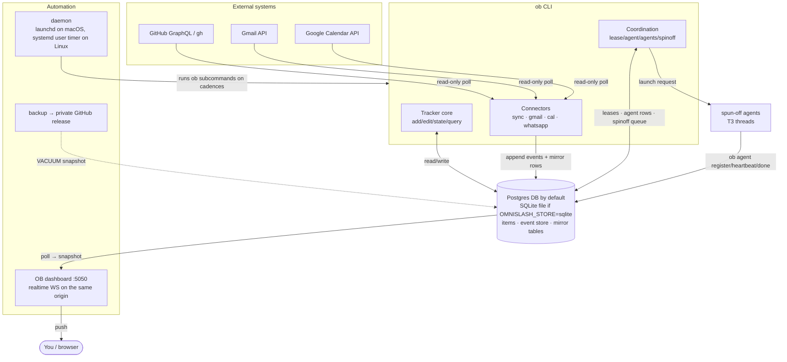

# `ob` guide

How `ob` fits together, the conventions every command shares, common workflows, configuration, and how to install and develop it. The per-command reference is [commands.md](commands.md); what changed and why is in [CHANGELOG.md](../CHANGELOG.md).

## How it fits together

The tracker state is one Postgres database by default, a local SQLite file when `OMNISLASH_STORE=sqlite` is set, or no database at all on a machine that sets `OMNISLASH_API` and talks to a remote ob API. The CLI is the only writer of tracker state; the
connectors append external facts; the daemon runs CLI subcommands on a schedule; the dashboard
reads the DB and pushes live updates. Nothing here sends or mutates anything external except the
explicit backup (a private GitHub release) and the spinoff launcher.



If mermaid doesn't render, the same picture in prose:

```
external sources ──(read-only poll)──▶ connectors ──▶ [ Postgres DB ] ◀──▶ tracker core (CLI)
                                                         │  ▲
                            coordination (leases/agents) ─┘  │
   daemon (launchd or systemd timer) ──runs ob subcommands on a schedule────────┘
   web dashboard ──poll the DB → push live snapshots──▶ browser
   spinoff ──opens a T3 thread──▶ agent ──ob agent register/heartbeat/done──▶ DB
```

### The layers

1. **Tracker core** — the worklist. `item` rows (types: `task`, `linear_ref`, `roadmap`,
   `decision`, `learning`) belong to a `project` (which carries a `kind`: `side` /
   `home` / `admin` / `learning`). Each item has a lifecycle: **capture** (`add`, `note`,
   `tag`, `link`) → **workflow** (`start` → `ready` → `close`, or `block`/`unblock`, validated
   per type/kind) → **query** (`next`, `list`, `show`, `brief`, `search`, `status`). `brief`
   assembles a topic's work-state (item/`--in-flight`) as text or `--json` so a reply to a
   "status of X?" question can be grounded in facts (it feeds the `/ob-slack-triage` skill). Priority is
   `critical/urgent/flake/high/medium/low/none` (critical, stored as 6, is an active production bug
   affecting users now and sorts first; flake is a flaky test, its own level between urgent and
   high); an item with no explicit priority derives `high` when it
   belongs to the current `focus` project. `today`/`next` drive the daily worklist.
   An item can be **paired with a GitHub issue** on `wayfinder_repo` (`add --issue` creates both;
   `issue link` pairs existing ones). That pairing is what makes `close` a **two-tracker** operation
   and what `issue landed` / `issue drift` read, see
   [Two trackers, one truth](commands.md#two-trackers-one-truth-issue-77).

2. **GitHub PR ingest** — `sync` pulls GitHub PRs and appends them to an **append-only `event`
   store** (plus mirror tables like `pr_comment`). It is what `ob status`'s in-flight PRs, `ob
   brief`'s PR lines, and alert rules 1 and 3 read. (The career-metrics half of this layer —
   `metrics` / `report` / `audit` and the Linear ingest that fed them — was deleted in ob 1121
   once its inputs were gone; the historical event rows stay.)

3. **Source connectors** — read-only awareness. `gmail`, `cal` and `whatsapp` poll their
   sources into dedicated mirror tables (`email_message`, `calendar_event`,
   `whatsapp_message`, each with FTS where relevant), **also mirroring a summary event** into the
   event store, and mapping senders/attendees/authors to people via the `person` registry
   (`resolvePerson`). Ingest is read-only — `whatsapp sync` opens the bridge's SQLite `messages.db`
   in read-only mode and never writes it. **Slack is no longer one of them (ob 208):** its poll
   needed a Slack user token that never existed on this machine, so it failed every 15 minutes from
   the day it was configured; work Slack awareness comes from the Claude Slack connector at the point
   of use (the `/ob-slack-triage` skill) instead. The `slack_message` rows it did ingest stay, and
   `ob slack unread` still reads them.
   `google auth` mints the shared OAuth token the Gmail/Calendar connectors read. **`whatsapp send`
   is the one outbound path** (ob's first): it POSTs the local bridge's REST API (localhost only) and
   is gated by an explicit human confirmation in `sendWhatsapp()` — nothing sends without it. A
   successful send then persists the sent message into `whatsapp_message` itself (#120), reading
   `messages.db` read-only for the bridge's real message id, so an outbound message is a real row
   immediately; ob still never writes the bridge's DB.

4. **Coordination (v2)**: parallel agents. `lease` is a TTL resource mutex in SQLite (FIFO with
   `--wait`), and it is the **only** locking mechanism here. Its keys name what sessions actually
   contend over: `port:3000` (decision #37), **`ticket:<ref>`**, **`worktree:<path>`** and
   **`app:<name>`** (#97). Those last three exist because two concurrent architect sessions had no
   mutual exclusion over a ticket: one removed a worktree, deleted its branch and landed the ticket
   **while another was mid-review and mid-gate on it**, so the reviewing architect's `git`/test output
   described a state that no longer existed. The damage is **untrustworthy verification**, not lost
   work: the same class of error a smoke-gate exists to remove.

   So the guard sits on the paths that **destroy or finalise**, not merely on advice: `spinoff
   cleanup` (removes a worktree, deletes a branch), `spinoff reconcile` (marks a ticket landed) and
   `spinoff <ref>`/launch (starts work on a ticket). The rule is the same in all three: a **live**
   foreign holder is never stomped, not even with `--force`, and an **expired** one is reclaimed
   silently, so a dead session cannot wedge a ticket forever. A blocked caller always gets `held by
   <holder> since <ts>` rather than a false result. **`ob lease release <resource> --force` is the one
   way past a live holder**, deliberately explicit.
   **`flake:slot`** (OB-2230) is the one flake fix on the whole machine: `ob spinoff` takes it for a
   `flake` ticket's builder and the handoff, close, abandon or a failed launch releases it.

   **A lease is owned by its `--holder`, so every later command names the same one** (#75). `acquire`,
   `heartbeat` and `release` are symmetric: what you took as `--holder architect-acme` you release as
   `--holder architect-acme`. The default holder is this `ob` process's `<pid>@<host>`, and every `ob`
   invocation is a **new pid**, so a defaulted release can never match a lease an earlier command took:
   it releases nothing, exits 1, and the message names the recorded holder plus the `--holder` retry.
   Releasing an **expired** lease needs no `--holder` match (it already protects nothing), so `--force`
   is reserved for its one job: breaking a **live** holder that is genuinely gone.

   `agent`/`agents` is a liveness registry (who's working on what now, heartbeat + TTL) and doubles as
    the natural acquisition hook. **Register ≠ launch (417):** `agent register` writes the row and
    claims the lease; it never launches anything. Only `ob spinoff` starts an agent. `agent register --status needs-human` on a t3 builder also puts `🙋` in front of its T3 thread title, and the next register with any other status takes it off again (1579; best effort, a title that cannot be set only warns). A **team role** row (`architect-<team>`, `sentinel-<team>` or `muse-<team>`, a t3 thread; OB-2255) does not need that second register (OB-1710): when it is `needs-human` and the owner sends the thread a message after the row was stamped, the next `ob spinoff reconcile` (the run-state mirror's pass, no new watcher) sets it back to `planning` and takes the `🙋` off through the same title helper. Only a message he typed counts; a queued `ob` note (handoff/landed) or a scheduled-task run leaves it, and a builder's `needs-human` stays until the builder or its handoff changes it. The boundary is the row's `heartbeat_at`, so a team thread that heartbeats after asking pushes it past his reply: re-register `--status planning` yourself then. `agent register --ticket` claims `ticket:<ref>` except when that builder's spinoff is already `handed-off` (577: register still updates note/status, does not re-claim `ticket:`/`worktree:`, does not `agent done`), `agent heartbeat`
     refreshes it, `agent done` releases **only the leases that agent itself acquired**. **A lease you
    already hold is compatible with registering under it**: an architect holding `ticket:<n>` for a gate
    dispatches a builder for that same ticket with
    `agent register --id <builder> --ticket <n> --holder architect-<team>`, which leaves the architect's hold
    exactly as it is instead of treating the documented flow as a collision. **`agent done` on that
    builder does not drop the architect's hold** (341): the builder inherited it, and an architect's hold
    survives while builders come and go under it. **`spinoff <ref> --holder`
   and `spinoff reconcile --holder` take the same flag with the same meaning** (#136): dispatching and
   landing a ticket you hold is the flow, not contention, so the architect's own hold is compatible and is
   left untouched, while a genuinely different live holder gets a refusal that names it (1589).
     `spinoff <ref>` opens or adopts the ticket's T3 thread in the same
     invocation and prints the thread id (1589); there is no queue to wait on
     and no drain daemon. When another live session holds its
     `ticket:`/`worktree:` lease (#97) it refuses, names the holder, exits
     non-zero and leaves no pending row.
     Agent count is not a reason to leave a row pending (ob 767): expired/stale
     builders do not occupy a launch slot, and `ob agent done` is not required
     to free the next tab.

5. **Automation** — `daemon install` schedules the recurring jobs below (Mac launchd / Linux systemd --user);
   `web` serves the OB dashboard on `:5050` (its WebSocket at `/api/realtime` on the same origin
   re-pushes on any DB change); `backup` captures an off-machine monthly snapshot.

   It binds **`127.0.0.1` by default** (192), so a laptop's dashboard is reachable from
   that laptop and nowhere else. The always-on server sets a LAN address instead
   (`OMNISLASH_WEB_BIND` in its systemd unit, or `ob config set web_bind <addr>`), which is what makes
   `https://<lan-name>:5050` work from the phone. The browser derives the sidecar's address from the
   page's own origin, so the LAN page dials the LAN sidecar without any second setting.

   **TLS (220) rides on exactly that same "one deployment" rule.** The page derives the socket's
   **scheme** from its origin too, so the one listener serves the page and its socket under the same certificate or neither:
   `--tls-cert`/`--tls-key` > `OMNISLASH_WEB_TLS_CERT`/`OMNISLASH_WEB_TLS_KEY` > the
   `web_tls_cert`/`web_tls_key` rows. **A laptop is untouched**: with nothing configured, `ob web`
   serves plain HTTP and says nothing about it, which is not a fault but the default. The always-on
   server gets a real Let's Encrypt certificate for a LAN-only name (`ob cert`, below), issued over a
   DNS-01 challenge so nothing is ever exposed, and its private key lives at
   `/etc/omnislash/tls/privkey.pem` (mode 0600, in a 0700 directory owned by the service user) where it
   is out of git and out of `ob backup`'s artifact by an explicit guard. The reason any of this exists
   is that the dashboard is growing pages you *type into*: a token pasted over plain HTTP is a token on
   the wire.

   The sidecar also hosts the **WhatsApp media endpoints** (158 voice notes + 162 images) — same
   CORS-open + LAN posture. They proxy the Go bridge's `POST /api/download` so the browser never sees
   the bridge bearer token (read server-side, sent only to the loopback bridge); decrypted bytes are
   cached to `whatsapp_media_cache_dir` keyed by `(chat_jid, id)`:
   - `GET /api/whatsapp/media?chat_jid=&id=` — streams a message's image/audio bytes with the right
     content-type (the dashboard's `` thumbnail / `<audio>` player src). Cache-first.
   - `GET /api/whatsapp/avatar?jid=` — streams a chat/group **profile picture** (163) via the bridge's
     `GET /api/avatar?jid=` (token stays server-side). Cache-first to `whatsapp_avatar_cache_dir`, keyed
     by jid with a long TTL (avatars rarely change). **404** when there's no picture — the round avatar in
     the feed then falls back to the name's initials.
   - `POST /api/whatsapp/transcribe` — body `{chat_jid, id}` → on-demand local-whisper STT of a voice
     note → `{ok:true, transcript}` stored on the message, or `{ok:false, reason}` when no whisper/
     ffmpeg is installed (**graceful** — the feed never breaks).

### The daemon jobs (`daemonJobs`)

`ob daemon install` writes **GUI-local jobs only** (457/664). Since OS-288 that is two jobs:
`role-tick` (`ob role tick` every 900s), which runs on the client because a pass may open a role
run and runs open on the caller's own T3, and `settle-sweep` (`ob t3 settle-sweep` every 1800s),
which settles finished threads on that same T3. Since ob 1589 `ob spinoff <ref>` launches its T3 thread
immediately, so the 45s `spinoff-drain` poll is retired. `ob daemon install` and `ob daemon uninstall`
both **remove** a leftover drain unit
(`com.omnislash.spinoff-drain` on macOS, `omnislash-spinoff-drain.{service,timer}` under
`~/.config/systemd/user` on Linux) and say so. A plist sets `HOME` and `PATH` in `EnvironmentVariables` (601),
because launchd does not inherit `HOME` and without it the `ob` wrapper skips
`~/.cloudflare_warp_ca.pem` and bun fetch dies; on Linux it is a systemd --user timer with
`HOME`/`PATH` in `Environment=`, never a plist under `~/Library`.
Server jobs live on the API host as systemd system units (declared in the server's job list). Logging is
`~/.local/share/omnislash/logs/` (launchd) or the user journal (Linux). After a freeze, reload the Mac column with
the cutover script that starts the GUI agents. Do not `ob daemon uninstall` leftover server
plists as a build step; the owner unloads those when he wants.

| Job | Command | Cadence | Placement |
|---|---|---|---|
| `role-tick` | `ob role tick` | every 900s (15 min, OS-67): writes what needs each team's architect into its inbox and delivers it; nothing new is one line, delivers nothing and starts no run. It also test-merges the team's running branches and posts each conflicting pair to the sentinel (OS-48). It also ends idle (15 minutes) and over-cap (200k context) role runs after asking each for its note (OS-57). The server's `ob jobs` never sees its runs, so it is never reported stale or never-ran there | **client** (`omnislash-role-tick.timer` on Linux, `com.omnislash.role-tick` on macOS) |
| `settle-sweep` | `ob t3 settle-sweep` | every 1800s (30 min, OS-288): settles every unsettled T3 thread no keep rule names (role threads, live builder rows and leases, a run or question in flight, queued messages, a thread you wrote in within 30 minutes, a subagent of a kept or running parent; archived threads are skipped). Exit 1 when a thread could not be read or settled. Its log is `~/.local/share/omnislash/logs/settle-sweep.log` (launchd) or the user journal (`journalctl --user -u omnislash-settle-sweep`) | **client** (`omnislash-settle-sweep.timer` on Linux, `com.omnislash.settle-sweep` on macOS) |
| ~~`spinoff-drain`~~ | `ob spinoff drain` | **retired (1589)** | No longer installed anywhere; install/uninstall remove a leftover unit. `ob spinoff drain` is still a manual one-shot. |
| `sync` | `ob sync` | every 3600s (hourly) | server (the API host) |
| `gmail-sync` | `ob gmail sync` | every 300s (5 min) | server (the API host) |
| `cal-sync` | `ob cal sync` | every 900s (15 min) | server (the API host) |
| `alerts` | `ob alerts --digest --notify` | daily 08:00; prints the digest and (1655, narrowed by 1687) pushes it as ONE Home Assistant message when at least one *action* alert exists (job, credential or blocked; never aging) | server (the API host) |
| `creds-check` | `ob creds check --all` | daily 07:45, ahead of the 08:00 digest (1655). **Declared here and installed only on the server** as `omnislash-creds-check.timer`, enabled by hand after one manual run. Exits 1 and names the credentials when any verdict is FAILED | server (the API host); never a Mac plist |
| `ci-main` | `ob ci main --notify` | hourly (OB-2276): the catch-up behind the GitHub webhook receiver, telling a red run on main the receiver missed and its recovery. **Declared here and installed only on the server** as `omnislash-ci-main.timer`, enabled by hand after one manual `ob ci main`. Exits 1 when a repo could not be read or a note not sent | server (the API host); never a Mac plist |
| `web` | `ob web` | persistent (KeepAlive + RunAtLoad) | server (the API host) |
| `whatsapp-bridge` | `ob whatsapp bridge run` | persistent (KeepAlive + RunAtLoad): `run` blocks (like `web`), so KeepAlive supervises the real bridge: crash → immediate restart. Moved to the server (ob 193/202) as `omnislash-whatsapp-bridge.service` with `Restart=always`. | server (the API host); plist removed from the Mac |
| `whatsapp-sync` | `ob whatsapp sync` | every 60s: poll the bridge → ob so the dashboard feed live-updates (184) | server (the API host); plist removed from the Mac |
| `cert-renew` | `ob cert renew` | daily 03:40, renews the LAN certificate the dashboard serves (220). **Declared here and installed only on the server** as `omnislash-cert-renew.timer`, like `ha-health`: the certificate belongs to the box that serves the dashboard. Daily is deliberate for a 90-day certificate, because lego only acts inside the last 30 days: that leaves a month of daily attempts between the first failure and an expiry, each one counting toward the `JOB FAILING` alert. On a machine with no `tls_domain` it prints "nothing to renew" and exits 0, so it is inert rather than noisy on a laptop | server (the API host); never a Mac plist |
| `backup` | `ob backup` | monthly, 1st at 03:15 | server (the API host) |

**Client vs server after cutover (448/457/664).** Client = GUI-local only: `role-tick` since OS-67 and
`settle-sweep` since OS-288 (the `spinoff-drain` job it used to hold is retired in 1589). `ob daemon install` / `status` / `uninstall`
talk about that client set, not the old full launchd fleet. Server = everything else (`sync`, `backup`, `gmail-sync`, `cal-sync`, `alerts`,
`net-pull`, `web`, the WhatsApp pair, `ha-health`, `cert-renew`). The pg-cutover
runbook's unfreeze step reloads **the Mac set**, which is `role-tick` and `settle-sweep`; `ob daemon status` lists them.

This table is the **only** declaration of the fleet: the server's job list and the systemd units are
asserted against it by `apps/cli/test/proxmox-units.test.ts`, and since ob 218 the per-job health signal
reads its expected cadence from it too. `ob jobs` reports what each of them last actually did, and
`ob alerts` rules 7-10 complain when one stops doing it.

---

## Global conventions

- **Shape:** `ob <command> [<positional>...] [--flags]` — git/gh-style. Primary argument is
  positional; the rest are named.
- **Output modes** (global flags):
  - default → concise **human** text (one line per item for lists)
  - `--json` → machine JSON (the stable contract skills and `jq` consume)
  - `--table` → aligned columns
  - `-q` / `--quiet` → **IDs only** (for scripts)
- **Other global flags:** `--db <path>` (overrides `OMNISLASH_DB` / the default DB location; **local-only**:
  with `remote_host` set it is refused rather than sent to the server, see
  [`--db` never crosses the wire](#--db-never-crosses-the-wire-213)),
  `--local` (answer from the local read replica; never dispatch over ssh; see
  [The client/server split](#the-clientserver-split-183)), `--no-daemon` (accepted; the CLI always
  opens SQLite directly), `-h` / `--help`.
- **Exit codes:** `0` success (including a clean empty result), `1` runtime error, `2` usage
  error (bad flags/args or no command). An empty result is **not** an error — scripts test
  output, not the exit code.
- **The `--json` guarantee** (149): a `--json` invocation either prints **parseable JSON** on stdout
  or **exits non-zero with a reason on stderr**, never both silent and successful. An empty result
  set is still valid JSON (`[]` or `{}`), so a consumer can `JSON.parse` stdout whenever the exit code
  is `0`, and any failure names itself rather than surfacing as the caller's own parse error. This is
  enforced in one place (`run()` in `cli.ts`), so it holds for every command: a handler that would
  print nothing in `--json` mode exits `1` saying so. Two concrete `ob` bugs sat behind it: the DB
  open ran outside `run()`'s error handling, and `openDb` set `busy_timeout` *after* the WAL switch, so
  a concurrent opener hit `SQLITE_BUSY_RECOVERY` with a 0ms retry budget and died with an uncaught
  stack and empty stdout. `openDb` now sets `busy_timeout` first, skips the migration pass when nothing
  is outstanding, and retries a bounded number of times on **`SQLITE_BUSY` only** (223): a deterministic
  failure surfaces on the first attempt with its cause, rather than being re-proved six times under a
  "concurrent access" headline that was not true.
- **Requested help exits `0`** (#134): `ob --help`, `ob -h`, `ob help`, `ob <command> [subcommand] --help`,
  `ob help <command> [subcommand]`, and `ob help env` print focused help on **stdout** and exit `0`,
  because asking for help is not a usage error. That makes `ob --help >/dev/null && echo OK` a valid
  "does `ob` load?" probe, which is what the repo's pre-land gate checks. Unknown help targets
  (`ob help nope`, `ob project nope --help`) print an error on stderr and exit `2`. A **bare `ob`**
  with no command is still a usage error: it prints the root overview on stdout and exits `2`.
- **Relative time windows:** because parsing is strict, a leading-dash value must use `=`, e.g.
  `--since=-7d` (not `--since -7d`). `--since` accepts ISO, `YYYY-MM-DD`, or `-Nd`.

### Database location (resolution order)

1. `--db <path>` (local-only: refused once `remote_host` is set, see
   [`--db` never crosses the wire](#--db-never-crosses-the-wire-213))
2. `OMNISLASH_DB` environment variable
3. `$XDG_DATA_HOME/omnislash/omnislash.sqlite`
4. `~/.local/share/omnislash/omnislash.sqlite` (default)

**MEMORY.md (739/740)** is this machine's always-on fact file at `$XDG_DATA_HOME/omnislash/MEMORY.md` else `~/.local/share/omnislash/MEMORY.md`, override `OMNISLASH_MEMORY_PATH`. Personal XDG, not git. `ob memory add` / `ob memory show`. OpenCode prepends the capped file into session context (740). session.idle stays needs-human; idle is a backstop only (no second model).

**SOUL.md (756)** is git-tracked `.opencode/SOUL.md` (shared identity). OpenCode prepends it into session context; missing file → skip, no crash. Not capped. MEMORY.md stays personal XDG.

**Creating a database is deliberate (198).** The server already has one. Every command opens an existing
database or refuses:

```
$ ob next
error: no database at ~/.local/share/omnislash/omnislash.sqlite, and creating one is deliberate: ob will not make a new tracker as a side effect of a command.
  the real database is probably elsewhere: run with OMNISLASH_DB=<path>, or pass --db <path>
  a machine that genuinely has no database yet gets one with OMNISLASH_DB_CREATE=1 (honours --db and OMNISLASH_DB)
```

It reads that way round because the likely cause is the likely cause: an environment that does not carry
`OMNISLASH_DB` while the real database sits somewhere else. That is exactly what happened on the server,
where the systemd units set `OMNISLASH_DB=/var/lib/omnislash/omnislash.sqlite` but an interactive shell does
not: a bare `ob status` used to create a second, empty, perfectly functional tracker at the default path
and answer from it. `OMNISLASH_DB_CREATE=1` is the process-wide opt-in for a caller that legitimately makes
throwaway databases (the test suites set it once, in `apps/cli/test/preload.ts`). A laptop is an API client and must not have a database (D2).

With `remote_host` set there is a **second** database on this machine: the read replica at
`<same directory>/replica.sqlite`, plus its `replica.meta.json` bookkeeping and the `replica.lock` /
`replica.swap-gate` files the swap is serialised on (308). It is a whole-file copy of
the server's DB, opened **read-only**, and it is what read commands answer from. It is never written by
a handler and never edited by hand: `ob replica refresh` replaces it wholesale. See
[The client/server split](#the-clientserver-split-183).

### `ob` talks to an API, not to the database (353)

**Setting `OMNISLASH_API` makes this machine an API client.** Every data command then goes over HTTPS with a
bearer token to the API [ob 352 mounts at `/api/ob`](commands.md#the-ob-api-352-purpose-built-endpoints-hosted-by-the-dashboard), and `ob` opens **no database at
all** — no Postgres driver, no connection url, no `pg_hba` entry for a laptop whose DHCP lease just moved.
Unset (which is the state today) nothing changes and `ob` uses the direct Postgres path described below.

```bash
export OMNISLASH_API=https://ob.example.org        # or: printf '%s\n' 'https://…' > ~/.omnislash_api_url
printf '%s\n' '<token>' > ~/.ob_api_token        # the SAME file the server authenticates against
chmod 0600 ~/.ob_api_token
```

**There is no dual mode, and that is the point (map decision D2).** `ob` talks to the API whether or not
it is on the LAN. It does *not* use Postgres when local and the API when remote, because a client that can
reach the data two ways eventually reaches it the wrong way and says nothing — which is ob 237 and ob 324
twice over: a path that still resolved, still opened, still answered, and every answer was wrong. So an
unreachable API is an **error**, never a quiet fall back to a database. The cost is honest and accepted: a
LAN call now goes over HTTP rather than straight to Postgres, which for a personal tracker is nothing.

**The credential is a token in a file outside the repo, mode 0600 (D5)** — `~/.ob_api_token`, the same path
and the same `OB_API_TOKEN_FILE` override the server reads, so there is one definition of where it lives.
`OMNISLASH_API_TOKEN` covers a one-off. Deliberately **not** an `ob secret`: the secret store is a table
inside the database the API fronts, which is the same circular bootstrap ob 320 hit. The token is sent in
the `Authorization` header and nowhere else — never in argv, never in a url, and never in an error message
(a transport error that echoes the request back is redacted before it reaches stderr).

**The team role routes can go to a second server (OS-76).** `OMNISLASH_ROLE_API` (or the first line of
`~/.omnislash_role_api_url`; `OMNISLASH_ROLE_API_URL_FILE` moves that file) names a base url for the role
routes only: `GET` and `POST` `/teams/:name/runs`, `POST /teams/:name/runs/:id`, `POST
/teams/:name/runs/:id/note-shown`, `GET /teams/:name/tick`, `GET /teams/:name/brief`, `POST
/teams/:name/notes`, and `GET` and `POST /teams/:name/inbox` with `POST /teams/:name/inbox/read`. Every other
route stays on `OMNISLASH_API`, including `/teams`, `/teams/:name`, `/teams/:name/edit`, `/teams/:name/join`,
`/teams/leave` and `/teams/:name/handoffs`. Both servers get the same bearer token and the same Access
headers, and an error from the role server names the role url it called. Unset or empty, every route goes to
`OMNISLASH_API` exactly as before, so nothing changes until the file is written.

**Project status routes go there too (OS-189).** The omnibus server does not know a project's status
(OS-134): it refuses `--status` and leaves `status` off its rows. So with a role base set, every `/projects`
route (list, add, edit and the `pause`, `resume` and `archive` aliases, rename, rm), `GET /next`, the spinoff
enqueue (`POST /spinoffs`, and `GET /spinoffs`) and `POST /spinoffs/launchable` go to the role server as well.
Both servers share one database, so a status written there is the status every reader sees. The other
`/spinoffs/...` routes stay on `OMNISLASH_API`. So with a role base set, `ob next`, every `ob project`
command and `ob spinoff` dispatch need the role server to answer.

**Overnight and tag count routes go there too (OS-252).** The omnibus server has no `POST /overnight/backfill`
and no `GET /tags` (both OS-216), and drops `at` on `POST /overnight/decide`. So with a role base set, every
`/overnight` route and `GET /tags` go to the role server; an item's own `/items/:id/tags` stays on `OMNISLASH_API`.

**Nothing waits forever (1616).** On 2026-10-20 a leaked Postgres pool slot left every `omnislash-web` write
hanging for 43 minutes with no error. Now each side has a bound that names the call: the client gives up
after `OB_API_TIMEOUT_MS` (default 150000) with `did not answer POST /items within 150000ms (timed out, not
unreachable)`; the server answers a request that outlives `OB_API_REQUEST_TIMEOUT_MS` (default 120000) with
a 504 `timeout` naming the route; and a Postgres `txn` / `NOTIFY` fails after `OMNISLASH_STORE_TIMEOUT_MS`
(default 30000). The server's bound is shorter than the client's, so a stalled store reports itself before
the client has to guess. A timeout bounds the WAIT only: Bun SQL has no abort, so a query already sent keeps
running underneath. The ingest routes (`/sync`, `/gmail/sync`, `/cal/sync`, `/creds/check`) get ten times the budget on both ends. A call that is legitimately slower still raises the variable, not the code. **Scope:** the API and a Postgres `txn` / `NOTIFY` are bounded; plain reads that bypass the API (the dashboard's own page loaders on `getStore()`) are not yet.

**A short outage is ridden out, not reported (OB-2160).** Every live deploy restarts `omnislash-web`, and for that
moment the port refuses connections. A call whose connection is **refused** (the request never reached the server)
is retried with backoff (0.5 s doubling, capped at 4 s) for up to `OB_API_RETRY_MS` (default 30000) in total, for
**every** method, since nothing was sent; it prints one stderr line, `ob API at <base> refused the connection,
retrying for up to 30s (a deploy restarts it)`, then answers or fails with the original `could not reach` error.
A connection **reset** may have reached the server, so only a `GET` retries one; a write that was reset fails at
once. A **timeout** is never retried (the server took the request). No command is excluded: a refused write never
arrived. File downloads (OB-1808) retry a refused connection only. `OB_API_RETRY_MS=0` turns it off, for a script
or test that wants the old fail-fast.

**Three classes of command, and nothing falls between them:**

| class | commands | what happens |
|---|---|---|
| routed | `add` `agent` `agents` `agenda` `alerts` `block` `brief` `cal` `close` `config` `creds` `cursor` `decision` `focus` `gmail` `issue` `jobs` `lease` `learning` `link` `list` `log` `next` `note` `order` `person` `project` `tournament` `ci` `github` `ready` `reopen` `review` `review-miss` `machine` `roadmap` `scope-change` `search` `secret` `show` `slack unread` `spinoff` `stakeholder` `start` `state` `status` `standup` (save/set/latest/posted) `sync` `tag` `test-user` `today` `triage` `unblock` `untag` `whatsapp search` `whatsapp recent` `whois` | one typed call to a purpose-built endpoint, rendered by the same code the local command uses. `sync` runs **on the API host**. |
| split | `google auth` `memory` | `google auth` (420/424): loopback **runs here** (browser + `127.0.0.1`), persist via `POST /secrets` (`secret set google`) so the host store gets it. Creds from `--client` / `--client-id` / `--client-secret`, else stored secret `google`. `google auth-url` (1305) is **served** (see below). `memory` (739/740): MEMORY.md is **this machine's** XDG file (`~/.local/share/omnislash/MEMORY.md`, override `OMNISLASH_MEMORY_PATH`); `show` reads it here with no HTTP, `add` appends here then dual-writes `POST /items` `--type learning`. Never dispatched over ssh. OpenCode prepends the capped file into session context (740). |
| local, and it runs | `daemon` `vision` | `daemon` writes launchd plists into `~/Library/LaunchAgents` on macOS, and systemd user timers on Linux. `vision compare` shells to this machine's mlx-vlm against local PNG paths (468, 477). All are handed handles that **refuse by name** if they ever reach for the data |
| the host runs it (OB-1808) | `backup` `db` `cert` `net` `ha` | the client asks `POST /host-jobs`; the host runs them as a job, so no HTTP request stays open. See [Commands the API host runs](#commands-the-api-host-runs-ob-1808) |
| local, and it refuses | `web` (run on the API host); plus the local halves of the SPLIT commands (`spinoff watch`, `whatsapp bridge`, `secret import`, `config … remote_host`) and four unported flags | refuse **up front and by name**. Host-only refusals name the API host. Machine-local refusals name THIS machine. No HTTP request is made. The complete list is [below](#the-refusals-enumerated-1121) |

**`ob spinoff` is SPLIT too, and the old classification was the bug (360).** It was marked local-only at
the cutover because it touches the database, and its refusal read *"run it on the machine that has both the
checkouts and the database: the API host"* — which has none of his checkouts.
That sentence sent the owner, at the office, to the one machine that could not do the job. Its two halves
live in different places and **neither is the API host**:

| half | where it lives | how |
|---|---|---|
| the queue, the ticket, the leases | Postgres | over the API: `GET/POST /spinoffs`, `/spinoffs/config`, `/spinoffs/launchable`, `/spinoffs/claim`, `/spinoffs/stamp`, `/spinoffs/land`, `/spinoffs/reclaim`, `/spinoffs/cleanup-guard` |
| the worktree, the agent spawn, `cleanup`'s git | the laptop in front of the human | locally, between the claim and the stamp |

So a spinoff from the office needs **his machine plus the API**, which is exactly what he has:

```sh
ob spinoff 360 --repo acme     # enqueued + claimed over the API, T3 thread opened on THIS laptop, stamped (217/1589)
ob spinoff drain                  # manual one-shot, this repo only (OB-1796; --repo <slug|path> names another, --all drains every repo): reclaim lapsed claims, launch the queued/legacy pending rows (a row whose ticket is done, whose work is on origin/main, or whose project is paused or archived without --allow-paused, is left queued: 'ob spinoff abandon <row>' retires it)
ob spinoff reconcile              # this machine's git decides; the API records the landing
ob spinoff list --json            # landed from GET /items status + this machine's origin/main
ob spinoff cleanup --dry-run      # git on this disk, guarded by the API's leases; "merged" is measured against origin/main (1760), or a squash-merged PR with the same head sha (OB-2141)
```

`ob spinoff list --json` sets `landed` the same way the local command does (932/937): ticket
status from one `GET /items?status=done` (only `done` counts; a per-ticket GET would stall the
host, which runs this command on the UI thread), and a LANDING commit naming the ticket on this
machine's `origin/main` — a merge subject or a conventional scope, never a `docs(`/`chart(` note,
and never one older than the row's `base_sha` (1201). A failed status read does not fail the list — the commit side can
still set the flag. Reconcile uses that same signal, so a done ticket or an origin/main landing
is marked merged even when local `main` has not moved. Human `ob spinoff list` (no `--json`)
does not fetch ticket status.

**Two properties of the drain survive the split, deliberately.** ob 308's race fix is still one conditional
`UPDATE … WHERE status='pending' RETURNING *`, executed on the authoritative database inside
`POST /spinoffs/claim` — the client never reads a row and then writes it, so two drains that both ask get
one row between them. ob 191's ordering is unchanged too: the **claim goes first** (it is the exclusion),
the launch happens here in between, and the stamp records it; a launch that happened whose stamp did not
is reported with the command that finishes the job, and the claim lease lapses so `ob spinoff reclaim`
re-queues the row.

**Only `ob spinoff watch` refuses, and its refusal names *this* machine.** It blocks on `fs.watch` of the
database *file*, and an API client has no database of any kind — it would block forever and report nothing.
The message says so, says that everything else about `ob spinoff` works here, and points at
`ob spinoff reconcile` / `ob spinoff list` / `ob agents` instead. A `#<issue>` ref refuses for the separate
reason that fetching the issue needs the tracker's GitHub credential, the same edge `ob add --issue` has.

**`ob whatsapp` is SPLIT too (366), and the old refusal sent people to the wrong machine.** `whatsapp
search` / `whatsapp recent` are ingested messages already in Postgres, so they are served
(`GET /api/ob/whatsapp/search?q=&limit=`, `GET /api/ob/whatsapp/recent?limit=&since=`). **OB-1809 served the rest, because the bridge runs on the API host:** `sync` and `bridge status` are host jobs, and `send`, `bio` and the per-chat prefs are routes. `send` still asks the human on the terminal they are at, before any request exists, and the server refuses a body without a literal `confirm: true`. Only `bridge start|run|stop` still refuses by name.
The native app's WhatsApp screen adds two more reads, `GET /api/ob/whatsapp/status` and `GET /api/ob/whatsapp/chats` (OB-1765).

**`ob gmail` / `ob cal` / `ob agenda` are served (415), and the token stays on the host.** Search,
list and agenda are store reads (`GET /api/ob/gmail/search?q=&limit=`, `GET /api/ob/gmail/list?limit=&since=`,
`GET /api/ob/cal/agenda`). Sync runs **on the API host** against secret `google` (or the host token
file) (`POST /api/ob/gmail/sync`, `POST /api/ob/cal/sync`) so a laptop never needs `~/.google_token`.
`ob gmail draft` and `ob gmail send-draft` (1757) run on the host the same way (`POST /api/ob/gmail/drafts`,
`POST /api/ob/gmail/drafts/:id/send`). `ob gmail read` and `ob gmail attachment` (1680) fetch from Gmail on the host
(`GET /api/ob/gmail/messages/:id`, `GET /api/ob/gmail/messages/:id/attachments`), and the **CLI writes the files and reads
the `--attach` files**, so the bytes cross the API as base64 and the host never touches your disk. A send needs `confirm: true` and `hash: "<hex>"` in the body, which the CLI sets only from `--confirm --hash <hex>`; the host re-reads the draft and decides the hash match itself (OB-1910), so the client never does.
`ob gmail drafts`, `ob gmail draft-edit` and `ob gmail draft-delete` (OB-1750) run on the host too (`GET /api/ob/gmail/drafts`, `POST /api/ob/gmail/drafts/:id/edit`, `DELETE /api/ob/gmail/drafts/:id?confirm=true`); a delete without `confirm=true` is a 400, and none of the three sends anything.
**`ob google auth` is SPLIT (420/424), and 1305 adds the phone half.** The desktop flow runs on an API
client — loopback OAuth (a browser + a `127.0.0.1` receiver) here, then persist via
`POST /api/ob/secrets` (`secret set google`) so the host store gets the minted JSON. No local DB, no
`~/.google_token`. Client creds from `--client` / `--client-id` / `--client-secret`, else `GET` secret
`google` and parse `client_id`/`client_secret` (a dead refresh token is fine).
**`ob google auth-url` (1305) IS served, because a phone cannot reach `127.0.0.1`.** The API host mints a
one-time `state` (10-minute TTL, single use, bound to the redirect URI) and answers with Google's consent
URL; the phone taps it, Google returns to `GET /api/ob/google/callback`, the state is burned, the code is
exchanged, and the token lands in the same encrypted secret `google`. The callback and `GET
/api/ob/google/auth` are the API's only **unauthenticated** routes — a browser tap cannot send a bearer
token — but **the mint itself is authenticated**: a browser route only resumes a state `auth-url` minted,
because otherwise anyone who can reach the host could start a flow and replace the stored token with their
own Google account. The desktop loopback flow above is unchanged.

Everything else refuses by name too, saying it is not behind an endpoint yet and where it can be run. That
is the ob 337 servable-list rule reinstated over a different transport: a command that reaches half its
data the wrong way is worse than one that refuses, because the refusal is reversible and an answer that
was acted on is not.

**`ob issue landed` / `ob issue drift` are SPLIT (389), like spinoff.** Pairing and the spinoff-table
facts come from the API (`GET /issues/pairing`, plus `GET /issues/github` for drift). Git runs HERE, on
this checkout. They do **not** print "run it on the API host" — that host has the wrong checkout (the
360-class bug). `could-not-tell` / `could-not-read` only when THIS machine's git cannot answer.
`ob issue reconcile` and `ob add --issue` use the GitHub credential on the API host and are served.
`ob link`, `ob edit`, `ob rm`, `ob today`, `ob focus` are store data and are served.

**416 killed the unrouted third class.** Every `ob` command is API-routed or local-only. A new HANDLER without a classification fails `api-routing-416.test.ts`. `unroutedRefusal` is a safety net, not a class.

**Already-servable commands now have purpose-built endpoints (416), not `POST /rpc`:**

| command | endpoint |
|---|---|
| `ob project` / `ob project add` | `GET/POST /api/ob/projects` |
| `ob project edit` / `ob project rename` / `ob project rm [--force]` | `POST /api/ob/projects/:name/edit`, `POST /api/ob/projects/:name/rename` (`{name}`), `DELETE /api/ob/projects/:name[?force=true]` |
| `ob t3 team` / `team add` / `team show` / `team edit` / `team join` / `team leave` / `team rm [--force]` / `team handoff` / `team restart` / `team forward` | `GET/POST /api/ob/teams`, `GET /api/ob/teams/:name`, `POST /api/ob/teams/:name/edit`, `POST /api/ob/teams/:name/join`, `POST /api/ob/teams/leave`, `DELETE /api/ob/teams/:name[?force=true]` (OB-2255); `POST /api/ob/teams/:name/handoffs`, `GET /api/ob/teams/:name/handoffs/latest?role=<r>`, `POST /api/ob/teams/:name/handoffs/:id/consume` (OB-2257). `ob t3 architect\|sentinel\|muse` reads, launches, titles, pins and turns auto-settle off on the client (T3 is there) and writes the row through `/agents`; `--remove` and `team rm --force` unpin on the client too. |
| `ob role start` / `role status` / `role end` | `GET /api/ob/teams/:name/runs[?role=<r>]`, `POST /api/ob/teams/:name/runs` (the marker and its lease; `created` false answers the open run), `POST /api/ob/teams/:name/runs/:id` (`thread_id`, `item_count`, `context_tokens`, `last_activity_at`, or `end_reason`, which ends the run and releases its lease). The thread is read, launched, pinned and settled on the client, where T3 is. |
| `ob role tick` | `GET /api/ob/teams/:name/tick` (the findings, computed on the server where the store is: `kind`, `ref`, `stamp`, `body`), then `POST /api/ob/teams/:name/inbox` per finding with its `client_key`, and delivery as `ob send`. Branch conflicts read the rows from `GET /api/ob/spinoffs`, test-merge in the client's checkout, post to the sentinel through the same inbox route and note each ticket with `POST /api/ob/items/:id/notes`. The team checkout and T3 are the client's. |
| `ob role brief` / `role note` | `GET /api/ob/teams/:name/brief?role=<r>` (the store facts: team, projects, rows, inbox, asks, the next three, the waiting note; a read, so a retried GET never loses the note), `POST /api/ob/teams/:name/notes` (`role`, `body`), `POST /api/ob/teams/:name/runs/:id/note-shown` (sent once the brief is printed, unless `--peek`). Pacing and each handed-off row's `State:` line are read on the client, where the T3 cache and the worktrees are. |
| `ob send` / `ob inbox` / `ob inbox --read` | `POST /api/ob/teams/:name/inbox` (`role`, `from`, `body`, optional `kind`, `ref`, `client_key`; a `client_key` already stored answers that message with `created` false), `GET /api/ob/teams/:name/inbox?role=<r>[&unread=false]`, `POST /api/ob/teams/:name/inbox/read` (`role`, `ids`, `by`). |
| `ob brief` / `ob brief --in-flight` | `GET /api/ob/brief?q=` or `?in_flight=true` |
| `ob log list` / `ob log <type>` | `GET/POST /api/ob/log` |
| `ob jobs` | `GET /api/ob/jobs` |
| `ob backup`, `ob db backup\|snapshot`, `ob cert` | `POST /api/ob/host-jobs`, then `GET /api/ob/host-jobs/:id` (OB-1808, see "Commands the API host runs") |
| `ob jobs host [<id>]` | `GET /api/ob/host-jobs`, `GET /api/ob/host-jobs/:id` |
| `ob jobs host fetch <id>` | `GET /api/ob/host-jobs/:id/files` |
| `ob db fetch <snapshot>` | `GET /api/ob/db/snapshots/:name` |
| `ob alerts` / `ob alerts snooze` | `GET /api/ob/alerts`, `POST /api/ob/alerts/snooze` |
| `ob decision` | `GET /api/ob/decisions`, `GET /api/ob/decisions/:id`, `POST /api/ob/decisions/supersede` |
| `ob doc` | `GET /api/ob/docs[?project=]`, `POST /api/ob/docs`, `GET /api/ob/docs/:id`, `POST /api/ob/docs/:id/set` |
| `ob learning` | `GET /api/ob/learnings`, `GET /api/ob/learnings/:id` |
| `ob roadmap` | `GET /api/ob/roadmaps`, `GET /api/ob/roadmaps/:id`, `POST /api/ob/roadmaps/:id/members` |
| `ob standup` save/set/latest/posted | `GET /api/ob/standup/latest`, `POST /api/ob/standup/save\|set\|posted`. **`generate` stays on THIS machine** (claude -p). |
| `ob slack unread` | `GET /api/ob/slack/unread?limit=`. **No poll revival (208).** `slack sync` stays retired. |
| `ob person` / `ob whois` | `GET/POST /api/ob/people`, `GET /api/ob/people/show`, `GET /api/ob/whois` (456) |
| `ob ci main` / `ob github hooks` | `GET /api/ob/ci/main`, `POST /api/ob/ci/main/notify`, `GET/POST /api/ob/github/hooks` (OB-2276); GitHub itself posts to `POST /api/ob/github/webhook` |
| `ob tournament` | `GET/POST /api/ob/tournaments`, `GET /api/ob/tournaments/:id`, `POST /api/ob/tournaments/:id/candidates\|matches\|pick` (OB-2271) |
| `ob review-miss` / `ob cursor` | `POST /api/ob/review-misses`, `GET /api/ob/review-misses/top`, `GET/POST /api/ob/cursors` |
| `ob machine audit` | `GET /api/ob/machine/audit?since=&stale_days=` (OS-170; admin family `machine`) |
| `ob test-user` | `GET/POST /api/ob/test-users` (add POSTs the secret value; host encrypts) |
| `ob sync` | `POST /api/ob/sync` — GitHub ingest **on the API host** |

After 456, `OB_API_LOCAL_ONLY` has no `store path not ported (337)` rows.

**A flag with no endpoint behind it refuses rather than being dropped.** `ob add --type decision --choice …`
would lose its detail row; `ob tag --repo` also *moves* the item; `--dry-run` on close/reopen has no
preview endpoint. Each says so and writes nothing — a command that ran, exited 0 and did not do what it
said is the ob 237 failure in miniature.

**`ob config` is routed, and `remote_host` is the one key that refuses.** The config table is the SERVER's,
so `ob config get/set` reads and writes the server's settings over `GET/POST /config` — that is how a
client flips `spinoff_engine` or any other setting without a database path. `remote_host` is NOT a config
key on the API client: it is the old ssh-hop pointer, and the client's real address comes from
`OMNISLASH_API` / `~/.omnislash_api_url` (353). So `ob config get/set remote_host` refuses by name rather than
reading — or worse, writing — a client-local pointer into the server's table.

#### The refusals, enumerated (1121)

**Every command a served client refuses, read off the code rather than remembered.** The lists come from
`apps/cli/src/api/routing.ts` (`API_ROUTED_COMMANDS` = served, `LOCAL_ONLY_COMMANDS` = refused up front,
with the wording in `OB_API_LOCAL_ONLY`), from the by-name refusals inside the SPLIT handlers
(`api/client-handlers.ts`, `api/spinoff-client.ts`), and from `unsupported()` — the four flags refused
rather than dropped. Nothing "unknown": a row is either **runs here** (the local half executes; no
endpoint is needed), **local** (refused; the machine that must run it is named), or **unported** (refused;
the endpoint does not exist yet, so the flag or ref is refused rather than silently ignored).

*Refused up front (`LOCAL_ONLY_COMMANDS`):*

| command | disposition | why it is machine-local |
|---|---|---|
| `ob daemon` | runs here | renders this machine's launchd plists (macOS) or systemd user timers (Linux) from `daemonJobs()` and shells to `launchctl` or `systemctl --user`; touches no tracker data |
| `ob vision` | runs here | mlx-vlm comparing local screenshot files; nothing leaves the machine (468) |
| `ob models` | split | the local override file is this machine's (`~/.config/ob/models.jsonc`); `model_routes` (show, get, set, unset, use, reader) is read and written over the API (OS-145) |
| `ob api-token` | runs here | it writes the scoped API tokens file on this machine (`~/.ob_api_tokens.json`), which the API host reads per request; a token never crosses HTTP (OS-178) |
| `ob usage` | runs here | reads the Claude transcripts on this machine (`~/.claude/projects`); only the thread names and `ob project list` come over the API, and a failed read prints slugs (OB-2278) |
| `ob gate` | runs here | it runs the `gate.json` of the checkout it is run in, with no tracker; CI runs it the same way (OS-210) |
| `ob skills` | runs here | reads and repoints the skill links in `~/.claude/skills` on this machine; only the `repo_checkouts` setting comes over the API, and without it the checkouts are `~/dev/omnibus` and `~/dev/omnislash` (OS-182) |
| `ob web` | refused — API host | it starts the dashboard, and the dashboard reads the store the API host holds |

*Refused inside a SPLIT handler (the served half goes over the API; this half is local):*

| refusal | disposition | why it is machine-local |
|---|---|---|
| `ob spinoff watch` | refused — this machine | it blocks on `fs.watch` of the database FILE, and an API client has no database file. Everything else about `spinoff` works here |
| `ob spinoff #<issue>` | refused — unported | a `#<n>` ref needs the tracker's GitHub credential to fetch that issue, and that fetch is not behind an endpoint; a ticket ref works |
| `ob whatsapp bridge start\|run\|stop` | refused — the server's own process | the Go bridge is a long-running unit on the API host, and no caller needs to run it: `sync`, `send`, `bio` and the chat prefs all reach it through the API, and `bridge status` is a host job (OB-1809) |
| `ob secret import` | refused — unported | it copies the plaintext token FILES on the machine it runs on; served it would import the server's files instead of the laptop's, so its meaning is not clear. The refusal lists the files it would read. `ob secret set <name>` stores one from here |
| `ob config get\|set remote_host` | refused — unported | `remote_host` is this machine's old ssh-hop pointer, not a server setting, so writing it into the server's table would point the server somewhere else |

*Runs here rather than refusing* (the local half is the only place it can happen, inside a served command):
`ob google auth` (loopback OAuth, then `POST /secrets`), `ob issue landed` / `ob issue drift` (pairing
over the API, git HERE), `ob t3 doctor` / `ob t3 login` / `ob t3 architect` (T3 is on this machine; the
architect's registry row is served), `ob memory show` / `ob memory add` (this machine's XDG `MEMORY.md`).

*Flags refused rather than dropped (`unsupported()`), on commands that ARE served:*

| refusal | disposition | why |
|---|---|---|
| `ob add --type roadmap\|decision\|learning` | refused — unported | the item's detail row (roadmap/decision/learning fields) is not part of `POST /items`, and creating the item without it would lose what you typed |
| `ob tag --repo/--project` | refused — unported | the flag also MOVES the item to that project; the tags endpoint only tags |
| `ob close\|reopen\|state --dry-run` | refused — unported | there is no preview endpoint, and running it for real is not what `--dry-run` means |
| `ob agent register --spawn-failed` | refused — unported | invalidating the queued spinoff row is not part of `POST /agents` |

*Not a machine refusal, listed so the count is complete:* `ob slack sync` (retired by ob 208 — no token
exists on any machine), `ob standup generate` (removed; standups are written with `ob standup save`),
`ob spinoff --agent` (retired by 563 — spinoff is always interactive; the flag is refused by the SAME
message on both surfaces, so it is not a hole one machine has and another does not), and
`ob metrics` / `ob report` / `ob audit` (deleted in 1121 — they are no longer commands at all, so there
is nothing to refuse). `unroutedRefusal` is a safety net that no known command can reach (416).

#### `ob secret` and `ob creds` over the API (357)

**A secret VALUE crosses the wire, where before it never left the host.** That is a real change and it was
weighed rather than assumed: the owner asked for it, because from the office `ob secret get`
refused and he could not reach Cloudflare or Home Assistant with tokens he owns. What makes it acceptable
is stacked — TLS to Cloudflare, an Access service-token policy in front of the tunnel, the API's own bearer
token, and the part that does **not** move: **decryption stays server-side**, against a master key that
never leaves the API host. The client receives plaintext; it never receives the key, the ciphertext, the iv or
the auth tag.

| command | endpoint |
|---|---|
| `ob secret list` | `GET /api/ob/secrets` — **names and ages only**; the response type has no field a value could arrive in |
| `ob secret get <name>` | `POST /api/ob/secrets/read` — decrypts on the host, returns the value, printed verbatim to stdout |
| `ob secret set <name>` | `POST /api/ob/secrets` — the value is read from **stdin**, never argv. Clears the credential's recorded check verdict, like the local command |
| `ob secret rm <name>` | `POST /api/ob/secrets/remove` |
| `ob secret import` | **not served** — refuses by name |
| `ob creds` | `GET /api/ob/creds` — presence, age, the last recorded verdict. Never a value |
| `ob creds check <name>\|--all` | `POST /api/ob/creds/check` — runs the live check on the host, where the credentials are |

**The read is a `POST` and not a `GET /secrets/:name`, deliberately.** The value is in neither shape's url,
so that is not the question; the **name** is. `linear`, `ha`, `cloudflare` is an inventory of what is worth
stealing and of when each was last reached for, and a path segment lands in Cloudflare's access logs, in
the tunnel's logs and in any proxy between — none of which this repo controls, and all of which outlive the
request. A body lands in none of them. It also makes one invariant checkable rather than a per-endpoint
judgement: **nothing about a secret, name or value, ever appears in a url**, which the test suite asserts
over every request the client makes. It costs REST symmetry, which D1 already gave up everywhere else.

**`ob secret import` stays local and refuses by name.** It copies the plaintext token *files* on the
machine it runs on into the store; served, it would import the **server's** files while the person meant
the laptop's — a command that exits 0 having done something else.

**A value never reaches a log line, an error message or a url.** `ob secret set` is the one call that puts
plaintext in a request body, so the client declares that value to its redaction alongside the bearer token:
a transport failure or a non-2xx body that carried the request back is scrubbed before it reaches stderr.
Server-side the plaintext never reaches the database driver at all — `setSecret` encrypts first, so what is
bound to the insert is base64 ciphertext, and no driver error can carry the value out through a 500.

**The endpoints are purpose-built, not generic CRUD (D1)**, and the request/response types live in
`apps/cli/src/api/contract.ts`, which **both halves import**, so a shape that changes there fails typecheck
on the client and the server in the same run rather than being discovered at runtime.

Missing token? The refusal is a setup guide rather than a complaint — the exact path it looked in, the mode
that file needs, the command that writes it, and where the token comes from:

```
no usable ob API token, and ob talks to the API for all of its data (there is no direct database path).
  looked for it in: ~/.ob_api_token
  that file holds ONE line, the token, and nothing else. Mode 0600.
  write it with:
      printf '%s\n' '<token>' > ~/.ob_api_token
      chmod 0600 ~/.ob_api_token
  the token is issued by the API host, not by ob: it is the SAME file that host authenticates
  against (ob 354 deploys it). It is NOT an 'ob secret' -- the secret store lives inside the
  database the API fronts, which is the circular bootstrap ob 320 hit.
  a one-off somewhere else, without touching the file: OMNISLASH_API_TOKEN=<token>
  a different file: OB_API_TOKEN_FILE=<path>
```

### The client/server split (183)

**Unset `remote_host` means nothing changes.** With no `remote_host` configured, `ob` opens the local
database read/write and behaves exactly as it always has, byte for byte. That is the pre-cutover
behaviour, and it is also what must happen **on the server**, where the same code runs and must never
dispatch anywhere. Everything below is inert until the pointer is set:

```bash
OB_REMOTE=0 ob config set remote_host ob@<server>   # point this client at the server
OB_REMOTE=0 ob config set remote_host ""                # ... and back to purely local
```

`remote_host` is read from **this machine's** DB, not the replica: it is the client's own pointer, so it
lives on the client. Every *other* setting stays the server's, because `ob config` is itself a remote
command once the pointer is set. `OB_REMOTE=0` is the inert mode that resolves the chicken-and-egg, and
it is the only supported way to set, change or clear the pointer.

If the `remote_host` setting cannot be read (the local DB is unopenable or corrupt, for example), `ob` fails
with `error: could not read the remote_host setting in <path>: <cause>` and exits 1 rather than quietly
writing a local database the server never sees. `OB_REMOTE=0` forces local mode deliberately. A missing DB
file, a DB with no `config` table and an unset or blank key still mean "no server configured".

**The classification rule: an explicit allowlist of READ commands answers from the replica, and
everything else goes to the server.** The default is remote on purpose. A command added next year, or
one nobody thought about, is therefore run on the server (correct, it might write) rather than silently
answering from a stale copy. `READ_COMMANDS` in `apps/cli/src/remote.ts` is the allowlist, and a test
enumerates every `HANDLERS` key so the classification cannot go stale in silence.

**Classification is on the full invocation, not the first word.** Several read-looking commands carry a
mutating subcommand, so only the read halves are allowlisted: `person list|show` (not `person add`),
`lease` / `lease status` (not `lease acquire`), `triage` (not `triage clear`), `issue list|landed|
reconcile|drift` (not `issue link`), `usage`. Flags count too: `focus` reads with no
flags, while `focus --clear` writes config. When in doubt, remote.

**The backstop that makes a mistake loud: the replica is opened read-only** (`bun:sqlite`'s
`{ readonly: true }`, so the connection itself is `SQLITE_OPEN_READONLY`). A
command wrongly classified as a read raises `SQLITE_READONLY` at the exact statement that would have
been lost, instead of writing into a file the next refresh overwrites. Silent write loss is the one
failure that would end trust in the tracker, so it is made impossible rather than merely avoided.

**Refresh triggers**, in priority order:

1. a successful remote command marks the replica **dirty**;
2. a read that finds it dirty (or missing) **refreshes synchronously first**, so `ob add … && ob next`
   shows the new item rather than yesterday's state;
3. `ob replica refresh` by hand (`--force` copies even on an unchanged token);
4. a periodic refresh on a timer (the launchd/systemd side is a separate ticket).

**The refresh protocol.** `ob replica token` on the server reports a cheap change token (size plus
nanosecond mtime of the DB **and** its `-wal`); an unchanged token skips the transfer entirely, which
matters because the live DB is ~59MB. Otherwise `ob replica dump` runs `VACUUM INTO` a temp file and
streams it gzipped on stdout, the only consistent way to copy a live WAL database; the `.sqlite`/`-wal`
files are never copied directly. The client writes it to a temp path, checks that it opens and that its
**schema fingerprint** (the same 097 fingerprint the migration safety-net snapshots) matches what this
client expects, and only then `rename()`s it into place, so a killed refresh cannot leave a half-written
replica.

**The rename waits for readers, and gives up rather than hanging (308).** On macOS, SQLite checks that the
path it opened still resolves to the inode it opened, so a reader whose replica is renamed away underneath
it gets `disk I/O error` (`SQLITE_IOERR_VNODE`) on every later statement -- permanently, on that handle.
Retrying the statement cannot help and a per-reader hardlink does not shield it, so the swap is serialised
instead: every replica reader takes a **shared** `flock` on `replica.lock` for the lifetime of its handle,
and a refresh takes an **exclusive** one for the rename alone (after the transfer, so nobody waits on a
59MB download). A refresh that cannot get it inside a few seconds is **deferred**: the previous replica
stays, the meta stays dirty so the next command tries again, `ob replica refresh` says `replica busy: ...`
and exits 0, and `--json` carries `"deferred": true`. A slightly stale replica is a correct answer; a hung
`ob` is not. `replica.swap-gate` is the fairness half: a refresh holds it while it waits, which makes new
readers queue behind it, because `flock` would otherwise let a busy machine starve the swap forever. Both
files are plain lock files, never read or written -- the lock cannot live in the database it is protecting,
so it is not an `ob` lease. A hold dies with the process that took it, so nothing is left to reap.

**Staleness never passes as live.** A replica-served read older than 120s, or one whose dirty refresh
could not reach the server, writes one line to **stderr**: `replica as of 4m ago (server unreachable)`.
stderr, not stdout, so `--json` consumers are untouched and the `--json` guarantee still holds.
`ob replica status [--json]` reports the path, age, token, dirty flag, host and last refresh result, plus a
`deferred:` line (when a refresh last kept the old copy because a reader had it open, `-` when never).
**Schema skew backs off.** A dump whose schema does not match this client is refused, and for the next 10
minutes a refresh does not download it again (`last refresh: failed: schema skew, backing off until <iso>`);
`ob replica refresh --force`, or a checkout whose migrations changed, retries at once. The JSON carries
`last_deferred_at`, `skew_at` and `skew_backoff_until`. The meta file is written atomically and every change
to it is one locked read-modify-write (`replica.meta.lock`), so a write marked dirty mid-refresh is not lost.

**Offline writes REFUSE and are never queued.** When ssh cannot reach the host, `ob` says so, names the
host, and states that the command was **not** applied. A replayed outbox against state that has moved on
is a corruption engine, and a refused `ob add` is only annoying. "Could not reach the host" (ssh's own
exit 255) and "it ran on the server and failed" (the server's exit code, streamed through unchanged) are
reported as different things, because they need opposite reactions.

**The loop guard.** The ssh hop sets `OB_REMOTE_HOP=1` in the child environment. An `ob` that starts with
that marker set **and** has `remote_host` configured refuses with a clear error instead of hopping again,
so a server that accidentally points at itself fails fast rather than ssh-ing to itself forever.

#### `--db` never crosses the wire (213)

**`--db` is a machine-local flag.** It names a file on the machine the command was typed on, and the whole
argv is what crosses the ssh hop verbatim, so `ob --db /tmp/scratch.sqlite add "x"` used to arrive on the
server as `ob --db /tmp/scratch.sqlite add x` and point it at a path only the client has. That stayed a
refusal rather than silent data loss for one reason: 198 refuses to create a database it was not asked
for. Without that guard the server would have made one at the client's path and quietly accepted writes
into a decoy.

**So with `remote_host` set, `--db` is refused** by every mode that consults the server, reads included,
before anything is dispatched:

```
$ ob --db /tmp/scratch.sqlite add "x"
error: --db is a LOCAL-ONLY flag: it names a database file on the machine the command was typed on, so it
is never sent to the server. 'ob add x' would have run against the server's own database instead of
the one --db names, so it was refused: nothing ran and nothing was written. To run it against that
database, make the invocation inert: OB_REMOTE=0 ob --db /tmp/scratch.sqlite add x. To read this machine's
replica of the server, use --local without --db. To run it on the server, drop --db.
```

Refusing beats silently dropping the flag: a user who passed `--db` meant a *specific* database, and
quietly running against a different one is the exact failure this whole design exists to prevent. Reads
are refused for the same reason in the other direction: a replica-served read under `--db` would answer
with the **server's** rows while naming a local file, and reading a pre-cutover copy that way is a step in
the cutover runbook. The one exception is the replica plumbing itself (`ob replica …`), whose job is
managing the per-database replica files.

**With no `remote_host` configured nothing changes**: `--db` behaves exactly as it always has, which is
how every test and every script uses it.

**No other flag is in this class.** The table was walked: `db snapshot --dir` is a directory on whichever
machine runs the snapshot, and the database being snapshotted is the server's; `person doc add --path` is a local input to a dispatched handler that fails **loudly** on the
server rather than resolving to something else (getting the bytes there is separate work); `spinoff
--worktree|--branch` and `agent register --worktree|--branch` are recorded as **data** about the
client's checkout, which is what the row should say (`spinoff --repo` also RESOLVES a path, and 217 settled
that one below by resolving it here instead of refusing it); and `web --bind` is part of a split command whose
local half never leaves this machine.

#### `spinoff --repo` is RESOLVED before the wire, not refused (217)

`ob spinoff <ticket>` is a write, so once `remote_host` is set the whole invocation is dispatched and every
argument is interpreted on the **server**, which holds `/opt/omnislash` and none of the owner's checkouts. A
`--repo` naming a filesystem path therefore either failed there or matched something different. Refusing
paths was weighed and rejected: pointing at a directory is the ergonomic actually used.

**So the path becomes a machine-independent SLUG here, on the machine that has the checkout, and only the
slug crosses the wire:**

```
$ ob spinoff CUE-1234 --repo ~/dev/cue-frontend.CUE-1234
# dispatched as: ob spinoff CUE-1234 --repo cue-frontend
```

The value is canonicalised first (relative paths and symlinks resolved, the way lease keys canonicalise a
worktree), and a worktree yields its **repo's** slug — a `wt` worktree `<repo>.<branch>` beside its repo, or a
T3 composer worktree `~/.t3/worktrees/<repo>/t3-<id>` (read from its git common dir, the same resolver `ob t3 architect`
uses), so running `ob spinoff` from an architect's T3 worktree needs no `repo_checkouts` entry per thread. The slug must
resolve **back** to that same checkout through the ordinary `resolveRepo` lookup (basename first, then any
`repo_checkouts` key pointing at it), so what is sent provably names the repo that was meant. A **bare slug
passes through unchanged**; it is already machine-independent.

Two refusals, both before anything is dispatched — nothing runs and nothing is written:

- a path **outside every checkout** (not a git checkout, or no such directory): there is no slug to derive,
  and guessing one from a basename would queue work against a repo nobody named;
- a checkout **no slug resolves back to** (typically a second checkout sharing a basename with the one
  `~/dev` or `repo_checkouts` names): the message says which checkout was meant, which one the slug names
  here, and to add a `repo_checkouts` entry for it — it never silently picks one.

With **no `--repo` at all** the ticket's own project checkout (OB-2130), else the cwd, is resolved here too, for the same reason (the server's cwd is
never the repo you meant), and 235's guard is unchanged: in a repo whose architect is **shared**, cwd still
says nothing, so it still asks for the flag. The row then carries the slug, and the drain resolves it back
to a checkout on the machine that launches it (`rowRepoPath`) — a row queued before this, carrying an
absolute path, is used exactly as it always was.

### The third class: split commands (side effect here, database half there)

A handful of commands write to the database **and** have to act on the machine in front of you. Dispatched
whole they write the right rows and then open a tab on a server with no display, reporting success. So
there are **three** answers, not two:

| class | where it runs | members |
|---|---|---|
| **replica** | here, read-only, offline-capable | the `READ_COMMANDS` allowlist |
| **remote** | entirely on the server | everything else (the default) |
| **split** | handler **here**, database half **on the server** | `daemon`, `web`, `spinoff drain\|reconcile\|cleanup` |

**The mechanism is one-directional: the local process finishes its own job.** A split command runs here,
reads from the replica like any other local read, and dispatches its database half back to the server as
an ordinary `ob` sub-invocation (`spinoff cleanup`'s is one `ob agent done <branch>` per branch it removed).
The server never reaches into the laptop. A server able to spawn
processes on a client is a far larger security surface than a client that finishes its own job, and it
would have to be able to reach *inwards*, which a laptop on someone else's Wi-Fi is not.

`SPLIT_COMMANDS` in `apps/cli/src/remote.ts` is the membership list, matched on the full invocation the
same way the read allowlist is (`spinoff drain` splits; `spinoff list` reads). A future command joins by
adding a rule, not by editing dispatch logic. `daemon` and `web` are the degenerate members: their database
half is **empty** (neither writes a row), so they run here, read the replica and dispatch nothing.

**Which class a machine-local command belongs to (216).** The read allowlist and the split class both
answer "run it here", so the line between them is what the invocation DOES, not where its files are. An
invocation that **answers a question** about this machine is a read; an invocation that **durably changes**
this machine is a split member, however empty its database half. Keeping a writer out of `READ_COMMANDS`
also keeps that table's invariant worth something: everything in it is safe to answer from a read-only
replica handle.

**The line is drawn at the EVIDENCE, not only at the side effect (225).** A command can be dispatchable in
every mechanical sense -- it writes rows, nothing about the argv names a local path -- and still be wrong to
send, because it decides *what* to write from facts that only exist here. `spinoff cleanup` is the live
example: it removes worktrees and branches from THIS machine's checkout, so dispatched whole it would delete
branches out of the server's own clone. So the question to ask of a candidate is not only *where does its
side effect land* but *where did the facts it acts on come from*.

**Ordering: the local half runs FIRST, the server half second.** The residue a partial run can leave is
therefore "something happened here that the server has no row for", never "a row for something that never
happened". That direction is chosen: the local half is the one you can see. The opposite residue is
invisible, and a claimed-but-unstamped row is bounded by the claim lease and recovered by `ob spinoff
reclaim`. It is also the order these handlers already ran in with no server configured, so inert and split
mode differ only in *where* the row lands.

**A partial failure is loud, and nothing is rolled back or queued.** When the local half lands and the
server then refuses (or is unreachable), `ob` prints what exists, what does not, and the one command that
finishes the job, and **exits non-zero** so a script cannot read it as success. Nothing is queued, for the
same reason offline writes are not: a replay against state that has moved on loses more than it saves.

**`--local` refuses a split command** rather than serving half of it: `--local` promises no network, and a
split command's database half *is* the server. `OB_REMOTE=0` is the way to run one entirely locally. The
refusal covers the degenerate members too, whose database half is empty and which `--local` could
therefore serve: an empty half is a fact about a handler that can change, and the answer should not depend
on which member you happened to invoke.

**The loop guard covers the class too.** A split command that arrives over an ssh hop (`OB_REMOTE_HOP=1`)
refuses, whether or not the server has a `remote_host` of its own, because its side effect belongs to the
machine that dispatched it.

**`REFUSED_COMMANDS` holds one command, `ports` (OB-2041: its lease table is the server's but `ss`, `ufw` and the route are read on this machine, so no one ssh hop answers both).** 189 refused `spinoff drain` and `spinoff
cleanup`, because drain's database half was a per-row claim/lease/launch/stamp pass in one sweep. A
refusal was never survivable there: the `spinoff-drain` daemon job runs `ob spinoff drain` **every 45
seconds on this Mac and stays here**, so the first `remote_host` would have stopped spinning off work
dead. 191 separated the sweep, which is what let drain join the class. (That job is retired since 1589;
the protocol it proved is what `ob spinoff <ref>` itself runs now.) The mechanism stays for the next
command whose halves will not separate, as `ports` did.

#### `spinoff <ref>` and `spinoff drain`: the claim/stamp protocol (191, 1589)

Since 1589 `ob spinoff <ref>` runs this protocol for its own row in the same invocation (enqueue →
claim → T3 launch here → stamp), so the thread id is printed before the command returns; a foreign
lease refuses at the enqueue and leaves no row. `ob spinoff drain` runs the same steps over every
pending row, by hand. The sweep is three steps, and only the middle one is local:

| step | where | what it is |
|---|---|---|
| `ob spinoff reclaim` | server | take back rows a previous drain claimed and never stamped (an expired claim, or no claim on record and older than the TTL) |
| `ob spinoff claim --id <n> [--holder <id>]` | server | **atomically** move one row `pending → launching`, take its `ticket:`/`worktree:` leases, and answer with the row |
| the launch | **here** | the worktree, the process table, the spawned agent |
| `ob spinoff stamp --id <n> --outcome launched\|failed [--worktree --base-sha --launcher --session --engine --t3-thread --t3-run --model --effort --raised --error]` | server | record the outcome and register the agent. `launched` needs a claimed (`launching`) row and `failed` any live row; a landed or failed row is refused, naming the row, its status and the target (OB-1920) |
| `ob spinoff land --id <n> --input-tokens …` | server | the reconcile write: retire a merged row, with the token totals read from **this** machine's transcript. Only a building or handed-off row lands (OB-1920) |
| `ob spinoff tokens backfill` | read here, write on the server | OB-1993: a landed row with no token count gets the count read from **this** machine's transcript, through a token-only write (`POST /spinoffs/tokens`) |

**The claim goes first, against the local-half-first rule above, and that exception is the point.** A
claim is not a side effect anyone can see; it is the exclusion that stops two machines launching the same
row. Ordering it second would be launching first and asking permission afterwards, and two Claude sessions
in one worktree cannot be undone by an error message.

**The claim is atomic in the strong sense**: one conditional statement (`UPDATE spinoff SET
status='launching' WHERE id=? AND status='pending' RETURNING *`), not a read followed by a write. SQLite
serialises writers, so exactly one drain gets a row back and every other gets nothing: there is no window
for a second drain to interleave with.

**A crash between claim and stamp cannot strand a row.** The claim also takes a lease, `spinoff:<id>`,
under the row's branch for **300s** (`CLAIM_TTL_S`), and the stamp releases it. A machine that dies in
between leaves a `launching` row whose claim simply **lapses**, and `ob spinoff reclaim` (run at the head
of every drain, and available to type by hand) puts it back to `pending`. It is bounded by the same
`launch_attempts` retry count as #151, so a deterministic crash cannot relaunch forever: the second
abandonment marks the row `failed` with the reason. A running launch **heartbeats** its claim every 100s
(a third of the TTL), so a slow launcher is never reclaimed and launched twice (OB-1921). A claim lease that
cannot be taken leaves the row `pending` and says who holds it. A `launching` row with **no claim on
record** (moved by hand, from before 191, or its lease released under it) is reclaimed too once it is older
than the TTL, aged by its `launched_at` (set at the claim) or else its request time; inside the TTL it is
left alone. `launch_attempts` is counted in **one** place, the claim: once per launch attempt, whether that
attempt then launches, throws, is reclaimed or is reported as a spawn failure. Reusing the lease table is
deliberate: the claim *is* a lease, and it already has an owner, a TTL and an expiry, so no migration was
needed.

**A failed local launch is visible and recoverable.** A launcher that throws is stamped `failed` with what
the local half had already resolved (worktree, base sha, launcher), exactly as the one-pass sweep recorded
it. If the **stamp itself** cannot be applied, the drain prints `NOT RECORDED:` with what launched here,
what the server does not have, the `ob spinoff stamp …` line that finishes the job, and the note that the
claim lapses and `ob spinoff reclaim` re-queues it, and exits non-zero. An unreachable server stops the
sweep at the claim, **before** anything local happens.

**`spinoff cleanup` is a local command by definition, so it splits rather than growing a claim.** Its git
half removes worktrees and deletes branches from the checkout in front of you; on the server it would do
that to the server's own clone, which has different branches with the same names. There is no per-row
claim to make, because the contended thing is a worktree on this disk, not a row. Its whole database half
is one `ob agent done <branch>` per branch it actually removed, dispatched strictly **after** the removal,
so the residue is a registry row for a branch that is gone: visible in `ob agents`, and cleared by
running the same command again. (Since 191 that step also runs on the "worktree removed, branch delete
failed" path, which used to release the leases but keep the row; the worktree that agent was building in
has just been deleted, so the row was never true either way.)

**One pass behind, deliberately.** The drain *reads* from the replica (refreshed first, like any other
split command) and *writes* through the steps, so a row reclaimed or a slot freed by this same pass is
only visible to the **next** one. A drain is run by hand now (1589), so the cost is a row that starts on
the next pass; the alternative, re-reading the server between rows, would put a network round trip inside a
loop that exists to be cheap.

**`spinoff watch` is still remote**, and its reconcile therefore reads the *server's* git state. It is not
part of the drain path, so nothing schedules it: splitting it is a follow-up, not a cutover blocker.

### Master key location (resolution order)

1. `OMNISLASH_MASTER_KEY_FILE` environment variable, a file holding **base64 of exactly 32 bytes**, mode `0600` (or tighter)
2. the macOS Keychain (`omnislash-master-key`), on darwin only. It is created only by the first write into an empty store; a missing key while secrets are stored is a named error, and the fix is to restore the key from backup (OB-1911)
3. otherwise an error naming `OMNISLASH_MASTER_KEY_FILE`; there is no third source

The env var **wins even on darwin**, deliberately, so the file path is exercisable on the Mac. See
[Secrets](commands.md#secrets) for the file format and the rules that go with it.

---


## Common workflows

### Daily flow

```sh
ob next                 # what to work on, in order
ob today 42 --rank 1    # pin item 42 to the top of today
ob start 42             # → in_progress
ob note 42 "spiked the API; blocked on the schema"
ob block 42 --reason "waiting on backend contract" --owner alice
ob unblock 42
ob close 42             # → done
ob status               # NOW snapshot: agents, in-flight PRs, blocked, focus, journal
```

### Cross-architect triage (#56)

Hand personal/tooling/cross-cutting work discovered while working in another repo to the OmniSlash
architect, then triage it here:

```sh
# in another repo (e.g. cue-frontend), an architect files a handoff:
ob add "Flaky deploy hook wastes 10min a build" --triage --project inbox --kind side
# --from is auto-captured from the current git repo; pass --from <repo> to override.

# in OmniSlash, the architect works the inbox:
ob triage               # what is awaiting triage (id, title, origin repo, note)
ob edit 57 --priority high   # triage it: assign a priority (clears the inbox flag)
ob triage clear 57      # or: it has been triaged, just clear the flag (keep the item)
ob triage reject 57     # or: it will not be worked (clear the flag + close it)
```

`ob next` and `ob status` show a one-line banner while the inbox is non-empty, so a handoff never
sits unnoticed.

### Standup store

```sh
ob standup save         # generated markdown on stdin
ob standup set          # edited markdown on stdin
ob standup posted       # mark posted + advance the "since last standup" boundary
```

A standup carries **one** time: the moment its content was assembled (its generation, or its edit when
it was hand-written with no generation). Posting is a status, not a second timestamp: `posted_at` is
that same one time, and the "since last standup" boundary moves to it. So the next standup starts where
the last one's content ended, not when you got round to posting it, and work done between generating and
posting is reported by the next standup instead of falling into a gap. Editing does not extend the
window: an edit changes the words, not the period the content was assembled from.

### Spin off work and drain agents

#### Spinoff vocabulary — one word per step (1513)

| step | word | old spelling (still accepted as input) |
|---|---|---|
| builder's verdict, last line of its commit (1579: reason only, ~100 chars; gate result on a `Gate:` line beneath) | `State: landable` | `State: ready` (an old commit stays landable) |
| the human handoff | `ob spinoff handoff` / `/ob-spinoff-handoff` | `ob spinoff ready` / `/ob-spinoff-done` |
| row lifecycle | `queued → launching → building → handed-off → landed` (+ `failed`) | `pending · launching · launched · ready-for-gate · merged` |

Output (`spinoff list`/`show`/`gateable`/`handoff`, their `--json`, `ob status`, `spinoff watch` and the readying
note) prints only the new words; `--status` and an API `GET /spinoffs?status=` accept either. The **stored**
row values and the wire are unchanged — a read-side mapping (`platform/cli-coord/src/spinoff-vocab.ts`), no
migration — so an older host or client keeps working in both directions. The **ticket's** own `done` status
is a different thing and is not renamed.

```sh
ob spinoff CUE-1234 --repo ~/dev/cue              # open its T3 thread NOW and print the thread id (the ticket's brief; you steer)
ob spinoff CUE-1235 --brief -                     # same, opening prompt from stdin
ob spinoff CUE-1236 --repo acmecorp/cue-frontend    # --repo also accepts an org/name slug (#61)
ob spinoff CUE-1237 --worktree ~/dev/cue.CUE-1237 # point at an existing checkout explicitly
ob spinoff 133 --holder architect-acme           # launch the ticket THIS architect is holding for its gate (#136)
ob spinoff queue 134                              # enqueue only; nothing launches until a drain or a later 'ob spinoff 134'
ob spinoff drain                                  # MANUAL one-shot, this repo only (--repo <slug|path> / --all, OB-1796): reclaim lapsed claims, launch every queued row not lease-blocked and not already landed (OB-1695: done ticket / landing commit past the row's base_sha)
ob agents                                         # who's live now
ob spinoff list --status building                 # inspect the queue
ob spinoff show 283                               # one row's detail (does NOT launch a builder)
ob spinoff gateable                               # handed-off rows + State + landable + rebuild advice
ob spinoff sendback 134 --note 'gate fails: fix x.ts'  # architect: handed-off -> building, note into the builder's thread (OB-1805)
ob spinoff resume PS-722 --note 'design doc merged; building the rest'  # handed-off -> building, out of the sentinel inbox (OS-235)
ob spinoff reopen 2022 --note 'landed before PR #514 merged'  # landed -> building, refused if reconcile would land it again (OB-2180)
ob spinoff mix --since 2026-10-01                 # band share vs 50/30/20 + outcome per model and work tag
```
A manual drain launches every pending row that is not lease-blocked (#97). Agent count is not a reason to leave a row pending (ob 767): expired/stale
builders do not occupy a launch slot, and `ob agent done` is not required to free the next tab.

There is no `spinoff-drain` daemon job any more (1589): `ob spinoff <ref>` launches in the same
invocation, so the only rows a drain finds are the ones `spinoff queue` left or a lapsed claim.

**A spinoff is done when its branch merges into `main` AND has at least one commit past its captured
`base_sha` (git-state + a unique-commit gate, not a PR).** OmniSlash skips PRs (decision #29), so the old
PR-merged check would never fire and a spinoff would linger `launched` forever (#36). Without the
unique-commit gate, a just-launched branch with zero commits is trivially "merged into main" and was
being flagged done immediately, while its agent was still starting (#60). `base_sha` is captured as
`git merge-base <branch> main` at launch/adoption, so `spinoff reconcile` (and the reconcile folded
into `drain`) marks a `launched` row `merged` once `git branch --merged main` includes its branch (the
same detection `spinoff cleanup` uses) AND `git rev-list --count <base_sha>..<branch>` is greater than
zero. A `NULL base_sha` (a row launched before this gate existed, or one whose launch never recorded it)
counts from the branch's own fork point, the oldest entry of its reflog (OB-1921): a merge-base with
`main` cannot serve once the branch has merged, because it is then the branch tip. With no reflog the row
stays the safe 0 and is never auto-marked merged by this gate. A `launched` row is also done when the ticket is `done`, or a **LANDING
commit naming it is already on `origin/main`** (ob 932): a merge subject, a conventional-commit scope
like `feat(ob N)`/`chore(ob N)`, or an explicit closing keyword (`Closes ob N`) — never a `docs(ob N): …` or `chart(…)` note, which wayfinder lands
*before* and *during* the build, and never one older than the row's captured `base_sha`, because a commit
from before the dispatch cannot be its land (ob 1201) — and a recorded `base_sha` the log cannot find
claims no landing at all, so an unverifiable start only ever leaves a row un-retired. Local `main` is not fast-forwarded, and a
`handed-off` row is not closed by that signal while its agent is still live. To learn about completions **without polling**, an architect runs
**`ob spinoff watch [--once]`**: it
blocks on the DB directory, reconciles by git-state on each change, and prints `ticket · branch · outcome`
for each spinoff that newly transitions to done (`landed`: a **merge into main**, or `handed-off`: the stamp from
`ob spinoff handoff` / `/ob-spinoff-handoff` — the human gesture that hands an interactive spinoff to the
architect to gate, no merge required); `--once` exits `0` after the first such transition so it
can run as a one-shot background task that re-invokes the architect. **Reportedness is persisted on the row**
(`spinoff.reported_at`, #41), not held in memory for the life of one process, so each completion is
reported exactly once ever: a freshly started `watch` does not re-announce the whole historical backlog
(which used to make `--once` exit immediately, before the spinoff being waited on had even started), and a
completion that some other `ob` invocation (`spinoff reconcile`, `spinoff drain`) reconciled first is still
reported once. `--once` therefore fires only on a genuinely **new** completion. The row is stamped **after** its
line is printed, never before (74), so the one failure mode left is a repeat report, never a completion that was
stamped but never announced (which nothing would ever emit again). The most-recently-done spinoffs also
surface in **`ob status`** (a "Recently completed spinoffs" section; `completed_spinoffs` in `--json`), so
the architect sees results at a glance.

**Clean up after merged work.** The fleet leaves a worktree + local branch per ticket; once a ticket's PR
merges they linger. `ob spinoff cleanup` sweeps them using **git state as the source of truth** — a
worktree whose branch is fully merged into `origin/main` and is clean gets `git worktree remove`d and its
branch deleted (plus any dangling merged branch with no worktree). A branch whose GitHub PR was
**squash-merged** counts as merged when the PR's head sha is the branch tip (OB-2141), so landed builds
are recognised; when GitHub cannot be read it says `github: could not read merged PRs (<reason>)` and falls
back to git alone. Anything **dirty or
unmerged is skipped with a reason** so in-progress work is never deleted, and the main checkout is never
touched. A worktree a **live process was launched from** is skipped even with `--force` (ob 138): git-clean
is not the same question as "is anything using this tree", and deleting the bundle out from under a
running instance made its `Info.plist` unverifiable. An unreadable process table is the same skip
(unknown ≠ not running). It also marks each swept branch's agent-registry row `done` so `ob agents`
stays truthful. A worktree or branch whose spinoff row is still live (queued, launching, building or
handed-off) is skipped even with `--force` and named in the dry run as `live spinoff row <id> <ref> (<status>)`
(OB-2159); retire a stale one with `ob spinoff abandon <ref>`. Preview with `--dry-run`; `--force` opts in to
removing dirty/unmerged too. This one is
**human-run** (no daemon) — you run it deliberately.

```sh
ob spinoff cleanup --dry-run   # preview what would be removed / skipped
ob spinoff cleanup             # remove merged+clean worktrees and dangling merged branches
```

### A PR outside OmniSlash carries nothing of ob (OB-1992)

ob is private, so a PR in any other repo (a *clean* repo; `isObRepo` is true only for OmniSlash) reads like an ordinary
open-source PR. OmniSlash's own flow is unchanged.

- **Branch:** a slug of the ticket title, at most 40 characters, with refs and ob's own words dropped; `-2`, `-3` when the
  name is taken locally or on origin. `--branch` still overrides it. The row, worktree, builder id and leases keep the ref.
- **Subjects:** `<type>(<area>): <subject>`, the area being the code it touches. No ref, no `State:`/`Gate:`/`Visual:` line.
- **Verdict:** recorded on the spinoff row with `ob spinoff state <ref> <verdict> [--reason] [--gate]`, read by every place
  that shows a verdict. A row with nothing recorded falls back to the last commit's `State:` line.
- **Done check and review:** `ob spinoff handoff <ref> --report <file>` puts them on the ticket's Decisions trail, not in the PR.
- **Leak check:** the handoff reads the branch, each commit message and the PR title and body, and refuses on any hit.
  `land-guard.ts` runs the same check on the squash subject and body (`--body`/`--body-file`; default the head commit's
  body; `--keys PS,HC` narrows what counts as a ref; `--clean` forces the check when the origin url does not tell). The diff is
  never scanned.
- **Landed:** `ob issue landed` answers from the row and the merged branch it recorded.

### Hold the ticket while you gate it (#97)

Two architect sessions collided twice in one day with no mutual exclusion over a ticket. One session
gated, committed, merged, **removed the worktree and deleted the branch while another architect was
mid-review and mid-gate on that same ticket**, so the reviewing architect's `git` and test output
described a state that no longer existed, and it reported a conclusion that was never true. Separately,
a concurrent launch hijacked the single-instance app then in use, so a screenshot-verify
checked the wrong binary. Nothing was lost either time; what broke was **trust in the verification**.

So a session that is about to build, gate, review, merge or clean up a ticket **takes its lease first**,
with a stable `--holder` so a later `ob` invocation can heartbeat and release it:

```sh
ob lease acquire ticket:96 --holder architect-acme --ttl 1800        # claim the ticket before gating
ob lease acquire worktree:$PWD --holder architect-acme --ttl 1800    # and the checkout you're reviewing
ob lease heartbeat ticket:96 --holder architect-acme                 # a long gate keeps it alive

# dispatching a builder for a ticket you hold is the flow, not a collision: name your own hold
ob agent register --id 96-build --ticket 96 --holder architect-acme

# ... review the diff, run the moon gate, merge, push ...
ob lease release ticket:96 --holder architect-acme                   # release on land or abandon
ob lease release worktree:$PWD --holder architect-acme

ob lease acquire app:widget --holder architect-acme --wait           # only one session drives/verifies a GUI app
```

**Every one of those commands carries the same `--holder`.** That is the whole contract: a lease is owned
by its holder string, `heartbeat`/`release` must name it, and the default `<pid>@<host>` belongs to a
single `ob` process that has already exited by the time the next command runs. Forget the flag and
`release` releases nothing and exits 1, telling you which holder the row names and what to re-run.

While that lease is live, another session gets told rather than allowed: `ob spinoff cleanup` **skips**
that worktree and branch (even with `--force`), `ob spinoff reconcile` **refuses** to mark the ticket
landed, and `ob spinoff <ref>` refuses to launch it (no row is left), each reporting `held by architect-acme
since <ts>`. A spun-off agent gets the same protection automatically: `spinoff` launch claims its
`ticket:` + `worktree:` under the branch id, `ob agent heartbeat <branch>` keeps them alive, and
`ob agent done <branch>` (or the reconcile that lands it) releases **that agent's own** leases.
A builder that registered under an architect hold does not drop it (341).

**Your own hold is not contention** (#136). The holder that took the lease says so and proceeds:
`ob spinoff <ref> --holder architect-acme` dispatches (and `ob spinoff reconcile --holder` lands) the very
ticket that architect is holding, leaving the hold exactly as it took it, while any **other** live holder
still gets a refusal that names it (a manual drain prints `⏸ left pending, held by <holder>`). Same flag, same meaning, as `ob agent register --holder`.

Nothing wedges permanently: every lease has a TTL, an **expired** lease is reclaimed silently by whoever
needs it next, and the escape hatch for a lease whose session is genuinely gone is one explicit command:

```sh
ob lease status                                          # who holds what, and which are expired
ob lease release ticket:96 --holder architect-acme      # your own hold: the normal release
ob lease release ticket:96 --force                       # break a LIVE holder that is gone: deliberate, never a side effect
```

### Check it isn't already built, then land it once (77)

The leases above stop **concurrent** work on a ticket. They say nothing about work that is **already
finished**, which is the other way a builder run gets wasted: ob 55 landed as `Merge ob 55` on `main`
while gh#110, the same feature under the other numbering, still read "to do", so a builder was dispatched to
build it and spent its whole run discovering the merge. Two commands close that gap, and they bracket the
dispatch:

```sh
# BEFORE dispatching: does this already exist on main? (local git only, no network)
ob issue landed 77          # by ob id -> reads ONLY `ob 77` evidence
ob issue landed '#129'      # by issue number -> reads ONLY `#129` evidence
                            # the two are independent sequences; a LINKED pair is checked under both
                            # "main" is origin/main when the checkout has one (as last fetched, no network),
                            # else local main: the architect checkout's local main never moves (1874)

# the pairing is what makes the check two-sided; add it once for work that has both
ob issue reconcile          # candidate unlinked pairs + the exact link command; links nothing itself
ob issue link 55 '#110'     # confirm one pair by hand
ob issue list               # the current pairs

# AFTER gating: one close, both trackers
ob close 77                 # → done locally AND closes issue #129, printing which issue it closed
ob close 77 --dry-run       # preview both moves, write nothing on either side
ob close 77 --no-github     # close locally only, deliberately

# periodically: where have the two drifted apart, in either direction?
ob issue drift
```

`issue landed` reports **only the signals that fired**, with the evidence for each, and distinguishes four
answers rather than two: found, not found, *could not tell*, and *could not look*. It never crosses the two
numberings without a link, and it never counts a branch that has no commits of its own, and a freshly created
worktree branch is trivially "merged into main", and treating that as landed would stop work being dispatched
at all.

*Could not tell* is the answer for evidence that matches the **number** but not the **numbering** (129), and
the commonest cause is a merge subject written the wrong way:

```sh
# THE HOUSE RULE: an unlinked ob item lands as `Merge ob <n>`, never `#<n>`
git commit -m 'Merge ob 122: the app holds its own lease'    # right: evidence about ob 122, and only ob 122
git commit -m 'Merge #122: the app holds its own lease'      # wrong: #122 is an unrelated real issue
```

`main` carries four of the wrong spelling (ob 120/121/122/127), and the cost was measured in both directions:
`ob issue landed 122` answered "no evidence on main" for work sitting on `main`, which is the exact signal
that had already bought one duplicate builder run, and `ob issue landed '#122'` answered ALREADY ON MAIN
citing **both** that merge and the real landing of gh#122 through its link, so one issue read as landed by
two unrelated changes. Now such a subject is reported under `ambiguous:` for **both** numberings and counted
for **neither**, with the house rule restated in the line. `ob issue link <id> #<n>` is the fix for a pair
that has both numbers: once linked, `#<n>` means the issue again and the check goes back to answering
confidently.

`close` never touches anything the link does not name: one issue, on `wayfinder_repo` only, and nothing at
all when there is no link. If the GitHub call fails the local close still stands and `ob` exits 1 with the
mismatch printed, so a half-close is loud instead of silent.

**There is one launcher: `t3` (ob 1109, 1120, 1589).** `spinoff_launcher` used to be `warp`, then the
native interactive app, then `headless` (a spawned `spinoff_agent_cmd -p <brief>` in the row's worktree,
captured to a per-agent log). All three are **retired**; 1589 removed the headless spawn, its logs and its
code default. `t3` opens a **T3 Code thread** bound to the ob-created worktree (see the `spinoff` row
above), and `ob spinoff <ref>` does it in the same invocation. Any other value, `headless` and `warp`
included, is a usage error naming t3, whether it comes from `--launcher`, `spinoff_launcher` or
`spinoff_launcher_by_repo`. The rows that recorded a retired launcher are **left exactly as they are** and
still read, render and filter as what they recorded (see *Where an agent lives* below): a retired launcher
is not a reason to rewrite history. A row still **pending** under one warns and launches on t3 (a
warning, never a wait).

Use `ob spinoff brief <ticket>` to inspect (or inject) the exact brief a launch would receive.

**The ENGINE says WHICH harness a launch runs.** `spinoff_engine`
(`claude` default, `opencode` opt-in) chooses Claude Code or OpenCode for every engine-shaped part of a
launch: which command setting builds the invocation (`spinoff_agent_cmd` / `architect_cmd` vs
`opencode_spinoff_agent_cmd` / `opencode_architect_cmd`), whether the
launch can mint a resumable session id (claude pre-mints a UUID; opencode mints its own `ses_` ids when
the session starts, then the unique root is captured and the tab resumes via `--session`, never `--continue`), and — because it decides how the
row's token total is **read back** at reconcile (Claude Code's `~/.claude/projects` jsonl cannot be read
by opencode's session-table reader or vice versa) — it is resolved **once at launch** and **stamped on
the row** (`spinoff.engine`), exactly the way the launcher is. A row stamped before the engine setting
existed reads as `claude`, which is truthful: nothing that predates opencode launches ran opencode.

### Activate a source

```sh
ob google auth --client ~/Downloads/client_secret.json   # one-time OAuth → encrypted secret `google`
ob gmail sync --backfill                                  # first pull (bounded: last 30 days, max 500)
ob gmail sync --days 7                                    # or narrow the backfill window
ob gmail search "invoice"                                 # FTS the ingested corpus
ob cal agenda                                             # today's events
# thereafter the gmail-sync (5m) and cal-sync (15m) daemon jobs keep it fresh
```

### Back up

```sh
ob config set backup_repo <owner/private-repo>   # must be PRIVATE
ob backup --dry-run                              # preview the plan (no side effects)
ob backup                                        # pg_dump + HA config → private release
```

`ob backup` treats `GH_TOKEN` or `GITHUB_TOKEN` as authenticated, then checks `gh auth status`. When neither works it authenticates itself (1575): the `github` token from the ob secret store (`ob secret set github`) goes to its own `gh` calls as `GH_TOKEN`, for that run only, and is never printed, logged or written to disk. A bare `ob backup` on the server works without a login, and the server's backup service wrapper still exports `GH_TOKEN` first. Do not `gh auth login` on the server.

Monthly is the off-machine layer, and it is too slow to be the only one. The local layer is hourly and
lives next to the database:

```sh
ob db snapshot --dry-run                         # what it would write, keep and prune
ob db snapshot                                   # pg_dump into ~/.local/share/omnislash/snapshots, rotated
ob db snapshot --list                            # what is retained right now
```

**Restoring one** (stop whatever writes the database first, then move the damaged file aside rather
than deleting it, and take its `-wal`/`-shm` sidecars with it, because leaving them beside a different
database is how a restore corrupts what it restored):

```sh
ob db snapshot --list                            # pick the copy from BEFORE the damage
mv ~/.local/share/omnislash/omnislash.sqlite ~/omnislash.broken.sqlite
rm -f ~/.local/share/omnislash/omnislash.sqlite-wal ~/.local/share/omnislash/omnislash.sqlite-shm
cp ~/.local/share/omnislash/snapshots/omnislash-snap-20260815-213000.sqlite \
   ~/.local/share/omnislash/omnislash.sqlite
ob status                                        # it opens, and the damage is gone
```

On the server both layers are timers and the full procedure (including restoring a whole container
from the weekly `vzdump`) is step 11 of the server runbook.

### Commands the API host runs (OB-1808)

`ob backup`, `ob db` and `ob cert` work the same from an API client as on the server, with no
ssh. The host starts a child `ob` as a job and answers at once; the client polls. No HTTP request stays open, because
several of these take minutes and a request has a 120s deadline.

| command | from a client | why |
|---|---|---|
| `ob cert status`, `ob db snapshot --list`, any `--dry-run` | waits, prints, exits with the job's code | the answer is the point, and it is quick |
| `ob backup`, `ob db backup`, `ob db snapshot`, `ob cert renew` | starts the job and returns; `--wait` follows | the effect is the point, and a dump or a DNS-01 challenge can take many minutes |

```sh
ob backup                       # started on the API host: ob backup (hj-20261105101500-a1b2c3)
ob jobs host                    # the recent jobs
ob jobs host hj-20261105101500-a1b2c3     # status, exit code and, once finished, the output
ob jobs host fetch <id>         # take a succeeded pull's files again
ob db snapshot --list
ob db fetch omnislash-snap-20261105-100000.dump --out ~/restore   # written 0600; never overwrites without --force
```

- **Starting the same job twice joins the one already running**, so a retry does not run a second `pg_dump`. Only the
  identical command counts: a `--dry-run` never joins a real run.
- **A job a restart killed reads `lost`.** A deploy restarts the web service and stops its children. The job never
  recorded an exit, it says so, and you run it again. `ob cert renew` is the exception: installing a new certificate
  restarts the service, so a lost renewal has probably worked. Check `ob cert status` before you run it again.
- **Waiting gives up after 15 minutes** with the job's id. The job itself keeps going, up to its
  own one-hour limit.
- **Files.** A pull is written to the job's own directory, not the host's checkout, which must stay clean for
  `ob-deploy.sh`, and comes back to the checkout you ran from. `ha pull` still never reads `secrets.yaml` or `.storage`,
  and the unredacted `network/.full` stays on the host for `ob backup`.
- **Secrets.** Output is scrubbed of the API token, every stored secret's value and credential-shaped strings before it
  leaves the host. If the store cannot be read, the output is withheld rather than sent half scrubbed. A snapshot holds stored secrets only as ciphertext.
- **Guards are the host's.** `ob backup` still refuses a public repo in the child. `ob db snapshot --dir`, `--keep-hourly`,
  `--keep-daily` and `--max-bytes` are refused from a client, because each changes what rotation deletes on the host.

### Skill links: `ob skills doctor` (OS-182)

The skills an agent loads are symlinks in `~/.claude/skills`, and they drift. Every `ob-*` link pointed at the
omnibus checkout after the skills moved on in omnislash, so the skeptical review ran omnibus's old
`review-leg.ts`, which has no Antigravity runner, and the `neon` leg failed on every run (OS-182).

`ob skills doctor` lists each link into an omnibus or omnislash checkout, one line each:

```
<name> <link target> same|differs|omnibus-only
```

- `same`: the link points into omnislash, or the omnibus copy is byte for byte the omnislash one.
- `differs`: the copies differ. The line ends with which side's last git commit on that skill directory is newer:
  `(omnislash newer)`, `(omnibus newer)` or `(newer side unknown)`.
- `omnibus-only`: omnislash has no copy at that path.
- A dangling link into omnibus (the skill left omnibus) whose omnislash copy exists reads `differs (omnislash newer)`, since
  omnibus has no copy to be newer.

Links that point anywhere else, and plain directories, are not listed. `--fix` repoints a `differs` link at the
omnislash copy only when omnislash is newer, and says `repointed to <path>`; a link omnibus is newer on says
`left as is`, and an `omnibus-only` link is left alone. Nothing else is deleted or written. `--json` prints the rows.

The checkouts come from the `repo_checkouts` setting (what `ob spinoff` resolves a repo with), else `$HOME/dev/omnibus`
and `$HOME/dev/omnislash`. `HOME` is honoured, so a test runs it against a temp home.

### Launch the dashboard

```sh
ob web            # builds and serves the OB dashboard at http://127.0.0.1:5050; Ctrl-C to stop
ob web --bind <lan-ip>   # LAN-reachable (the always-on server's form; the phone can open it)
ob web --prebuilt            # serve the dist already built, no build (the server's unit, OB-2160)
ob web --port 5199                                    # the OB dashboard (apps/ob-dashboard) on :5199
ob config set web_bind <lan-ip>   # the persistent form of the same thing
ob cert status        # the LAN certificate: names, issuer, days left, where the key is
ob cert renew         # issue or renew it (DNS-01; no port opened, no A record published)
ob web --tls-cert /etc/omnislash/tls/fullchain.pem --tls-key /etc/omnislash/tls/privkey.pem
                      # https://<name>:5050 (its socket is wss on the same port); no flags = plain http, which is fine
# or let the daemon supervise it (KeepAlive, starts at login):
ob daemon install
ob daemon status
```

#### The Tokens page (219)

`/tokens` is the dashboard face of `ob creds`: every credential `ob` depends on, grouped by where it
lives (the encrypted store, the OS keychain, a file on disk), each row
carrying presence, when it was stored, the last recorded check and the refresh instruction for **its**
kind. The ones outside the store are the point of the page: the master key and the WhatsApp session
are exactly the ones that still live there, and neither appears in `ob secret list`. The router
password and the Claude Code login are not on this list (425).

- **No provider is called on load.** "Check now" is a click, one credential at a time. The verdict is
  recorded, so the page reads "checked 3 minutes ago" instead of calling again on every render.
- **"Never checked" is its own state**, distinct from "checked and bad". Collapsing them is the failure
  mode this page exists to remove.
- **No value ever reaches the browser.** No endpoint returns one, nothing renders one, and the paste
  box is write-only: it posts and clears.
- **The write path refuses over cleartext.** A pasted token is accepted only over **TLS** (220) or over
  **loopback**, where it reaches no network at all. Anything else is refused server-side with the
  reason, and the page says up front why there is no box. The protocol is read from the connection's
  own URL, never from `x-forwarded-proto`, which anyone on the LAN can set; a TLS-terminating proxy in
  front of the dashboard would need its own decision here rather than inheriting this one.
- **Who can reach it.** The endpoint is as reachable as the dashboard: `web_bind` plus the LAN. TLS
  stops the value being readable on the wire, and the LAN boundary is what stops a stranger reaching
  the endpoint at all. That pair is the whole defence today: there is no per-user auth on the
  dashboard, so anyone already on the house network who can open `/tokens` can also overwrite a stored
  token (they cannot read one). Worth revisiting if the dashboard ever leaves the LAN.

---

## Configuration & settings

`ob config set <key> <value>`. Notable keys (with defaults):

| Key | Default | Meaning |
|---|---|---|
| `remote_host` | *(unset)* | The server holding the authoritative DB, e.g. `ob@<server>` (183). **Unset means nothing changes**: `ob` opens the local DB and behaves exactly as it always has, which is both the pre-cutover behaviour and what must happen on the server itself. Set, this machine becomes a **client**: an allowlist of read commands answers from the local read-only replica and everything else runs on the server over ssh. It is read from **this machine's** DB rather than the replica (it is the client's own pointer), and set or cleared in inert mode: `OB_REMOTE=0 ob config set remote_host <host>`. See [The client/server split](#the-clientserver-split-183). |
| `github_login` | *(empty)* | Your GitHub login (PR search scope). |
| `google_token_path` | `~/.google_token` | Legacy Gmail + Calendar OAuth token file — the transition fallback for the `google` secret. |
| `google_oauth_redirect_uri` | *(empty)* | The **hosted** OAuth callback URI (1305), e.g. `https://<api-host>/api/ob/google/callback`. Must be registered in the Google console; `GET /api/ob/google/auth` sends it as `redirect_uri` and `ob google auth-url` binds the state to it. Empty = derive from the origin the request arrived on (right for a LAN tap; `X-Forwarded-Proto` is honored behind the tunnel). |
| `github_key_path` | `~/.github_key` | Legacy GitHub token file — fallback for the `github` secret (after the gh CLI / `GITHUB_TOKEN`). |
| `ha_token_path` | `~/.ha_token` | Legacy Home Assistant token file — the transition fallback for the `ha` secret. |
| `google_calendar_ids` | `primary` | Comma-separated calendars to poll. |
| `whatsapp_db_path` | `~/dev/whatsapp-mcp/whatsapp-bridge/store/messages.db` | The WhatsApp Go bridge's SQLite messages DB. `whatsapp sync` opens it **read-only** and never writes it — and since #120 so does `whatsapp send`, straight after a successful send, purely to recover the real message id of the row the bridge just wrote. |
| `whatsapp_contacts_db_path` | *(empty → derive)* | The bridge's own address book (`whatsmeow_contacts` in `whatsapp.db`, sibling of messages.db), opened **read-only** to resolve a chat's display name (full/push/business/first name) so the dashboard chat-list shows people, not phone numbers (156). Empty = derive the `whatsapp.db` sibling of `whatsapp_db_path`; an absent DB degrades gracefully to `chat_name`/jid. |
| `whatsapp_qr_path` | *(empty → derive)* | The file the bridge writes the **current pairing QR payload** to whenever whatsmeow emits one (274), so re-linking is a panel on the dashboard's Tokens page instead of a terminal on the box tailing a log. `ob` only ever **reads** it; the bridge writes it (a patch the bridge build script applies). Empty = derive the `qr.json` sibling of `whatsapp_db_path`. |
| `whatsapp_bridge_url` | `http://127.0.0.1:8080` | The WhatsApp Go bridge's loopback REST API base. `whatsapp send` POSTs `{base}/api/send` — **localhost only**; the bridge is the one that talks to WhatsApp. |
| `whatsapp_bridge_token_path` | `~/dev/whatsapp-mcp/whatsapp-bridge/store/.bridge-token` | Bearer-token file for the bridge REST API (`chmod 600`). Read at send time (never cached; the bridge may rotate it). |
| `whatsapp_bridge_bin` | `~/dev/whatsapp-mcp/whatsapp-bridge/whatsapp-bridge` | The Go bridge binary that `ob whatsapp bridge start` spawns (161). Launched **detached** with cwd = its own directory (it needs `store/` beside it) and env `WHATSAPP_BRIDGE_PORT` parsed from `whatsapp_bridge_url`. |
| `self_bio` | *(empty)* | Global self-bio (#28) — a short first-person "about me" woven into **every** Claude-suggested WhatsApp reply as a trusted block near the top of the prompt, so drafts sound like you without re-declaring it per chat. Set via `ob whatsapp bio` or the dashboard edit box; empty → omitted from the prompt (the prior suggest shape). |
| `whatsapp_media_cache_dir` | *(empty → derive)* | Where the media proxy (158/162) caches decrypted image/voice-note bytes, keyed by `(chat_jid, id)`, so re-viewing/transcribing doesn't refetch. Empty = derive `<XDG_DATA_HOME\|~/.local/share>/omnislash/wa-media`. |
| `whatsapp_avatar_cache_dir` | *(empty → derive)* | Where the avatar proxy (163) caches profile-picture bytes, keyed by jid, with a long TTL (avatars rarely change) so the feed doesn't refetch every render. Empty = derive `<XDG_DATA_HOME\|~/.local/share>/omnislash/wa-avatars`. |
| `whisper_engine` | *(empty → auto-detect)* | Which whisper flavour to shell to (201): `whisper.cpp` or `openai-whisper`. Empty = auto-detect from `whisper_bin_path`'s basename (`whisper-cli`/`main` → whisper.cpp; `whisper` → openai-whisper; unset/ambiguous → whisper.cpp, the installed flavour). |
| `whisper_bin_path` | `whisper-cli` | Local speech-to-text binary for on-demand voice-note transcription (158/201). Detected on PATH (or an absolute path); if absent, transcription degrades gracefully to a "transcription unavailable" hint (never a failure). `whisper-cli` is whisper.cpp; use `whisper` for openai-whisper. |
| `whisper_model` | *(empty → engine default)* | The model for the STT binary — **engine-specific**: for **whisper.cpp** it's a PATH to a `ggml-*.bin` file (empty → `<XDG_DATA_HOME\|~/.local/share>/omnislash/whisper-models/ggml-base.bin`); for **openai-whisper** it's a model NAME (empty → `base`). |
| `ffmpeg_bin_path` | `ffmpeg` | ffmpeg binary — whisper needs it to decode ogg/opus voice notes into 16kHz-mono WAV (required by whisper.cpp, which cannot read ogg/opus). Detected on PATH; if absent, transcription degrades gracefully. |
| `vision_engine` | *(empty → mlx-vlm)* | Which local vision engine describes WhatsApp images (198b/378): `mlx-vlm` (the **default** — fully local, decision #31) or an explicit opt-in `claude` (the old runner — the one engine where image bytes leave the machine, to Anthropic). Empty/auto/unknown → mlx-vlm. |
| `vision_model` | `mlx-community/Qwen2.5-VL-7B-Instruct-4bit` | The HF repo the mlx-vlm engine runs (378). Qwen2.5-VL 4-bit: strong open model for casual photos AND UI screenshots. The **first run downloads it from HuggingFace (GBs)** — see `vision_timeout`. |
| `vision_bin_path` | `mlx_vlm.generate` | The local vision binary (378) — the console script `pip install -U mlx-vlm` installs (`mlx_lm.generate` is the mlx-*LM* CLI and has no `--image` flag). Detected on PATH (or an absolute path); if absent, an image degrades gracefully to a `[image]` placeholder (never a failure). |
| `vision_timeout` | `300000` | Cap (ms) on one mlx-vlm vision run. Normal generations take seconds, but the FIRST run downloads the model (GBs from HuggingFace), so a run killed by this cap is reported naming the model + that a bigger `vision_timeout` (or a one-off manual download) is the remedy. |
| `web_bind` | `127.0.0.1` | The address `ob web` binds: the dashboard on `:5050`, realtime socket included (192). Loopback by default: a laptop's dashboard is reachable from that laptop and nowhere else, and widening it is always deliberate. The always-on server sets its LAN address (via `OMNISLASH_WEB_BIND` in `omnislash-web.service`), which is what makes `https://<lan-name>:5050` open on the phone. `--bind <addr>` wins over `OMNISLASH_WEB_BIND`, which wins over this row. `0.0.0.0` binds **every** interface the machine has, including any VPN or tunnel interface, so it is an opt-in you type rather than a default anyone inherits. Bun's own default is every interface, so this setting is what makes "loopback unless asked" true rather than merely documented. LAN only by house rule either way: `ob web` is never published through the Cloudflare tunnel. |
| `web_tls_cert` / `web_tls_key` | (empty) | The PEM chain and private key `ob web` serves on its listener, page and socket alike (220). Empty by default, and that is the whole of the laptop story: no certificate configured means plain HTTP and no error. `--tls-cert`/`--tls-key` win, then `OMNISLASH_WEB_TLS_CERT`/`OMNISLASH_WEB_TLS_KEY` (the form a systemd unit uses), then these rows. Set **both or neither**: half a pair is a usage error rather than a silent fall back to cleartext. Set to a file that does not exist yet, `ob web` refuses to start rather than serving plain HTTP (1383). A key readable beyond its owner is refused with the `chmod 600` that fixes it. |
| `tls_domain` | (empty) | The name the certificate is issued for, and the only name it is valid for (e.g. `ob.<your-domain>`). It resolves to the LAN address through a **Pi-hole Local DNS** record, never a public A record, so it does not resolve at all off the LAN. Empty means this machine does not do TLS, which is what makes the `cert-renew` job a no-op on a laptop instead of a daily failure. |
| `tls_email` | (empty) | The Let's Encrypt account contact. Required once `tls_domain` is set: the CA will not issue an account without one. |
| `tls_dir` | `/etc/omnislash/tls` | Where the installed material (`fullchain.pem` 0644, `privkey.pem` 0600) and lego's own storage (`lego/`, including its ACME account key) live. Owned by the service user, mode 0700. Never in git; `ob backup` refuses to stage anything in it that is a private key. |
| `tls_renew_days` | `30` | Renew when fewer than this many days remain. Let's Encrypt issues for 90, so 30 leaves a month of daily attempts between the first failed renewal and an actual expiry, every one of them counting toward the `JOB FAILING` alert (218). |
| `lego_bin` | `lego` | The ACME client `ob cert renew` drives. A seam: a newer upstream binary replaces Debian's packaged one by setting this row, with no code change. |
| `branch_age_days` | `3` | The stale-branch threshold: alert rule 3 and the dashboard's PR age chip. (`pr_max_lines` / `pr_max_files` went with `ob audit` in 1121; `metric_exclude_authors` with `ob metrics`.) |
| `alert_pr_unreviewed_hours` / `alert_aging_days` / `alert_blocked_days` | `24` / `5` / `3` | Alert windows. |
| `spinoff_agent_cmd` | `claude --dangerously-skip-permissions --model claude-opus-5 --effort medium` | Command a spun-off agent tab runs. Skips permission prompts (these sessions are unattended) and pins **Opus 5 at medium reasoning effort** (#141), the sweep's live value. This default is only what a **fresh `ob init`** gets: an existing config row wins, which is why it drifted unnoticed once. |
| `architect_cmd` | `claude --dangerously-skip-permissions "/ob-architect"` | Command the architect runs when it starts a planning session (#84). Deliberately **excluded** from the builder model/effort pinning on `spinoff_agent_cmd` (#141): architects are the strategic layer, so this stays on the CLI's own default model and effort. The asymmetry is a decision, not an oversight. |
| `spinoff_launcher` | `t3` | Launcher seam for `ob spinoff <ref>` (and a manual `spinoff drain`). `t3` (1120) opens a T3 Code thread bound to the row's worktree, and since 1589 it is the **only** routable value: `headless` is retired with `warp` (#79) and the interactive app. `ob config set spinoff_launcher <v>` **refuses** anything else with a usage error naming t3; a legacy value already stored is not honoured and resolves to `t3`. Rows that recorded a retired launcher are untouched and still read as what they recorded. This is the fallback used when `spinoff_launcher_by_repo` has no (valid) entry for the repo. Read **only at launch**: the resolved launcher is then recorded on the row (#125), so changing this setting never rewrites where already-launched agents live. |
| `spinoff_launcher_by_repo` | `{}` | A JSON object mapping a repo's basename (its last path segment, same key as `repo_checkouts`) to a launcher value (only `t3` since 1589), e.g. `{"some-repo": "t3"}`. `ob config set` refuses an entry naming anything else. Precedence (#83): a repo present here with a known launcher value wins over `spinoff_launcher`; a repo absent from the map, or mapped to an unknown value (warns rather than failing), falls back to the global `spinoff_launcher`. A `warp` or `headless` entry already stored is one of those unknown values (#79, 1589), so it warns and falls back rather than resurrecting a removed launcher. Also read **only at launch** (#125): flipping an entry does not retro-relocate existing rows, which is exactly why the resolved launcher is stored rather than re-derived. |
| `spinoff_tier_models` | `` (empty) | The **tier → model** map for `ob spinoff --tier` (1480): a JSON object naming the model a `t3` build runs on for any of `complex`/`medium`/`simple`, e.g. `{"simple":"claude-haiku-5-5"}`. Empty (or a tier left out) keeps the defaults: `complex` `claude-opus-5-5`, `medium` `claude-sonnet-5-5`, `simple` `claude-haiku-5-5`. A bare model id runs on the T3 project's own provider instance; a **provider-qualified** value `<provider>:<model>` (1549), e.g. `{"simple":"opencode:opencode-go/deepseek-v4.1-flash"}`, runs on that provider instance, looked up in T3's capabilities (split on the **first** colon, so a model id that itself contains a colon cannot be given bare — the text before the first colon is always the provider). The qualified id is what `spinoff.model` is stamped with. An unknown provider, a provider T3 reports unusable, an empty half (`opencode:`), a malformed value,  an unknown tier, a non-string model, or a model T3's catalog does not list on that instance is a **named refusal** at launch (the row fails with the reason), never a fallback. Read at launch, and the model actually used is stamped on the row, so changing this never rewrites what already-launched builds ran on. |
| `spinoff_engine` | `claude` | Which harness a launched agent session runs under: `claude` (Claude Code) or `opencode` (OpenCode). The engine decides every engine-shaped thing about a launch (the command builders (`spinoff_agent_cmd` → `opencode_spinoff_agent_cmd`, `architect_cmd` → `opencode_architect_cmd`), the session-id scheme (**claude** pre-mints a UUID the tab can resume; **opencode** mints its own `ses_` ids at session start, which cannot be named in advance) after the TUI exists the unique root is captured and the tab resumes via `--session`, never `--continue`) and the token reader (Claude's `~/.claude/projects` jsonl vs opencode's own SQLite `session` table: neither engine can read the other's transcript source, so reconcile reads from the row's stamped engine, never from today's setting). Resolved **once at launch**, the same way the launcher is, and **stamped on the row** (`spinoff.engine`); a NULL/older row reads as `claude`, which is truthful because everything pre-dating opencode launches was claude. `claude` stays the default: existing rows and machines change nothing until they opt in. |
| `opencode_spinoff_agent_cmd` | `.opencode/spinoff-tui.sh` | opencode's builder command, the counterpart of `spinoff_agent_cmd` under `spinoff_engine=opencode`. V2 TUI `--prompt` only fills the composer; `--auto` is auto-approve, not auto-run. The wrapper creates a session, `POST /api/session/{id}/model` pins the session to `opencode-go/deepseek-v4.1-flash` and refuses to continue unless the stamp took, `POST /api/session/{id}/prompt` `{text}` starts the turn, then execs the full TUI with `--session`. The pin is a session API call, not a `--model` flag on the command. Resume is `--session` with no brief. A stored `opencode --auto` is upgraded the same way the architect cmd is. Headless still spawns `opencode run --auto` (the wrapper is not a headless verb). Without the pin an unset machine default falls through to the free `mimo-v2.6-flash-free`, which emits hundreds of empty shell calls (ob 846/848/871). Server headless jobs pin via `opencode_headless_model` instead. |
| `opencode_headless_model` | `opencode-go/deepseek-v4-flash` | Model pin for server headless `opencode run` jobs: whatsapp describe / suggest / converse. Not the builder command — do **not** put `--model` on `opencode_spinoff_agent_cmd`. describe (images) uses `opencode-go/deepseek-v4-flash-vision-exp`, not this row. |
| `opencode_architect_cmd` | `.opencode/architect-tui.sh` | opencode's architect command. V2 TUI has no `--agent` (`run`/`mini` only). Mini is the wrong UI. The wrapper creates a session, `POST /api/session/{id}/agent` `{agent:architect}`, `POST /api/session/{id}/model` pins the session to `opencode-go/deepseek-v4.1-flash` and refuses to continue unless the stamp took, then execs the full TUI with `--session`. A `--prompt` kickoff stays on the build agent. Without the pin a fresh `--auto` architect fell back to the free `mimo-v2.6-flash-free`, which never registered (ob 846/848). |
| `repo_checkouts` | `{}` | A JSON object mapping a `--repo` slug (or its last path segment) to an absolute local checkout, e.g. `{"owner/app": "/Users/j/dev/app"}`. Consulted when `--repo` isn't itself an existing git-repo directory, before the `~/dev/<name>` fallback (#61). |
| `backup_repo` | *(empty)* | Private repo for backups (public is refused). |
| `wayfinder_repo` | *(empty)* | The GitHub repo whose `wayfinder:task`/`wayfinder:epic` issues are the takeable-ticket **frontier** shown in `ob status` (221). Only the frontier is sourced from GitHub; the maps stay markdown. |
| `ha_host` / `ha_user` | *(empty)* / `root` | The Home Assistant host. |
| `ha_notify_service` | *(empty)* | The HA notify service `ob alerts --notify` pushes to (`mobile_app_<device>`); empty sends no push. |
| `github_webhook_url` | *(empty)* | The public URL GitHub posts webhook events to (`ob ci hooks`); empty refuses. |
| `adguard_addon_slug` / `adguard_config_file` | `a0d7b954_adguard` / `AdGuardHome.yaml` | **Retired (ob 495).** Kept for the historical `--adguard` dry-run path; the weekly job skips this source. |
| `adguard_api_url` / `adguard_cred_path` | `` (empty) / `~/.adguard_cred` | Retired with the add-on (ob 495). Optional AdGuard REST-API enrichment path, unused. |
| `router_bin_path` | `` (empty) | Optional native `.bin` export path; if set + present it is staged into `network/.full/` for `ob backup` (private-release-only, never git). |

---

## Install & develop

Runtime + package manager is **Bun**; DB is **Drizzle** (`drizzle-orm/bun-sqlite`).

```sh
bun install
bun run src/index.ts --help    # run from source
bunx moon run cli-coord:test    # lease/agent/spinoff/coord shard
bunx moon run cli-whatsapp:test # whatsapp ingest/send/bridge shard
bunx moon run cli-sources:test  # gmail/calendar/google/ha shard
bunx moon run cli-db:test       # db/pg suites (097, atomicity, harness)
bunx moon run cli-core:test     # leftover hub tests (API, tracker, secrets, …)
bunx moon run cli:test         # surface backstops (docs-completeness, flag-drift, cli-exit-codes, test-ownership, lint-no-floating-promises)
bunx moon run --concurrency 3 :typecheck :test   # land gate (ob 567/568/573, OB-2033); unchanged tasks are cache hits
bun test                       # everything — same as both targets together
bun run typecheck              # or: bunx tsc --noEmit
```

The on-PATH `ob` is a wrapper that `exec bun`s this source (never a copied compiled binary) —
see the repo root `README.md` for the install wrapper.

### Contended writes wait instead of dying (317)

Since the cutover to the server (185) every write from every machine, plus ~10 server timers, funnels
into one SQLite file, so losing a race for the write lock is the normal case. `SQLITE_BUSY` is the one
sqlite error that is always safe to survive: the lock was never taken, so nothing was written and there
is no partial state. A write that dies on it is a bug.

Two did, on the same day: an `omnislash-cal-sync` run lost a whole cycle (`error: database is locked`,
then `Failed to start omnislash-cal-sync.service`) and an `ob agent register` dispatched over ssh failed
and then succeeded on a plain retry, unchanged. Neither `openDb`'s `PRAGMA busy_timeout = 5000` nor its
`SQLITE_BUSY` retry loop (223) covered them: the retry loop covers the OPEN and returns a handle, and
busy_timeout was BYPASSED because both writes used a **deferred** transaction. A deferred `BEGIN` that
reads and then writes has to upgrade a read lock to a write lock, and sqlite refuses that upgrade
immediately without calling the busy handler, because a connection that waited while holding a read lock
could deadlock. Measured: the deferred transaction fails in 1ms, the same body as `IMMEDIATE` waits
1580ms and commits.

So every write transaction goes through `writeTxn` (`src/db/busy.ts`) rather than
`db.transaction(...)()`:

- it opens with `BEGIN IMMEDIATE`, taking the write lock before the body reads anything, which puts the
  wait back under `busy_timeout`, and
- it retries the whole transaction on contention, bounded by BOTH an attempt count and a wall-clock
  budget (`WRITE_ATTEMPTS` / `WRITE_BUDGET_MS`), so a command or a timer fails with something readable
  rather than hanging.

Giving up prints what happened and what is safe to do about it:

```
error: could not register the agent: the database is locked by another process, and still was after 5 attempts over 15612ms.
  nothing was written (sqlite refuses a contended write before it changes anything), so running this again is safe
  sqlite said: database is locked
```

Only `SQLITE_BUSY` and `SQLITE_LOCKED` are retried. Everything else surfaces on the first attempt, on
purpose: `SQLITE_IOERR` in particular means something did happen, and sweeping it in here would hide it.
Single-statement writes outside a transaction never had this problem, since an autocommit write does get
the busy handler and blocks for the holder.

### Adding a table or column (schema, migration, snapshot)

The schema lives in `src/db/schema.ts` and the applied chain in `src/db/migrations` (`meta/_journal.json`
plus one `<idx>_<tag>.sql` per entry). `openDb()` applies them at runtime, reading the journal and the
`.sql` files and nothing else, in drizzle's own format and against drizzle's own `__drizzle_migrations`
bookkeeping table. The **applying** is ob's (`applyMigrations` in `src/db.ts`, 223) rather than
`drizzle-orm/bun-sqlite/migrator`'s, for two reasons that only show up on a machine where 13 daemons hit
the database continuously:

- **Each migration lands under an exclusive write lock, and the decision is made inside it.** drizzle
  reads "what is the newest applied migration" *outside* the transaction that then applies one, and
  opens that transaction with a deferred `BEGIN`. So every concurrent opener independently decides the
  same migration is outstanding, they all attempt the DDL, and all but one lose with a deterministic
  "table already exists" that is really just contention. `BEGIN IMMEDIATE` with the decision inside it
  means a loser waits on the write lock and then finds the work already done.
- **An unrecorded-but-present migration is repaired instead of bricking every later open.** drizzle
  decides "applied" from `created_at` alone and never from the hash, so a database whose objects exist
  without their bookkeeping row re-runs that migration on every single open, fails on "already exists",
  and never recovers. On 2026-08-16 that made the live tracker unopenable for six minutes. `openDb` now
  detects that shape and records the migration **without re-running it** (printing a one-line note on
  stderr), which is the same adopt-rather-than-replay move the pre-drizzle v18 baseline already gets.

The repair refuses to guess. It adopts a migration only when **every** statement in it is already
satisfied, which it establishes by attempting each one in a transaction it always rolls back. A
genuinely *part*-applied migration is reported instead, naming its tag and the sqlite reason, and the
database is left exactly as it was:

```
$ ob list
error: migration 0023_person_id_documents could not be applied: duplicate column name: id_number
  the database is unchanged (the migration rolled back), and ob cannot open it until this is resolved
```

That message is the second half of 223. The old one reported `(concurrent access)` for a failure that
was perfectly deterministic, retried it six times, and printed the entire `.sql` file (comment header
and all) where its cause belonged, because drizzle wraps the sqlite error in a `Failed to run the query
'<the whole migration>'`. The retry loop is now reserved for genuine `SQLITE_BUSY`; anything
deterministic surfaces on the first attempt with its tag.

**Writing a migration is unchanged**, and the existing rules still hold: additive and non-destructive,
safe to apply to the live already-adopted database, one statement per `--> statement-breakpoint` chunk.
Two properties are worth knowing when you write one by hand. Statements are run with `prepare()`, which
compiles the first statement of a chunk and ignores whatever trails it (0014 carries a stray
`</content>` line that `exec()` would reject), so **put one statement in a chunk** rather than relying on
either behaviour. And because the repair works by re-attempting statements, a migration whose statements
are individually **not** idempotent-detectable (a backfill `UPDATE`, an `INSERT ... SELECT`) is correctly
treated as never-redundant: it will be reported rather than adopted, which is the safe answer.

**A migration ships with its snapshot.** `meta/<idx>_snapshot.json` is the state drizzle-kit believes the
database is in, and `drizzle-kit generate` produces its diff by comparing `schema.ts` against the
**newest** snapshot in that directory. It never looks at the `.sql` files. So a migration written by hand
without a snapshot leaves the newest snapshot behind the real schema, and the next `generate` re-emits
every table added since as a fresh `CREATE TABLE`: a file that is destructive by collision the moment
anyone applies it. That is exactly what 204 repaired, after 23 hand-written migrations had accumulated
against a snapshot frozen at `0000`.

The supported path, from `apps/cli`:

```sh
# 1. edit src/db/schema.ts
bunx drizzle-kit generate          # writes the .sql, the journal entry AND meta/<idx>_snapshot.json
bunx moon run cli-db:test           # 097 fingerprint must move additively only
```

Commit all three artefacts together. If you do hand-write the `.sql` (renames and the FTS virtual tables
still need it, since drizzle cannot express them), run `generate` afterwards anyway so the snapshot
catches up, and delete the redundant `.sql` plus its journal entry it wants to add. `platform/cli-db/test/db-snapshot-meta-204.test.ts`
fails if the newest journal entry has no snapshot, or if that snapshot's tables do not match `schema.ts`.

Only `generate` is used here. The driver-backed drizzle-kit commands (`migrate`, `push`, `pull`,
`studio`) need a driver this repo deliberately does not install, and they are the ones that would touch a
real database: migrations are applied by `openDb()`, never by drizzle-kit.

### The Postgres schema alongside it (321, phase 1 of the move off SQLite)

`src/db/pg/schema.ts` (+ `pg/schema/personal.ts`, `pg/schema/business.ts`) is the `drizzle-orm/pg-core`
port of the schema above, with its own chain in `src/db/pg/migrations` and its own config:

```sh
bunx drizzle-kit generate --config drizzle.pg.config.ts --name <what_changed>
```

SQLite stays authoritative until the cutover (ob 326). As of ob 324 the pg schema IS imported at
runtime, but only when a store is opened in postgres mode (see the next section) — nothing reaches for it
otherwise. Export names and column keys are identical to the SQLite modules, which is what lets a
consumer be written once and run against either engine. The chain **restarts at `0000`**: the 27 SQLite
migrations are history and are not replayed.
Every rule from the SQLite chain survives the move — additive and non-destructive, one statement per
`--> statement-breakpoint` chunk, and the `.sql` + journal entry + `meta/<idx>_snapshot.json` generated
together.

The port is **mechanical**: `text` stays `text`, `integer` stays `integer`. Timestamps stay ISO-8601 text
and 0/1 flags stay integers; converting them to `timestamptz` and `boolean` is ob 327, deliberately a
separate change so a 65-table diff does not also change meaning. Four places where SQLite and Postgres
cannot agree are decided at the site in `pg/schema.ts`: `autoIncrement` primary keys become identity
columns **generated BY DEFAULT** (so the ob 323 exporter can insert the existing ids and keep every FK
intact, at the cost of having to reset each sequence afterwards), `mode: "boolean"` and `mode: "json"`
columns flatten to the integer/text they already were on disk, and a TEXT column's `CURRENT_TIMESTAMP`
default becomes `to_char((now() AT TIME ZONE 'utc'), 'YYYY-MM-DD HH24:MI:SS')`, which Postgres accepts
and which reproduces SQLite's exact stored string.

The 5 fts5 virtual tables and the 25 shadow tables behind them are **not** ported: Postgres full-text is
a `tsvector` column with a GIN index on the source table, so they have no analogue at all. The seam they
leave is marked at the bottom of `pg/schema.ts` and belongs to ob 322.

`test/pg-schema-321.test.ts` guards all of that without a database: the snapshot rule re-armed for the pg
chain, the one-statement-per-chunk rule, column-for-column parity with the SQLite schema (minus the fts
seam), 63-byte constraint-name truncation collisions, and a check that no `timestamptz`/`boolean`/`jsonb`
column has crept in early.

### The store seam, and how the cutover is switched (324, phase 4)

`src/db/store.ts` is the seam every database consumer opens the database through. It hands out a `Store` — a query-builder root `q`, a table namespace `t`, a
dialect-correct `unionAll`, and the two value encoders below — and which engine is behind them is
**configuration, not code**:

| variable | meaning |
|---|---|
| `OMNISLASH_STORE` | `postgres` (**the default; unset means this**, since 337j) or `sqlite` |
| `OMNISLASH_PG_URL` | the connection url; wins over the file, for a one-off against a different cluster |
| `OMNISLASH_PG_URL_FILE` | file holding that url, default `~/.omnislash_pg_url`, mode 0600 |

Each process's Postgres client is **capped at `max: 3`** (431) and **idle connections close after 30s** (401), except oneshot CLI commands, which **disable idle-out** (594). Bun's SQL client pools ~10 by default and the database host's `max_connections` is 50, so four live processes at the default leave no slot for a fifth (`53300`). The cap stops a process taking ten; the idle-out stops a long-running supervisor (`ob web`'s unused extras) holding its three forever. Oneshots close the pool on exit, so they cannot leak slots; they must not idle-out because Bun **throws** `Idle timeout reached after 30s` instead of silently recycling, and `ob whatsapp sync` reads the bridge's SQLite between Postgres queries: a slow or locked `messages.db` was failing `omnislash-whatsapp-sync.service` on a ~1-min cadence (590/594). That string is Bun SQL's, not the whatsmeow bridge. `ob web` keeps the 30s idle-out (realtime holds the store). `ob whatsapp bridge run` **closes the store after spawn**: the Go child holds the session; the supervisor must not sit on pool slots for days. Do not raise `max_connections` as the fix.

**Opening a store migrates under one pinned connection (1532).** `applyPgMigrations` takes the session-scoped `pg_advisory_lock(587336)` on a connection it `reserve()`s from the pool and runs lock → apply → unlock on that same backend, so the lock cannot be left on an idle pooled session (on 2026-10-20 that leak queued 28 openers on the API host behind the dashboard for half an hour and used up `max_connections`). The wait is bounded by `lock_timeout` (60s): a held lock fails with an error naming `587336` and the `pg_locks` query that finds the holder, instead of hanging every scheduled job. An unlock that releases nothing throws. New connections also time out after **10s** (`connectionTimeout`).

The url lives in a file rather than in `ob secret` because the secret store is a table **inside** the
database the url is needed to reach. That circularity is recorded in the migration map's phase 0.

**Percent-encode the password.** `openssl rand -base64` emits `+`, `/` and `=`, every one of which is url
syntax, so a raw password ends the url early and the connection fails with a flat *"cannot be parsed as a
URL"* that names nothing. `ob` parse-checks the url before it reaches the driver and says so; encode it
with `bun -e 'process.stdout.write(encodeURIComponent(process.argv[1]))' '<password>'`.

#### Postgres is the default now, and that default lives in the BUILD (337j)

The engine used to be chosen purely by configuration, and correctly so: SQLite was authoritative, both
stores were live, and a revert had to be one variable rather than a code change.

The cutover has now happened. Postgres holds the data; the SQLite file is a frozen copy that nothing
writes. That turns an unset variable from "the safe default" into the **ob 237 failure class** — it opens
fine, it answers, and every answer is months out of date. And the environment cannot be relied on to
prevent it: a shell profile may not be writable, so every fresh shell
tab, starts with nothing set.

So the default moved into the build. **`ob` works in a fresh shell with no `OMNISLASH_*` variable at all**,
reading its connection url from `~/.omnislash_pg_url`.

`OMNISLASH_STORE=sqlite` still selects SQLite, by name and deliberately. It is kept because the SQLite path
is still needed: the commands not yet ported, and the foreign SQLite files `ob` reads (the WhatsApp
bridge store, the HA recorder). What it opens is **frozen at the cutover** — history, not the tracker.

If there is no url, `ob` refuses with the path it looked for, the mode that file needs, the two commands
that write it, the percent-encoding warning and the escape hatch. It never prints the url: an error
message is the single most likely thing to be pasted into a chat window, and that one carries a password.

**What the switch moves.** Every store consumer: `ob` and the dashboard read and write through the
same seam, so a page is never rendered from two databases.

### CLI test targets (moon)

Land gate is **`bunx moon run --concurrency 3 :typecheck :test`** (ob 567/568/573, OB-2033 replaced Nx with moon; amends #22: runtime stays one `ob`; the shards exist so an unchanged shard is a cache hit). On-PATH `ob` is still `apps/cli/src/index.ts`. moon hashes each task's inputs, and the cli, dashboard, platform and domain projects share the tag `ob-ts`, whose inherited inputs (`.moon/tasks/ob-ts.yml`) are that whole tree, because they import each other by relative path. Keep `--concurrency 3`: moon defaults to one task per core, and at that load the Postgres-backed suites time out.

- **`moon run cli-coord:test`**: lease / agent / spinoff / coord (`platform/cli-coord`).
- **`moon run cli-whatsapp:test`**: WhatsApp ingest / send / bridge (`platform/cli-whatsapp`).
- **`moon run cli-sources:test`**: Gmail / Calendar / Google / HA (`platform/cli-sources`).
- **`moon run cli-db:test`**: db / pg suites (`platform/cli-db`: 097 fingerprint, migration atomicity, pg harness). Schema + migrations stay in `apps/cli/src/db` (#26). Run **twice** when the change touches `apps/cli/src/db/**`, the store, the pg harness, or `platform/cli-db`, the second time with `--force` (otherwise it is a cache hit).
- **`moon run cli-core:test`**: leftover hub tests (`platform/cli-core`: API handlers, tracker, secrets, and so on). Hubs stay in the app; the tests moved out of it.
- **`moon run cli:test`**: surface backstops in `apps/cli` (docs-completeness, flag-drift, cli-exit-codes, test-ownership, lint-no-floating-promises). Not the old 5-minute umbrella. `test-ownership-573.test.ts` fails if a CLI `*.test.ts` sits in no moon project with a `test` task.

Raw `bun test` from `apps/cli` runs only those surface backstops. Hub leftover files live under `platform/cli-core/test`.

### The Postgres test harness (325)

The Postgres migration's Phase 5. SQLite gives every test a fresh database by naming a file nobody
else knows about; Postgres has no in-memory mode and no per-file database, so the equivalent is built
from a real, throwaway cluster. It lives in `test/pg/` and it is **additive** — `freshDb()` and the
SQLite suite are untouched, and SQLite stays authoritative until Phase 6.

**Using it.** `freshPgDb()` is the `freshDb()` equivalent and the default:

```ts
import { freshPgDb, freshPgDatabase } from "./pg/harness.ts";

const db = await freshPgDb();               // a schema-loaded database, isolated, ~0.3-2.8ms
await db.sql`INSERT INTO item (title) VALUES ('x')`;
// released automatically after the test; `await db.release()` to do it early

const own = await freshPgDatabase();        // a database of this test's own, ~90ms
const empty = await freshPgDatabase({ empty: true });  // no schema, for migration-machinery tests
await own.drop();
```

`freshPgDb()` leases one of a pool of already-migrated databases and resets it on release; take
`freshPgDatabase()` when a test needs several backends writing at once, or asserts on what a crash
left behind. Hand a database to a **subprocess** with `.url` (a libpq URL naming the socket) and to a
second **in-process** connection with `.options` (Bun's SQL client cannot parse a unix-socket URL).
Reading either makes the reset conservative, because another backend's writes are not visible in this
one's statistics.

**Why a pool and not a database per test.** Measured on a fixture schema the same shape as the real
one (73 tables), per database acquired:

| mechanism | per database | ×1100 acquisitions |
| --- | --- | --- |
| SQLite `freshDb()` (today's baseline) | 11.60ms | 12.8s |
| PGlite, fresh in-memory instance + DDL | 356.70ms | 392s |
| PGlite, fresh instance from a dumped template | 58.50ms | 64s |
| `CREATE DATABASE .. TEMPLATE` (wal_log) | 114.70ms | 126s |
| `CREATE DATABASE .. TEMPLATE` (file_copy) | 89.83ms | 99s |
| `CREATE SCHEMA` per test + DDL replay | 60.80ms | 67s |
| `TRUNCATE` every table between tests | 60.60ms | 67s |
| **pooled database + `TRUNCATE` only the dirtied tables** | **0.27-2.75ms** | **0.3-3.0s** |

Everything that builds a database per test turns 12.8s of setup into 60-100s, which is how a gate
stops being run. Transaction-rollback isolation measured fastest of all (0.5ms) and was **rejected**:
Bun's SQL client does not nest a `begin()` inside a manually-issued `BEGIN`, it emits a real COMMIT,
so any code under test that opens a transaction silently escapes the isolation.

**Hermetic.** The binaries are the `@embedded-postgres/<platform>` npm package (an
`optionalDependency` of `apps/cli`, os/cpu-gated so only one platform downloads). That package ships
its shared-library symlinks as a manifest and rebuilds them in a `postinstall`, which bun skips; the
harness rebuilds them itself at first use rather than adding the package to the root
`trustedDependencies`, because that key makes bun rewrite the whole lockfile (68 insertions and 198
deletions across the unrelated web-app dependency tree). Nothing is fetched at test time,
no image is pulled, and the cluster has **no TCP listener at all** — it is reachable only through a
unix socket in a directory the run just created, so no test can reach the Mac's Postgres or the
server's. Clusters live under `/dev/shm/ob-cli-pg` when `/dev/shm` is a tmpfs with room (OB-2029: on a disk
filesystem the checkpoint every `CREATE DATABASE` forces can stall for seconds under load), else under
`/tmp/ob-cli-pg`; never under the run's `$TMPDIR`, because a unix socket path cannot exceed 103 bytes
and macOS's `$TMPDIR` spends half of that.

**Lazy and self-cleaning.** Nothing starts a postmaster until a test asks for a database, so the
existing SQLite suite pays nothing. `test/preload.ts` calls `installPgTestHooks()`, which releases
leases after each test, stops the cluster after the run, and sweeps the clusters of runs that were
killed: a `kill -9` leaves the postmaster running and reparented to launchd (macOS) or to init (Linux), so each cluster records
its owning test process and a cluster whose owner is gone is killed and removed on the next run.

Env vars: `OMNISLASH_TEST_PG_POOL` (pool size, default 4), `OMNISLASH_TEST_PG_BIN` (a directory holding
`initdb` and `postgres`, to use a machine Postgres instead), `OMNISLASH_TEST_PG_ROOT` (where clusters
live; unset, `/dev/shm` when it is a tmpfs with room, else `/tmp`, OB-2029).

**The seam Phase 4 plugs into.** `test/pg/schema-source.ts` is the only thing that knows what the
schema is. It exports `setPgSchema({ id, apply })`, where `apply(sql)` runs against an empty database
and `id` names the cached template. Today it is a fixture of the same shape as the real schema; when
the pg-core port lands, `apply` becomes the real migration chain and nothing else in the harness moves.
