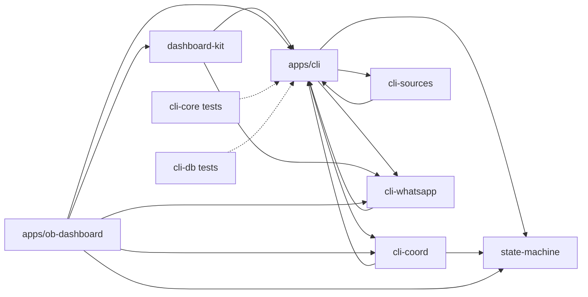

# Architecture

This page describes how OmniSlash is put together: the packages, how a command runs, where data lives
and how the code is tested. For using the CLI, read [apps/cli/README.md](../apps/cli/README.md),
[the guide](../apps/cli/docs/guide.md), [the command reference](../apps/cli/docs/commands.md) and
[the changelog](../apps/cli/CHANGELOG.md).

## The pieces

The repo is a Bun workspace (`apps/*`, `platform/*`, `skills`). moon runs the tasks. Every project below
is a moon project with the same id as its folder name, except `apps/cli`, whose id is `cli`.

| Path | What it is |
| --- | --- |
| `apps/cli` | The `ob` command: argument parsing, most command modules, the store, the API client and server handler, T3 Code integration, GitHub ingest. |
| `apps/ob-dashboard` | The tracker's web app (TanStack Start and Vite). Bare `ob web` builds and serves it. See [its README](../apps/ob-dashboard/README.md). |
| `platform/cli-coord` | Coordination: leases, the agent registry, spinoffs and the daemon. See [README](../platform/cli-coord/README.md). |
| `platform/cli-sources` | Google connectors: Gmail and Calendar. See [README](../platform/cli-sources/README.md). |
| `platform/cli-whatsapp` | The WhatsApp connector and its local bridge. See [README](../platform/cli-whatsapp/README.md). |
| `platform/dashboard-kit` | Shared dashboard parts: realtime hook, item drawer, PWA parts, guarded writes. See [README](../platform/dashboard-kit/README.md). |
| `platform/state-machine` | Item, spinoff and role lifecycles as XState machines, plus a TLA+ model. See [README](../platform/state-machine/README.md). |
| `platform/cli-core` | Test suite only: behaviour tests for `apps/cli`. See [README](../platform/cli-core/README.md). |
| `platform/cli-db` | Test suite only: store and migration tests. See [README](../platform/cli-db/README.md). |
| `skills` | Agent skills, one folder per skill with a `SKILL.md`. See [skills/README.md](../skills/README.md). |

Packages import each other by relative path, not through package names.

## Package dependencies

Arrows point from the importer to what it imports (source code, not tests).

`apps/cli` and the `cli-*` packages import each other in both directions. They behave as one program
split into folders. `state-machine` imports nothing else from the repo.

The `dependsOn` lists in the `moon.yml` files do not match these imports exactly. That does not affect
caching: every project tagged `ob-ts` hashes the whole repo for every task (`.moon/tasks/ob-ts.yml`),
so a change anywhere re-runs every task.

## How a command runs

1. `apps/cli/src/index.ts` is the entry point (the `ob` bin). It moves an old home layout if one is
   found, then calls `run(process.argv.slice(2))` from `cli.ts`.
2. `cli.ts` parses flags with one strict `FLAGS` table and looks the command up in `HANDLERS`, a map
   from command name to handler. Help exits 0. A bare `ob` or an unknown command exits 2.
3. If an API base is configured, the command goes to the API client (see below) and no database is
   opened.
4. Otherwise `run()` opens the store, builds a context (`db`, `store`, `flags`, `args` and the rest)
   and records the run for scheduled jobs in the `job_run` table (`jobs.ts`).
5. The handler runs. Most handlers live in `apps/cli/src/commands/`. Some come from the platform
   packages: `daemon`, `lease`, `agent`, `agents` and `spinoff` from `cli-coord`, `gmail`, `cal`,
   `agenda` and `google` from `cli-sources`, and `whatsapp` from `cli-whatsapp`.
6. A `UsageError` exits 2 and an `AppError` exits 1. A command run with `--json` that prints nothing
   exits 1. The store is closed in a `finally`.

`run()` also keeps an older remote seam (`remote.ts`, the `remote_host` setting) that runs a command
over ssh or against a local SQLite replica (`replica.ts`). A replica read is refused under Postgres.

## The store

The `Store` interface (`apps/cli/src/db/store.ts`) wraps a Drizzle query root for either database.
`OMNISLASH_STORE` picks the kind (`apps/cli/src/db/store-kind.ts`):

- unset, empty, `postgres`, `postgresql` or `pg`: Postgres, the default;
- `sqlite`: SQLite;
- anything else is an error.

Postgres reads its connection URL from `OMNISLASH_PG_URL`, or from the file named by
`OMNISLASH_PG_URL_FILE` (default `~/.omnislash_pg_url`, mode 0600). The URL cannot live in `ob secret`,
because the secret store is in the database. The pool holds at most 3 connections.

SQLite uses the file named by `OMNISLASH_DB` or `--db`. ob will not create a new database file unless
`OMNISLASH_DB_CREATE=1` is set, so a mistyped path fails instead of starting an empty tracker.

Code that uses the store awaits every query builder and never calls `.all()`, `.get()` or `.run()`,
so the same code runs on both databases. `store.txn()` wraps a transaction.

Each database has its own schema and migration chain:

| | Schema | Migrations | drizzle-kit config |
| --- | --- | --- | --- |
| SQLite | `src/db/schema.ts` | `src/db/migrations` | `drizzle.config.ts` |
| Postgres | `src/db/pg/schema.ts` | `src/db/pg/migrations` | `drizzle.pg.config.ts` |

Only `drizzle-kit generate` is used. ob applies migrations itself at runtime.

## API client mode

When `OMNISLASH_API` is set, or the file `~/.omnislash_api_url` exists, `ob` is an HTTP client
(`apps/cli/src/api/`). It sends the command to `<base>/api/ob` with a bearer token from
`OMNISLASH_API_TOKEN` or a token file, and never opens a database. There is no fallback to the store
when the API is unreachable.

- `routing.ts` lists the commands that go over the API and the ones that only work locally, with the
  reason for each.
- `client.ts` is the HTTP client and `client-handlers.ts` maps commands to API calls.
- `server.ts` exports `createObApi(deps)`, a plain `(Request) => Promise<Response>` handler that
  checks auth first. A host server mounts it. This repo's `ob web` does not.
- Scoped tokens (`ob api-token`) limit a token to some commands and some rows (`scoped-tokens.ts`,
  `scope-guard.ts`, `scope-filter.ts`).
- Optional Cloudflare Access headers come from `OMNISLASH_API_ACCESS_CLIENT_ID` and
  `OMNISLASH_API_ACCESS_CLIENT_SECRET`.

An example base is `https://ob.example.org`.

## The daemon and automation jobs

`daemonJobs()` in `platform/cli-coord/src/commands/coord.ts` declares every scheduled job. It is the one
list of what should run and when:

| Job | Schedule |
| --- | --- |
| `sync` | hourly |
| `gmail-sync` | every 5 minutes |
| `cal-sync` | every 15 minutes |
| `alerts --digest --notify` | daily 08:00 |
| `web --prebuilt` | kept alive |
| `whatsapp-bridge run` | kept alive |
| `whatsapp-sync` | every minute |
| `backup` | monthly, the 1st at 03:15 |
| `cert-renew` | daily 03:40 |
| `tunnel-check` | daily 07:30 |
| `creds-check --all` | daily 07:45 |
| `role-tick` | every 15 minutes |
| `t3 settle-sweep` | every 30 minutes |
| `ci-main --notify` | hourly |

The server runs most of these from its own service units, which are not part of this repo. On a
workstation, `ob daemon install` writes only the client jobs (today `role-tick` and `settle-sweep`, which need the
local T3 Code): one launchd agent per job on macOS (label `com.omnislash.<job>`), or a systemd user
service and timer on Linux. `ob daemon status` and `ob daemon uninstall` manage them.

`apps/cli/src/jobs.ts` derives the expected fleet from the same list, and each run is recorded in the
`job_run` table. `ob jobs` shows each job's health, and `ob alerts` raises an alert for a job that is
failing, stale or has never run.

## Coordination

Several agents work in the same repos at once. `platform/cli-coord` keeps them apart:

- **Leases** (`lease.ts`): one live holder per resource, such as `ticket:<ref>` or
  `worktree:<path>`, with a time to live. `ob lease run <resource> -- <cmd>` holds a lease for the
  length of a command and always releases it. The dashboard's browser tests run under
  `cpu:browser` this way.
- **Agent registry** (`agent.ts`, `agent-register.ts`): `ob agent register` records a running agent
  and claims its ticket lease. `ob agent done` releases only that agent's own leases. `ob agents`
  lists them.
- **Spinoffs** (`commands/spinoff.ts` and the `spinoff-*.ts` modules): `ob spinoff` hands a ticket
  to a builder in its own git worktree on a T3 Code thread, then tracks it through check, build,
  handoff and close. Every state change goes through the spinoff machine in `state-machine`
  (`applyMove`). A handoff needs the pull request's CI to be green (`commands/handoff-ci.ts`).

T3 Code is reached through one client in `apps/cli/src/t3/client.ts`. Roles and teams live in
`apps/cli/src/role-*.ts`, `team-*.ts` and `inbox.ts`.

## Connectors

Every connector writes what it reads into the `events` table (`events.ts`) and keeps its position in a
cursor setting, so a sync picks up where the last one stopped.

- **Gmail and Calendar** (`platform/cli-sources`): an OAuth client in `google.ts`, ingest in
  `ingest/gmail.ts` and `ingest/calendar.ts`, and the `gmail`, `cal`, `agenda` and `google` commands.
  The daemon's `gmail-sync` and `cal-sync` jobs run the ingest.
- **WhatsApp** (`platform/cli-whatsapp`): ob runs a local bridge binary and reads its message
  database read-only. Sending, media, voice-note transcription and suggested replies are in
  `src/whatsapp/`.
- **GitHub** (`apps/cli/src/ingest/github.ts`): `ob sync` (or `ob sync --source github`) reads
  pull requests through the GraphQL API. `apps/cli/src/github-issues.ts` creates, closes and reopens
  issues for items that are tracked as GitHub issues.

## The dashboard

`apps/ob-dashboard/serve.ts` opens the store once with `getStore({ migrate: false })`, hands it to the
app with `provideStore`, and serves the built app with `Bun.serve`: the realtime socket
(`/api/realtime`, fed by `apps/cli/src/realtime.ts`), the service worker, the static client and SSR.
Shared parts come from `platform/dashboard-kit`.

## Tests and the gate

Each project runs its own tests:

- `bun test` for the CLI packages. Every package preloads `apps/cli/test/preload.ts`, which gives each
  run its own temp directory and a temp SQLite store (`OMNISLASH_STORE=sqlite`).
- The Postgres suites (`cli-core`, `cli-db`, `cli-sources`, `cli-whatsapp`) also preload
  `apps/cli/test/pg/warm.ts`. It starts a throwaway Postgres cluster from the `@embedded-postgres`
  packages on a unix socket with no TCP port, and removes it after the run.
- Vitest for `state-machine`, and for the happy-dom `*.vitest.tsx` tests in `dashboard-kit` and
  `ob-dashboard`.
- Setting `OB_TEST_REPORT_DIR` writes a JUnit report per project.

Run one project with `bunx moon run <project>:test`, for example `bunx moon run cli-coord:test`.

The gate is `gate.json`, run by `ob gate run`:

1. `bunx moon run --concurrency 3 :typecheck :test :lint ob-dashboard:build-storybook`
   (with `MOON_BASE=origin/main`);
2. `bunx moon run state-machine:export -- --check`, which fails if the exported role machine drifts;
3. `bun scripts/check-workflows.ts .github/workflows/*.yml`.

`ob gate run` caches a pass per commit and `gate.json` content. CI (`.github/workflows/ci.yml`) runs the
same gate after `bun install --frozen-lockfile`, and a separate job runs the TLA+ model checker
(`platform/state-machine/model/tlc.sh`). The lint task is oxlint with type-aware rules and warnings
denied. It applies to every `ob-ts` project (`apps/*` and `platform/*`), not to `skills`.

The Playwright end-to-end tests (`ob-dashboard:e2e`) are not part of the gate.
